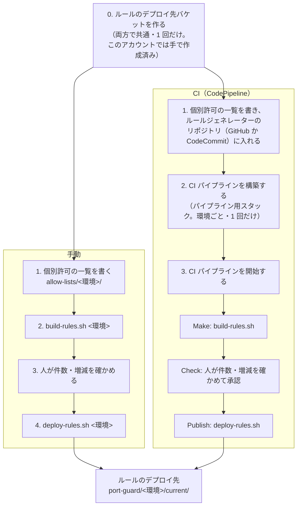
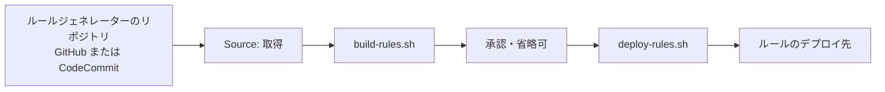

# ip-port-guard-rule-refresh-pipeline


図の「ルールのビルド」「ルールのデプロイ」はこのフォルダの `build-rules.sh`・`deploy-rules.sh`（CodePipeline でも手動でも同じ）、「S3 ルールの管理」はルールのデプロイ先、「SSM ルール取得」「IP制限の有効化」は [rule-refresh-via-ssm/](rule-refresh-via-ssm/README.md) が受け持つ。図の「ルール」は iptables のルールではなく、ipset 入れ替えスクリプトとその中の IP の一覧を指す。

日本・AWS（東京・大阪）・個別許可の IP の一覧から、各サーバーの ipset を入れ替えるスクリプトを作り、S3 に上げる。ローカル・踏み台サーバー・CodePipeline で、同じ `build-rules.sh` と `deploy-rules.sh` を使う。

このフォルダだけをコピーして運用できる。`allow-lists/` と `command/` はすべてこのフォルダの中にあり、親フォルダのファイルを使わない。

## 用語

置き場所は 3 つあり、役割が分かる次の名前で呼ぶ（2026-11-18 に決めた。以前の「ルールバケット」「ルールの置き場所」「パイプラインバケット」「中間成果物用バケット」「成果物用バケット」「既存ルール用バケット」「配布先」「公開場所」は使わない）。

| 名前 | 実際のもの | 置くもの | 使うもの | 作り方 |
|---|---|---|---|---|
| ルールジェネレーター | このフォルダの `build-rules.sh`・`deploy-rules.sh`・`command/`・`allow-lists/` | ルールを作って上げるスクリプトと、個別許可の一覧 | ローカル・踏み台サーバー・CodePipeline のすべて | **正本は Git のリポジトリ**（下のルールジェネレーターのリポジトリ）。S3 には置かない |
| ルールジェネレーターのリポジトリ | GitHub または CodeCommit のリポジトリ（どちらか 1 つ。パイプライン用スタックの `SourceProvider` で選ぶ） | ルールジェネレーターの正本 | ローカル・踏み台サーバーは取ってきたものを使う。CodePipeline は実行のたびにここから取る | どちらのホストに置くかは決まっていない |
| ルールのデプロイ先バケット | `ip-port-guard-rules-<アカウント ID>-<リージョン>-an` | ルールのデプロイ先（下）を、環境の数だけ持つ | 同上 | **手で作成済み**（2026-11-17。アカウントのリージョナル名前空間、パブリックアクセスはすべてブロック）。ローカル・踏み台サーバーからも使うので、スタックでは作らない。パイプライン用スタックは名前で参照するだけ |
| ルールのデプロイ先 | `s3://<ルールのデプロイ先バケット>/port-guard/<環境>/current/` | ルール（ipset 入れ替えスクリプトなど）と前回分の一覧。各サーバーはここから取る | 同上 | `deploy-rules.sh` が上げたときにできる |
| パイプラインの受け渡しバケット | `port-guard-handoff-<環境>-<アカウント ID>-<リージョン>-an`（環境ごとに 1 つ。後ろに付く部分も含めて 63 文字までなので、先頭部分は 32 文字に収める） | CodePipeline がステージの間で受け渡すファイル（Git から取ったその回のソースの写しと、ビルドの結果）。**人は何も置かない** | その環境の CodePipeline だけ（ローカル・踏み台サーバーでは使わない） | パイプライン用スタックが、パイプラインと一緒に作る |

ルールジェネレーターを直すときは、ルールジェネレーターのリポジトリを直す。S3 に入るルールジェネレーターの中身は、どれも写しで正本ではない。パイプラインの受け渡しバケットには CodePipeline がその回のソースの zip を置き、ルールのデプロイ先には `deploy-rules.sh` がその回に使った個別許可の一覧（`allow-ipv4.txt`・`allow-ipv6.txt`）を記録として上げる。

バケットは、ルールのデプロイ先バケットが 1 つ（環境の間で共用）と、パイプラインの受け渡しバケットが CodePipeline を作った環境の数だけ（最大 3 つ）。CodePipeline を使わず、ローカル・踏み台サーバーだけで流すなら、ルールのデプロイ先バケットの 1 つだけで足りる。

テンプレート・コードの名前との対応: ルールのデプロイ先バケットはパラメータ `RuleDeployBucketNamePrefix`（名前の先頭部分。既定 `ip-port-guard-rules`。実際の名前は `<先頭部分>-<アカウント ID>-<リージョン>-an`）、パイプラインの受け渡しバケットはリソース `PipelineHandoffBucket` と出力 `PipelineHandoffBucketName`。出力のルールのデプロイ先の URI は `RuleDeployLocation`。2026-11-18 に、呼び名に合わせて `PublishBucketName`・`PublishBucket`・`CreatePublishBucket`・`PublishLocation`・`PipelineBucketName`・`PipelineBucket`・`PipelineBucketNamePrefix` から変えた。同じ日に、バケット用スタックを無くした（ルールのデプロイ先バケットの定義は、作り方の記録として `rule-deploy-bucket.yml` に分けて残した）。あわせて、完全名を渡す `RuleDeployBucketName` を、名前の先頭部分を渡す `RuleDeployBucketNamePrefix` に変えた（パイプラインの受け渡しバケットはパイプライン用スタックへ移し、ルールのデプロイ先バケットを作る選択肢 `CreatePublishBucket` はやめた）。パイプラインの受け渡しバケットの実際の名前の先頭部分も、`ip-port-guard-pipeline` から変え、最後に `port-guard-handoff-<環境>` にした（環境を足した `ip-port-guard-pipeline-handoff-<環境>` は 63 文字の上限を超えるため。まだ AWS に作っていないので、作り直しは要らない）。`PublishProject`・`PublishRole`・`Publish` のステージは、バケットではなく S3 に上げる段階の名前なので変えていない。

状態（2026-11-18）: 入口スクリプトと、パイプライン用スタック（環境ごと）を用意した。2026-11-18 に、ルールジェネレーターのリポジトリを GitHub と CodeCommit のどちらでも取れるようにした（両版とも、GitHub・CodeCommit それぞれの `cfn-lint`、CDK の合成、14 件の自動テストまで確認した）。CloudFormation YAML と CDK（Python）の両版がある。構文・定義の検査、CDK の合成、AWS CLI と公開元の取得を模擬したビルド・デプロイまで確認した。実際の AWS へのスタック作成とアップロードは行っていない。各サーバーがルールのデプロイ先から取得・照合して ipset を入れ替える側は、SSM で流す形（人が流す手動の更新と、月曜・木曜 11:00 の定期更新）を [rule-refresh-via-ssm](rule-refresh-via-ssm/README.md) に用意した（2026-11-19。手順は [instance-setup.md](rule-refresh-via-ssm/instance-setup.md)。AWS では流していない）。

設計で決めたこと・決まっていないこと・確かめたことは、[設計判断のまとめ](design-decisions.md)（リリース判定の資料）にある。

## 構築と実行の流れ

手動（ローカル・踏み台サーバーでスクリプトを流す）と CI（CodePipeline）の 2 つのやり方がある。どちらも最初にルールのデプロイ先バケットを作り、ルールジェネレーターの `build-rules.sh`（作る）→ 人の確認 → `deploy-rules.sh`（上げる）で、ルールのデプロイ先に上げる。違うのは、スクリプトを人が流すか、CodePipeline が流すかだけ。



| 順 | 手動 | CI |
|---|---|---|
| 0（1 回だけ） | ルールのデプロイ先バケットを作る（このアカウントでは手で作成済み。作り方の記録は [rule-deploy-bucket.yml](cloudformation/rule-deploy-bucket.yml)） | 同じ（同じバケットを使う） |
| 1（変えるたび） | `allow-lists/<環境>/` の個別許可の一覧を書き、ルールジェネレーターのリポジトリにコミットする（スクリプトは手元の作業コピーを使うので、コミットしていない一覧でも上がってしまう。上げる前にコミットする） | 同じ。CodePipeline は、開始したときのブランチの内容（コミット済みのもの）を使う |
| 2（構築・1 回だけ） | なし | CI パイプラインを構築する。GitHub なら先に CodeConnections の接続を作って認可する。パイプライン用スタックを環境ごとに作る（パイプラインの受け渡しバケットも一緒にできる）（[CloudFormation の手順](cloudformation/README.md)）。**構築した直後に、CodePipeline が自動で 1 回動く**（止められない）。この 1 回は Web コンソールから人が開始したのと同じ扱いで、承認のステージで止まるので、**却下する** |
| 3（更新のたび） | `build-rules.sh <環境>` → 人が確かめる → `deploy-rules.sh <環境>` | CI パイプラインが**週 2 回（月曜・木曜の日本時間 9:00）、自動で開始する**（定期実行。人が開始してもよい）。Make（`build-rules.sh`）→ Check（人が承認）→ Publish（`deploy-rules.sh`）の順に進む。**定期実行とコマンドからの開始では Check を飛ばし、Web コンソールから人が開始したときだけ承認で止まる**（[開始の仕方と承認](#開始の仕方と承認)）。増減の確認で止まったら、止まった理由と増減が SNS のトピックからメールで届く（[問題が起きたときの扱い](design-decisions.md#2-4-ルールを作るときに問題が起きたときの扱い)） |
| 要る権限 | 流す人の AWS CLI の認証情報で、ルールのデプロイ先を読み書きする（[権限](#ルールのデプロイ先バケットと権限)） | CodeBuild のロール（スタックが作る）。構築する人は CloudFormation と IAM を作る権限が要る |

同じ環境に、手動と CI から同時に上げない（後から上げた方が残り、増減を比べる基準の前回分の一覧もずれる）。

### 開始の仕方と承認

承認（Check のステージ）を挟むかどうかは、パイプラインを開始するときの変数 `APPROVAL` で決まる（既定値は `required`）。

| 開始の仕方 | `APPROVAL` | Check のステージ |
|---|---|---|
| Web コンソールから人が開始（「変更をリリースする」） | 既定値の `required` のまま | 承認で止まる。人がビルドのログの件数・増減を見て承認する |
| 定期実行（週 2 回） | `skip` を渡す | 飛ばす（Skipped）。Make の増減の確認だけで進む |
| コマンドから開始 | `--variables name=APPROVAL,value=skip` で `skip` を渡す（付け忘れると承認で止まる） | 飛ばす |
| 構築した直後の自動の 1 回 | 既定値の `required` | 承認で止まる。この 1 回は却下する |

自動で上げるのは、個別許可の一覧を書き終えてからにする（今の `allow-lists/` は空の仮置きなので、そのまま定期実行が動くと、空の個別許可の一覧で作ったルールが上がり、前回分の一覧も進んでしまう）。

ルールのデプロイ先バケットの名前の先頭部分は、手動では `ip-port-guard-rules` に決めてある（`command/set-s3-uri.sh`）。CI ではパイプライン用スタックの `RuleDeployBucketNamePrefix`（既定も `ip-port-guard-rules`）で変えられるが、変えると手動と別のバケットを指すので、既定のまま使う。

## ローカル・踏み台サーバーで実行する

必要なものは bash・curl・awk・AWS CLI と、公開元（`ftp.apnic.net`・`ip-ranges.amazonaws.com`）への HTTPS 接続。

このフォルダで実行する。

```bash
bash build-rules.sh staging --region ap-northeast-1 --profile your-profile
# 表示された件数・増減を確認する
bash deploy-rules.sh staging --region ap-northeast-1 --profile your-profile
```

環境は `development`・`staging`・`production`。通常は同じルールでも、検証用に個別許可の一覧とルールのデプロイ先を分けられる。

`--region` と `--profile` は任意で、すべての AWS CLI 呼び出し（アカウント ID の取得・S3 の取得・アップロード）に引き継ぐ。省略した場合は `AWS_REGION`（または `AWS_DEFAULT_REGION`）と `AWS_PROFILE` を使い、それもなければ AWS CLI の既定設定を使う。引数は環境変数より優先する。

```bash
# 環境変数で指定してもよい
export AWS_REGION=ap-northeast-1
export AWS_PROFILE=your-profile
bash build-rules.sh staging
bash deploy-rules.sh staging
```

入口スクリプトは自分の置き場所を基準にファイルを使うため、別の作業ディレクトリから絶対パスで呼んでもよい。

## ビルドとデプロイ

| 順 | 処理 | 実行するもの |
|---|---|---|
| 1 | APNIC の割り当て統計と AWS の `ip-ranges.json` を取得し、日本と AWS の東京・大阪の一覧を作る | `build-rules.sh <環境>` |
| 2 | `allow-lists/<環境>/allow-ipv4.txt`・`allow-ipv6.txt` を作業フォルダへ写す | 同上 |
| 3 | S3 にある前回分の一覧を取得する。初回はなくてもよい | 同上 |
| 4 | 件数と前回からの増減を表示し、ipset 入れ替えスクリプトを作る | 同上 |
| 5 | 表示された内容を人が確認する | — |
| 6 | 作ったファイルを S3 に上げ、最後に `SHA256SUMS` を上げる | `deploy-rules.sh <環境>` |

ビルドでは S3 に書き込まない。環境とルールのデプロイ先の名前の照合、ビルド後の個別許可一覧との比較など、入口に余分な確認は入れない。既存の `make-refresh.sh` にある件数の下限と増減 5% の判定は引き続き使う。増減を確認して進める場合は `FORCE=1 bash build-rules.sh staging` とする。

| 設定 | 既定値・変更方法 |
|---|---|
| 個別許可の一覧 | このフォルダの [`allow-lists/<環境>/`](allow-lists/README.md)。運用する VPC の範囲などを記入する |
| 作業フォルダ | このフォルダの `work/<環境>/`。`PORT_GUARD_WORK_DIR` で変更できる |
| ルールのデプロイ先 | `s3://ip-port-guard-rules-<アカウント ID>-<リージョン>-an/port-guard/<環境>/current/`。通常は指定不要。変更するときだけ `PORT_GUARD_S3_URI` で指定する（末尾の `/` なし） |

個別許可の一覧は、今は3環境ともコメントだけの仮置き。実運用前に記入する。書式と含める範囲は [allow-lists/README.md](allow-lists/README.md) を参照する。

## ルールのデプロイ先バケットと権限

ルールのデプロイ先バケットは、アカウントのリージョナル名前空間で `ip-port-guard-rules` を先頭部分として指定して作ったもの。実際の名前には `-<アカウント ID>-<リージョン>-an` が付く。入口スクリプトはログイン先のアカウント ID と指定したリージョンから、その名前を組み立てる。

パブリックアクセスはすべてブロックしたまま使う。AWS CLI の認証情報と権限で読み書きする。公開 ACL は付けない。

| 操作 | 必要な S3 権限 |
|---|---|
| ビルド | ルールのデプロイ先バケットの `s3:ListBucket` と、前回分の一覧の `s3:GetObject` |
| デプロイ | ルールのデプロイ先 `port-guard/<環境>/current/` 配下の `s3:PutObject` |

ログインだけで S3 の権限が付くわけではない。IAM ユーザーまたはロールに必要な権限を持たせる。

ルールのデプロイ先に置くものは次のとおり。

```text
port-guard/<環境>/current/
  command/port_guard/refresh-ipv4.sh
  command/port_guard/refresh-ipv6.sh
  port_guard_whitelists/allow-ipv4.txt
  port_guard_whitelists/allow-ipv6.txt
  port_guard_whitelists/last-refresh/*.txt
  SHA256SUMS
```

同じ環境に複数の場所から同時にデプロイしない。前回分の一覧は、毎回ルールのデプロイ先から取り直す。

## CodePipeline で実行する

現在のスクリプトから構築できるように、両版を更新した。ソース取得 → ビルド → 承認（省略可）→ デプロイの順に実行し、ビルドした結果を後段へ渡す。デプロイ側で作り直さない。



| スタック | CloudFormation YAML | CDK Python | 管理するもの |
|---|---|---|---|
| パイプライン用・環境ごと | [list-refresh-pipeline.yml](cloudformation/list-refresh-pipeline.yml) | [list_refresh_stack.py](cdk/python/list_refresh_stack.py) | CodePipeline、パイプラインの受け渡しバケット、2つの CodeBuild、IAM ロール、ログ、定期実行の規則、通知の権限 |
| ルールのデプロイ先バケット用・環境間で共用（作り方の記録。このアカウントでは流さない） | [rule-deploy-bucket.yml](cloudformation/rule-deploy-bucket.yml) | [rule_deploy_bucket_stack.py](cdk/python/rule_deploy_bucket_stack.py) | ルールのデプロイ先バケット |

流すのはパイプライン用スタックだけ。パイプラインの受け渡しバケットは、そのパイプラインからしか使わないので、パイプラインと同じスタックで作る（スタックを消してもバケットは残す）。ルールのデプロイ先バケットは、先に手で作り、ローカル・踏み台サーバーのコマンドからも使っているので、パイプライン用スタックでは作らない。作り方は [rule-deploy-bucket.yml](cloudformation/rule-deploy-bucket.yml) に記録として残している（別のアカウント・リージョンで作るとき、作り直すときに使う）。パイプライン用スタックはパラメータ `RuleDeployBucketNamePrefix` で名前の先頭部分（既定 `ip-port-guard-rules`）を受け取り、ローカルの入口スクリプトと同じく `<先頭部分>-<アカウント ID>-<リージョン>-an` を参照するだけで、設定は変えない。

ルールジェネレーターのリポジトリは、パイプライン用スタックのパラメータ `SourceProvider` で GitHub か CodeCommit を選ぶ（既定は `GitHub`）。どちらでも、取ったその回のソースを同じ形（`CODE_ZIP`）で Make のステージへ渡すので、Make から後は同じ。

| | `SourceProvider=GitHub` | `SourceProvider=CodeCommit` |
|---|---|---|
| Source のステージのアクション | `CodeStarSourceConnection`（CodeConnections） | `CodeCommit` |
| 事前に要るもの | CodeConnections の接続を作り、GitHub 側で認可して `AVAILABLE` にしておく（組織のリポジトリなら組織のオーナーが行う） | 同じアカウント・リージョンの CodeCommit のリポジトリ |
| 渡すパラメータ | `ConnectionArn`・`FullRepositoryId`（`owner/repo`。大文字・小文字も合わせる） | `CodeCommitRepositoryName` |
| パイプラインのロールに付く権限 | その接続の `codeconnections:UseConnection`・`codestar-connections:UseConnection` | そのリポジトリの `codecommit:GetBranch`・`GetCommit`・`GetRepository`・`UploadArchive`・`GetUploadArchiveStatus`・`CancelUploadArchive` |
| 自動の開始 | しない（`DetectChanges=false`） | しない（`PollForSourceChanges=false`。EventBridge の規則も作らない） |

選ばなかった方のパラメータは空のままでよい。`BranchName`（既定 `main`）と `SourceDirectory` は両方で使う。このフォルダがリポジトリの一部なら `SourceDirectory` にその相対パスを指定し、リポジトリ直下に置くなら `.` を使う。リポジトリと接続はまだ決めていないので、構築するときに渡す。

- ソースはルールジェネレーターのリポジトリから直接取得する。独自の圧縮・パッケージング作業は加えない。
- ソースの変更では自動で開始しない。開始は、人が手動で行うか、定期実行（パラメータ `ScheduleExpression`。既定は毎週月曜・木曜の日本時間 9:00 `cron(0 0 ? * MON,THU *)`。空なら定期実行しない）で行う。スタックを初めて作成した際の初回実行は別に発生する。
- Make のビルドが失敗したら（増減の確認で止まったときを含む）、止まった理由と一覧ごとの増減を、パラメータ `NotificationTopicArn` で渡した既存の SNS のトピックへ送る（空なら送らない）。
- 同じパイプラインの実行は `QUEUED` で直列にする。ローカルからの同時デプロイまでは制御しない。
- ビルド用ロールはルールのデプロイ先を読むだけ。デプロイ用ロールは、その環境のルールのデプロイ先に書ける。どちらもパイプラインの受け渡しバケットは読み書きする。
- 承認を挟むかは、開始するときのパイプライン変数 `APPROVAL` で決まる（[開始の仕方と承認](#開始の仕方と承認)）。増減 5% の判定を通す場合は、実行時のパイプライン変数 `FORCE=1` を渡す。

構築手順は [CloudFormation の README](cloudformation/README.md) と [CDK の README・比較](cdk/python/README.md) にある。いずれか一方の実装を選んで使う。

## 確認したことと未実施のこと

`bash -n`、両版のテンプレート検査、CDK のパイプライン用スタックの合成（GitHub・CodeCommit の両方）、14 件の自動テストを実施した（2026-11-18）。テストでは定義間のビルド仕様・承認条件・パイプラインの受け渡しバケットの設定と保持・ルールのデプロイ先バケットの参照・ルールのデプロイ先の権限を照合した。模擬実行では、単独コピー・3環境・リージョンとプロファイルの引き継ぎ・前回分の取得・チェックサム・ビルド成果物だけでのデプロイを確認した。

実際の CodeConnections 接続・CodeCommit からの取得・CodeBuild 実行・AWS へのデプロイは未実施。各サーバーへ取得や適用を指示する SSM の処理はパイプライン用スタックには含めず、[rule-refresh-via-ssm](rule-refresh-via-ssm/README.md) で流す（手動の更新と定期更新）。

AWS の仕様は公式ドキュメントと照合した（2026-11-17）: [CLI の環境変数と優先順位](https://docs.aws.amazon.com/cli/latest/userguide/cli-configure-envvars.html)、[S3 の名前空間](https://docs.aws.amazon.com/AmazonS3/latest/userguide/gpbucketnamespaces.html)、[パブリックアクセスのブロック](https://docs.aws.amazon.com/AmazonS3/latest/userguide/access-control-block-public-access.html)、[S3 操作の権限](https://docs.aws.amazon.com/AmazonS3/latest/userguide/using-with-s3-policy-actions.html)、[CodeConnections のソースアクション](https://docs.aws.amazon.com/codepipeline/latest/userguide/action-reference-CodestarConnectionSource.html)。2026-11-18 に追加で照合した: [CodeCommit のソースアクション](https://docs.aws.amazon.com/codepipeline/latest/userguide/action-reference-CodeCommit.html)。
