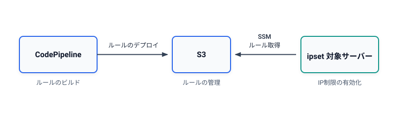

# ip-port-guard-rule-refresh-pipeline — ipset 入れ替えスクリプトを作って S3 に上げる（ローカル・踏み台サーバー・CI で同じコマンド）

> 状態（2026-11-16）: **オプションとして用意だけしたもの**。今の一覧の更新は、踏み台サーバーから各サーバーへ SSH で流す形が本体。
>
> 2026-11-16 に作りを変えた（フォルダ名も `list-refresh-pipeline` から変えた）。変えた点は 2 つ。**個別許可の IP の一覧の正本を、S3 からリポジトリ（[`allow-lists/<環境>/`](allow-lists/README.md)）に移した**。**ローカル・踏み台サーバー・CI のどこでも、同じ 2 つのコマンド（`build-rules.sh`・`deploy-rules.sh`）で流せるようにした**。
>
> 2026-11-17 に、**このフォルダだけで完結する形**にした（`allow-lists/` と `command/` をこのフォルダの中に置いた。このフォルダだけを写せば、写した先で作る・上げるが通る）。公開バケットは、アカウントのリージョナル名前空間で `ip-port-guard-rules` を名前の先頭部分として作成済み。入口のスクリプトに `PORT_GUARD_S3_URI` を渡さなくてよくした。環境の取り違えなどの確認は、入口のスクリプトから外した（人が確かめる。CI にしたら要らない）。
>
> 確認済み（2026-11-17）: `bash -n` による構文確認と、このフォルダだけを別の場所へコピーした状態でのビルド・デプロイ。公開元の取得と AWS CLI を模擬し、3 環境・初回と再実行・空白を含むパス・リージョンと宛先の指定・照合の値を最後に送る順番を確認した。**実際の公開元の取得と S3 への読み書きはしていない**。[CodePipeline の定義](#codepipeline-の定義2026-11-14-の作りのまま作り直しが要る)（CloudFormation 版・CDK 版）は 2026-11-14 の作りのままで、今のスクリプトとは合っていない。各サーバーが S3 から取って入れ替える側は、まだ作っていない。

## 方針

iptables ＋ ipset の許可 IP の一覧は、**リポジトリにあるものと公開元の IP の一覧から作り、人が確認してから S3 に上げ、各サーバーが定期に取得・照合して入れ替える**。このフォルダは、そのうち「S3 に上げる」までを受け持つ。

| 決めごと | 内容 |
|---|---|
| 正本はリポジトリ | スクリプトと個別許可の IP の一覧は、リポジトリにあるものが正本。踏み台サーバーや S3 にあるものは、リポジトリから写したもの |
| リポジトリの外から取るもの | 公開元の IP の一覧（APNIC・AWS）と、前回分の IP の一覧（S3 の公開場所）だけ（[どこにあるものを使うか](#どこにあるものを使うか)） |
| このフォルダだけで完結 | 入口のスクリプト・部品のスクリプト・個別許可の IP の一覧は、すべてこのフォルダの中にある。このフォルダの外のファイルは使わない。このフォルダだけを写した先でも、同じコマンドが通る |
| 入口のスクリプトは簡素に | 余計な確認を入れない。内容が正しいかは、人が表示を見て確かめる |
| どこでも同じコマンド | 実行場所（ローカル・踏み台サーバー・CI）で、流すコマンドも順番も変えない。実行場所ごとの違いは、AWS の認証情報の持ち方だけ |
| 人の確認 | 作る（`build-rules.sh`）と上げる（`deploy-rules.sh`）を分け、間で人が件数と増減を確かめる |

## 用語

| 名前 | 指すもの |
|---|---|
| 実行場所 | このフォルダのコマンドを流す場所。ローカル（作業者の PC）・踏み台サーバー・CI の 3 つ |
| 環境 | 1 つの VPC。`development`・`staging`・`production` の 3 つ（2026-11-16 に決めた）。この名前を、`allow-lists/` の下のフォルダの名前と、S3 の公開場所の `<環境>` の両方に使う |
| 公開元の IP の一覧 | Web 上にある元の一覧。APNIC の割り当ての統計 `delegated-apnic-latest`（`ftp.apnic.net`）と、AWS の IP アドレスの範囲 `ip-ranges.json`（`ip-ranges.amazonaws.com`）。リポジトリにも S3 にも置かない |
| ipset に入れる IP の一覧 | 各サーバーの ipset の集合に入れる IP の範囲を、1 行 1 件（1 列目が CIDR）で書いたファイル。次の 3 種類で、それぞれ IPv4 と IPv6 がある |
| 　日本の IP の一覧 | `jp-ipv4.txt`・`jp-ipv6.txt`。公開元の IP の一覧（APNIC）から `make-jp-lists.sh` が作る |
| 　AWS の IP の一覧 | `aws-ipv4.txt`・`aws-ipv6.txt`。公開元の IP の一覧（`ip-ranges.json`）から `make-aws-lists.sh` が、東京（`ap-northeast-1`）と大阪（`ap-northeast-3`）のリージョンの分だけを取り出して作る（区分は `AMAZON`。台北のローカルゾーン `ap-northeast-1-tpe-1` は除く） |
| 　個別許可の IP の一覧 | `allow-ipv4.txt`・`allow-ipv6.txt`。VPC の範囲や海外の拠点など、日本の範囲の外でも許可する相手。**人が書く。正本はこのフォルダの [`allow-lists/<環境>/`](allow-lists/README.md)** |
| 前回分の IP の一覧 | `port_guard_whitelists/last-refresh/*.txt`。前回 S3 に上げた ipset に入れる IP の一覧の、CIDR だけの写し。`make-refresh.sh` が今回の一覧との増減を比べる基準にし、終わりに今回の分で更新する。S3 の公開場所にあるものを使う |
| ipset 入れ替えスクリプト | 各サーバーで流し、ipset の集合の中身を入れ替えるシェルスクリプト `command/port_guard/refresh-ipv4.sh`・`refresh-ipv6.sh`。`make-refresh.sh` が作り、ipset に入れる IP の一覧が中に書き込まれている。一時の集合に入れて件数を確かめてから `ipset swap` で入れ替えるので、**集合が空になる時間はない**。フォルダ名と図の「ルール（rule）」は、これを指す |
| 照合の値 | `SHA256SUMS`。S3 に上げたファイルそれぞれの SHA-256。最後に上げる |
| S3 の公開場所 | `s3://ip-port-guard-rules-<アカウント ID>-<リージョン>-an/port-guard/<環境>/current/`。環境ごとに分ける。入口のスクリプトが決めるので、渡さなくてよい（別の場所にするときだけ、環境変数 `PORT_GUARD_S3_URI`（末尾の `/` なし）で渡す） |
| 公開バケット | S3 の公開場所があるバケット。コンソールに入力した名前は `ip-port-guard-rules`、実際の名前は `ip-port-guard-rules-<アカウント ID>-<リージョン>-an`（2026-11-17 に作成済み。パブリックアクセスはすべてブロック）。「公開」はルールの配布先という意味で、読み書きは AWS CLI の認証情報と権限を使う |
| 入口のスクリプト | このフォルダの `build-rules.sh`（作る）と `deploy-rules.sh`（S3 に上げる）。どの実行場所でも、この 2 つを流す |
| 部品のスクリプト | このフォルダの `command/`。宛先を決める `set-s3-uri.sh` と、入口のスクリプトが流す `make-jp-lists.sh`・`make-aws-lists.sh`・`fetch-last-lists.sh`・`make-refresh.sh`・`publish-refresh-scripts.sh` |
| 作業フォルダ | 入口のスクリプトが、取ったもの・作ったものを置くフォルダ。既定はこのフォルダの `work/<環境>/`（Git の管理から外している）。環境変数 `PORT_GUARD_WORK_DIR` で変えられる |
| 各サーバー | port-guard（iptables ＋ ipset の絞り込み）を入れてある稼働中のサーバー。ipset の集合を持っていて、ipset 入れ替えスクリプトを流す相手。[全体の流れ](#全体の流れ)の図では「ipset 対象サーバー」と書いている |

## 全体の流れ



ipset 入れ替えスクリプトを作って S3 の公開場所に上げ、各サーバーが S3 の公開場所から取って、自分の ipset の集合の中身を入れ替える。作る側と各サーバーは直接にはつながらず、S3 の公開場所だけを間に置く。図は、作る側を CI（CodePipeline）で流す場合を描いている。ローカル・踏み台サーバーで流すときは、図の CodePipeline のところで、同じ入口のスクリプトを人が流す。

図の言葉と、このドキュメントでの名前の対応は次のとおり。

| 図の表記 | このドキュメントでの名前と、すること | 用意の状態（2026-11-16） |
|---|---|---|
| CodePipeline「ルールのビルド」 | `build-rules.sh`。公開元の IP の一覧を取り、ipset に入れる IP の一覧を作り、件数と前回分の IP の一覧との増減を確かめて、ipset 入れ替えスクリプトを作る | スクリプトは用意した（流していない）。CodePipeline の定義は作り直しが要る |
| 矢印「ルールのデプロイ」 | 人が確かめた後の `deploy-rules.sh`。S3 の公開場所に上げる（照合の値を最後） | 同上 |
| S3「ルールの管理」 | S3 の公開場所。ipset 入れ替えスクリプト・個別許可の IP の一覧の写し・前回分の IP の一覧・照合の値を置く（[S3 の公開場所に置かれるもの](#s3-の公開場所に置かれるもの)） | 公開バケットは作成済み（2026-11-17） |
| 矢印「SSM」「ルール取得」 | 各サーバーが、S3 の公開場所から ipset 入れ替えスクリプトと照合の値を取る。そのきっかけになるコマンドを、SSM で各サーバーに流す | **まだ作っていない** |
| ipset 対象サーバー「IP制限の有効化」 | 各サーバー。取ったものを照合の値と照合してから ipset 入れ替えスクリプトを流し、ipset の集合の中身を新しい一覧に入れ替える | **まだ作っていない**（ipset 入れ替えスクリプトそのものは、踏み台サーバーから SSH で流す今の手順で使っているものと同じ） |

図を読むときの点:

- **図の「ルール」は、iptables のルールのことではない**。ipset に入れる IP の一覧と、それを中に書き込んだ ipset 入れ替えスクリプトを指す。ipset 入れ替えスクリプトは ipset の集合の中身だけを入れ替え、iptables のルールには触らない
- **図の「IP制限の有効化」は、port-guard を有効にする操作（`enable`）のことではない**。port-guard がすでに入っている各サーバーで、80・443 番の絞り込みが新しい一覧で効くようになることを指す。ipset 入れ替えスクリプトは、最初に ipset の集合があることを確かめ、なければ止まる
- **右の矢印は、取りに行く向き**（各サーバー → S3）で描いている。ファイルは S3 の公開場所から各サーバーへ渡る。S3 や CodePipeline の側から各サーバーへ送り込む形ではない
- 図は、SSM で各サーバーにコマンドを流して取らせる形で描いている。各サーバーの cron で動かす案も残っていて、どちらにするか、S3 を読む権限をどう持たせるかは、[決まっていないこと](#決まっていないこと)のまま
- 図にないもの: 人の確認（`build-rules.sh` と `deploy-rules.sh` の間）、照合の値での照合

図は手で書いた SVG（[`images/list-refresh-flow.svg`](images/list-refresh-flow.svg)）で、作り直すスクリプトはない。構成を変えたら、図とこの節をそろえて直す。

## 流れ（どの実行場所でも同じ）

| 順 | すること | 流すもの | 中で流す部品のスクリプト |
|---|---|---|---|
| 1 | 公開元の IP の一覧（APNIC・AWS）を取り、日本の IP の一覧と AWS の IP の一覧（東京・大阪）を作る | `build-rules.sh <環境>` | `make-jp-lists.sh`・`make-aws-lists.sh`（どちらも、取ることと作ることを続けて行う） |
| 2 | 個別許可の IP の一覧を、このフォルダの `allow-lists/<環境>/` から作業フォルダに写す | 同上 | —（`cp`） |
| 3 | 前回分の IP の一覧を、S3 の公開場所から取る（初回は何もないので、何も取らない） | 同上 | `fetch-last-lists.sh` |
| 4 | 件数と前回分との増減を確かめ、ipset 入れ替えスクリプトを作る（下限割れ・増減 5% 超で止まる。確かめて進めるときは `FORCE=1`） | 同上 | `make-refresh.sh` |
| 5 | **人が確かめる**。4 の表示（件数・増 / 減の件数）を見る。必要なら、作業フォルダの ipset 入れ替えスクリプトを 1 台に流して結果を見る | — | — |
| 6 | S3 の公開場所に上げる（ipset 入れ替えスクリプト・個別許可の IP の一覧の写し・前回分の IP の一覧を上げ、最後に照合の値を上げる） | `deploy-rules.sh <環境>` | `publish-refresh-scripts.sh` |

このフォルダで流す（別の場所からでも流せる。入口のスクリプトは、自分の置き場所にある `command/` と `allow-lists/` を使う）。環境は `development`・`staging`・`production`。

```bash
# 1〜4. 作る（S3 には何も上げない）
bash build-rules.sh staging
# 5. 表示を見て確かめる
# 6. S3 の公開場所に上げる
bash deploy-rules.sh staging
```

| 点 | 内容 |
|---|---|
| 許可する相手を変えるとき | このフォルダの `allow-lists/<環境>/allow-ipv4.txt`（と `allow-ipv6.txt`）を書き直してコミットし、1 から流す |
| 初回 | S3 の公開場所に何もなくても流せる。前回分の IP の一覧がないので、4 の増減の確認は行われず（「前回の記録なし」と出る）、件数の下限だけを確かめる |
| 5 で上げないと決めたとき | 何も上げずに終える。作業フォルダの前回分の IP の一覧は 4 で進んでいるが、次の回の 3 で S3 の公開場所のものに戻る |
| 作業フォルダにできるもの | `port_guard_whitelists/`（公開元の IP の一覧、ipset に入れる IP の一覧、前回分の IP の一覧）、`command/port_guard/refresh-ipv4.sh`・`refresh-ipv6.sh`、`SHA256SUMS`（6 の後） |
| 踏み台サーバーから各サーバーへ SSH で流す今の手順と合わせるとき | 踏み台サーバーのカレントのフォルダ（`command/` と `port_guard_whitelists/` があるところ）で `PORT_GUARD_WORK_DIR="$PWD"` を付けて流すと、ipset 入れ替えスクリプトが今の手順と同じ `command/port_guard/` にできる |

## どこにあるものを使うか

| もの | 正本のある場所 | 備考 |
|---|---|---|
| 入口のスクリプト・部品のスクリプト | リポジトリ（このフォルダ） | このフォルダの `command/` を使う |
| 個別許可の IP の一覧 | リポジトリ（このフォルダの [`allow-lists/<環境>/`](allow-lists/README.md)） | **3 つの環境（`allow-lists/development/`・`staging/`・`production/`）に、空の仮置きだけを置いた（2026-11-16）。実際の一覧は、まだ入れていない**。空のまま S3 に上げない（[allow-lists の README](allow-lists/README.md#今置いてあるもの仮置き)） |
| 公開元の IP の一覧 | リポジトリの外（APNIC・AWS が公開している） | 流すたびに取る |
| 前回分の IP の一覧 | リポジトリの外（S3 の公開場所） | 人が書くものではなく、前回上げた結果の記録。リポジトリには置かない（上げるたびにコミットが要ることになるため）。初回はなくてよい |

## 実行場所ごとの準備

どの実行場所でも要るもの: bash・curl・awk・AWS CLI、`ftp.apnic.net` と `ip-ranges.amazonaws.com` への HTTPS、S3 の公開場所を読む権限（`build-rules.sh`）と書く権限（`deploy-rules.sh`）。

AWS CLI は、バケットを作ったアカウントの認証情報とリージョンで使う。リージョンは `AWS_REGION`、`AWS_DEFAULT_REGION`、`aws configure get region` の順に使い、アカウント ID は `aws sts get-caller-identity` で取得する。プロファイルを使う場合は、通常どおり `AWS_PROFILE` で選ぶ。

**パブリックアクセスはすべてブロックしたままでよい**。ログインしているユーザーまたはロールに、ビルドでは `s3:ListBucket`（バケット）と `s3:GetObject`（前回分の一覧）、デプロイでは `s3:PutObject`（`port-guard/<環境>/current/` 配下）の権限があれば読み書きできる。ログインだけでこれらの権限が付くわけではない。スクリプトは AWS CLI の認証をそのまま使い、公開 ACL は付けない。

名前空間・パブリックアクセスのブロック・操作ごとの権限は、AWS のドキュメントと照らし合わせた（2026-11-17）: [名前空間とバケット名](https://docs.aws.amazon.com/AmazonS3/latest/userguide/gpbucketnamespaces.html)、[パブリックアクセスのブロック](https://docs.aws.amazon.com/AmazonS3/latest/userguide/access-control-block-public-access.html)、[S3 操作に必要な権限](https://docs.aws.amazon.com/AmazonS3/latest/userguide/using-with-s3-policy-actions.html)。

| 実行場所 | リポジトリの中身の持ち方 | AWS の認証情報 |
|---|---|---|
| ローカル | リポジトリを取ったもの、またはこのフォルダだけを写したもの | 作業者の認証情報（AWS CLI のプロファイルなど） |
| 踏み台サーバー | このフォルダだけを写す | AWS CLI でログインしている人の権限 |
| CI | CI がリポジトリから取る | CI のロール。作るところと上げるところでロールを分けられる（今の CodePipeline の定義は分けている） |

## S3 の公開場所に置かれるもの

フォルダの形は作業フォルダと同じ。

```text
s3://ip-port-guard-rules-<アカウント ID>-<リージョン>-an/port-guard/<環境>/current/
  command/port_guard/refresh-ipv4.sh           # ipset 入れ替えスクリプト（各サーバーが取って流すもの）
  command/port_guard/refresh-ipv6.sh
  port_guard_whitelists/allow-ipv4.txt         # 個別許可の IP の一覧の写し（上げたときに使った内容の記録。正本はリポジトリ）
  port_guard_whitelists/allow-ipv6.txt
  port_guard_whitelists/last-refresh/*.txt     # 前回分の IP の一覧（次の回の比較の基準）
  SHA256SUMS                                   # 照合の値（最後に上げる）
```

## 気を付けること

- 同じ環境に、2 つの実行場所から同時に流さない。両方が同じ S3 の公開場所に上げるので、後から上げた方が残り、比較の基準もずれる
- **個別許可の IP の一覧が空のまま（今の 3 つの環境の仮置き）上げない**。入口のスクリプトは、空であることでは止まらない。空の一覧で作った ipset 入れ替えスクリプトを各サーバーで流すと、VPC の中から来る 80・443 番への通信も捨てられる
- `deploy-rules.sh` は、コミットしていない個別許可の IP の一覧でも上げられる（今は確かめていない）。上げる前にコミットする
- `make-refresh.sh` の下限の件数・増減の基準（5%）は、スクリプトの中の値がそのまま使われる

## CodePipeline の定義（2026-11-14 の作りのまま。作り直しが要る）

[CloudFormation 版](cloudformation/list-refresh-pipeline.yml)と [CDK（Python）版](cdk/python/README.md)がある（パラメータ・出力・動きは同じ。`cfn-lint` と、CDK 版のローカルでの合成・定義の照合まで確かめた。AWS にはデプロイしていない）。**2026-11-14 の作りのままで、今のスクリプトでは動かない**。CI をどの形にするかを決めてから作り直す（[決まっていないこと](#決まっていないこと)）。

今の定義がしていること: パイプライン用バケットに人が上げた部品のスクリプトを、取得スクリプト（[`source/fetch-bastion-scripts.sh`](source/fetch-bastion-scripts.sh)）がビルドの最初に取り、一覧を作るビルド（`...-make`）→ 承認のステージ → S3 に上げるビルド（`...-publish`）の順に流す。

| 今のスクリプトと合っていない点 | 作り直すときにすること |
|---|---|
| ビルドが `command/fetch-allow-and-last-lists.sh` を流す（2026-11-16 に `fetch-last-lists.sh` に変え、個別許可の IP の一覧を S3 から取るのをやめた） | 部品のスクリプトを 1 つずつ並べず、`build-rules.sh <環境>` と `deploy-rules.sh <環境>` を流す。公開バケットもアカウントのリージョナル名前空間で作成済みのものに合わせる |
| 個別許可の IP の一覧を S3 の公開場所から取る前提で、リポジトリの `allow-lists/` を受け取る口がない | パイプラインのソースを、このフォルダの中身にする |
| 部品のスクリプトを、人がパイプライン用バケットに上げ直す（リポジトリとつながっていない） | 同上（`source/fetch-bastion-scripts.sh` と、使った版の記録は要らなくなる） |

作り直しても残す決めごと:

| 部分 | 決めごと | 理由 |
|---|---|---|
| 人の確認 | 承認のステージ（`RequireApproval`。既定で入れる）。承認する人は、一覧を作るビルドのログ（件数・増減）を見る | [流れ](#流れどの実行場所でも同じ)の 5 |
| S3 への上げ方 | 承認の後の、別の CodeBuild で流す。S3 のデプロイアクションは使わない | ほかの実行場所と同じスクリプトで、同じ順番（照合の値を最後）にする。S3 のデプロイアクションはファイルを置く順番を決められない |
| 権限 | 一覧を作るビルドのロールは、S3 の公開場所を読むだけ。S3 の公開場所に書けるのは、S3 に上げるビルドのロールだけ（この環境の `current/` の下だけ） | 承認の前のビルドから S3 の公開場所を変えられないようにする |
| 開始 | 手動だけ | 人が始める |
| 環境の分け方 | 1 つの環境に 1 つのスタック | S3 の公開場所が環境ごとに分かれ、個別許可の IP の一覧も環境ごとに違う |

今の定義について分かっている注意（2026-11-14 に書いたもの。作り直すときに見直す）:

- パイプラインのスタックを作った直後に、パイプラインが 1 回自動で動く（CodePipeline の動き）
- 既存のバケットを公開バケットにするときは、そのバケットの暗号化が SSE-S3 であること（SSE-KMS なら、ロールに KMS の権限を足す必要がある）
- CodeBuild は公開元の IP の一覧を、APNIC（`ftp.apnic.net`）と `ip-ranges.amazonaws.com` に外から取りに行く。VPC の中で動かす設定にはしていない（既定のまま、AWS の管理のネットワークから出る）
- パイプラインのソースと CodeBuild の決まりで確かめたページ（2026-11-13）: [パイプラインの構造の決まり](https://docs.aws.amazon.com/codepipeline/latest/userguide/pipeline-requirements.html)、[CodeBuild のアクション](https://docs.aws.amazon.com/codepipeline/latest/userguide/action-reference-CodeBuild.html)、[S3 のソースアクション](https://docs.aws.amazon.com/codepipeline/latest/userguide/action-reference-S3.html)

## 決まっていないこと

| 項目 | 内容 |
|---|---|
| 使うかどうか | 今は見送りの扱い。無人で回す必要が出たとき、または AMI から台を増やす運用になったときに検討する |
| CI の形（2026-11-16 に「後で決める」とした） | 案 1: CodePipeline のソースを Git のリポジトリにする（AWS の側に Git ホストへの接続を作る）。案 2: リポジトリの一式を圧縮して S3 に上げ、それを CodePipeline のソースにする（Git の接続は足さないが、変えるたびに上げ直す）。案 3: CodePipeline をやめ、Git ホストの CI で同じ入口のスクリプトを流す。どの案でも、流すのは `build-rules.sh` と `deploy-rules.sh` |
| 環境ごとの個別許可の IP の一覧 | 3 つの環境（`allow-lists/development/`・`staging/`・`production/`）に、空の仮置きだけを置いた（2026-11-16）。実際の一覧は、まだ入れていない |
| 各サーバーが取得・照合して入れ替える側 | S3 の公開場所から ipset 入れ替えスクリプトと照合の値を取り、照合してから流す仕組み。定期の実行（cron か State Manager か）と、S3 を読む認証情報の持たせ方。S3 から取ったスクリプトを root で流すので、S3 の公開場所に書ける人・ロールを絞ることが前提になる |
| 定期の実行（作る側） | 要るなら、CI の予定の実行を足す（今はない）。人の確認を挟むと、無人では最後まで進まない |
