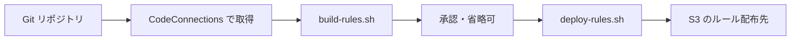

# ip-port-guard-rule-refresh-pipeline

日本・AWS（東京・大阪）・個別許可の IP の一覧から、各サーバーの ipset を入れ替えるスクリプトを作り、S3 に上げる。ローカル・踏み台サーバー・CodePipeline で、同じ `build-rules.sh` と `deploy-rules.sh` を使う。

このフォルダだけをコピーして運用できる。`allow-lists/` と `command/` はすべてこのフォルダの中にあり、親フォルダのファイルを使わない。

状態（2026-11-17）: 入口スクリプトと、バケット用・パイプライン用の2スタックを用意した。CloudFormation YAML と CDK（Python）の両版がある。構文・定義の検査、CDK の合成、AWS CLI と公開元の取得を模擬したビルド・デプロイまで確認した。実際の AWS へのスタック作成とアップロードは行っていない。各サーバーが S3 から取得・照合して ipset を入れ替える側は、まだ用意していない。

## ローカル・踏み台サーバーで実行する

必要なものは bash・curl・awk・AWS CLI と、公開元（`ftp.apnic.net`・`ip-ranges.amazonaws.com`）への HTTPS 接続。

このフォルダで実行する。

```bash
bash build-rules.sh staging --region ap-northeast-1 --profile your-profile
# 表示された件数・増減を確認する
bash deploy-rules.sh staging --region ap-northeast-1 --profile your-profile
```

環境は `development`・`staging`・`production`。通常は同じルールでも、検証用に一覧と配布先を分けられる。

`--region` と `--profile` は任意で、すべての AWS CLI 呼び出し（アカウント ID の取得・S3 の取得・アップロード）に引き継ぐ。省略した場合は `AWS_REGION`（または `AWS_DEFAULT_REGION`）と `AWS_PROFILE` を使い、それもなければ AWS CLI の既定設定を使う。引数は環境変数より優先する。

```bash
# 環境変数で指定してもよい
export AWS_REGION=ap-northeast-1
export AWS_PROFILE=your-profile
bash build-rules.sh staging
bash deploy-rules.sh staging
```

入口スクリプトは自分の置き場所を基準にファイルを使うため、別の作業ディレクトリから絶対パスで呼んでもよい。

## ビルドとデプロイ

| 順 | 処理 | 実行するもの |
|---|---|---|
| 1 | APNIC の割り当て統計と AWS の `ip-ranges.json` を取得し、日本と AWS の東京・大阪の一覧を作る | `build-rules.sh <環境>` |
| 2 | `allow-lists/<環境>/allow-ipv4.txt`・`allow-ipv6.txt` を作業フォルダへ写す | 同上 |
| 3 | S3 にある前回分の一覧を取得する。初回はなくてもよい | 同上 |
| 4 | 件数と前回からの増減を表示し、ipset 入れ替えスクリプトを作る | 同上 |
| 5 | 表示された内容を人が確認する | — |
| 6 | 作ったファイルを S3 に上げ、最後に `SHA256SUMS` を上げる | `deploy-rules.sh <環境>` |

ビルドでは S3 に書き込まない。環境と配布先の名前の照合、ビルド後の個別許可一覧との比較など、入口に余分な確認は入れない。既存の `make-refresh.sh` にある件数の下限と増減 5% の判定は引き続き使う。増減を確認して進める場合は `FORCE=1 bash build-rules.sh staging` とする。

| 設定 | 既定値・変更方法 |
|---|---|
| 個別許可の一覧 | このフォルダの [`allow-lists/<環境>/`](allow-lists/README.md)。運用する VPC の範囲などを記入する |
| 作業フォルダ | このフォルダの `work/<環境>/`。`PORT_GUARD_WORK_DIR` で変更できる |
| S3 の配布先 | `s3://ip-port-guard-rules-<アカウント ID>-<リージョン>-an/port-guard/<環境>/current/`。通常は指定不要。変更するときだけ `PORT_GUARD_S3_URI` で指定する（末尾の `/` なし） |

個別許可の一覧は、今は3環境ともコメントだけの仮置き。実運用前に記入する。書式と含める範囲は [allow-lists/README.md](allow-lists/README.md) を参照する。

## S3 バケットと権限

作成済みのバケットは、アカウントのリージョナル名前空間で `ip-port-guard-rules` を先頭部分として指定したもの。実際の名前には `-<アカウント ID>-<リージョン>-an` が付く。入口スクリプトはログイン先のアカウント ID と指定したリージョンから、その名前を組み立てる。

パブリックアクセスはすべてブロックしたまま使う。AWS CLI の認証情報と権限で読み書きする。公開 ACL は付けない。

| 操作 | 必要な S3 権限 |
|---|---|
| ビルド | バケットの `s3:ListBucket` と、前回分の一覧の `s3:GetObject` |
| デプロイ | 配布先 `port-guard/<環境>/current/` 配下の `s3:PutObject` |

ログインだけで S3 の権限が付くわけではない。IAM ユーザーまたはロールに必要な権限を持たせる。

S3 に置くものは次のとおり。

```text
port-guard/<環境>/current/
  command/port_guard/refresh-ipv4.sh
  command/port_guard/refresh-ipv6.sh
  port_guard_whitelists/allow-ipv4.txt
  port_guard_whitelists/allow-ipv6.txt
  port_guard_whitelists/last-refresh/*.txt
  SHA256SUMS
```

同じ環境に複数の場所から同時にデプロイしない。前回分の一覧は、毎回 S3 の配布先から取り直す。

## CodePipeline で実行する

現在のスクリプトから構築できるように、両版を更新した。ソース取得 → ビルド → 承認（省略可）→ デプロイの順に実行し、ビルドした結果を後段へ渡す。デプロイ側で作り直さない。



| スタック | CloudFormation YAML | CDK Python | 管理するもの |
|---|---|---|---|
| バケット用・環境間で共用 | [rule-buckets.yml](cloudformation/rule-buckets.yml) | [rule_buckets_stack.py](cdk/python/rule_buckets_stack.py) | 中間成果物用バケット。必要ならルール用バケットも新規作成する |
| パイプライン用・環境ごと | [list-refresh-pipeline.yml](cloudformation/list-refresh-pipeline.yml) | [list_refresh_stack.py](cdk/python/list_refresh_stack.py) | CodePipeline、2つの CodeBuild、IAM ロール、ログ。バケットは作らない |

今の作成済みルール用バケットは、バケット用スタックでも参照するだけ。`CreatePublishBucket=false` が既定で、再作成や設定変更はしない。既存バケットを CloudFormation 管理に取り込むリソースインポートは別の操作であり、ここでは行わない。

Git の接続先はまだ指定していないため、構築時に利用可能な CodeConnections 接続 ARN・リポジトリ・ブランチを渡す。接続の認可は事前に完了しておく。このフォルダが既存リポジトリの一部なら `SourceDirectory` にその相対パスを指定し、リポジトリ直下に置くなら `.` を使う。

- ソースは Git から直接取得する。独自の圧縮・パッケージング作業は加えない。
- 変更のたびには自動実行せず、手動で開始する。スタックを初めて作成した際の初回実行は別に発生し得る。
- 同じパイプラインの実行は `QUEUED` で直列にする。ローカルからの同時デプロイまでは制御しない。
- ビルド用ロールはルール配布先を読むだけ。デプロイ用ロールは、その環境の配布先に書ける。
- `RequireApproval=false` で承認を省略できる。増減 5% の判定を通す場合は、実行時のパイプライン変数 `FORCE=1` を渡す。

構築手順は [CloudFormation の README](cloudformation/README.md) と [CDK の README・比較](cdk/python/README.md) にある。いずれか一方の実装を選んで使う。

## 確認したことと未実施のこと

`bash -n`、両版のテンプレート検査、CDK の2スタック合成、7件の自動テストを実施した。テストでは定義間のビルド仕様・承認条件・バケットの保持と既存参照・ルール配布先の権限を照合した。模擬実行では、単独コピー・3環境・リージョンとプロファイルの引き継ぎ・前回分の取得・チェックサム・ビルド成果物だけでのデプロイを確認した。

実際の CodeConnections 接続・CodeBuild 実行・AWS へのデプロイは未実施。各サーバーへ取得や適用を指示する SSM の処理や、定期実行は今回の2スタックには含めていない。

AWS の仕様は公式ドキュメントと照合した（2026-11-17）: [CLI の環境変数と優先順位](https://docs.aws.amazon.com/cli/latest/userguide/cli-configure-envvars.html)、[S3 の名前空間](https://docs.aws.amazon.com/AmazonS3/latest/userguide/gpbucketnamespaces.html)、[パブリックアクセスのブロック](https://docs.aws.amazon.com/AmazonS3/latest/userguide/access-control-block-public-access.html)、[S3 操作の権限](https://docs.aws.amazon.com/AmazonS3/latest/userguide/using-with-s3-policy-actions.html)、[CodeConnections のソースアクション](https://docs.aws.amazon.com/codepipeline/latest/userguide/action-reference-CodestarConnectionSource.html)。
