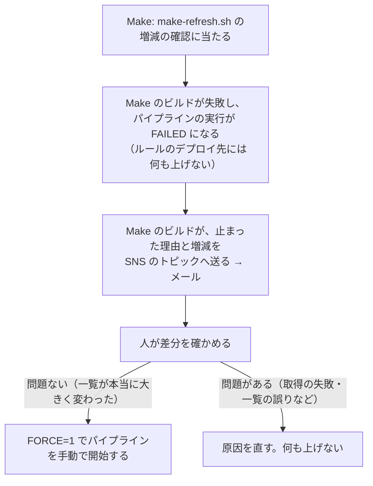

# 設計判断のまとめ（リリース判定の資料）

ip-port-guard-rule-refresh-pipeline の設計で決めたことと、その理由、まだ決まっていないこと、確かめたこと・確かめていないことをまとめる。リリースしてよいかを判断するための資料。

状態（2026-11-18）: **下書き**。「1. 決めたこと」は、これまでの作業で決まったもの。「2. 今回決めること」は 2026-11-18 にすべて決まり、実装した（AWS では流していない）。

用語は [README の用語](README.md#用語)と同じ。この資料では次の名前も使う。

| 名前 | 指すもの |
|---|---|
| 増減の確認 | `make-refresh.sh` の 2 つの確認。件数が下限より少ない一覧があれば止める（下限の確認）。前回分の一覧からの増減が 5% を超える一覧があれば止める（5% の確認。`FORCE=1` で通せる） |
| 失敗の通知 | パイプラインの実行が失敗したときに、SNS のトピックへ送る通知。トピックからメールで受け取る |
| 定期実行 | 決めた予定で、パイプラインを自動で開始すること |

## 1. 決めたこと

| # | 決めたこと | 理由 |
|---|---|---|
| D1 | ルールジェネレーター（スクリプトと個別許可の一覧）の正本は Git のリポジトリ。S3 には置かない | 何を流したかを Git で追えるようにする。S3 にあるものは、どれもその回の写し |
| D2 | 手動（ローカル・踏み台サーバー）と CI で、同じ `build-rules.sh`・`deploy-rules.sh` を同じ順に流す | やり方が 2 つあっても、作られるルールと上げ方を同じにする |
| D3 | 作る（`build-rules.sh`）と上げる（`deploy-rules.sh`）を分ける。作る段階ではルールのデプロイ先に書かない | 間で人や確認を挟めるようにする。CI では、作るロールにルールのデプロイ先への書き込み権限を持たせない |
| D4 | 個別許可の一覧は秘匿情報として扱わず、リポジトリに置く（`allow-lists/<環境>/`） | 誰がいつ変えたかを Git で追える |
| D5 | 前回分の一覧（増減を比べる基準）は S3 のルールのデプロイ先に置く。リポジトリには置かない | 人が書くものではなく、上げた結果の記録。リポジトリに置くと上げるたびにコミットが要る |
| D6 | 環境は `development`・`staging`・`production`。ルールのデプロイ先を環境ごとに分ける | 通常の運用では同じルールだが、検証のために分けられるようにする |
| D7 | ルールのデプロイ先バケットは 1 つ（環境の間で共用）で、パイプラインとは別の個別のスタック（[rule-deploy-bucket.yml](cloudformation/rule-deploy-bucket.yml)）で作成する。このアカウントでは手で作成済みなので、このスタックは流さない（定義は作り方の記録） | 手動のコマンドとパイプラインの両方から使うので、パイプラインより先に作っておく必要がある。パイプラインのスタックに含めると、パイプラインを作るまで手動で使えず、パイプラインのスタックを消すときにも巻き込まれるので、分ける |
| D8 | パイプラインの受け渡しバケットは、パイプライン用スタックの中で環境ごとに作る | パイプラインのスタックにバケットの作成も含めるため、環境ごとのスタック経由で作られたパイプラインには、スタックごとにパイプライン専用のバケットが作られる |
| D9 | ルールのデプロイ先バケットは、パブリックアクセスをすべてブロックし、AWS の認証と権限で読み書きする | ルールをインターネットに公開しない。各サーバーも権限で取る |
| D10 | ルールジェネレーターのリポジトリは GitHub と CodeCommit のどちらでもよい（YAML 版は `SourceProvider`、CDK 版は合成時の `sourceProvider` で選ぶ） | どちらのホストに置くかは決まっていない |
| D11 | パイプラインは、ソースの変更では自動で開始しない | 人か予定（定期実行。2 で決める）で開始する |
| D12 | 増減の確認を、ルールを作るたびに行う。当たったら止め、何も上げない | 誤った一覧を上げると、各サーバーで日本からの通信まで捨てる恐れがある。上げる前に止める |
| D13 | ルールのデプロイ先へは、ファイルを上げてから最後に照合の値（`SHA256SUMS`）を上げる | 上げている途中に各サーバーが取っても、照合の値と合わない組は使わない |
| D14 | Make から Publish へは、決まった名前のフォルダ `handoff/` に写したものだけを渡す。Publish でルールを作り直さない | 確かめたものと同じものを上げる |

## 2. 今回決めたこと（2026-11-18）

### 2-1. 人の承認をやめ、自動で進める

| | 内容 |
|---|---|
| 決めたこと | 定期実行とコマンドからの開始では、人の承認を飛ばして自動で進める。Web コンソールから人が開始したときは承認を挟む（2-7。2026-11-19 に、スタックのパラメータ `RequireApproval` で全部の実行の承認をまとめて切り替える形から変えた） |
| 自動の確認 | Check のステージ（人の承認）は、それ自体では何も確かめていない。自動の確認は、Make の中の増減の確認だけで行う |
| 気を付けること | 定期実行は、スタックを作った後の予定の時刻から自動で上げる。個別許可の一覧を書き終えてからスタックを作る |

### 2-2. 定期実行（2026-11-18 に決めた）

| | 内容 |
|---|---|
| 決めたこと | **週 2 回（毎週月曜・木曜の日本時間 9:00）**（2026-11-18 に週 1 回から変えた）。パイプライン用スタックに EventBridge Scheduler の予定を足す（2026-11-19 に EventBridge の予定の規則から替えた。2-7）。予定はパラメータ `ScheduleExpression` で渡し、既定は `cron(0 0 ? * MON,THU *)`（毎週月曜・木曜の UTC 0:00 ＝ 日本時間 9:00）。空にすると定期実行しない。各サーバーがルールを取得する定期更新（[rule-refresh-via-ssm の設計](rule-refresh-via-ssm/scheduled-refresh-design.md)。月曜・木曜の日本時間 11:00）の 2 時間前に上げる |
| 仕組み | 予定が、スタックが作るロール（`codepipeline:StartPipelineExecution`。このパイプラインだけ）で、変数 `APPROVAL=skip` を付けてパイプラインを開始する（承認を飛ばす）。`FORCE` は既定の `0`。予定の式は UTC で書く（Scheduler のタイムゾーンは UTC にしている） |
| 理由 | 1 回あたりの増減が小さくなり、5% の確認に当たりにくい。APNIC の一覧の変化は月に数件〜数十件 |
| 気を付けること | 定期実行は承認を飛ばすので、9:00 に上げたルールを 11:00 の定期更新で取得する。Web コンソールから人が開始した回だけは承認で止まる |

### 2-3. 増減の確認で止まったときの通知（2026-11-18 に決めた）

| | 内容 |
|---|---|
| 通知する場面 | **Make のビルドが失敗したとき**。増減の確認（下限の確認・5% の確認）に当たって止まったときがこれに当たる。公開元の IP の一覧の取得に失敗したなど、ほかの理由で Make が失敗したときも通知する（件名で分ける） |
| 通知の中身 | **止まった理由と、一覧ごとの件数・増減**（`make-refresh.sh` の表示）、ビルドのログの場所、次にすること（差分の確かめ方と `FORCE=1` で開始する手順）。件名は、増減の確認で止まったときは「増減の確認で止まった」、それ以外は「ビルドが失敗した」 |
| 送り方 | Make のビルドの中から送る。buildspec で `build-rules.sh` の表示をファイル（`build-rules.log`）にも残し、`build-rules.sh` が失敗したら、同じコマンドの中で `command/notify-make-failure.sh` が SNS へ送ってから、ビルドを失敗で終える。`build-rules.sh` は変えない（手動のときは通知しない） |
| 理由 | EventBridge のイベントには、どちらの確認で止まったかと一覧ごとの増減が入らない（ビルドのログにだけ出る）。メールだけで、`FORCE=1` で進めてよいかを判断する材料がそろうようにする |
| トピック | **既にあるトピック**の ARN をパラメータ `NotificationTopicArn` で渡す。空なら通知しない（既定は空）。メールの宛先（サブスクリプション）は、トピックの側で管理する |
| 権限 | Make のビルドのロールに、そのトピックへの `sns:Publish` だけを足す。トピックのポリシーは書き換えない（同じアカウントのロールからの送信は、ロールの権限で足りる）。トピックが KMS で暗号化されているなら、ロールにそのキーの権限を足す必要がある（今は足していない） |
| 通知しないもの | Source・Publish のステージの失敗、承認の却下。必要なら、EventBridge の規則でパイプラインの `FAILED` を拾う形を後から足せる |

### 2-4. ルールを作るときに問題が起きたときの扱い

**増減の確認に当たるとビルドは何も上げずに止まり、止まった理由と増減がメールで届くので、人が差分を確かめ、問題なければ `FORCE=1` を付けてパイプラインを手動で開始し直す。**

止まっている間も、各サーバーのルールは前のままで、絞り込みは前の一覧で効き続ける（ルールのデプロイ先には何も上がっていない）。手動で流したときも同じところで止まるが、通知は CI のときだけ送る。



| 当たった確認 | ビルドのログに出るもの | `FORCE=1` で通せるか |
|---|---|---|
| 下限の確認 | `<一覧の名前>: <件数> 件で、下限の <下限> 件より少ない` と `件数が足りない一覧があるので止める` | **通せない**。公開元の IP の一覧の取得に失敗したなど、一覧そのものがおかしいので、原因を直す |
| 5% の確認 | `<一覧の名前>: <件数> 件（前回 <件数> 件、増 <件数> 件、減 <件数> 件）`、`前回からの増減が 5% を超えている`、`増減が大きい一覧があるので止める` | 通せる |

#### 差分の確かめ方

1. **件数を見る**: パイプラインの Make のビルドのログ（CloudWatch Logs の `/aws/codebuild/port-guard-list-refresh-<環境>`、ストリーム `make/...`）に、一覧ごとの件数と増・減の件数が出る
2. **中身を見る**: ビルドのログには、増えた・減った CIDR そのものは出ない。中身を見るときは、手元で同じ `build-rules.sh` を流す（ルールのデプロイ先には何も上げない）。止まったとき、作業フォルダに前回分（`.txt`）と今回分（`.new`）の両方が残るので、それを比べる

```bash
# このフォルダで。AWS CLI でログインしている人の権限で、ルールのデプロイ先を読む
bash build-rules.sh staging          # パイプラインと同じところで止まる
cd work/staging/port_guard_whitelists/last-refresh
LC_ALL=C comm -13 jp-ipv4.txt jp-ipv4.new   # 増えた範囲
LC_ALL=C comm -23 jp-ipv4.txt jp-ipv4.new   # 減った範囲（jp-ipv6・aws-ipv4・aws-ipv6 も同じ）
```

手元で流すのはパイプラインより後なので、公開元の IP の一覧が更新されていれば、結果が少し違うことがある。

#### FORCE=1 でパイプラインを手動で開始する手順

```bash
aws codepipeline start-pipeline-execution --name port-guard-list-refresh-staging \
  --variables name=FORCE,value=1 name=APPROVAL,value=skip
```

`FORCE=1` が効くのは、その 1 回の実行だけ（次の定期実行は `FORCE=0` に戻る）。5% の確認だけを通し、下限の確認は通さない。手動で上げるときは、`FORCE=1 bash build-rules.sh staging` のあと `bash deploy-rules.sh staging` を流す。

### 2-5. ルールのデプロイ先バケットの CDK 版

| | 内容 |
|---|---|
| 決めたこと | `cdk/python/rule_deploy_bucket_stack.py` を足し、[rule-deploy-bucket.yml](cloudformation/rule-deploy-bucket.yml) と同じバケットを定義する。YAML 版と同じく、作り方の記録で、このアカウントでは流さない |
| 合成 | `app.py` で、パイプライン用スタックとは別のスタック（`port-guard-rule-deploy-bucket`）として合成する。2 つのスタックの間に依存は付けない |
| 確かめ方 | YAML 版と CDK 版の設定が同じことを、テストで照合する |

### 2-6. `list_refresh_stack.py` の整理

| | 内容 |
|---|---|
| 今の問題 | 1 つの `__init__` に全部が入っていて、各行の末尾に説明のコメントが付いている。コードとコメントが混ざって、レビューしにくい |
| 決めたこと | 部品ごとのメソッドに分ける（パラメータ、パイプラインの受け渡しバケット、CodeBuild とその権限、ソース、パイプライン、定期実行、失敗の通知）。コメントは行の末尾ではなく、部品の頭にまとめて書く。合成されるテンプレートは変えない（テストで確かめる） |

### 2-7. 開始の仕方で承認を分ける（2026-11-19 に決めた）

**定期実行とコマンドからの開始では承認を飛ばし、Web コンソールから人が開始したときだけ承認を挟む。**

| | 内容 |
|---|---|
| 仕組み | パイプラインの変数 `APPROVAL` を足し、既定値を `required` にする。Check のステージに入り口の条件（`VariableCheck` の規則で `#{variables.APPROVAL}` が `required` と等しいか）を付け、満たさなければ Check を飛ばす（結果 Skip）。`RequireApproval` のパラメータは、この仕組みに置き換えた（無くした） |
| Web コンソールから人が開始 | 変数を変えなければ既定値の `required` のままなので、承認で止まる |
| 定期実行 | `APPROVAL=skip` を渡して開始する。EventBridge の規則のターゲットには CodePipeline に変数を渡す設定がないので、定期実行を **EventBridge Scheduler** に替え、CodePipeline の開始の API を直接呼ぶ形（ユニバーサルターゲット `arn:aws:scheduler:::aws-sdk:codepipeline:startPipelineExecution`）で変数を渡す。Scheduler は時刻を日本時間（`Asia/Tokyo`）で書ける |
| コマンドから開始 | `aws codepipeline start-pipeline-execution --name ... --variables name=APPROVAL,value=skip`。付け忘れたときは承認で止まる（安全な側に倒れる） |
| 気を付けること | Web コンソールでも、開始するときに変数を `skip` に書き換えれば承認を飛ばせる（人が意図して選ぶ操作）。Skip の結果を持つ条件は、実行中に上書きできない。構築直後の自動の 1 回は、変数が既定値なので承認で止まる |
| 確かめたこと | ステージの入り口の条件で Skip を使えること、Skip に使える規則が `LambdaInvoke` と `VariableCheck` であること（[ステージの条件](https://docs.aws.amazon.com/codepipeline/latest/userguide/stage-conditions.html)）。EventBridge の規則のターゲットに CodePipeline の変数の設定がないこと（[Target](https://docs.aws.amazon.com/eventbridge/latest/APIReference/API_Target.html)）。Scheduler のユニバーサルターゲットで任意の API を呼べること（`get`・`list` などで始まる読み取りの API は除く）（[ユニバーサルターゲット](https://docs.aws.amazon.com/scheduler/latest/UserGuide/managing-targets-universal.html)）。いずれも 2026-11-19 |
| 確かめていないこと | `VariableCheck` でパイプラインの変数（`#{variables.APPROVAL}`）を見られること（ドキュメントの例はソースアクションの出力の変数だけ）。Scheduler から CodePipeline を変数付きで開始できること（入力の JSON のキーを `Name`・`Variables` と大文字で始めるのは、ドキュメントの例（SQS・Step Functions）にならったもの）。入り口の条件の規則を評価するのに、パイプラインのロールに追加の権限が要るか。いずれも実際に流して確かめる必要がある |

## 3. 決まっていないこと

| 項目 | 内容 |
|---|---|
| 通知に使うトピック | 2-3。どの既存のトピックか（ARN）。KMS で暗号化されているか |
| ルールジェネレーターのリポジトリ | GitHub か CodeCommit か。リポジトリとブランチ。GitHub なら CodeConnections の接続 |
| 個別許可の一覧の中身 | `allow-lists/<環境>/` は空の仮置き。少なくとも、稼働サーバーの VPC の範囲を書く |
| 各サーバーがルールを取って入れ替える側 | SSM で流す形を [rule-refresh-via-ssm](rule-refresh-via-ssm/README.md) に用意した（2026-11-19。人が流す手動の更新と、月曜・木曜 11:00 の定期更新（State Manager の関連付け）。手順は [instance-setup.md](rule-refresh-via-ssm/instance-setup.md)。AWS では流していない）。環境のタグの実際のキーと値は決まっていない |

## 4. 確かめたこと・確かめていないこと

| 確かめたこと（2026-11-18） | 方法 |
|---|---|
| 入口のスクリプトと部品の構文 | `bash -n` |
| テンプレートの書き方 | `cfn-lint`（YAML 版 2 つと、CDK 版を GitHub・CodeCommit それぞれで合成したもの） |
| YAML 版と CDK 版の動き・権限・バケット・定期実行・通知が同じこと | 自動テスト 14 件（AWS には接続しない） |
| 増減の確認で止まったときの通知 | AWS CLI を模擬したテストで、Make のビルドが失敗で終わり、何も上げず、止まった理由と一覧ごとの増減を載せた通知を 1 通送ること（トピックが空なら送らないこと） |
| ビルドから Publish までの受け渡し | AWS CLI と公開元の取得を模擬したテストで、Make が作った `handoff/` だけで `deploy-rules.sh` が通ること |
| AWS の仕様 | AWS のドキュメントと照合した（README と手順書の「参考」の節） |

| 確かめていないこと | 影響 |
|---|---|
| 実際の AWS へのスタックの作成 | 権限の不足や名前のぶつかりは、作るまで分からない |
| 実際の CodeBuild での実行 | ビルドの環境（イメージに入っているコマンド）の違いは、流すまで分からない |
| 実際の定期実行（Scheduler から承認を飛ばして開始）と SNS への送信 | EventBridge Scheduler からの開始と、SNS からメールが届くことは、流すまで分からない。KMS で暗号化したトピックは、ロールにキーの権限がないので送れない |
| GitHub の接続・CodeCommit からの取得 | 接続の認可やリポジトリの権限は、流すまで分からない |
| 手で作ったルールのデプロイ先バケットの設定 | バージョニング・暗号化が [rule-deploy-bucket.yml](cloudformation/rule-deploy-bucket.yml) と同じかは見ていない |
