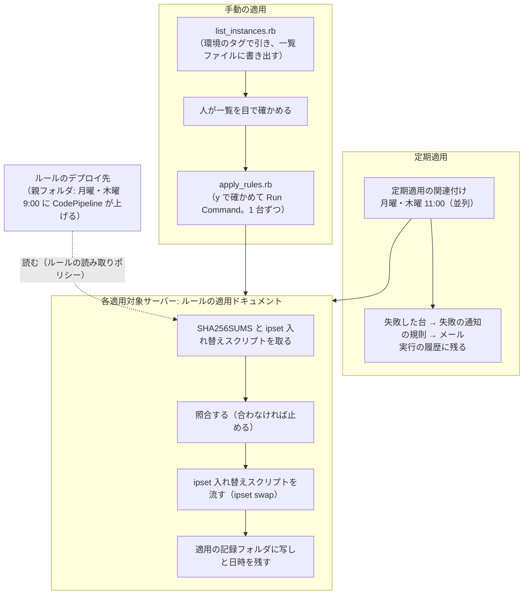

# rule-apply-via-ssm — ルールのデプロイ先から各サーバーへルールを取得して適用する（SSM）

[全体の流れの図](../../images/list-refresh-flow.svg)の「**SSM ルール取得**」（ipset 対象サーバー → S3）と、その先の「**IP制限の有効化**」に当たる部分。SSM で、環境ごとの適用対象サーバーに、ルールのデプロイ先からの取得・照合・ipset の入れ替えを流す。流し方は 2 つある。

| 流し方 | 動かす人・きっかけ | 対象 | 流し方 |
|---|---|---|---|
| 手動の適用 | 作業者が `apply_rules.rb` で流す（Run Command） | 環境のタグで引いた一覧を、人が目で確かめたもの | 1 台ずつ。1 台でも失敗したら残りは流さない |
| 定期適用 | 毎週月曜・木曜の日本時間 11:00 に無人で流れる（State Manager の関連付け） | 環境のタグが合う台すべて | 全台に並列。失敗した台は通知し、実行の履歴に残す |

どちらも同じ**ルールの適用ドキュメント**（SSM のコマンドのドキュメント）を流す。

**インスタンスへの設定の手順は [instance-setup.md](instance-setup.md) にまとめている**（ドキュメント・ポリシー・タグ・ロール・手動での確かめ・定期適用の開始・運用）。定期適用の設計と、EventBridge Scheduler との比べは [scheduled-apply-design.md](scheduled-apply-design.md)。

状態（2026-11-19）: テンプレートとコマンドを用意した。`cfn-lint`・`ruby -c`・`bash -n`（ルールの適用ドキュメントの中のスクリプトを取り出して）の確認だけで、**AWS に対しては流していない**。

## 用語

[親フォルダの用語](../README.md#用語)（ルールのデプロイ先バケット・ルールのデプロイ先など）に加えて、次の名前を使う。

| 名前 | 指すもの |
|---|---|
| 適用対象サーバー | ルールを入れる EC2 のインスタンス。図の「ipset 対象サーバー」。port-guard（iptables ＋ ipset）を入れ済みで、SSM に登録されていて応答するもの |
| 環境のタグ | 適用対象サーバーがどの環境（`development`・`staging`・`production`）かを表すタグ。既定はキー `Environment`、値は環境の名前 |
| ルールの適用ドキュメント | ルールの適用スクリプトを中身にした、自分で作る SSM のコマンドのドキュメント `port-guard-apply-rules`（[cloudformation/rule-apply-document.yml](cloudformation/rule-apply-document.yml)。アカウントに 1 つ）。**ルールの適用スクリプトの正本**。ルールのデプロイ先・リージョン・IPv6 も流すかをパラメータで受け取る |
| ルールの適用スクリプト | ルールの適用ドキュメントの中のシェルスクリプト（適用対象サーバーで root で流れる）。ルールのデプロイ先から照合の値（`SHA256SUMS`）と ipset 入れ替えスクリプトを取り、照合してから ipset 入れ替えスクリプトを流す |
| ルールの読み取りポリシー | 適用対象サーバーの IAM ロールに付ける管理ポリシー `port-guard-rule-read-<環境>`。その環境のルールのデプロイ先の `s3:GetObject` だけを許す（[cloudformation/rule-read-policy.yml](cloudformation/rule-read-policy.yml)） |
| インスタンスの一覧ファイル | 手動の適用で使う、適用対象サーバーを 1 行 1 台で書いた TSV（`instance-lists/<環境>.tsv`）。列は「インスタンス ID・パブリック IP・Name タグ」 |
| 定期適用の関連付け | 定期適用を行う State Manager の関連付け。環境ごとに 2 つ（`port-guard-apply-rules-<環境>-mon`・`-thu`）（[cloudformation/scheduled-apply.yml](cloudformation/scheduled-apply.yml)） |
| 失敗の通知の規則 | 定期適用で失敗した台を、SNS のトピックへ台ごとに知らせる EventBridge の規則 |
| 適用の記録フォルダ | 適用対象サーバーの `/var/lib/port-guard/rules/`。最後に流した ipset 入れ替えスクリプトの写しと、流した日時（`last-applied`）を残す |

## 全体の流れ



ルールのデプロイ先にルールを上げるところ（`build-rules.sh`・`deploy-rules.sh`。手動か CodePipeline）は [親フォルダ](../README.md) で行う。このフォルダは、上がったルールを各サーバーに入れるところだけを受け持つ。

## 手動の適用のコマンド

手順の中での使い方は [instance-setup.md の 6](instance-setup.md#6-手動で-1-回流して確かめる環境ごと)。

| コマンド | すること |
|---|---|
| `ruby rb/list_instances.rb --env <環境> [--tag-key KEY] [--tag-value VALUE] [--out FILE] [--overwrite]` | 環境のタグが合い、動いていて SSM で応答する台を、インスタンスの一覧ファイルに書き出す（読み取りだけ）。SSM で応答しない台は、外した理由とともに表示する。同じ名前のファイルがあれば上書きしない |
| `ruby rb/apply_rules.rb --env <環境> [--list FILE] [--ipv6] [--s3-uri URI] [--document-name NAME]` | インスタンスの一覧ファイルの台に、ルールの適用ドキュメントを Run Command で流す。対象・取得元・ドキュメントを表示し、`y` を受けてから送る。1 台ずつ流し、1 台でも失敗したら残りは流さない。全台が `Success` なら終了コード 0 |

どちらも `--profile`・`--region` を受け付ける。取得元（ルールのデプロイ先）は `s3://ip-port-guard-rules-<アカウント ID>-<リージョン>-an/port-guard/<環境>/current`（親フォルダの `command/set-s3-uri.sh` と同じ組み立て方）。

インスタンスの一覧ファイルの例（タブ区切り。パブリック IP や Name タグがない台は `-`）:

```text
# 環境: staging（タグ Environment=staging）。2026-11-18 10:00:00 に list_instances.rb が作成
# instance_id	public_ip	name
i-0123456789abcdef0	203.0.113.10	web-staging-1
i-0fedcba9876543210	-	web-staging-2
```

## 決めたこと

| # | 決めたこと | 理由 |
|---|---|---|
| A1 | 取得・照合・ipset の入れ替えまでを 1 回で行う | 取得と入れ替えを分けると、取得だけ済んだ台が残る |
| A2 | 適用対象サーバーは、ルールのデプロイ先を**自分の IAM ロールの権限**で読む（ルールの読み取りポリシーを付ける） | ルールのデプロイ先バケットはパブリックアクセスをすべてブロックしている（[D10](../design-decisions.md#1-決めたこと)）。定期適用にもそのまま使える。暫定対応のフェーズ 1（`docs/ec2/ssm-setup`）の「既存のロールに権限を足さない」とは違う扱いになる |
| A3 | 手動の適用では、環境のタグで引いた一覧を人が目で確かめてから流す | 引いた結果をそのまま流さず、間に人の確認を挟む |
| A4 | インスタンスの一覧ファイルの列は、インスタンス ID・パブリック IP・Name タグ | 人が見て台を見分けられるようにする |
| A5 | AWS の操作は、gem を使わず、AWS CLI のコマンドを呼ぶ Ruby で書く（Ruby 2.6 以上・標準のライブラリだけ） | 作業者の PC と踏み台サーバーに gem を入れなくて済む |
| A6 | このフォルダの中で完結させる（`docs/ec2/ssm-setup` の部品は使わず、要るものは写す） | 親フォルダの [D2](../design-decisions.md#1-決めたこと) に合わせる |
| A7 | ルールの適用スクリプトの正本は、ルールの適用ドキュメント（CloudFormation のテンプレート）だけにする。手動の適用も定期適用も、このドキュメントを流す（2026-11-19） | スクリプトが 1 か所になり、手動で確かめたものと同じものが定期適用で流れる |
| A8 | 定期適用は毎週月曜・木曜の日本時間 11:00（ルールのデプロイ先へのデプロイ 9:00 の 2 時間後）。全台に並列で流し、失敗した台は通知と実行の履歴で後から分かればよい（2026-11-18） | [設計](scheduled-apply-design.md) |

## 決まっていないこと

| 項目 | 内容 |
|---|---|
| 環境のタグ | 実際のキーと値（既定の `Environment=<環境>` で合っているか） |
| IPv6 | IPv6 も絞る台があるか（あれば手動は `--ipv6`、定期適用は `ApplyIpv6=1`） |
| どの環境で定期適用するか | 3 環境すべてか、`production` だけか |
| 通知に使うトピック | 親フォルダと同じトピックでよいか。KMS で暗号化されているか |
| 50 台を超える環境（手動の適用） | Run Command に 1 回で渡せるインスタンス ID は 50 まで。超えたら一覧ファイルを分けて流す |

## ファイル

| ファイル | 役割 |
|---|---|
| [instance-setup.md](instance-setup.md) | **インスタンスへの設定の手順**（1 つにまとめたもの） |
| [scheduled-apply-design.md](scheduled-apply-design.md) | 設計: ルールの定期適用（State Manager の関連付け。EventBridge Scheduler との比べ） |
| `cloudformation/rule-apply-document.yml` | ルールの適用ドキュメント（アカウントに 1 つ。ルールの適用スクリプトの正本） |
| `cloudformation/rule-read-policy.yml` | ルールの読み取りポリシー（環境ごと） |
| `cloudformation/scheduled-apply.yml` | 定期適用（環境ごと。定期適用の関連付け 2 つ、関連付けのロール、失敗の通知の規則） |
| `rb/list_instances.rb` | 手動の適用: 環境のタグで引き、インスタンスの一覧ファイルに書き出す（読み取りだけ） |
| `rb/apply_rules.rb` | 手動の適用: インスタンスの一覧ファイルの台に、ルールの適用ドキュメントを Run Command で流す |
| `rb/lib/aws_cli.rb`・`rb/lib/cli.rb` | 汎用の部品（AWS CLI の呼び出し、オプション・確認・使い方の誤り）。`docs/ec2/ssm-setup/rb/lib/` から写した |
| `instance-lists/` | インスタンスの一覧ファイルの既定の置き場所（Git には入れない） |
