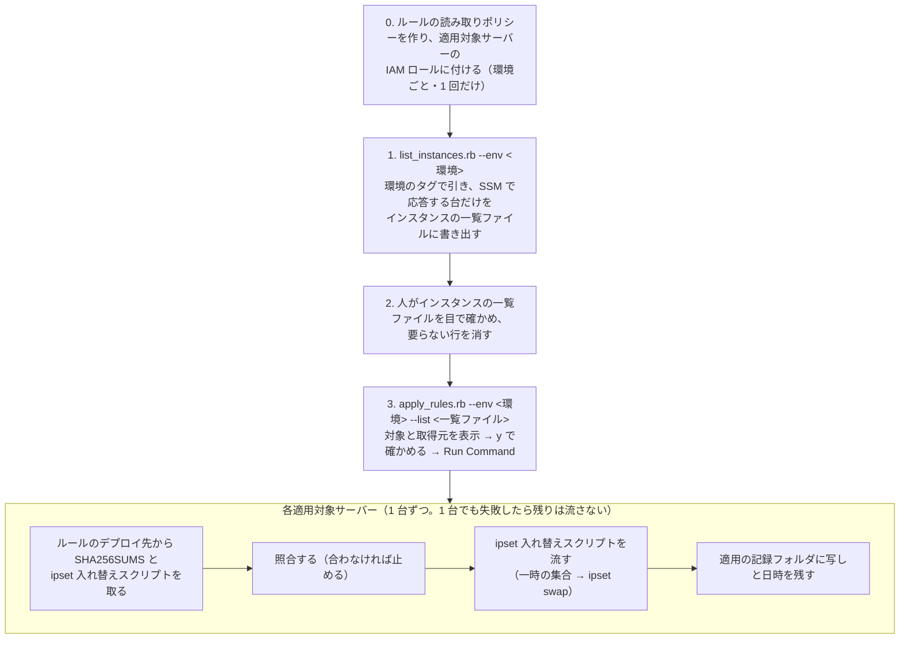

# rule-apply-via-ssm — ルールのデプロイ先から各サーバーへルールを取得して適用する（SSM Run Command）

[全体の流れの図](../../images/list-refresh-flow.svg)の「**SSM ルール取得**」（ipset 対象サーバー → S3）と、その先の「**IP制限の有効化**」に当たる部分。作業者の PC（または踏み台サーバー）から SSM の Run Command で、環境ごとの適用対象サーバーに、ルールのデプロイ先からの取得・照合・ipset の入れ替えを流す。

状態（2026-11-18）: **骨組み**。README・権限の定義・コマンドを用意した。`ruby -c`・`bash -n`・`cfn-lint` の確認だけで、AWS に対しては流していない。

## 用語

[親フォルダの用語](../README.md#用語)（ルールのデプロイ先バケット・ルールのデプロイ先など）に加えて、次の名前を使う。

| 名前 | 指すもの |
|---|---|
| 適用対象サーバー | ルールを入れる EC2 のインスタンス。図の「ipset 対象サーバー」。port-guard（iptables ＋ ipset）を入れ済みで、SSM に登録されていて応答する（Run Command を受け付ける）もの |
| 環境のタグ | 適用対象サーバーがどの環境（`development`・`staging`・`production`）かを表すタグ。既定はキー `Environment`、値は環境の名前。`--tag-key`・`--tag-value` で変えられる |
| インスタンスの一覧ファイル | 適用対象サーバーを 1 行 1 台で書いた TSV。列は「インスタンス ID・パブリック IP・Name タグ」。既定の場所は `instance-lists/<環境>.tsv`。`list_instances.rb` が書き出し、人が目で確かめて要らない行を消してから `apply_rules.rb` に渡す。手で書いてもよい |
| ルールの読み取りポリシー | 適用対象サーバーの IAM ロールに付ける管理ポリシー `port-guard-rule-read-<環境>`。その環境のルールのデプロイ先の `s3:GetObject` だけを許す（[cloudformation/rule-read-policy.yml](cloudformation/rule-read-policy.yml)） |
| ルールの適用スクリプト | Run Command で適用対象サーバーに送り、root で流すシェルスクリプト [remote/apply-rules.sh](remote/apply-rules.sh)。ルールのデプロイ先から照合の値（`SHA256SUMS`）と ipset 入れ替えスクリプトを取り、照合してから ipset 入れ替えスクリプトを流す |
| 適用の記録フォルダ | 適用対象サーバーの `/var/lib/port-guard/rules/`。最後に流した ipset 入れ替えスクリプトの写しと、流した日時（`last-applied`）を残す |

## 全体の流れ



| 順 | すること | コマンド |
|---|---|---|
| 0（環境ごと・1 回だけ） | ルールの読み取りポリシーを作り、適用対象サーバーの IAM ロールに付ける | `aws cloudformation deploy` と `aws iam attach-role-policy`（[下](#0-ルールの読み取りポリシーを付ける)） |
| 1 | 環境のタグで適用対象サーバーを引き、インスタンスの一覧ファイルに書き出す | `ruby rb/list_instances.rb --env <環境>` |
| 2 | インスタンスの一覧ファイルを目で確かめ、要らない行を消す（行頭に `#` を付けてもよい） | 手で |
| 3 | インスタンスの一覧ファイルの台に、ルールの適用スクリプトを流す | `ruby rb/apply_rules.rb --env <環境> --list instance-lists/<環境>.tsv` |

ルールのデプロイ先にルールを上げるところ（`build-rules.sh`・`deploy-rules.sh`。手動か CodePipeline）は [親フォルダ](../README.md) で行う。このフォルダは、上がったルールを各サーバーに入れるところだけを受け持つ。

## 0. ルールの読み取りポリシーを付ける

```bash
# このフォルダで。環境ごとに 1 回
aws cloudformation deploy \
  --stack-name port-guard-rule-read-staging \
  --template-file cloudformation/rule-read-policy.yml \
  --parameter-overrides EnvironmentName=staging \
  --capabilities CAPABILITY_NAMED_IAM

# 適用対象サーバーの IAM ロールの名前を調べる（インスタンスプロファイル → ロール）
aws ec2 describe-instances --instance-ids i-0123456789abcdef0 \
  --query 'Reservations[].Instances[].IamInstanceProfile.Arn' --output text
aws iam get-instance-profile --instance-profile-name <インスタンスプロファイルの名前> \
  --query 'InstanceProfile.Roles[].RoleName' --output text

# ロールにポリシーを付ける（ロールごとに 1 回。同じロールを使う台はまとめて済む）
aws iam attach-role-policy --role-name <ロールの名前> \
  --policy-arn arn:aws:iam::<アカウント ID>:policy/port-guard-rule-read-staging
```

- インスタンスプロファイルがない台（Default Host Management Configuration だけで SSM に登録されている台など）には付けられない。その台では、ルールの適用スクリプトの取得が権限の不足で失敗する
- 適用対象サーバーから S3 に届く経路（インターネットゲートウェイ・NAT ゲートウェイ・S3 のゲートウェイエンドポイントのどれか）が要る

## 1・2. インスタンスの一覧ファイルを作って確かめる

```bash
ruby rb/list_instances.rb --env staging --region ap-northeast-1 --profile your-profile
# → instance-lists/staging.tsv に書き出し、同じ内容を表示する。SSM で応答しない台は、外した理由とともに表示する
```

インスタンスの一覧ファイルの例:

```text
# 環境: staging（タグ Environment=staging）。2026-11-18 10:00:00 に list_instances.rb が作成
# instance_id	public_ip	name
i-0123456789abcdef0	203.0.113.10	web-staging-1
i-0fedcba9876543210	-	web-staging-2
```

- 列はタブ区切り。パブリック IP を持たない台は `-`、Name タグがない台は `-`
- 引く条件: 環境のタグが合い、状態が `running` で、SSM に登録されていて応答する（`PingStatus=Online`）台
- 同じ名前のファイルがあれば上書きしない（人が確かめた後の一覧を消さないため）。作り直すときは `--overwrite`
- 環境のタグがない環境では、同じ形のファイルを手で書いてもよい（1 列目のインスタンス ID だけを使う）

## 3. ルールを適用する

```bash
ruby rb/apply_rules.rb --env staging --list instance-lists/staging.tsv --region ap-northeast-1 --profile your-profile
# IPv6 も絞っている台なら --ipv6 を足す（refresh-ipv6.sh も流す）
```

| 点 | 内容 |
|---|---|
| 確かめてから流す | 対象の台（一覧ファイルの内容）と、取得元のルールのデプロイ先を表示し、`y` を受けてから Run Command を送る |
| 取得元 | `s3://ip-port-guard-rules-<アカウント ID>-<リージョン>-an/port-guard/<環境>/current`（親フォルダの `command/set-s3-uri.sh` と同じ組み立て方）。変えるときは `--s3-uri` |
| 流し方 | 1 回の Run Command（`AWS-RunShellScript`）で、1 台ずつ（`--max-concurrency 1`）流し、1 台でも失敗したら残りは流さない（`--max-errors 0`） |
| 照合 | 照合の値（`SHA256SUMS`）を先に取り、そのあと ipset 入れ替えスクリプトを取って照合する。ルールのデプロイ先へは照合の値が最後に上がる（[設計判断 D14](../design-decisions.md#1-決めたこと)）ので、上げている途中に取った組は合わず、何も変えずに止まる |
| 入れ替え | ipset 入れ替えスクリプトは、一時の集合に入れて件数を確かめてから `ipset swap` で入れ替える。集合が空になる時間はない。port-guard を入れていない台では、今の集合がないので何も変えずに止まる |
| 結果 | 台ごとの状態（`Success`・`Failed` など）と、ルールの適用スクリプトの出力を表示する。全台が `Success` なら終了コード 0、そうでなければ 1 |

## 決めたこと

| # | 決めたこと | 理由 |
|---|---|---|
| A1 | Run Command では、取得・照合・ipset の入れ替えまでを 1 回で行う | 一覧を目で確かめてから流すので、取得と入れ替えを分けなくてよい |
| A2 | 適用対象サーバーは、ルールのデプロイ先を**自分の IAM ロールの権限**で読む（ルールの読み取りポリシーを付ける） | ルールのデプロイ先バケットはパブリックアクセスをすべてブロックしている（[D10](../design-decisions.md#1-決めたこと)）。各サーバーが定期に取りに行く形にも、そのまま使える。暫定対応のフェーズ 1（`docs/ec2/ssm-setup`）の「既存のロールに権限を足さない」とは違う扱いになる |
| A3 | 適用対象サーバーは、環境のタグで引き、SSM で応答する台だけをインスタンスの一覧ファイルに書き出す。人が目で確かめた一覧ファイルの台にだけ流す | 引いた結果をそのまま流さず、間に人の確認を挟む |
| A4 | インスタンスの一覧ファイルの列は、インスタンス ID・パブリック IP・Name タグ | 人が見て台を見分けられるようにする |
| A5 | AWS の操作は、gem を使わず、AWS CLI のコマンドを呼ぶ Ruby で書く（Ruby 2.6 以上・標準のライブラリだけ） | 作業者の PC と踏み台サーバーに gem を入れなくて済む。`docs/ec2` の暫定対応の道具と同じやり方 |
| A6 | このフォルダの中で完結させる（`docs/ec2/ssm-setup` の部品は使わず、要るものは写す） | 親フォルダの [D2](../design-decisions.md#1-決めたこと)（このフォルダだけで運用できる）に合わせる |

## 決まっていないこと

| 項目 | 内容 |
|---|---|
| 環境のタグ | 実際のキーと値（既定の `Environment=<環境>` で合っているか） |
| IPv6 | IPv6 も絞る台があるか（あれば `--ipv6`） |
| 定期の実行 | 今は人が流す。State Manager や cron で定期に流すかは決めていない |
| 50 台を超える環境 | Run Command に 1 回で渡せるインスタンス ID は 50 まで。超えたら分けて流す（今は分けない） |

## ファイル

| ファイル | 役割 |
|---|---|
| `rb/list_instances.rb` | 1・2: 環境のタグで引き、SSM で応答する台をインスタンスの一覧ファイルに書き出す（読み取りだけ） |
| `rb/apply_rules.rb` | 3: インスタンスの一覧ファイルの台に、Run Command でルールの適用スクリプトを流す |
| `rb/lib/aws_cli.rb`・`rb/lib/cli.rb` | 汎用の部品（AWS CLI の呼び出し、オプション・確認・使い方の誤り）。`docs/ec2/ssm-setup/rb/lib/` から写した |
| `remote/apply-rules.sh` | ルールの適用スクリプト（適用対象サーバーで root で流れる。AWS CLI で S3 から取る） |
| `cloudformation/rule-read-policy.yml` | ルールの読み取りポリシー（環境ごと） |
| `instance-lists/` | インスタンスの一覧ファイルの既定の置き場所（Git には入れない） |
