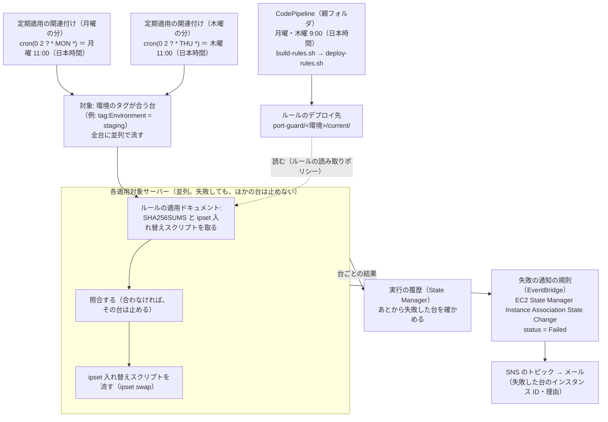

# 設計: ルールの定期適用（State Manager の関連付け）

状態（2026-11-19）: **実装した**（[cloudformation/rule-apply-document.yml](cloudformation/rule-apply-document.yml)・[cloudformation/scheduled-apply.yml](cloudformation/scheduled-apply.yml)。`cfn-lint` までで、AWS には流していない）。手順は [instance-setup.md](instance-setup.md)。AWS の仕様は AWS のドキュメントと照らし合わせた（2026-11-18。末尾の「参考」）。確かめられなかったことは、その場所に書いている。

[README](README.md) の手動の適用（`list_instances.rb` → 人が確かめる → `apply_rules.rb`）に加えて、**同じルールの適用スクリプトを、AWS 側に保存した予定で、無人で流す**形を設計する。手動の適用は残す（臨時の適用、新しい台の初回、失敗した台の流し直し、定期適用を止めているとき）。

## 用語

[README の用語](README.md#用語)に加えて、次の名前を使う。

| 名前 | 指すもの |
|---|---|
| 定期適用 | 決めた予定で、適用対象サーバーにルールの適用スクリプトを無人で流すこと。この設計では State Manager の関連付けで行う |
| ルールの適用ドキュメント | ルールの適用スクリプトを中身にした、自分で作る SSM のコマンドのドキュメント（`port-guard-apply-rules`。種類は `Command`）。ルールのデプロイ先などはパラメータで受け取る |
| 定期適用の関連付け | ルールの適用ドキュメントを、予定と対象（環境のタグ）と流し方を決めて流し続ける State Manager の関連付け。**環境ごとに 2 つ**（月曜の分 `port-guard-apply-rules-<環境>-mon` と木曜の分 `port-guard-apply-rules-<環境>-thu`） |
| 関連付けのロール | 定期適用の関連付けが、適用対象サーバーにコマンドを送るときに使う IAM ロール（`AssociationDispatchAssumeRole`） |
| 失敗の通知の規則 | 定期適用で失敗した台を、SNS のトピックへ知らせる EventBridge の規則。環境ごとに 1 つ |

## 全体の形

予定は**毎週月曜と木曜**。ルールのデプロイ先へのデプロイ（CodePipeline）は日本時間 9:00、インスタンスのルールの取得（定期適用）は日本時間 11:00 で、デプロイから 2 時間あける。適用対象サーバーには**並列で**流し、一部の台で失敗しても、ほかの台には流し続ける。失敗した台は、台ごとにメールで知らせ、あとから実行の履歴でも確かめられる。



| 構成要素 | 作り方 | 中身 |
|---|---|---|
| ルールの適用ドキュメント | `AWS::SSM::Document`（`DocumentType: Command`、`schemaVersion: '2.2'`、ステップは `aws:runShellScript`） | ルールの適用スクリプト。パラメータは「ルールのデプロイ先」「リージョン」「IPv6 も流すか」。アカウントに 1 つで、環境の間で共用する |
| 定期適用の関連付け | `AWS::SSM::Association`。環境ごとに 2 つ（月曜の分・木曜の分） | 下の表。2 つの違いは `ScheduleExpression` と `AssociationName` だけ |
| 関連付けのロール | `AWS::IAM::Role`（信頼する相手は `ssm.amazonaws.com`） | 下の「関連付けのロール」 |
| 失敗の通知の規則 | `AWS::Events::Rule` と、その実行ロール（`AWS::IAM::Role`。信頼する相手は `events.amazonaws.com`） | 下の「失敗した台の扱い」 |
| ルールの読み取りポリシー | 今ある [rule-read-policy.yml](cloudformation/rule-read-policy.yml) をそのまま使う | 適用対象サーバーの IAM ロールに付ける（手動の適用と同じ） |

### 月曜と木曜で関連付けを 2 つにする理由

State Manager の関連付けの cron 式では、曜日に**1 つの曜日か毎日（`*`）しか書けない**（`MON,THU` のような並びや `MON-FRI` のような範囲は、メンテナンスウィンドウだけで使える）。そのため、月曜の分と木曜の分の 2 つの関連付けにする。2 つは予定と名前のほかはまったく同じで、テンプレートでは同じ書き方を 2 回並べる。

rate 式（例: `rate(84 hours)`）で 1 つにまとめる方法もあるが、曜日と時刻が決まらない（作った時刻から数える）ので使わない。

### 定期適用の関連付けに書くもの

| プロパティ | 値 | 理由 |
|---|---|---|
| `AssociationName` | `port-guard-apply-rules-<環境>-mon`・`port-guard-apply-rules-<環境>-thu` | 2 つを見分ける |
| `Name` | ルールの適用ドキュメントの名前 | — |
| `Targets` | `Key: tag:<環境のタグのキー>`、`Values: [<環境>]` | 環境のタグで対象を決める。手動の `list_instances.rb` と同じ条件 |
| `Parameters` | ルールのデプロイ先・リージョン・IPv6 も流すか | 環境ごとに違う値だけを渡す |
| `ScheduleExpression` | 月曜の分は `cron(0 2 ? * MON *)`、木曜の分は `cron(0 2 ? * THU *)`（UTC 2:00 ＝ 日本時間 11:00） | ルールのデプロイ先へのデプロイ（CodePipeline の定期実行。月曜・木曜の日本時間 9:00）から 2 時間後に、インスタンスがルールを取得する。予定は UTC でしか書けない |
| `ApplyOnlyAtCronInterval` | `true` | 既定では、関連付けを作った直後に 1 回流れる。作った直後には流さない |
| `MaxConcurrency` | `100%` | 全台に並列で流す |
| `MaxErrors` | `100%` | 失敗した台があっても、残りの台に流し続ける（`0` にすると、最初の失敗で残りの台に送らなくなる） |
| `AssociationDispatchAssumeRole` | 関連付けのロールの ARN | 指定しないと Systems Manager のサービスリンクロールが使われるが、AWS のドキュメントでは、サービスリンクロールへの対応は段階的に終わる予定で、自分で作ったロールが勧められている |
| `OutputLocation`（任意） | ルールのデプロイ先バケットとは別の場所 | 出力を残すなら。今は付けない（実行の履歴はコンソールと AWS CLI で見られる） |

## 失敗した台の扱い

失敗した台は、その台だけルールが前のままになる（絞り込みは前の一覧で効き続ける）。ほかの台には流し続ける。失敗した台は、**通知で知り、あとから実行の履歴で確かめる**。次の予定（月曜の失敗なら木曜）で、同じルールがもう一度流れる。急ぐときは、手動の `apply_rules.rb` でその台だけ流し直す。

### 通知（失敗の通知の規則）

| 項目 | 内容 |
|---|---|
| 拾うイベント | `source: aws.ssm`、`detail-type: EC2 State Manager Instance Association State Change`、`detail.status: Failed`、`detail.association-id` がその環境の定期適用の関連付け（2 つ）のどちらか |
| イベントに入るもの | `detail.instance-id`（失敗した台）、`detail.association-id`、`detail.document-name`、`detail.error-code`、`detail.execution-summary`、`detail.last-execution-date` など（AWS のドキュメントのイベントの例による） |
| 送り先 | SNS のトピック。親フォルダの CodePipeline の失敗の通知と同じ、既にあるトピック（`NotificationTopicArn`）を使う |
| 送り方 | EventBridge の規則の送り先に、実行ロール（そのトピックへの `sns:Publish` だけ）を付ける。**トピックのポリシーは書き換えない**（EventBridge は、SNS の送り先には実行ロールとトピックのポリシーのどちらでも使える）。トピックが KMS で暗号化されているなら、実行ロールにそのキーの権限を足す |
| メールの中身 | 入力の変換（`InputTransformer`）で、環境・失敗した台のインスタンス ID・時刻・エラーのコード・要約と、あとから確かめるコマンド（下）を、読める文にして送る |
| 届く数 | 失敗した台ごとに 1 通。多くの台で失敗すると、その数だけ届く |
| 気を付けること | EventBridge のイベントは「できる限り」届けるもので、取りこぼすことがある（AWS のドキュメントの記述）。通知は気づくためのもので、**正本は実行の履歴** |

### あとから確かめる（実行の履歴）

定期適用の関連付けの実行の履歴に、実行ごと・台ごとの結果が残る。コンソール（Systems Manager → State Manager → 関連付け → 実行の履歴）か、AWS CLI で確かめる。

```bash
# 関連付けの実行の一覧（新しい順）
aws ssm describe-association-executions --association-id <定期適用の関連付けの ID>
# ある実行で失敗した台
aws ssm describe-association-execution-targets --association-id <ID> --execution-id <実行の ID> \
  --filters Key=Status,Value=Failed
```

確かめていないこと: 上の 2 つのコマンドの出力の形と、失敗した台の出力（ルールの適用スクリプトの表示）をどこまで見られるかは、実際に流して確かめる。台ごとの出力をまとめて見る小さなコマンド（Ruby）を足すかは、そのあとで決める。

## ルールの適用スクリプトを 1 か所にする（2026-11-19 に決めた）

ルールの適用スクリプトの正本は、**ルールの適用ドキュメントのテンプレート**（[cloudformation/rule-apply-document.yml](cloudformation/rule-apply-document.yml) の `Content`）だけにした。手動の `apply_rules.rb` も、`AWS-RunShellScript` にスクリプトを付けて送るのをやめ、このドキュメントの名前とパラメータで送る。以前の `remote/apply-rules.sh` は消した。

| 検討した案 | 扱い |
|---|---|
| 手動もルールの適用ドキュメントを使い、スクリプトはテンプレートの中だけに置く | **採用**。AWS 側で流れるスクリプトが 1 つになり、手動で確かめたものと同じものが定期適用で流れる。テンプレートだけで作れる |
| `remote/apply-rules.sh` を正本にし、テンプレートに写す（テストで照らし合わせる） | 不採用。写しがずれる恐れがあり、照らし合わせる仕組みが要る |
| `remote/apply-rules.sh` から、ドキュメントを作るコマンドを足す | 不採用。作り方がテンプレートの外に出る（作り方の定義はテンプレートに残す） |

テンプレートの中のスクリプトの構文は、テンプレートから取り出して `bash -n` で確かめる。ドキュメントの中身を変えると新しい版が既定の版になり（`UpdateMethod: NewVersion`）、そのドキュメントを使う関連付けは予定を待たずにすぐ流れる（AWS のドキュメントの記述）。

## 関連付けのロール

| 項目 | 内容 |
|---|---|
| 信頼する相手 | `ssm.amazonaws.com` |
| 許すこと | ルールの適用ドキュメントを、環境のタグが合う台に送ること（`ssm:SendCommand` を、ドキュメントとインスタンスに絞る） |
| 根拠 | AWS のドキュメント（[State Manager の仕組みの「Setup roles for AssociationDispatchAssumeRole」](https://docs.aws.amazon.com/systems-manager/latest/userguide/state-manager-about.html#setup-assume-role)）に、`ssm.amazonaws.com` を信頼し、`ssm:SendCommand`（コマンドのドキュメントのとき）を呼べる権限を持たせる、とある（2026-11-19 に確かめた）。リソースをドキュメントと `instance/*` に絞った最小の権限で足りるかは、実際に流して確かめる |

## 手動の適用との違い

| | 手動の適用（README） | 定期適用 |
|---|---|---|
| 対象の決め方 | 環境のタグで引いた一覧を、**人が目で確かめて**消してから流す | 環境のタグが合う台に、そのまま流す |
| 流し方 | 1 台ずつ。1 台でも失敗したら残りは流さない | **全台に並列**。失敗した台があっても、残りの台に流し続ける |
| 失敗した台 | その場で表示される | **通知**（メール）と、**実行の履歴** |
| 流れるもの | ルールの適用スクリプト（案 1 ならルールの適用ドキュメント） | ルールの適用ドキュメント |
| 予定 | なし（人が流す） | AWS 側に保存（毎週月曜・木曜） |
| 安全のための確認 | 人の確認・照合の値・ipset 入れ替えスクリプトの件数の確認 | 照合の値・ipset 入れ替えスクリプトの件数の確認。それより前の、ルールを作るときの増減の確認（親フォルダの `make-refresh.sh`）に頼る |

人の確認を挟まず、全台に並列で流すので、**誤ったルールが上がっていると、全台に一度に入る**。それを防ぐのは、ルールを作るときの増減の確認（下限の確認・5% の確認）と、ipset 入れ替えスクリプトの件数の確認だけになる。また、**環境のタグが正しく付いていること**が前提になる（タグを付け間違えた台にも流れる。port-guard を入れていない台では、今の集合がないので何も変えずに失敗し、通知が届く）。

## 気を付けること

- CodePipeline の定期実行も、定期適用に合わせて**月曜・木曜の日本時間 9:00**にした（2026-11-18。親フォルダのパラメータ `ScheduleExpression` の既定 `cron(0 0 ? * MON,THU *)`。EventBridge の予定の規則の cron 式は曜日を並べて書ける）。どちらの曜日も、9:00 に上げたルールを 11:00 に取得する
- CodePipeline で承認を残している（`RequireApproval=true`）と、承認が 11:00 までに済まない週は、月曜の定期適用が前のルールをもう一度入れ直すだけになる
- 予定は UTC で書く（`ScheduleExpression` は UTC）。関連付けの予定の間隔は 30 分以上で、cron 式の曜日は 1 つの曜日か毎日だけ

## 決めること

| 項目 | 内容 |
|---|---|
| 時刻 | 決めた（2026-11-18）: ルールのデプロイ先へのデプロイは日本時間 9:00、インスタンスのルールの取得は日本時間 11:00 |
| 環境のタグ | 実際のキーと値（README と同じ） |
| 通知に使うトピック | 親フォルダと同じトピックでよいか（親フォルダの「決まっていないこと」と同じ） |
| どの環境で定期適用するか | 3 環境すべてか、`production` だけか |

## 補足: EventBridge Scheduler で定期実行する場合との比べ

EventBridge Scheduler の予定から、Run Command の `SendCommand` を直接呼ぶ形（ユニバーサルターゲット `arn:aws:scheduler:::aws-sdk:ssm:sendCommand`）もある。予定はどちらも AWS 側に保存される。**この用途（月曜・木曜、並列、失敗した台を知らせる）では、State Manager の関連付けの方が構成と記述が少なく済み、失敗した台も追いやすい**。EventBridge Scheduler は、月曜・木曜を 1 つの予定に書けるのが利点だが、`SendCommand` の引数を JSON の文字列として書く手間と、失敗した台を見つける手間が増える。

### 構成の比べ（1 つの環境あたり）

| | State Manager の関連付け（この設計） | EventBridge Scheduler |
|---|---|---|
| 予定 | 定期適用の関連付けが **2 つ**（月曜・木曜。cron 式に曜日を並べられないため） | 予定が **1 つ**（`cron(0 11 ? * MON,THU *)`） |
| 共通で要るもの | ルールの適用ドキュメント（アカウントに 1 つ） | 同じ |
| ロール | 関連付けのロール | 予定の実行ロール（信頼する相手は `scheduler.amazonaws.com`、許すことは `ssm:SendCommand`） |
| 失敗した台の通知 | 失敗の通知の規則（EventBridge）と、その実行ロール | 同じく EventBridge の規則と実行ロール。拾うイベントは Run Command の台ごとの状態の変化（`EC2 Command Invocation Status-change Notification`）で、`document-name` で絞る |
| 任意で増えるもの | — | 予定のグループ、`SendCommand` を呼べなかったときの再試行と送り先（SQS のキュー） |

### 記述の比べ

| | State Manager の関連付け | EventBridge Scheduler |
|---|---|---|
| 対象・流し方の書き方 | `Targets`・`MaxConcurrency: 100%`・`MaxErrors: 100%`・`Parameters` を、テンプレートのプロパティとしてそのまま書く | 同じ内容（対象のタグ・流し方・パラメータ）を、`SendCommand` の引数の **JSON を文字列にしたもの**として `Input` に書く。テンプレートの中で JSON の文字列を組み立てるので、引用符や `!Sub` の扱いに気を付ける必要があり、読みにくい |
| 予定の書き方 | `cron(0 2 ? * MON *)` と `cron(0 2 ? * THU *)`（**UTC だけ**。日本時間から換算する）。同じ関連付けを 2 回書く | `cron(0 11 ? * MON,THU *)` と `ScheduleExpressionTimezone: Asia/Tokyo`（**日本時間のまま、1 つで書ける**） |
| 作った直後 | 既定では直後に 1 回流れる。`ApplyOnlyAtCronInterval: true` で止める | cron 式の予定は、予定の時刻まで流れない |
| 書く量（目安） | 関連付け 2 つ分（同じ内容の繰り返し） | 予定 1 つ分だが、`FlexibleTimeWindow` の指定が要り、`Input` の JSON がある。全体ではおおむね同じくらいで、読みやすさは State Manager の関連付けの方がよい |

### 運用の比べ

| | State Manager の関連付け | EventBridge Scheduler |
|---|---|---|
| 失敗した台をあとから確かめる | 関連付けの実行の履歴に、実行ごと・台ごとの成功・失敗がまとまって残る（関連付けの名前から辿れる） | EventBridge Scheduler に分かるのは「`SendCommand` を呼べたか」まで。台ごとの結果は、Run Command の履歴（`list-commands` から実行を探し、`list-command-invocations` で台ごとの状態を見る）を別に見に行く |
| 失敗した台の通知 | 関連付けの台ごとの状態の変化（`Failed`）を拾う | Run Command の台ごとの状態の変化（`Failed`）を拾う。再試行・送り先の設定は `SendCommand` を呼ぶところまでにしか効かない |
| 手動の適用との共用 | ルールの適用ドキュメントを共用できる（案 1） | 同じく共用できる |

### どちらを選ぶか

| 場面 | 向いている方 |
|---|---|
| 決まった曜日・時刻に流し、失敗した台を実行の履歴で追いたい（この用途） | **State Manager の関連付け** |
| 日本時間で細かく予定を決めたい、曜日を並べた予定を 1 つで書きたい、ほかの定期実行（EventBridge Scheduler）とまとめて管理したい | EventBridge Scheduler |

確かめていないこと: EventBridge Scheduler の `Input` に書ける長さの上限は確かめていない（ルールの適用ドキュメントを使えば、`Input` にスクリプトを入れずに済むので、問題になりにくい）。

## 参考

AWS のドキュメントと照らし合わせた（2026-11-18）:

- [AWS::SSM::Association（CloudFormation）](https://docs.aws.amazon.com/AWSCloudFormation/latest/TemplateReference/aws-resource-ssm-association.html): `ScheduleExpression`（UTC）、`ApplyOnlyAtCronInterval`、`MaxConcurrency`・`MaxErrors`（`100%` も書ける）、`AssociationDispatchAssumeRole`（サービスリンクロールへの対応は段階的に終わる予定）、`Targets` のタグの書き方
- [Systems Manager の cron 式・rate 式](https://docs.aws.amazon.com/systems-manager/latest/userguide/reference-cron-and-rate-expressions.html): 関連付けの予定は 30 分以上の間隔、cron 式の曜日は 1 つか毎日だけ（曜日の並び・範囲はメンテナンスウィンドウだけ）、作った直後に流れること
- [Systems Manager の EventBridge のイベントの種類](https://docs.aws.amazon.com/systems-manager/latest/userguide/reference-eventbridge-events.html) と [イベントの例](https://docs.aws.amazon.com/systems-manager/latest/userguide/monitoring-systems-manager-event-examples.html): `EC2 State Manager Instance Association State Change`（`Failed`・`Pending`・`Success`。`instance-id`・`association-id`・`error-code` などを含む）、`EC2 Command Invocation Status-change Notification`、イベントはできる限り届けるもの
- [EventBridge のリソースベースのポリシー](https://docs.aws.amazon.com/eventbridge/latest/userguide/eb-use-resource-based.html): SNS の送り先には、実行ロールとトピックのポリシーのどちらでも使える
- [EventBridge Scheduler のユニバーサルターゲット](https://docs.aws.amazon.com/scheduler/latest/UserGuide/managing-targets-universal.html): `arn:aws:scheduler:::aws-sdk:<サービス>:<操作>`、`Input` は呼ぶ API の引数の JSON、実行ロールが要ること
- [EventBridge Scheduler の予定の種類](https://docs.aws.amazon.com/scheduler/latest/UserGuide/schedule-types.html): cron 式（曜日の並びも書ける）・rate 式、タイムゾーン（`--schedule-expression-timezone`）
