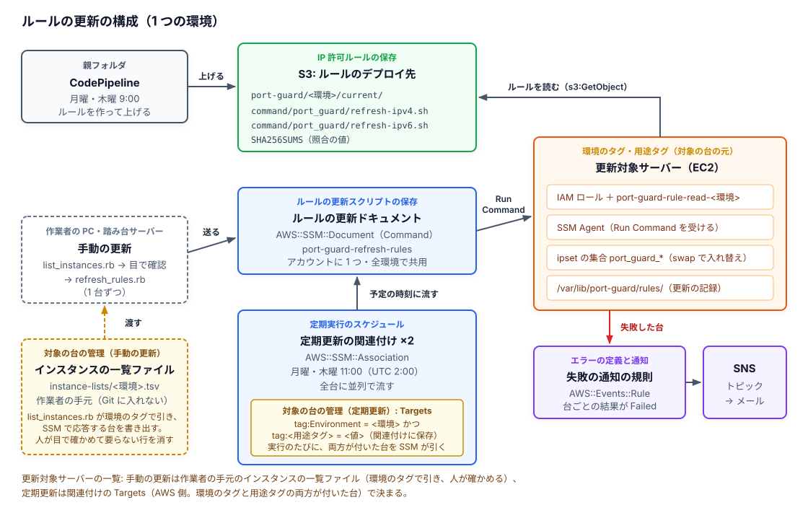
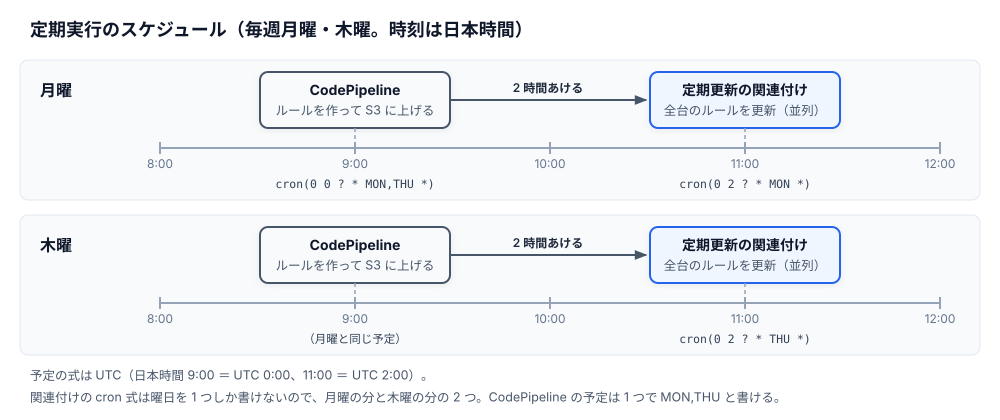
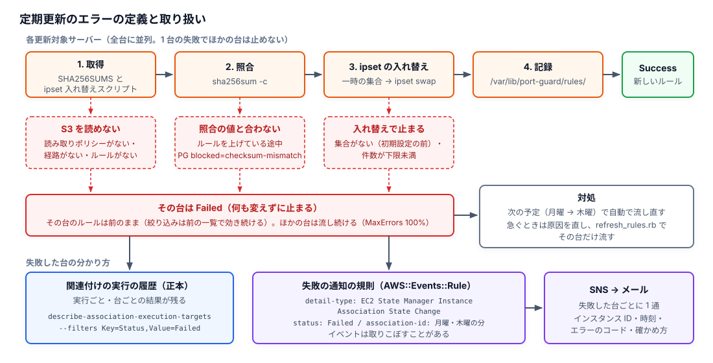

# rule-refresh-via-ssm — 各サーバーのルールを、ルールのデプロイ先の新しいルールに更新する（SSM）

> **ルールの更新**とは、port-guard（iptables ＋ ipset）を**入れ済み**の台で、ipset の集合の中身だけを、ルールのデプロイ先にある新しい一覧に入れ替えること。iptables のルールには触らない。port-guard を最初に入れる初期設定（`install`・`enable`。[手順](../../steps.md)）とは別のもので、初期設定が済んでいない台では何も変えずに失敗する。

[全体の流れの図](../list-refresh-flow.svg)の「**SSM ルール取得**」（ipset 対象サーバー → S3）と、その先の「**IP制限の有効化**」に当たる部分。SSM で、環境ごとの更新対象サーバーに、ルールのデプロイ先からの取得・照合・ipset の入れ替えを流す。流し方は 2 つある。

| 流し方 | 動かす人・きっかけ | 対象 | 流し方 |
|---|---|---|---|
| 手動の更新 | 作業者が `refresh_rules.rb` で流す（Run Command） | 環境のタグで引いた一覧を、人が目で確かめたもの | 1 台ずつ。1 台でも失敗したら残りは流さない |
| 定期更新 | 毎週月曜・木曜の日本時間 11:00 に無人で流れる（State Manager の関連付け） | 環境のタグと用途タグの両方が付いた台すべて | 全台に並列。失敗した台は通知し、実行の履歴に残す |

どちらも同じ**ルールの更新ドキュメント**（SSM のコマンドのドキュメント）を流す。

**インスタンスへの設定の手順は [instance-setup.md](instance-setup.md) にまとめている**（ドキュメント・ポリシー・タグ・ロール・手動での確かめ・定期更新の開始・運用）。定期更新の設計と、EventBridge Scheduler との比べは [scheduled-refresh-design.md](scheduled-refresh-design.md)。

状態（2026-11-19）: テンプレートとコマンドを用意した。`cfn-lint`・`ruby -c`・`bash -n`（ルールの更新ドキュメントの中のスクリプトを取り出して）の確認だけで、**AWS に対しては流していない**。

## 用語

[親フォルダの用語](../README.md#用語)（ルールのデプロイ先バケット・ルールのデプロイ先など）に加えて、次の名前を使う。

| 名前 | 指すもの |
|---|---|
| 更新対象サーバー | ルールを入れる EC2 のインスタンス。図の「ipset 対象サーバー」。port-guard（iptables ＋ ipset）を入れ済みで、SSM に登録されていて応答するもの |
| 環境のタグ | 更新対象サーバーがどの環境（`development`・`staging`・`production`）かを表すタグ。既定はキー `Environment`、値は環境の名前。手動の更新と定期更新の両方で使う |
| 用途タグ | 定期更新に入れる台だけに付けるタグ。定期更新は、環境のタグと用途タグの**両方**が付いた台だけに流す。実際のキーと値は決まっていない（スタックのパラメータ `PurposeTagKey`・`PurposeTagValue`。仮の既定は `PortGuardScheduledRefresh` = `true`） |
| ルールの更新ドキュメント | ルールの更新スクリプトを中身にした、自分で作る SSM のコマンドのドキュメント `port-guard-refresh-rules`（[cloudformation/rule-refresh-document.yml](cloudformation/rule-refresh-document.yml)。アカウントに 1 つ）。**ルールの更新スクリプトの正本**。ルールのデプロイ先・リージョン・IPv6 も流すかをパラメータで受け取る |
| ルールの更新スクリプト | ルールの更新ドキュメントの中のシェルスクリプト（更新対象サーバーで root で流れる）。ルールのデプロイ先から照合の値（`SHA256SUMS`）と ipset 入れ替えスクリプトを取り、照合してから ipset 入れ替えスクリプトを流す |
| ルールの読み取りポリシー | 更新対象サーバーの IAM ロールに付ける管理ポリシー `ip-port-guard-rules-read-<環境>`（名前は、ルールのデプロイ先バケットの名前の先頭部分 `RuleDeployBucketNamePrefix` に `-read-<環境>` を付けたもの）。その環境のルールのデプロイ先の `s3:GetObject` だけを許す（[cloudformation/rule-read-policy.yml](cloudformation/rule-read-policy.yml)） |
| インスタンスの一覧ファイル | 手動の更新で使う、更新対象サーバーを 1 行 1 台で書いた TSV（`instance-lists/<環境>.tsv`）。列は「インスタンス ID・パブリック IP・Name タグ」 |
| 定期更新の関連付け | 定期更新を行う State Manager の関連付け。環境ごとに 2 つ（`port-guard-refresh-rules-<環境>-mon`・`-thu`）（[cloudformation/scheduled-refresh.yml](cloudformation/scheduled-refresh.yml)） |
| 失敗の通知の規則 | 定期更新で失敗した台を、SNS のトピックへ台ごとに知らせる EventBridge の規則 |
| 更新の記録フォルダ | 更新対象サーバーの `/var/lib/port-guard/rules/`。最後に流した ipset 入れ替えスクリプトの写しと、流した日時（`last-refreshed`）を残す |

## システムの構成



| 置くもの | どこに | AWS のリソース | 作り方 |
|---|---|---|---|
| IP 許可ルール（ipset 入れ替えスクリプトと照合の値） | S3 のルールのデプロイ先 `port-guard/<環境>/current/` | S3 のバケット（親フォルダのルールのデプロイ先バケット） | 親フォルダの `deploy-rules.sh`（手動か CodePipeline。月曜・木曜 9:00） |
| ルールの更新スクリプト | ルールの更新ドキュメント `port-guard-refresh-rules`（アカウントに 1 つ） | `AWS::SSM::Document`（`DocumentType: Command`） | [cloudformation/rule-refresh-document.yml](cloudformation/rule-refresh-document.yml) |
| 定期実行のスケジュール | 定期更新の関連付け `port-guard-refresh-rules-<環境>-mon`・`-thu`（環境ごとに 2 つ） | `AWS::SSM::Association` | [cloudformation/scheduled-refresh.yml](cloudformation/scheduled-refresh.yml) |
| 定期実行時のエラーの定義と通知 | 失敗の通知の規則 `port-guard-refresh-rules-<環境>-failed`（環境ごと） | `AWS::Events::Rule`（送り先は既存の SNS のトピック） | 同上（`NotificationTopicArn` を渡したときだけ） |
| S3 を読む権限 | 更新対象サーバーの IAM ロール | `AWS::IAM::ManagedPolicy` `ip-port-guard-rules-read-<環境>` | [cloudformation/rule-read-policy.yml](cloudformation/rule-read-policy.yml) |
| 更新対象サーバーの一覧（手動の更新） | 作業者の手元のインスタンスの一覧ファイル `instance-lists/<環境>.tsv`（Git に入れない） | なし（ファイル） | `list_instances.rb` が環境のタグで引き、SSM で応答する台を書き出す。人が目で確かめて要らない行を消す |
| 更新対象サーバーの一覧（定期更新） | 定期更新の関連付けの `Targets`（`tag:Environment = <環境>` と `tag:<用途タグ> = <値>` の**両方が付いた台**）。一覧は持たず、実行のたびに SSM が引く | `AWS::SSM::Association` の `Targets` | [cloudformation/scheduled-refresh.yml](cloudformation/scheduled-refresh.yml)（パラメータ `TagKey`・`TagValue`・`PurposeTagKey`・`PurposeTagValue`） |

どちらの一覧も、元は EC2 の**タグ**。手動の更新は環境のタグだけで引き（人が一覧を確かめる）、定期更新は環境のタグと用途タグの両方で決まる。定期更新に台を足す・外すときは、その台の用途タグを付ける・外す（次の予定からそのまま効く）。

ルールのデプロイ先にルールを上げるところ（`build-rules.sh`・`deploy-rules.sh`。手動か CodePipeline）は [親フォルダ](../README.md) で行う。このフォルダは、上がったルールを各サーバーに入れるところだけを受け持つ。

### 定期実行のスケジュール



毎週月曜・木曜の日本時間 9:00 に CodePipeline がルールを上げ、2 時間後の 11:00 に定期更新の関連付けが全台のルールを更新する。予定の式は UTC で書く。関連付けの cron 式は曜日を 1 つしか書けないので、月曜の分と木曜の分の 2 つにしている（[設計](scheduled-refresh-design.md#月曜と木曜で関連付けを-2-つにする理由)）。

### 定期実行時のエラーの定義と取り扱い



| エラー（その台が `Failed` になるもの） | 段階 | 出力に出るもの | 主な原因 |
|---|---|---|---|
| S3 を読めない | 取得 | `aws s3 cp` のエラー（`403` など） | ルールの読み取りポリシーが付いていない、S3 に届く経路がない、ルールのデプロイ先にルールがない |
| 照合の値と合わない | 照合 | `PG blocked=checksum-mismatch` | ルールを上げている途中に取った |
| 入れ替えで止まる | ipset の入れ替え | ipset 入れ替えスクリプトのエラー | port-guard の初期設定の前（集合がない）、一覧の件数が下限未満 |
| AWS CLI がない | 取得の前 | `PG blocked=aws-cli-not-found` | 台に AWS CLI が入っていない |

| 取り扱い | 内容 |
|---|---|
| その台 | 何も変えずに止まる。ルールは前のままで、絞り込みは前の一覧で効き続ける |
| ほかの台 | 止めずに流し続ける（`MaxErrors: 100%`） |
| 記録（正本） | 関連付けの実行の履歴に、実行ごと・台ごとの結果が残る |
| 通知 | 失敗の通知の規則（`AWS::Events::Rule`）が、`EC2 State Manager Instance Association State Change` の `status: Failed` を拾い、SNS のトピックへ台ごとに 1 通送る（取りこぼすことがある） |
| 対処 | 次の予定で自動で流し直す。急ぐときは原因を直し、`refresh_rules.rb` でその台だけ流す（[instance-setup.md の運用](instance-setup.md#失敗した台を確かめる)） |

## 設定のステップ

各ステップのコマンドは [instance-setup.md](instance-setup.md) にある。

## IAM ロールと付けるポリシー

| ロール | 使う人・仕組み | 付けるポリシー | 種類 | 作り方・付け方 |
|---|---|---|---|---|
| 更新対象サーバーの IAM ロール（既存。インスタンスプロファイルのロール） | 各サーバー（SSM Agent と、ルールの更新スクリプトの `aws s3 cp`） | `AmazonSSMManagedInstanceCore` | AWS 管理ポリシー | 既に付いている前提（`docs/ec2/ssm-setup` で用意する。SSM で応答するのに要る） |
| 〃 | 〃 | `ip-port-guard-rules-read-<環境>`（その環境のルールのデプロイ先の `s3:GetObject` だけ） | カスタマー管理ポリシー | [rule-read-policy.yml](cloudformation/rule-read-policy.yml) で作り、`aws iam attach-role-policy` で付ける（[instance-setup.md の 5](instance-setup.md#5-iam-ロールにルールの読み取りポリシーを付けるロールごと)） |
| 関連付けのロール `port-guard-refresh-rules-dispatch-<環境>` | State Manager（定期更新の関連付けがコマンドを送るとき） | `send-rule-refresh-document`（ルールの更新ドキュメントを EC2 のインスタンスに送る `ssm:SendCommand` だけ） | インラインポリシー（管理ポリシーは付けない） | [scheduled-refresh.yml](cloudformation/scheduled-refresh.yml) がロールごと作る |
| 失敗の通知の規則の実行ロール（名前はスタックが付ける） | EventBridge（失敗の通知の規則が SNS へ送るとき） | `publish-failures`（そのトピックへの `sns:Publish` だけ） | インラインポリシー | 同上（`NotificationTopicArn` を渡したときだけ）。トピックが KMS で暗号化されているなら、そのキーの権限を足す（要る操作は SNS のドキュメントで確かめる。今は入れていない） |

作業者（人・踏み台サーバー）の IAM ユーザー・ロールに付ける管理ポリシーは用意していない。要る権限は次のとおり（AWS のドキュメントで 1 つずつは確かめていない。足りなければ、エラーに出る操作を足す）。

| 作業 | 要る権限 |
|---|---|
| `list_instances.rb` | `ec2:DescribeInstances`、`ssm:DescribeInstanceInformation`。サーバーリストと照合するとき（`--hosted-zone-id`）は、加えて `route53:ListResourceRecordSets` |
| `refresh_rules.rb` | `sts:GetCallerIdentity`、`ssm:SendCommand`（ルールの更新ドキュメントと対象のインスタンス）、`ssm:ListCommands`、`ssm:ListCommandInvocations`、`ssm:GetCommandInvocation` |
| IAM ロールへのポリシーの付与（[instance-setup.md の 5](instance-setup.md#5-iam-ロールにルールの読み取りポリシーを付けるロールごと)） | `ec2:DescribeInstances`、`iam:GetInstanceProfile`、`iam:AttachRolePolicy` |
| スタックの作成・更新（[instance-setup.md の 1・2・7](instance-setup.md)） | CloudFormation のスタックの操作に加えて、スタックが作るもの（SSM のドキュメント・関連付け、IAM のポリシー・ロール、EventBridge の規則）を作る権限と、ロールを渡す `iam:PassRole` |
| 実行の履歴の確認（[instance-setup.md の 8](instance-setup.md#8-最初の予定のあとで確かめる環境ごとに-1-回)） | `ssm:ListAssociations`、`ssm:DescribeAssociationExecutions`、`ssm:DescribeAssociationExecutionTargets` |


## 手動の更新のコマンド

手順の中での使い方は [instance-setup.md の 6](instance-setup.md#6-手動で-1-回流して確かめる環境ごと)。

| コマンド | すること |
|---|---|
| `ruby rb/list_instances.rb --env <環境> [--tag-key KEY] [--tag-value VALUE] [--out FILE] [--overwrite] [--hosted-zone-id ID ...] [--server-list FILE] [--type-tag-key KEY] [--server-list-host-column NAME] [--server-list-type-column NAME]` | 環境のタグが合い、動いていて SSM で応答する台を、インスタンスの一覧ファイルに書き出す（読み取りだけ）。SSM で応答しない台は、外した理由とともに表示する。同じ名前のファイルがあれば上書きしない。`--hosted-zone-id`・`--server-list` を付けると、Route 53 の名前と DB のサーバーリストと照合し、差分を警告として表示する（[サーバーリストとの照合](#サーバーリストとの照合)） |
| `ruby rb/refresh_rules.rb --env <環境> [--list FILE] [--ipv6] [--s3-uri URI] [--document-name NAME]` | インスタンスの一覧ファイルの台に、ルールの更新ドキュメントを Run Command で流す。対象・取得元・ドキュメントを表示し、`y` を受けてから送る。1 台ずつ流し、1 台でも失敗したら残りは流さない。全台が `Success` なら終了コード 0 |

どちらも `--profile`・`--region` を受け付ける。取得元（ルールのデプロイ先）は `s3://ip-port-guard-rules-<アカウント ID>-<リージョン>-an/port-guard/<環境>/current`（親フォルダの `command/set-s3-uri.sh` と同じ組み立て方）。

インスタンスの一覧ファイルの例（タブ区切り。パブリック IP や Name タグがない台は `-`）:

```text
# 環境: staging（タグ Environment=staging）。2026-11-18 10:00:00 に list_instances.rb が作成
# instance_id	public_ip	name
i-0123456789abcdef0	203.0.113.10	web-staging-1
i-0fedcba9876543210	-	web-staging-2
```

## サーバーリストとの照合

`list_instances.rb` に `--hosted-zone-id`（と `--server-list`）を付けると、一覧を作るときに、EC2・Route 53・DB のサーバーリストを突き合わせ、合わないところを**警告**として表示する。**一覧に入れる台は変えない**（環境のタグが合い、SSM で応答する台。2026-11-19 に決めた）。警告は、画面に出すのに加えて、インスタンスの一覧ファイルに `# 警告:` の行で書き込む（`refresh_rules.rb` は `#` の行を読まないので、流すときの邪魔にならず、人が一覧を確かめるときに目に入る）。

```text
EC2（環境のタグが合う台: インスタンス ID・パブリック IP・分類のタグ）
  └ パブリック IP（Elastic IP）で突き合わせる → Route 53（A レコード: IP → 名前）
                                                  └ 名前で突き合わせる → DB のサーバーリスト（ホスト名・サーバータイプ）
                                                                          └ 分類のタグの値 ＝ サーバータイプ か
```

| オプション | 中身 | 既定 |
|---|---|---|
| `--hosted-zone-id ID` | 名前を引く Route 53 のホストゾーン。何度でも指定できる。付けると、一覧ファイルに `dns_name` の列が増える | なし（付けなければ照合しない） |
| `--server-list FILE` | DB から書き出したサーバーリスト（TSV）。`--hosted-zone-id` と一緒に使う（Route 53 の名前を通して突き合わせるため） | なし |
| `--type-tag-key KEY` | EC2 の分類のタグのキー。付けなければ、分類の照合だけをしない | `list_instances.rb` の先頭の定数 `TYPE_TAG_KEY`（今は未確定なので空。決まったらそこに書く） |
| `--server-list-host-column NAME` | サーバーリストのホスト名の列（見出しの名前） | `host`（先頭の定数） |
| `--server-list-type-column NAME` | サーバーリストのサーバータイプの列（見出しの名前） | `type`（先頭の定数） |

サーバーリスト（TSV）の想定する形（**実際の形は未確定**。列の名前はオプションで合わせる。見出しの行が 1 行目に要る。`#` で始まる行と空の行は読まない）。見本は [samples/server-list-staging.tsv](samples/server-list-staging.tsv):

```text
host	type	memo
web-staging-1.example.com	web	ほかの列があってもよい
web-staging-2	web
batch-staging-1.example.com	batch
```

- 1 つの環境の台だけを書き出したものを渡す（ほかの環境の台が入っていると、「EC2 にない」の警告がその分だけ出る）
- ホスト名は FQDN（`web-staging-1.example.com`）でも短い名前（`web-staging-2`）でもよい。大文字・小文字と末尾の `.` は区別しない。**短い名前は、Route 53 の名前の最初のラベル（最初の `.` より前）と突き合わせる**

Route 53 の例（A レコード。エイリアスのレコードは読まない）:

```text
web-staging-1.example.com.   A   203.0.113.10   ← EC2 のパブリック IP（Elastic IP）と同じ値
```

出る警告:

| 警告 | 意味 | 例 |
|---|---|---|
| `パブリック IP がない` | Route 53 と突き合わせられない | Elastic IP を付けていない台 |
| `Route 53 に名前がない` | その IP を指す A レコードがない | 名前を付け忘れた、IP が変わった |
| `Route 53 の名前が複数ある` | 1 つの IP を指す A レコードが 2 つ以上 | 古いレコードが残っている（DB との突き合わせはすべての名前で行う） |
| `DB のサーバーリストにない` | Route 53 の名前が、サーバーリストのどのホスト名とも合わない | DB に登録されていない台 |
| `分類が違う` | 分類のタグの値と、サーバーリストのサーバータイプが違う | タグは `web`、DB は `batch` |
| `分類のタグがない` | `--type-tag-key` を指定したが、台にそのタグがない | タグの付け忘れ |
| `EC2（環境のタグ）にない` | サーバーリストのホスト名が、環境のタグが合う台のどれとも合わない | 止めた・消した台が DB に残っている、環境のタグが違う、Route 53 の名前がない |
| `サーバーリストに同じホスト名が 2 回ある` | サーバーリストの重複 | 書き出しの誤り |

警告が出ても、終了コードは 0（書き出した）のまま。照合が効くのは、手動の更新で一覧を作るときだけ。定期更新（State Manager の関連付け）は用途タグだけで対象を決めるので、サーバーリストとは突き合わせない。

## 決めたこと

| # | 決めたこと | 理由 |
|---|---|---|
| A1 | 取得・照合・ipset の入れ替えまでを 1 回で行う | 取得と入れ替えを分けると、取得だけ済んだ台が残る |
| A2 | 更新対象サーバーは、ルールのデプロイ先を**自分の IAM ロールの権限**で読む（ルールの読み取りポリシーを付ける） | ルールのデプロイ先バケットはパブリックアクセスをすべてブロックしている（[D9](../design-decisions.md#1-決めたこと)）。定期更新にもそのまま使える。暫定対応のフェーズ 1（`docs/ec2/ssm-setup`）の「既存のロールに権限を足さない」とは違う扱いになる |
| A3 | 手動の更新では、環境のタグで引いた一覧を人が目で確かめてから流す | 引いた結果をそのまま流さず、間に人の確認を挟む |
| A4 | インスタンスの一覧ファイルの列は、インスタンス ID・パブリック IP・Name タグ | 人が見て台を見分けられるようにする |
| A5 | AWS の操作は、gem を使わず、AWS CLI のコマンドを呼ぶ Ruby で書く（Ruby 2.6 以上・標準のライブラリだけ） | 作業者の PC と踏み台サーバーに gem を入れなくて済む |
| A6 | このフォルダの中で完結させる（`docs/ec2/ssm-setup` の部品は使わず、要るものは写す） | 親フォルダ（ip-port-guard-rule-refresh-pipeline）と同じく、このフォルダだけを写して運用できるようにする |
| A7 | ルールの更新スクリプトの正本は、ルールの更新ドキュメント（CloudFormation のテンプレート）だけにする。手動の更新も定期更新も、このドキュメントを流す（2026-11-19） | スクリプトが 1 か所になり、手動で確かめたものと同じものが定期更新で流れる |
| A8 | 定期更新は毎週月曜・木曜の日本時間 11:00（ルールのデプロイ先へのデプロイ 9:00 の 2 時間後）。全台に並列で流し、失敗した台は通知と実行の履歴で後から分かればよい（2026-11-18） | [設計](scheduled-refresh-design.md) |
| A9 | 呼び名は「ルールの更新」（refresh）。「適用」（apply）は使わない（2026-11-19。フォルダ・コマンド・ドキュメント・関連付け・スタックの名前も変えた） | 「適用」は、port-guard を最初に入れる初期設定（`install`・`enable`）と取り違えやすい。この仕組みは、入れ済みの台の ipset の集合の中身を入れ替えるだけ。親フォルダ（rule-refresh-pipeline）や ipset 入れ替えスクリプト（`refresh-ipv4.sh`）とも言葉がそろう |
| A10 | 一覧を作るときに、EC2・Route 53（パブリック IP → 名前）・DB のサーバーリストを突き合わせ、合わないところは警告だけにする。一覧に入れる台は変えない（2026-11-19） | DB の書き出しが古いときなどに、台が黙って一覧から落ちないようにする。差分は人が一覧を確かめるときに見る |

## 決まっていないこと

| 項目 | 内容 |
|---|---|
| 環境のタグ | 実際のキーと値（既定の `Environment=<環境>` で合っているか） |
| 用途タグ | 定期更新に使う用途タグの実際のキーと値（仮の既定は `PortGuardScheduledRefresh` = `true`） |
| IPv6 | IPv6 も絞る台があるか（あれば手動は `--ipv6`、定期更新は `IncludeIpv6=1`） |
| どの環境で定期更新するか | 3 環境すべてか、`production` だけか |
| 通知に使うトピック | 親フォルダと同じトピックでよいか。KMS で暗号化されているか |
| 分類のタグ | EC2 の分類のタグのキー（決まったら `list_instances.rb` の先頭の定数 `TYPE_TAG_KEY` に書く）。値が DB のサーバータイプと同じ文字列か |
| DB のサーバーリストの形 | 列の名前（ホスト名・サーバータイプ）、見出しの行、ホスト名が FQDN か短い名前か、1 つの環境の台だけを書き出せるか |
| 50 台を超える環境（手動の更新） | Run Command に 1 回で渡せるインスタンス ID は 50 まで。超えたら一覧ファイルを分けて流す |

## ファイル

| ファイル | 役割 |
|---|---|
| [instance-setup.md](instance-setup.md) | **インスタンスへの設定の手順**（1 つにまとめたもの） |
| [scheduled-refresh-design.md](scheduled-refresh-design.md) | 設計: ルールの定期更新（State Manager の関連付け。EventBridge Scheduler との比べ） |
| `cloudformation/rule-refresh-document.yml` | ルールの更新ドキュメント（アカウントに 1 つ。ルールの更新スクリプトの正本） |
| `cloudformation/rule-read-policy.yml` | ルールの読み取りポリシー（環境ごと） |
| `cloudformation/scheduled-refresh.yml` | 定期更新（環境ごと。定期更新の関連付け 2 つ、関連付けのロール、失敗の通知の規則） |
| `rb/list_instances.rb` | 手動の更新: 環境のタグで引き、インスタンスの一覧ファイルに書き出す（読み取りだけ）。Route 53・DB のサーバーリストとの照合（任意）。照合の既定値（分類のタグのキー、サーバーリストの列の名前）は先頭の定数 |
| `rb/refresh_rules.rb` | 手動の更新: インスタンスの一覧ファイルの台に、ルールの更新ドキュメントを Run Command で流す |
| `rb/lib/aws_cli.rb`・`rb/lib/cli.rb` | 汎用の部品（AWS CLI の呼び出し、オプション・確認・使い方の誤り）。`docs/ec2/ssm-setup/rb/lib/` から写した |
| `rb/lib/server_list_check.rb` | `list_instances.rb` の照合: EC2・Route 53・DB のサーバーリストを突き合わせ、警告の文を作る（AWS には触らない） |
| `instance-lists/` | インスタンスの一覧ファイルの既定の置き場所（Git には入れない） |
| `samples/server-list-staging.tsv` | `list_instances.rb --server-list` に渡す DB のサーバーリストの見本（想定の形。実際の書き出しの形は未確定） |
| `system-architecture.svg`・`refresh-schedule.svg`・`failure-handling.svg` | 図: システムの構成、定期実行のスケジュール、定期実行時のエラーの定義と取り扱い（手で書いた SVG） |
| `setup-steps.svg` | 図: 設定のステップ（[instance-setup.md](instance-setup.md) の流れ） |
| `iam-policies.svg` | 図: IAM ロールと付けるポリシー（引き受ける相手・ロール・ポリシー・許す対象） |
