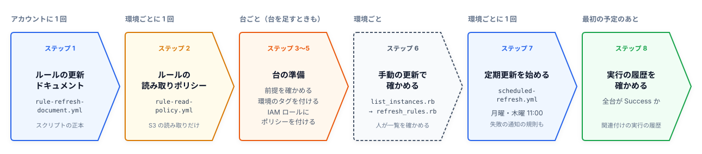
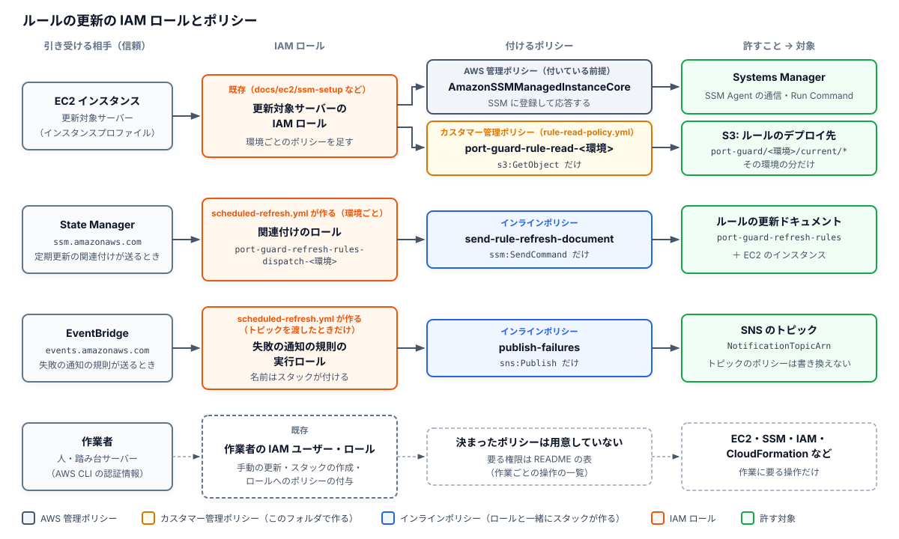

# インスタンスへの設定の手順（ルールの更新）

更新対象サーバーが、ルールのデプロイ先（S3）からルールを取得して ipset を入れ替えられるようにする手順を、1 つにまとめたもの。手動の更新（人が一覧を確かめて流す）と、定期更新（毎週月曜・木曜の日本時間 11:00 に無人で流す）の両方を扱う。

状態（2026-11-19）: テンプレートとコマンドは `cfn-lint`・`ruby -c`・`bash -n`（ルールの更新ドキュメントの中のスクリプトを取り出して）の確認だけで、**AWS に対しては流していない**。初めて流すときは、`development` か `staging` で、この手順のとおりに 1 環境ずつ確かめる。

用語は [README の用語](README.md#用語)と [定期更新の設計の用語](scheduled-refresh-design.md#用語)と同じ。コマンドは、断りがなければこのフォルダ（`rule-refresh-via-ssm/`）で、作業者の PC か踏み台サーバーから流す（AWS CLI の認証情報が要る。`--region`・`--profile` は省略している）。

## 全体の流れ



構成・スケジュール・エラーの扱いの図は [README のシステムの構成](README.md#システムの構成)。

| 順 | すること | いつ | 作るもの・使うもの |
|---|---|---|---|
| 1 | ルールの更新ドキュメントを作る | アカウント・リージョンに 1 回（中身を変えたときも） | [cloudformation/rule-refresh-document.yml](cloudformation/rule-refresh-document.yml) |
| 2 | ルールの読み取りポリシーを作る | 環境ごとに 1 回 | [cloudformation/rule-read-policy.yml](cloudformation/rule-read-policy.yml) |
| 3 | 前提を確かめる | 台ごと | — |
| 4 | 環境のタグと用途タグを付ける | 台ごと | `aws ec2 create-tags` |
| 5 | IAM ロールにルールの読み取りポリシーを付ける | ロールごと（同じロールの台はまとめて済む） | `aws iam attach-role-policy` |
| 6 | 手動で 1 回流して確かめる | 環境ごと（新しい台を足したときも） | [rb/list_instances.rb](rb/list_instances.rb)・[rb/refresh_rules.rb](rb/refresh_rules.rb) |
| 7 | 定期更新を始める | 環境ごとに 1 回 | [cloudformation/scheduled-refresh.yml](cloudformation/scheduled-refresh.yml) |
| 8 | 最初の予定のあとで確かめる | 環境ごとに 1 回 | `aws ssm describe-association-executions` など |

ルールのデプロイ先にルールが上がっていること（親フォルダの `deploy-rules.sh` か CodePipeline）が前提。上がっていなければ、6 の手動の更新は照合の値が取れずに失敗する。

## 1. ルールの更新ドキュメントを作る（アカウントに 1 回）

```bash
aws cloudformation deploy \
  --stack-name port-guard-rule-refresh-document \
  --template-file cloudformation/rule-refresh-document.yml
```

- ルールの更新スクリプトの正本は、このテンプレートの中（`Content` の `runCommand`）。手動の更新と定期更新は、どちらもこのドキュメントを流す
- 中身を変えたら、同じコマンドでスタックを更新する。新しい版ができて既定の版になる（`UpdateMethod: NewVersion`）
- **既定の版が変わると、定期更新の関連付けは予定を待たずにすぐ流れる**（AWS のドキュメントの記述）。中身を変えるのは、ルールのデプロイ先に正しいルールが上がっているときにする

## 2. ルールの読み取りポリシーを作る（環境ごとに 1 回）

```bash
aws cloudformation deploy \
  --stack-name port-guard-rule-read-staging \
  --template-file cloudformation/rule-read-policy.yml \
  --parameter-overrides EnvironmentName=staging \
  --capabilities CAPABILITY_NAMED_IAM
```

できるもの: 管理ポリシー `ip-port-guard-rules-read-staging`（`s3://ip-port-guard-rules-<アカウント ID>-<リージョン>-an/port-guard/staging/current/*` の `s3:GetObject` だけ）。

## 3. 前提を確かめる（台ごと）

| 前提 | 確かめ方 | 満たさないとき |
|---|---|---|
| port-guard（iptables ＋ ipset）を入れてある | `../../steps.md` か `../../bastion-install-commands.md` の手順で入れた台か。台の中で `sudo ipset list -t port_guard_jp` が通る | ipset 入れ替えスクリプトが、今の集合がないので何も変えずに失敗する |
| SSM に登録されていて応答する | `aws ssm describe-instance-information --filters Key=InstanceIds,Values=<インスタンス ID>` で `PingStatus` が `Online` | Run Command も定期更新も届かない（`docs/ec2/ssm-setup` の手順で直す） |
| インスタンスプロファイル（IAM ロール）が付いている | `aws ec2 describe-instances --instance-ids <ID> --query 'Reservations[].Instances[].IamInstanceProfile.Arn'` が空でない | 5 のポリシーを付けられず、ルールの取得が権限の不足で失敗する |
| S3 に届く経路がある | インターネットゲートウェイ・NAT ゲートウェイ・S3 のゲートウェイエンドポイントのどれかがある | ルールの取得が失敗する |
| AWS CLI がある | 台の中で `aws --version`（Amazon Linux 2 には最初から入っている） | ルールの更新ドキュメントが「AWS CLI がない」で止まる |

## 4. 環境のタグと用途タグを付ける（台ごと）

```bash
# 環境のタグ（手動の更新と定期更新の両方で使う）
aws ec2 create-tags --resources i-0123456789abcdef0 --tags Key=Environment,Value=staging
# 用途タグ（定期更新に入れる台だけ。実際のキーと値は決まっていない。下は仮の既定）
aws ec2 create-tags --resources i-0123456789abcdef0 --tags Key=PortGuardScheduledRefresh,Value=true
```

| タグ | 使うところ | 既定 | 変えるとき |
|---|---|---|---|
| 環境のタグ | 手動の更新（`list_instances.rb`）と定期更新 | キー `Environment`、値は環境の名前 | 6 の `list_instances.rb` に `--tag-key`・`--tag-value`、7 のスタックに `TagKey`・`TagValue` を渡す（両方をそろえる） |
| 用途タグ | 定期更新だけ | キー `PortGuardScheduledRefresh`、値 `true`（仮） | 7 のスタックに `PurposeTagKey`・`PurposeTagValue` を渡す |

- **定期更新は、環境のタグと用途タグの両方が付いた台すべてに流れる**（人の確認を挟まない。関連付けの `Targets` に複数のタグのキーを書くと、すべてが付いた台だけが対象になる。AWS のドキュメントの記述）。port-guard を入れていない台や、別の環境の台に用途タグを付けない
- 用途タグを付けない台は、定期更新に入らない（手動の更新だけで更新する）

## 5. IAM ロールにルールの読み取りポリシーを付ける（ロールごと）



このステップで付けるのは、図のいちばん上の「更新対象サーバーの IAM ロール」の `ip-port-guard-rules-read-<環境>`。ほかのロール（関連付けのロール・失敗の通知の規則の実行ロール）は、7 のスタックが作る。

```bash
# 台の IAM ロールの名前を調べる（インスタンスプロファイル → ロール）
aws ec2 describe-instances --instance-ids i-0123456789abcdef0 \
  --query 'Reservations[].Instances[].IamInstanceProfile.Arn' --output text
aws iam get-instance-profile --instance-profile-name <インスタンスプロファイルの名前> \
  --query 'InstanceProfile.Roles[].RoleName' --output text

# ポリシーを付ける
aws iam attach-role-policy --role-name <ロールの名前> \
  --policy-arn arn:aws:iam::<アカウント ID>:policy/ip-port-guard-rules-read-staging
```

- 既存のロールに権限を足すことになる（暫定対応のフェーズ 1 `docs/ec2/ssm-setup` の「既存のロールに権限を足さない」とは違う扱い。[README の決めたこと A2](README.md#決めたこと)）
- 同じロールを別の環境の台でも使っているなら、その環境のポリシーも付ける

## 6. 手動で 1 回流して確かめる（環境ごと）

定期更新を始める前に、同じルールの更新ドキュメントを人が見ながら流し、全台で通ることを確かめる。

```bash
# 環境のタグで引き、SSM で応答する台をインスタンスの一覧ファイルに書き出す
ruby rb/list_instances.rb --env staging
# instance-lists/staging.tsv を目で確かめ、要らない行を消す（外した台の表示も見る）
# Route 53 の名前と DB のサーバーリストとも照合するなら（差分は警告で出る。一覧に入る台は変わらない）:
#   ruby rb/list_instances.rb --env staging --hosted-zone-id Z0123456789ABC --server-list db-servers-staging.tsv --overwrite

# 流す（対象と取得元を表示し、y を受けてから送る。1 台ずつ、1 台でも失敗したら残りは流さない）
ruby rb/refresh_rules.rb --env staging
# IPv6 も絞っている環境なら --ipv6
```

結果の見方: 台ごとに `== <インスタンス ID>: Success` と、ルールの更新ドキュメントの出力が出る。出力の最後が `PG result=refreshed` なら入った。失敗したときは、出力の `PG blocked=...` の理由を見る。

| 出力 | 理由 | 直し方 |
|---|---|---|
| `fatal error: An error occurred (403)` など S3 の取得の失敗 | ルールの読み取りポリシーが付いていない、S3 に届かない、ルールのデプロイ先にルールがない | 5・3 を見直す。ルールのデプロイ先に上がっているかを確かめる |
| `PG blocked=checksum-mismatch` | ルールを上げている途中に取った | 上げ終わってから流し直す |
| `PG blocked=aws-cli-not-found` | 台に AWS CLI がない | AWS CLI を入れる |
| ipset 入れ替えスクリプトの `ipset list -t port_guard_...` の失敗 | port-guard を入れていない | port-guard を入れる（3） |
| `... 件未満なので止める` | ルールの一覧が少なすぎる | ルールを作り直す（親フォルダ） |

## 7. 定期更新を始める（環境ごとに 1 回）

```bash
aws cloudformation deploy \
  --stack-name port-guard-scheduled-refresh-staging \
  --template-file cloudformation/scheduled-refresh.yml \
  --capabilities CAPABILITY_NAMED_IAM \
  --parameter-overrides EnvironmentName=staging \
    NotificationTopicArn=arn:aws:sns:<リージョン>:<アカウント ID>:<トピックの名前>
# IPv6 も絞っている環境なら IncludeIpv6=1。タグを既定から変えたなら TagKey=... TagValue=...
```

できるもの:

| もの | 名前 | 中身 |
|---|---|---|
| 定期更新の関連付け（月曜の分） | `port-guard-refresh-rules-staging-mon` | `cron(0 2 ? * MON *)`（月曜の日本時間 11:00）。環境のタグと用途タグの両方が付いた台に、ルールの更新ドキュメントを並列で流す。失敗した台があっても残りの台に流し続ける |
| 定期更新の関連付け（木曜の分） | `port-guard-refresh-rules-staging-thu` | `cron(0 2 ? * THU *)`（木曜の日本時間 11:00）。ほかは月曜の分と同じ |
| 関連付けのロール | `port-guard-refresh-rules-dispatch-staging` | ルールの更新ドキュメントを EC2 のインスタンスに送る（`ssm:SendCommand`）だけ |
| 失敗の通知の規則 | `port-guard-refresh-rules-staging-failed` | 台ごとの結果が `Failed` になったら、トピックへ台ごとに 1 通送る（`NotificationTopicArn` が空なら作らない） |

- 作った直後には流れない（`ApplyOnlyAtCronInterval: true`）。最初に流れるのは、次の月曜か木曜の 11:00
- ルールのデプロイ先へのデプロイ（親フォルダの CodePipeline）は月曜・木曜の日本時間 9:00。定期実行は承認を飛ばすので、そのまま 11:00 に取得される（Web コンソールから人が開始した回だけ承認で止まる）
- 失敗の通知は、トピックのポリシーを書き換えず、規則の実行ロール（そのトピックへの `sns:Publish` だけ）で送る。トピックが KMS で暗号化されているなら、実行ロールにそのキーの権限を足す（テンプレートには入れていない）

## 8. 最初の予定のあとで確かめる（環境ごとに 1 回）

```bash
# 関連付けの ID（スタックの出力 MondayAssociationId・ThursdayAssociationId でもよい）
aws ssm list-associations --association-filter-list key=AssociationName,value=port-guard-refresh-rules-staging-mon

# 実行の一覧（新しい順）と、ある実行の台ごとの結果
aws ssm describe-association-executions --association-id <関連付けの ID>
aws ssm describe-association-execution-targets --association-id <関連付けの ID> --execution-id <実行の ID>
```

全台が `Success` なら終わり。台の中では、`/var/lib/port-guard/rules/last-refreshed` に流した日時と取得元が残る。

## 運用

### 失敗した台を確かめる

失敗した台は、メール（失敗の通知の規則）で知る。メールは取りこぼすことがあるので、**正本は関連付けの実行の履歴**。

```bash
aws ssm describe-association-executions --association-id <関連付けの ID>
aws ssm describe-association-execution-targets --association-id <関連付けの ID> --execution-id <実行の ID> \
  --filters Key=Status,Value=Failed
```

失敗した台は、その台だけルールが前のままになる（絞り込みは前の一覧で効き続ける）。次の予定（月曜の失敗なら木曜）で同じルールがもう一度流れる。急ぐときは、原因を直してから、その台だけを書いたインスタンスの一覧ファイルで `refresh_rules.rb` を流す。

### 台を足す

3〜5 を行う（タグ・ロールのポリシー）。用途タグも付けた台は、次の予定から定期更新に入る。すぐに入れたいなら、その台だけで 6 を流す。

### 定期更新を止める・やめる

| したいこと | すること |
|---|---|
| しばらく止める | 用途タグを外す（その台だけ。手動の更新はそのまま使える）か、スタックを消す（環境ごと） |
| やめる | `aws cloudformation delete-stack --stack-name port-guard-scheduled-refresh-staging`。関連付け・ロール・通知の規則が消える。台の ipset は最後に入れたルールのまま残る |
| 予定を変える | スタックのパラメータ `MondaySchedule`・`ThursdaySchedule`（UTC。関連付けの cron 式は曜日を 1 つしか書けない）を変えて更新する。**関連付けを変えると、すぐに 1 回流れる**（AWS のドキュメントの記述） |

### ルールの更新スクリプトを変える

1 のテンプレートを直してスタックを更新する。既定の版が変わり、定期更新の関連付けはすぐに流れる。先に `development` で手動の更新（6）で確かめてから、ほかの環境の台に広げる（ドキュメントはアカウントに 1 つなので、更新するとすべての環境の関連付けが流れる点に気を付ける）。

## 参考

AWS のドキュメントと照らし合わせた（2026-11-19）:

- [AWS::SSM::Document](https://docs.aws.amazon.com/AWSCloudFormation/latest/TemplateReference/aws-resource-ssm-document.html): `UpdateMethod`（`NewVersion` で新しい版を作り、既定の版にする）、`Name` の変更は置き換え
- [State Manager の仕組み](https://docs.aws.amazon.com/systems-manager/latest/userguide/state-manager-about.html): 関連付けのロール（`ssm.amazonaws.com` を信頼し、`ssm:SendCommand` を持つ）、関連付けが予定のほかに流れる場合（関連付けの変更、ドキュメントの既定の版の変更、台が初めてオンラインになったとき）と `ApplyOnlyAtCronInterval`
- [AWS::SSM::Association](https://docs.aws.amazon.com/AWSCloudFormation/latest/TemplateReference/aws-resource-ssm-association.html)、[cron 式・rate 式](https://docs.aws.amazon.com/systems-manager/latest/userguide/reference-cron-and-rate-expressions.html)、[EventBridge のイベント](https://docs.aws.amazon.com/systems-manager/latest/userguide/reference-eventbridge-events.html)、[EventBridge の SNS の送り先の権限](https://docs.aws.amazon.com/eventbridge/latest/userguide/eb-use-resource-based.html)（[設計](scheduled-refresh-design.md#参考)と同じ）
