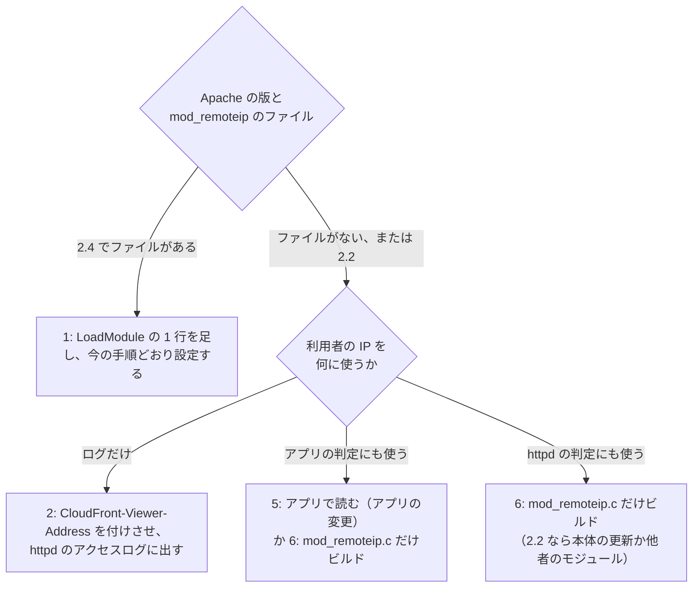

# 利用者の IP の復元

> 位置付け: 参考。B. CloudFront → EC2 への移行で、稼働サーバーの httpd とアプリから見た送り元を、CloudFront の IP ではなく利用者の IP にする方法の検討。今の手順は `mod_remoteip` を準備で入れる形（[準備の 3](./step0-preparation.md#3-稼働サーバーの-httpd-の設定)、設定は [cloudfront-to-ec2-httpd.md の 4](./cloudfront-to-ec2-httpd.md#4-利用者の-ip-を復元する)）。ここには、なぜ要るか、いつ入れるか、`mod_remoteip` を使えない古い Apache のときの軽い選択肢をまとめる。手順の全体は [README](./README.md#ステップの流れ)。
>
> 確かめた範囲: Apache と CloudFront の仕様は、それぞれの公式のドキュメントと照らし合わせた（2026-11-18）。`mod_remoteip` と `RequestHeader unset` の動きは、今の構成に近いコンテナで確かめた（2026-11-10）。**稼働サーバーの Apache の版と、モジュールがあるかは確かめていない**。
>
> 作成日: 2026-11-18

## 用語

[README の用語](./README.md#用語)に加えて、次の名前で書き分ける。

| 用語 | 指すもの |
|---|---|
| 利用者の IP | 利用者の端末（またはその手前の proxy）が CloudFront に接続したときの送り元の IP |
| 接続の相手の IP | httpd が受けた TCP の接続の相手の IP。CloudFront を通すと CloudFront の IP になる。httpd の `REMOTE_ADDR` |
| 利用者の IP の復元 | 接続の相手の IP を、ヘッダーに入っている利用者の IP に置き換えること（`mod_remoteip` が行う） |
| `X-Forwarded-For` | 送り元の IP を並べるヘッダー。CloudFront は末尾に利用者の IP を足す。利用者が自分で付けて送ることもできる |
| `CloudFront-Viewer-Address` | CloudFront が付けるヘッダー。利用者の IP と送り元のポートが入る（例 `198.51.100.10:46532`） |
| httpd のアクセスログ | 稼働サーバーの httpd の `access.log` |
| WAF のログ | WAF の web ACL の要求の記録。既定では残さない（[README の T10](./README.md#決めたこと)） |
| httpd の判定 | httpd の設定で IP を使って許可・拒否すること（`Require ip`、`RewriteCond %{REMOTE_ADDR}` など） |
| アプリの判定 | アプリが IP を使って許可・制限・記録すること（Rails の `request.remote_ip`、`request.ip`） |

## なぜ要るか

CloudFront を通すと、httpd が受ける接続の相手はすべて CloudFront になる。利用者の IP は `X-Forwarded-For`（と、付けさせれば `CloudFront-Viewer-Address`）にしか残らない。何もしないと、次が CloudFront の IP になる。

| 影響を受けるもの | 何もしないとき |
|---|---|
| httpd のアクセスログ | 送り元がすべて CloudFront の IP になる。不審なアクセスの調査や、利用者の数え上げができない |
| httpd の判定 | CloudFront の IP で判定される。許可した IP の利用者も止まるか、CloudFront の範囲を許可すると全員が通る |
| アプリの判定 | Rails の `request.remote_ip` が、CloudFront の IP か、利用者が偽って付けた `X-Forwarded-For` の値になる見込み。Rails のログの送り元、IP での許可、回数の制限、アクセスの記録に影響する |

**今の構成では、利用者の IP が残る場所は httpd のアクセスログだけ**（WAF のログは既定で残さず、CloudFront のアクセスログも設定していない）。何もしないと、利用者の IP がどこにも残らない。

ALB を通す構成（オプションの A・C）にしても、要ることは変わらない。接続の相手が ALB の IP（VPC の中のアドレス）になるだけで、利用者の IP は `X-Forwarded-For` にしか残らない。違うのは、信頼する範囲の指定が VPC の CIDR 1 つで済み、変わらないこと（CloudFront から直接受ける今の構成では、CloudFront の範囲の一覧を作って、ときどき更新する）。

## いつ入れるか

**切り替えの前（準備）に入れるのがよい**（[design-decisions.md の D24](./design-decisions.md#稼働サーバーの-httpd)）。

| 理由 | 内容 |
|---|---|
| 最初から正しく出る | CloudFront を通る最初の要求から、httpd のアクセスログとアプリに利用者の IP が出る。後から入れると、切り替えてから入れるまでの間、送り元がすべて CloudFront の IP になる |
| 確認 2 で確かめられる | ステップ 2 の確認 2 で、DNS を変えずに CloudFront 経由で接続し、httpd のアクセスログの送り元が自分の IP になることを見る |
| 切り替えの日に触る設定が減る | 問題が出たときに、原因を切り分けやすい |

切り替えの前に入れても、直接来ている利用者には、ほぼ影響しない。`mod_remoteip` は、接続の相手が信頼する範囲（CloudFront のオリジン向けのアドレス）のときだけ置き換える。

ただし、一緒に入れる `RequestHeader unset X-Forwarded-For` は、直接来ている要求からも `X-Forwarded-For` を消す。Rails 4.2 の `request.remote_ip` は、`X-Forwarded-For` があるとその値を優先して使うことがある（コンテナで確かめたとき、利用者が偽って付けた値を選んだ）。そのため、会社の proxy などを経由して `X-Forwarded-For` が付いている利用者は、`remote_ip` がヘッダーの値から接続の相手の IP（proxy の IP）に変わる。偽れない値になるので正しくなる方向の変化だが、アプリの判定で IP を使っているなら、該当の利用者で結果が変わることがある（[準備の 3 の注意](./step0-preparation.md#3-稼働サーバーの-httpd-の設定)）。

## `mod_remoteip` は入っているか

`mod_remoteip` は、Apache 2.4 の httpd 本体に含まれる「Base」のモジュール（Apache のドキュメント）。別に入れるものではなく、要るのは設定だけ。Apache 2.2 にはない。

Amazon Linux 2 の yum の httpd（2.4 系）なら、モジュールのファイルはあって、読み込みの設定だけがないことも考えられる（稼働サーバーの上では確かめていない）。

```bash
httpd -v                                   # 版（2.2 か 2.4 か）
sudo httpd -M | grep remoteip              # 読み込まれているか
ls /etc/httpd/modules/ | grep remoteip     # ファイルがあるか（あれば LoadModule の 1 行で済む）
```

## 古い Apache で `mod_remoteip` を使えないときの選択肢

Apache 本体の更新や、モジュールの個別のビルドより軽い順に並べる。

| # | 方法 | 効くところ | 作業 | 向いているとき |
|---|---|---|---|---|
| 1 | **ファイルがあれば `LoadModule` の 1 行を足す** | httpd のアクセスログ・httpd の判定・アプリの判定のすべて | 設定だけ | Apache 2.4 で、モジュールのファイルがある |
| 2 | **CloudFront に `CloudFront-Viewer-Address` を付けさせ、httpd のアクセスログの形式に足す** | httpd のアクセスログだけ | 定義のオリジンリクエストポリシーの ID を 1 つ替える ＋ `LogFormat` に 1 項目 | 利用者の IP をログに残したいだけ |
| 3 | httpd のアクセスログの形式に `%{X-Forwarded-For}i` を足す | httpd のアクセスログだけ | `LogFormat` に 1 項目 | 2 と同じで、CloudFront の設定は変えたくない |
| 4 | CloudFront のアクセスログか、WAF のログに残す | AWS の側のログだけ | CloudFront か WAF の設定（料金がかかる） | 稼働サーバーに触りたくない |
| 5 | アプリで、2 のヘッダーを読むか、Rails の `trusted_proxies` に CloudFront の範囲を書く | アプリの判定だけ | アプリの変更 | アプリの判定で IP を使っている |
| 6 | `mod_remoteip.c` だけを、今の版のソースから `apxs` でビルドして入れる | すべて | 1 ファイルのビルド（`httpd-devel` などが要る） | Apache 2.4 を自分でビルドしていて、判定にも使う |

### 2 の詳しい内容（ログだけなら、これが軽くて確か）

| 項目 | 内容 |
|---|---|
| CloudFront の設定 | オリジンリクエストポリシーを、今の `AllViewer`（ID `216adef6-5c7f-47e4-b989-5492eafa07d3`）から、AWS の管理ポリシー `AllViewerAndCloudFrontHeaders-2022-06`（ID `33f36d7e-f396-46d9-90e0-52428a34d9dc`）に替える。こちらは `AllViewer` の中身（Host ヘッダー、Cookie、クエリ文字列のすべて）に、`CloudFront-Viewer-Address` などの CloudFront のヘッダーを足したもの（AWS のドキュメント） |
| 定義の変更 | ステップ 2 の CloudFront の `OriginRequestPolicyId` の 1 か所（YAML の `step2-cloudfront.yml` と、CDK の `common.py` の `define_distribution` の両方） |
| httpd の設定 | `LogFormat` に `%{CloudFront-Viewer-Address}i` を足す。ログを書く仕組み（`mod_log_config`）は httpd に最初から入っている |
| 3 との違い | `X-Forwarded-For` は利用者が偽った値も混ざる（信用できるのは末尾の値）。`CloudFront-Viewer-Address` は CloudFront が付ける値。ただし、利用者が同じ名前のヘッダーを付けて送った場合に CloudFront が上書きするかは、AWS のドキュメントで確かめられなかった |

### 2〜5 では届かないもの

httpd の `REMOTE_ADDR` と Rails の `request.remote_ip` は、CloudFront の IP のまま。httpd の判定（`Require ip` など）と、アプリの判定は直らない。それが要るなら、1・5・6 のどれかになる。

Apache 2.2 の場合、`mod_remoteip` の代わりは他者のモジュール（`mod_rpaf` など）で、ビルドが要るので軽くはならない。

## 決め方



## 確かめること

| 項目 | 確かめ方 |
|---|---|
| 稼働サーバーの Apache の版と、`mod_remoteip` のファイル | 上の「`mod_remoteip` は入っているか」のコマンド |
| アプリの判定で IP を使っているか | アプリのコードで `remote_ip`・`request.ip`・`REMOTE_ADDR` を使っている箇所と、その使い道（ログだけか、許可・制限などの判定か） |
| httpd の判定で IP を使っているか | httpd の設定で `Require ip`・`Allow from`・`%{REMOTE_ADDR}` を使っている箇所 |
| `CloudFront-Viewer-Address` の上書き | 2 を選ぶなら、ステップ 2 の確認 2 で、自分で同じ名前のヘッダーを付けて送り、httpd のアクセスログに出る値が CloudFront の付けた値になるか |

## 参考

照らし合わせた日: 2026-11-18。

- [Apache Module mod_remoteip（Status: Base）](https://httpd.apache.org/docs/2.4/mod/mod_remoteip.html)
- [Add CloudFront request headers（CloudFront-Viewer-Address は利用者の IP と送り元のポート。オリジンリクエストポリシーで付ける）](https://docs.aws.amazon.com/AmazonCloudFront/latest/DeveloperGuide/adding-cloudfront-headers.html)
- [Use managed origin request policies（AllViewer と AllViewerAndCloudFrontHeaders-2022-06 の ID と中身）](https://docs.aws.amazon.com/AmazonCloudFront/latest/DeveloperGuide/using-managed-origin-request-policies.html)
- コンテナでの確かめの結果は [cloudfront-to-ec2-httpd.md の検証の結果](./cloudfront-to-ec2-httpd.md#検証の結果)
