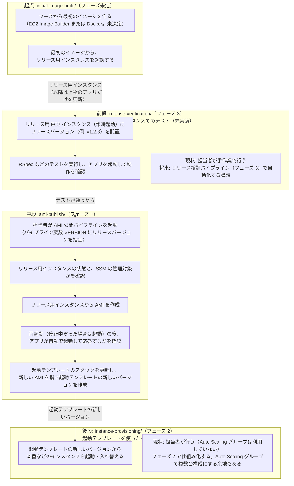

# EC2 のリリースの仕組み

Rails アプリのリリースバージョンを、常時起動のリリース用 EC2 インスタンスで確認し、AMI と起動テンプレートにして、本番などのインスタンスを構築するまでの仕組みと、その設計ドキュメント。

## 全体像

リリースの流れは 3 つの段階からなり、段階ごとにフォルダを分けて並べている。フェーズの番号は**開発の優先順位**で付けており、流れの順番とは一致しない。

| フェーズ | 段階 | フォルダ | 状態 |
|---|---|---|---|
| **フェーズ 1** | 中段: AMI と起動テンプレートの用意 | `ami-publish/` | 実装済み |
| フェーズ 2 | 後段: 起動テンプレートを使ったインスタンスの構築 | `instance-provisioning/` | 未実装 |
| フェーズ 3 | 前段: 作成元のインスタンスでのテスト（リリース検証の自動化） | `release-verification/` | 未実装 |

前段と後段は、フォルダと役割の説明だけを置いている。

全体のフローは次のとおり。リリースの流れ（前段・中段・後段）の前提になるリリース用インスタンスを、ソースから作る**起点**の段階として [`initial-image-build/`](./initial-image-build/README.md) を置いている（未着手。フェーズの番号は未定）。

| # | フローの手順 | 段階・フォルダ |
|---|---|---|
| 1 | ソースから**最初のイメージ**（OS・ミドルウェアなどの下回りとアプリ）を作る | 起点: `initial-image-build/` |
| 2 | 最初のイメージから、AMI の作成元になる**リリース用インスタンス**を起動する | 起点: `initial-image-build/` |
| 3 | リリース用インスタンスでは、**上物のアプリだけ**を新しいリリースバージョンにアップデートする | 前段: `release-verification/` |
| 4 | アップデートしたインスタンスをもとに、アプリのパッケージとして **AMI と起動テンプレート**を作る | 中段: `ami-publish/` |
| 5 | 起動テンプレートを使って、本番などのインスタンスに**配布**する | 後段: `instance-provisioning/` |

1・2 は、最初の 1 回と、下回り（OS・ミドルウェア）を作り直すときだけ行う。リリースのたびに繰り返すのは 3〜5。



| 段階 | フォルダ | 内容 | フェーズ・状態 | 担当 |
|---|---|---|---|---|
| 起点 | [`initial-image-build/`](./initial-image-build/README.md) | ソースからの最初のイメージの作成（EC2 Image Builder または Docker） | 未着手（フェーズ未定） | — |
| 前段 | [`release-verification/`](./release-verification/README.md) | 作成元のリリース用インスタンスでのテスト（配置、RSpec、動作確認） | フェーズ 3。未実装（設計のみ） | 現状は担当者の手作業 |
| **中段** | [**`ami-publish/`**](./ami-publish/README.md) | **AMI と起動テンプレートの用意** | **フェーズ 1。実装済み** | **AMI 公開パイプライン** |
| 後段 | [`instance-provisioning/`](./instance-provisioning/README.md) | 起動テンプレートを使ったインスタンスの構築 | フェーズ 2。未実装 | 担当者 |

## フォルダ構成

```
docs/ec2/
├── README.md                          # このファイル（全体像とフォルダ構成）
├── CLAUDE.md                          # Claude Code 向けの作業ガイド
│
│  ── 段階ごとのフォルダ（リリースの流れの順）──
├── initial-image-build/               # 起点（フェーズ未定）: ソースからの最初のイメージの作成（EC2 Image Builder または Docker。作業計画、Image Builder の説明、AL2023 と Ruby 3.4 の Docker の定義と Image Builder の定義の下書き。Ruby を ruby-build で入れるものと、AL2023 のパッケージで入れるもの）
├── release-verification/              # 前段（フェーズ 3）: 作成元のリリース用インスタンスでのテスト（未実装。役割と設計への参照だけ）
├── ami-publish/                       # 中段（フェーズ 1）: AMI と起動テンプレートの用意（Go の仕組み生成ツールと Ruby の AMI 公開ツール）
├── instance-provisioning/             # 後段（フェーズ 2）: 起動テンプレートを使ったインスタンスの構築（未実装。役割と参照だけ）
│
│  ── 今の環境（AL2）への暫定対応の道具 ──
├── port-guard-rollout/                # 国内だけに絞る設定（iptables ＋ ipset）を複数台に入れる道具（Go。未実装。設計は notes/ec2-operations/）と、試す相手になる今の構成に近いインスタンスの Docker の定義（al2-instance/）
│
│  ── リリースの仕組みの設計ドキュメント ──
├── ami-build-pipeline.md              # 全体の設計（リリース検証 → AMI 化 → 起動テンプレート）
├── ami-publish-development-plan.md    # 中段の開発計画（決定事項 D1〜D10 の正本）
├── ami-publish-environment-verification.md  # 中段の稼働環境での確認手順書
├── ami-publish-troubleshooting.md     # 中段のトラブルシューティング
│
│  ── 調査・補足のドキュメントとメモ（主要なもの以外）──
├── notes/
│   ├── ami-publish/                   # 中段の補足
│   │   ├── ami-publish-release-instance-iam.md            # リリース用インスタンス（AMI の作成元）の IAM ロールの許可と設定方法
│   │   ├── ami-publish-iam-roles.md                       # AMI 公開パイプラインに関わる IAM ロールと許可ポリシーの現状（全体の一覧）
│   │   ├── ami-publish-health-check-role-association-flow.md # ヘルスチェックの区間だけリリース用インスタンスにロールを紐付けるフロー
│   │   └── ami-build-image-builder-options-memo.md        # メモ: EC2 Image Builder を使う案（未採用）
│   ├── release-verification/          # 前段の補足
│   │   └── e2e-testing-on-codebuild-memo.md               # メモ: CodeBuild での E2E テストの構成（未決定）
│   ├── instance-provisioning/         # 後段の補足
│   │   ├── launch-template-auto-scaling-readiness-memo.md # メモ: 起動テンプレートを後から Auto Scaling グループで使う余地
│   │   ├── letsencrypt-certificate-timing.md              # 構築の流れの中で Let's Encrypt の証明書をいつ扱うか
│   │   ├── distributed-instance-maintenance.md            # 配った AMI から起動したインスタンスの運用中のメンテナンス
│   │   └── cloudfront-alb-front-options.md                # 配布先のインスタンスの前段の構成（CloudFront と ALB）と料金の考え方
│   └── ec2-operations/                # EC2 の運用に関する個別の調査
│       ├── cfn-s3-userdata-provisioning.md    # CloudFormation + S3 + UserData によるファイル配備
│       ├── letsencrypt-automation.md          # Let's Encrypt の証明書発行・初期設定の自動化
│       ├── userdata-cfn-init-privileges.md    # 補足: UserData・cfn-init の実行権限
│       ├── shell-environment-customization.md # 補足: bash プロンプト等のシェル環境の自動設定
│       ├── ssm-session-manager-operations.md  # SSM Session Manager による EC2 運用
│       ├── amazon-linux-2023-operations-tips.md # Amazon Linux 2023 の運用のチップス（セキュリティ更新の扱いなど）
│       ├── access-restriction-os-firewall.md  # 暫定対応: OS（iptables ＋ ipset、または firewalld）で国内だけに絞る
│       ├── access-restriction-os-firewall-work-plan.md # 上の iptables ＋ ipset の案の作業計画
│       ├── access-restriction-rollout-script-design.md # 設計: 複数台に入れるスクリプト（チェックポイントで区切る）
│       ├── firewalld-overview.md          # 補足: firewalld とは何か（利点と、向いている場面）
│       ├── access-restriction-apache.md       # 暫定対応: Apache で国内だけに絞る（mod_maxminddb）
│       └── access-restriction-rails-app.md    # 暫定対応: アプリ（Rails 4.2）で国内だけに絞る（Rack::Attack）
│
└── samples/
    └── nginx-passenger-rails/         # 学習用サンプル（nginx + Passenger + Rails の CloudFormation。リリースの仕組みとは無関係）
```

`*-memo.md` は、採用しなかった、または保留中の選択肢を忘れないための備忘録で、採用済みの設計ではない。
