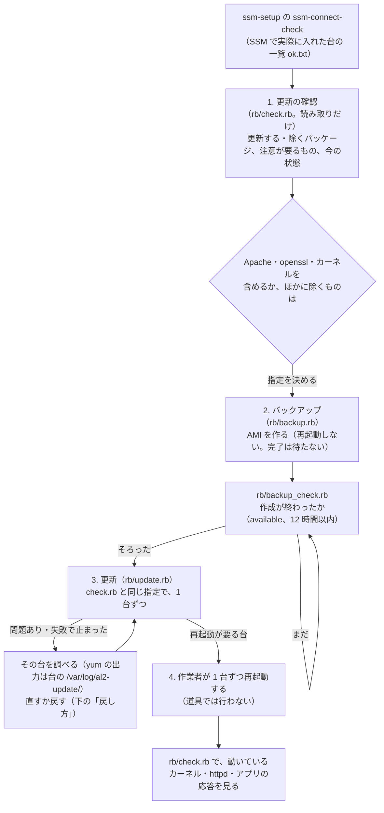
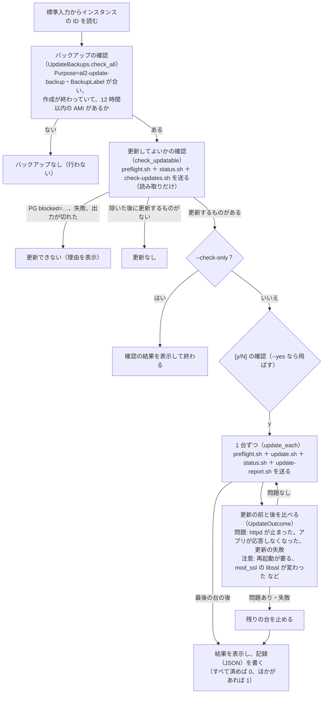

# al2-update — 運用中の AL2 のインスタンスで、OS のパッケージを複数台まとめて更新する道具

> 状態: 書いただけ（構文の確認（Ruby 2.6 と手元の Ruby）、rubocop、`bash -n` だけ済み）。実際の AWS・インスタンスではまだ動かしていない。`remote/` のシェルの中の yum・awk の扱いも、AL2 の上ではまだ確かめていない（下の「未確認の点」）。

## 役割

今の環境（Amazon Linux 2・Apache（httpd 2.4）・Passenger・Rails 4.2・Ruby 2.7.7（rbenv。OpenSSL 1.0.2k にリンク））の運用中のインスタンスで、**OS のパッケージの更新（yum の更新）を、複数台まとめて、1 台ずつ**行う。作業者の PC で動き、AWS CLI のコマンドと SSM の Run Command で各インスタンスを操作する（SSH の経路は作らない）。インスタンスには、暫定対応のフェーズ 1（[ssm-setup](../ssm-setup/README.md)）で SSM で入れるようにしておく（`ssm-connect-check` の `--ok-out` の一覧を、この道具の標準入力に渡せる）。

暫定対応の 2 つのフェーズ（ssm-setup・[port-guard-rollout](../port-guard-rollout/README.md)）とは別の作業で、別のフォルダ・別の道具・別のバックアップ（AMI のタグ `Purpose=al2-update-backup`）に分けている。AL2023 での作り直し（[今の構成を AL2023 で作り直す検討](../initial-image-build/existing-system-rebuild-on-al2023.md)）とも別。

### 何に気を付けるか

更新で **httpd・mod_ssl・openssl のまわりが変わると、アプリに影響しうる**。過去に、AL2 の起動のときの自動の更新（cloud-init の `repo_upgrade: security`）で `httpd`・`mod_ssl` が新しい版に上がり、`mod_ssl` のリンク先の libssl が変わって、ビルドのテストが落ちたことがある（[テスト用のインスタンスの Image Builder の説明](../port-guard-rollout/al2-instance/image-builder/README.md) の「起動のときの更新」「版の確かめ方」）。そこで、この道具は次のようにしている。

| 決まり | 内容 | 理由 |
|---|---|---|
| 先に見せる | `rb/check.rb`（読み取りだけ）で、台ごとに、更新される予定のパッケージを「更新する」「除く」に分けて並べ、注意が要るもの（下の表）に理由を添える。`rb/update.rb` も、更新の前に同じものを調べて、台ごとの件数と注意が要るものの名前を表示してから `[y/N]` で確かめる | 何が変わるかを知ってから更新する |
| 既定はセキュリティの更新だけ | `yum update --security`。全部の更新は `--all` | 変わるものを少なくする |
| Apache は既定で除く | `httpd*`・`mod_*` を `--exclude` で除く。`--include-apache` で対象にする（テスト用のインスタンスで確かめてから） | 過去に問題が出たのがここ。`mod_ssl` の更新で `openssl11` に切り替わることがある |
| SSM Agent はいつも除く | `amazon-ssm-agent` は外せない除外 | Run Command で動いている yum が SSM Agent を更新すると、途中で SSM Agent が再起動して結果が返らなくなることがある（SSM Agent の更新は `AWS-UpdateSSMAgent` で別に行う） |
| ほかにも除ける | `--exclude PATTERN`（yum の `--exclude` と同じパターン。何回でも） | 台や時期によって止めたいものがあるとき |
| 1 台ずつ、悪くなったら止める | 1 台の更新の後に、`httpd` が動いているか、アプリが応答するか（インスタンスの中から `--health-url`）を**更新の前と比べ**、悪くなったら残りの台は行わない | 1 台目で問題が出たら、ほかの台に広げない |
| `mod_ssl` の libssl を見る | 更新の前後で、`ldd` で `mod_ssl.so` のリンク先の libssl を比べ、変わったら「注意」に出す（止めはしない） | 過去の事例そのもの |
| 再起動しない | 再起動が要るか（`needs-restarting -r`）と、古いライブラリを使ったままのサービス（`needs-restarting -s`）を表示するだけ。サービス（httpd など）の再起動もしない | 再起動は影響が大きいので、作業者が 1 台ずつ行う（下の「再起動とカーネルの更新」） |
| バックアップを確かめてから | 更新の前に、台ごとに AMI（再起動しない）を取り、更新はそのバックアップがある台だけに行う | 戻せるようにする |

注意が要るものとして目立たせるパッケージ（`rb/al2_update.rb` の `ATTENTION`。除くかどうかとは別）:

| パターン | 理由 |
|---|---|
| `httpd*` | Apache の本体（Passenger とアプリが中で動く） |
| `mod_*` | Apache のモジュール（`mod_ssl` はリンク先の libssl が変わることがある） |
| `apr*` | Apache が使う部品 |
| `openssl*` | OpenSSL（`mod_ssl` と Ruby の openssl が使う。動いているプロセスは再起動まで古いものを使う） |
| `kernel*` | カーネル（再起動するまで効かない） |
| `glibc*` | glibc（動いているプロセスは再起動まで古いものを使う） |

`openssl`（1.0.2k の `openssl-libs`）は既定では除かない。同じ 1.0.2k の中の更新で、ライブラリの名前（`libssl.so.10`）は変わらないと見込んでいる（Ruby の openssl も、同じ名前のライブラリを使い続ける）。除くかどうかは「決めること」に残した。

## 使い方

作業者の PC に AWS CLI（v2）と Ruby 2.6 以上（macOS に入っている Ruby でもよい。標準のライブラリだけ）。認証情報・リージョンは AWS CLI の設定（`AWS_PROFILE`・`AWS_REGION` など）。標準入力にインスタンスの ID を 1 行に 1 つ（`#` から後と空の行は無視）。

```bash
cd al2-update

# 1. 更新の確認（読み取りだけ）。--ok-out に、更新するものがある台の一覧を書き出す
ruby rb/check.rb --ok-out to-update.txt < ok.txt
ruby rb/check.rb --all --ok-out to-update.txt < ok.txt              # 全部の更新を見る
ruby rb/check.rb --include-apache < ok.txt                          # Apache も含めたら何が変わるかを見る

# 2. バックアップ（AMI を作る。再起動しない。完了は待たない）
ruby rb/backup.rb --backup-label 2026-11 --check-only < to-update.txt   # 確かめるだけ
ruby rb/backup.rb --backup-label 2026-11 < to-update.txt
ruby rb/backup_check.rb --backup-label 2026-11 < to-update.txt          # 作成が終わったかを確かめる

# 3. 更新（check.rb と同じ指定を渡すと、同じ範囲を更新する）
ruby rb/update.rb --backup-label 2026-11 --check-only < to-update.txt   # 確かめるだけ
ruby rb/update.rb --backup-label 2026-11 < to-update.txt
ruby rb/update.rb --backup-label 2026-11 --health-url https://127.0.0.1/health < to-update.txt

# 4. 再起動が要る台は、作業者が 1 台ずつ再起動し、もう一度 check.rb で状態を見る（下の「再起動とカーネルの更新」）

# 書き方の確認（rubocop を入れるのは初回だけ）
cd rb && bundle install && bundle exec rubocop
```

| 指定 | どれで使えるか | 内容 |
|---|---|---|
| `--all` | check・update | 全部の更新を対象にする（既定はセキュリティの更新だけ。`yum --security`） |
| `--exclude PATTERN` | check・update | 更新から除くパッケージ（何回でも）。`amazon-ssm-agent` はいつも除く |
| `--include-apache` | check・update | 既定で除く Apache（`httpd*`・`mod_*`）も対象にする |
| `--health-url URL` | check・update | インスタンスの中から `curl` で応答を見る URL（既定 `http://127.0.0.1/`。証明書は確かめず、転送は追わない。2xx・3xx を応答ありとみなす。空にすると見ない） |
| `--ok-out PATH` | check | 更新するものがある台の一覧を書き出す（backup・update の標準入力に渡せる） |
| `--backup-label LABEL` | backup・backup_check・update | バックアップ作業のタイミング（任意の値。例 `2026-11`）。AMI のタグ `BackupLabel` に付け、更新の前の確認に使う |
| `--record PATH` | update | 記録を書くファイル（既定 `al2-update-<実行の ID>.json`。`.gitignore` で除いている） |
| `--check-only` | backup・update | 確かめて表示するだけ |
| `--yes` | backup・update | `[y/N]` の確認（端末 `/dev/tty` から読む）を飛ばす |

終了コード: 0（すべて済んだ。更新するものがなかった台は問題にしない）、1（失敗・対象外・止めた台がある）、2（入力・前提の問題。インスタンスの ID がない、`--backup-label` がない・形が違う、知らない指定、AWS CLI がない）。

## 流れ

作業全体の流れ（どの順にコマンドを使うか）。



`rb/update.rb` の中の流れは「バックアップの確認 → 更新してよいかの確認（更新される予定の表示）→ `[y/N]` の確認 → 1 台ずつ更新して確かめる（問題が出たら残りを止める）→ 結果の表示と記録」。



## インスタンスに送るもの（remote/）

`rb/` が、渡す値（`AU_SCOPE`・`AU_EXCLUDE`・`AU_HEALTH_URL`・`AU_RUN_ID`）を前に付け、いくつかをつなげて 1 つのスクリプトとして送る（root で実行される）。結果は port-guard-rollout と同じく `PG <キー>=<値>`・`PGSTEP <段階>`・`PG blocked=<理由>` の行で返す。Run Command の出力は 24,000 文字で切れるので、長い一覧（パッケージの一覧）は最後に回し、最後の行 `PG output_end=yes` が返ったかで切れていないかを確かめる。

| ファイル | 送る場面 | 内容 |
|---|---|---|
| `preflight.sh` | 確認・更新 | 更新してよいか（読み取りだけ）。AL2 であること、yum のコマンドがあること、ほかで yum が動いていないこと（起動の直後の cloud-init の更新など）、`/` と `/var` の空きが 500 MB 以上。問題があれば `PG blocked=<理由>` を出して止める |
| `status.sh` | 確認・更新の後 | 今の状態（読み取りだけ）。動いているカーネルと入っている最新のカーネル、再起動が要るか（`needs-restarting -r`）、古いライブラリを使ったままのサービス（`needs-restarting -s`）、`httpd`・`mod_ssl`・`openssl-libs`・`openssl11-libs` の版、`mod_ssl` のリンク先の libssl、`httpd` が動いているか、`yum-cron` が有効か、アプリの応答（`curl`） |
| `check-updates.sh` | 確認 | 更新される予定のパッケージ（`yum check-update`。`--security` は `AU_SCOPE` による）。除くものはここでは付けずに全部を返し、作業者の PC の側で「更新する」「除く」に分ける。読み取りだけだが、パッケージの情報を取るので yum のキャッシュは新しくなる |
| `update.sh` | 更新 | `yum -y [--security] --exclude=… update`。yum の出力は台の `/var/log/al2-update/<実行の ID>.log` に残す。変わったパッケージは、更新の前後の `rpm -qa` の差から「更新」「新しく入った」「取り除いた」に分けて `<実行の ID>.changes` に書く。yum の履歴の ID（`yum history undo` に使う）も返す |
| `update-report.sh` | 更新 | `update.sh` が書いた、変わったパッケージの一覧を返す（最後に送る） |

## バックアップ

[ssm-setup の Python 版のバックアップ](../ssm-setup/py/ssm_setup_backup/) と同じ考え方で、タグ `Purpose` だけを `al2-update-backup` に分けている（ssm-setup の `ssm-setup-backup`、port-guard-rollout の `port-guard-rollout-backup` とは混ぜない。ほかのフェーズで取ったバックアップは、この道具の更新の前の確認では数えない）。

| 項目 | 内容 |
|---|---|
| 作り方 | `rb/backup.rb`。1 台ずつ、状態（running か stopped）、ルートボリュームが EBS か、AMI を作る権限（`create-image --dry-run`）を確かめてから、`create-image --no-reboot` で作り始める（完了は待たない）。すでにあっても新しく作る |
| 名前とタグ | 名前は `<Name タグ>-<インスタンスの ID>-before-al2-update-<実行の ID>`（使えない文字は `-` に、長すぎれば先頭を削る）。AMI とスナップショットに `Name`・`Purpose=al2-update-backup`・`SourceInstanceId`・`SourceInstanceName`・`BackupRunId`・`BackupLabel` |
| 更新の前の確認 | `rb/update.rb` は、`BackupLabel` が指定した値と合い、作成が終わっていて（`available`）、作成から 12 時間以内の AMI がある台だけを更新する。`rb/backup_check.rb` は同じ条件で確かめるだけ |
| 再起動しない AMI | 動いたままの台から取るので、ファイルシステムの一貫性は保証されない（書き込みの途中のものが残りうる）。更新の前の戻り先としては足りると見込んでいる |
| 古い AMI の整理 | 道具では行わない（タグ `Purpose=al2-update-backup` で探して、作業者が消す） |

## 再起動とカーネルの更新

道具では再起動しない。`rb/update.rb` は、台ごとに「再起動が要る」（`needs-restarting -r` の結果。yum-utils がなければ `unknown`）と「再起動が要るサービス」（`needs-restarting -s`）を表示し、記録にも書くだけ。

- **カーネル**: `kernel` の更新は新しい版を足すだけで（古い版も残る）、**再起動するまで効かない**。`status.sh` の「動いている」と「入っている最新」が違えば、再起動が要る。AL2 のカーネルの系列（4.14・5.10 など）は yum の更新では変わらない（系列を変えるのは `amazon-linux-extras` で、この道具では扱わない）。再起動の後に新しいカーネルで起動しない・起動が遅いときに備え、1 台ずつ行い、SSM で入れること（`rb/check.rb` で状態が返ること）を確かめてから次の台に進む
- **glibc・openssl など**: 動いているプロセスは、再起動するまで古いライブラリを使う（`needs-restarting -s` に `httpd` などが出る）。セキュリティの直しを効かせるには、そのサービスを再起動する（`httpd` は `systemctl restart httpd`。Passenger とアプリも起動し直す）。**影響が出るのはこの再起動のとき**で、更新の直後に「httpd が動いている・アプリが応答する」ことは、再起動の後も動くことを保証しない
- **手順の例**（1 台ずつ）: 利用者の少ない時間に `aws ec2 reboot-instances --instance-ids <ID>` → 数分待つ → `echo <ID> | ruby rb/check.rb` で、動いているカーネルが最新か、`httpd` が `active` か、アプリの応答が 2xx・3xx かを見る → 次の台
- 再起動では cloud-init の `repo_upgrade` は動かない（同じインスタンスの 2 回目以降の起動のため）と見込んでいる（「未確認の点」）

## 戻し方

| 方法 | 内容 | 気を付けること |
|---|---|---|
| yum の履歴で戻す | 台に入って（Session Manager か Run Command）`yum history undo <yum の履歴の ID>`。ID は表示と記録（`yum_history`）にある | 古い版がリポジトリにないと戻せない。カーネルは古い版が残っているので、`grub2-set-default` などで古い版で起動する方が早い |
| ルートボリュームを AMI から置き換える | `aws ec2 create-replace-root-volume-task --instance-id <ID> --image-id <バックアップの AMI> --delete-replaced-root-volume false` | インスタンスの ID・IP は変わらない。台は再起動される。ルート以外のボリュームは戻らない。今の環境で使えるかは確かめていない |
| AMI から新しく起動する | バックアップの AMI からインスタンスを起動し、入れ替える | **新しいインスタンスの最初の起動では、cloud-init がセキュリティの更新を入れる**（`repo_upgrade: security`。過去の事例の原因）。UserData に `#cloud-config` の `repo_upgrade: none` を入れて止める。インスタンスの ID・IP が変わる |

道具は戻す操作を持たない（記録の JSON に、台ごとのバックアップの AMI と yum の履歴の ID を残す）。

## 作業者の IAM に要る権限

`ec2:DescribeInstances`、`ec2:DescribeImages`、`ec2:CreateImage`、`ec2:CreateTags`（AMI の作成のときにタグを付けるため）、`ssm:SendCommand`（`AWS-RunShellScript`）、`ssm:GetCommandInvocation`。

## フォルダの中身

| ファイル | 内容 |
|---|---|
| `rb/check.rb` | 更新の確認（`UpdateCheck`。読み取りだけ） |
| `rb/backup.rb` | バックアップの AMI を作る（`UpdateBackup`） |
| `rb/backup_check.rb` | バックアップがあるかを確かめるだけ（`UpdateBackupCheck`） |
| `rb/update.rb` | 更新の実行（`PackageUpdate`） |
| `rb/update_outcome.rb` | 1 台の更新の結果。更新の前後を比べて、問題と注意に分け、表示と記録の形にする（`UpdateOutcome`） |
| `rb/remote_result.rb` | 送った結果（`PG <キー>=<値>`・`PGSTEP`・`PG blocked=<理由>`）の読み取り（`RemoteResult`） |
| `rb/al2_update.rb` | このフォルダの部品。何を更新の対象にするかの指定（check と update で共通）、送るスクリプトの組み立て、パッケージの見分け方（除く・注意が要る） |
| `rb/backups.rb` | バックアップの決まり（タグ、名前、更新の前の確認の条件） |
| `rb/lib.rb` | 共通の部品（ssm-setup の `rb/lib.rb` の写し） |
| `rb/Gemfile`・`rb/Gemfile.lock`・`rb/.rubocop.yml` | 書き方の確認の rubocop だけを入れる（ssm-setup の `rb/` の写し）。書き方は rubocop の既定（確かめる版を Ruby 2.6 にしているだけ） |
| `remote/` | インスタンスに送るシェル（上の「インスタンスに送るもの」） |

どのスクリプトも 1 つのクラスで、流れの大枠を公開のメソッドとして上に並べ（流れは `run` の上のコメント）、ヘルパは `private` の下に分けている。AWS に書き込む箇所（AMI の作成、更新のスクリプトの送信）には `# [変更]` コメントを付けている。

## 決めること

| # | 決めること | 今の作り | 考えられる選択肢 |
|---|---|---|---|
| 1 | Apache（`httpd*`・`mod_*`）の更新をいつ・どう入れるか | 既定で除き、`--include-apache` で対象にする | テスト用のインスタンス（[al2-instance](../port-guard-rollout/al2-instance/README.md) の Image Builder 版など）で、更新の後に `mod_ssl` の libssl とアプリの動作を確かめてから本番に入れる。ずっと止めるなら versionlock（下の 3） |
| 2 | `openssl`（1.0.2k）の更新を既定で除くか | 除かない（注意として表示するだけ） | 除く（`--exclude 'openssl*'` を既定にする）。除くと、OpenSSL のセキュリティの直しが入らない |
| 3 | versionlock（`yum-plugin-versionlock`）を使うか（保留中） | 使わない。除外は道具を動かすたびの `--exclude` だけ | versionlock で `httpd`・`mod_ssl` などを固定すると、この道具の外の更新（手で動かす yum、`yum-cron`、AMI から起動したときの cloud-init）でも変わらなくなる。外し忘れると、セキュリティの直しがずっと入らない |
| 4 | 更新の後に `httpd` を再起動するか | しない（`needs-restarting -s` を表示するだけ） | `--restart-httpd` を足し、更新の直後に再起動して、作業者が見ている間に影響を出し切る（バックアップも新しいうちに戻せる）。再起動の間はアプリが止まる |
| 5 | 再起動を道具で行うか | 行わない | 今の作りのまま、作業者が 1 台ずつ行う。道具で行うなら、再起動 → SSM の登録を待つ → `status.sh` で確かめる、を 1 台ずつ、y/n/q で確かめる形（port-guard-rollout の `enable.rb` と同じ形） |
| 6 | 問題が出たときに残りを止めるか | 止める（`--keep-going` はない） | 台が多く、問題の台を後で直すなら、止めずに進める指定を足す |
| 7 | アプリの応答の確かめ方 | インスタンスの中から `curl` で `--health-url`（既定 `http://127.0.0.1/`）を見て、2xx・3xx を応答ありとみなす | 名前ベースのバーチャルホストなら `Host` を付ける、作業者の PC から外側の IP で見る（port-guard の遮断が有効な台では、作業者の IP を許可しておく必要がある） |
| 8 | `yum-cron` が有効な台をどうするか | 有効かを表示するだけ | この道具で更新するなら `yum-cron` を止める（自動の更新と重なると、何がいつ変わったかが追えない） |
| 9 | 長い出力（24,000 文字を超える）の扱い | 最後の行で切れたかを確かめ、更新の確認では「更新できない」にする（`--exclude` で絞る） | Run Command の出力を S3 に書かせる（`--output-s3-bucket-name`。バケットと権限が要る。`lib.rb` の写しの外に送り方を足すことになる） |
| 10 | このフォルダを暫定対応の何番目のフェーズにするか | 番号を付けず、2 つのフェーズとは別の作業として置いた | フェーズ 3 にする（CLAUDE.md の「2 つのフェーズに完全に分けている」の書き方も直す） |

## 未確認の点

| # | 確かめること |
|---|---|
| 1 | 実際の AWS・インスタンスで、4 つのコマンドが最後まで動くか（まだ一度も動かしていない） |
| 2 | AL2 の yum で、`yum --security check-update` の一覧と、`yum --security update` が実際に更新するものが一致するか（`--security` は、セキュリティの勧告がある版まで上げるのか、最新まで上げるのか。依存で増えるものは、更新の後の「新しく入った」にだけ出る） |
| 3 | `yum check-update` の出力の読み方（名前が長いときの 2 行への折り返し、`Obsoleting Packages` の区切り）が、今の AL2 の出力に合っているか |
| 4 | `--exclude` で `httpd*` を除いたとき、ほかのパッケージの依存で更新が失敗しないか（失敗すれば「失敗」として止まり、yum の出力は台の `/var/log/al2-update/` に残る） |
| 5 | 本番の台に yum-utils（`needs-restarting`）が入っているか。`needs-restarting -s` が使える版か（なければ `unknown` と出る） |
| 6 | 更新にかかる時間が、Run Command の実行の上限（`lib.rb` の 900 秒）と、結果を待つ時間（約 16 分）に収まるか |
| 7 | `amazon-ssm-agent` を除いても、ほかのパッケージ（`systemd` など）の更新で SSM Agent が再起動されることがないか |
| 8 | `httpd` の更新（`--include-apache` のとき）で、パッケージの側が `httpd` を再起動するか（すれば、更新の直後の確認で影響が見える） |
| 9 | Ruby（rbenv の 2.7.7）の openssl が、`openssl-libs` の更新の後も `libssl.so.10` を使い続けるか（`status.sh` では見ていない。rbenv の場所が台によって違いうるため） |
| 10 | 再起動のときに cloud-init の `repo_upgrade` が動かないこと（同じインスタンスの 2 回目以降の起動）と、ルートボリュームの置き換え（`create-replace-root-volume-task`）の後にも動かないこと |
| 11 | `mod_ssl.so` の場所（`/etc/httpd/modules/mod_ssl.so`）が本番の台で同じか |
