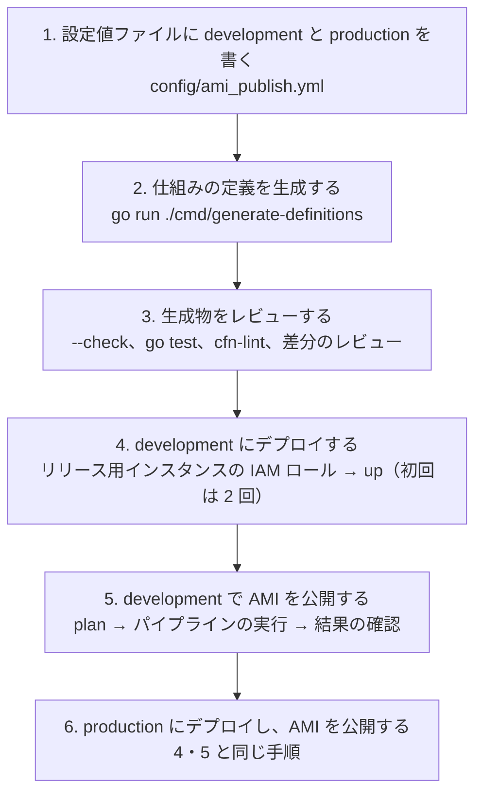

# チュートリアル: development と production の AMI 公開パイプラインを作って動かす

仕組みの生成ツール（`cmd/generate-definitions`）から始めて、**development** と **production** の 2 つの環境に AMI 公開パイプラインを用意し、AMI を公開するまでを順に行う。

- 対象: AMI 公開パイプラインを初めて作る担当者
- 各手順の詳細と背景は [README](./README.md)、稼働環境での確認項目は [確認手順書](../ami-publish-environment-verification.md)、失敗したときは [トラブルシューティング](../ami-publish-troubleshooting.md)
- コマンドはすべて `ami-publish/` のルート（パイプラインのソースのリポジトリのルート）で実行する
- 例のアプリケーション名は `myapp`、リージョンは `ap-northeast-1`

## 全体の流れ



development で一通り動くことを確かめてから、production に同じ手順を繰り返す。

## 0. 前提

### 手元に必要なもの

| もの | 用途 | 確認 |
|---|---|---|
| Go | 仕組みの生成ツール | `go version` |
| AWS CLI | デプロイ、パイプラインの起動 | `aws --version` |
| Ruby（`.ruby-version`）と Bundler | 手元からの `plan`・`rollback` | `ruby --version`、`bundle install` |
| cfn-lint（任意） | CloudFormation テンプレートの検証 | `cfn-lint --version`（`pip install cfn-lint`） |

### 環境ごとに AWS 側で用意するもの

| もの | development | production | 設定値ファイルの項目 |
|---|---|---|---|
| AWS の認証情報（プロファイル） | 例: `myapp-dev` | 例: `myapp-prod` | （設定値ファイルには書かない） |
| リリース用インスタンス（常時起動。SSM Agent が自動起動。インスタンスプロファイルは付けない） | development 用の 1 台 | production 用の 1 台 | `release_instance_id` |
| 起動テンプレートに入れるセキュリティグループ | development 用 | production 用 | `launch_template.security_group_ids` |
| パイプラインのソースの取得元（GitHub の場合は CodeConnections の接続。コンソールで承認まで済ませる） | 環境のアカウントで作る | 環境のアカウントで作る | `pipeline.source_connection_arn` ほか |
| ヘルスチェックの Basic 認証（必要な場合だけ） | SSM Parameter Store の SecureString | 同左 | `health_check.basic_auth_parameter_name` |

- development と production は、**同じ AWS アカウントでも、別のアカウントでもよい**。スタックやパイプラインの名前に環境名が入るため、同じアカウントでも名前はぶつからない。以下の例は、環境ごとにプロファイルを切り替えて実行する（同じアカウントなら同じプロファイルでよい）
- パイプラインのソースは、`ami-publish/` の中身をルートとするリポジトリにする（この `pk` リポジトリのままではパイプラインから動かない）

## 1. 設定値ファイルに development と production を書く

**1 つの設定値ファイル（`config/ami_publish.yml`）の `environments` に、2 つの環境を並べて書く。** キー（`development`・`production`）がそのまま環境名になる。リソースの名前は書かない（`application_name` と環境名から自動で決まる）。

```yaml
environments:
  development:
    aws_region: ap-northeast-1
    application_name: myapp
    release_instance_id: i-0123456789abcdef0          # development のリリース用インスタンス
    pipeline:
      source_type: github
      source_connection_arn: arn:aws:codeconnections:ap-northeast-1:111111111111:connection/00000000-0000-0000-0000-000000000000
      source_repository_id: example-org/ami-publish
      source_branch_name: main
      log_retention_days: 30
    launch_template:
      instance_type: t3a.small
      security_group_ids:
        - sg-0123456789abcdef0
    ami:
      name_tag_prefix: myapp-web-dev
    health_check:
      url: http://localhost/up
    timeouts:
      codebuild_minutes: 90
      image_available_seconds: 1800
      instance_online_seconds: 900
      health_check_seconds: 600
      stack_update_seconds: 900
      poll_interval_seconds: 15
      progress_log_interval_seconds: 60

  production:
    aws_region: ap-northeast-1
    application_name: myapp
    release_instance_id: i-0fedcba9876543210          # production のリリース用インスタンス
    pipeline:
      source_type: github
      source_connection_arn: arn:aws:codeconnections:ap-northeast-1:222222222222:connection/11111111-1111-1111-1111-111111111111
      source_repository_id: example-org/ami-publish
      source_branch_name: main
      log_retention_days: 90
    launch_template:
      instance_type: t3a.medium
      security_group_ids:
        - sg-0fedcba9876543210
    ami:
      name_tag_prefix: myapp-web
    health_check:
      url: http://localhost/up
      basic_auth_parameter_name: /myapp/production/health-check/basic-auth   # Basic 認証が要らなければ削除する
    timeouts:
      codebuild_minutes: 90
      image_available_seconds: 1800
      instance_online_seconds: 900
      health_check_seconds: 600
      stack_update_seconds: 900
      poll_interval_seconds: 15
      progress_log_interval_seconds: 60
```

- 未知の項目や形式の誤りは、次の生成でエラーになる（終了コード 2）。項目の意味は、リポジトリの `config/ami_publish.yml` のコメントを参照
- 環境名は英小文字・数字・ハイフン。`application_name` と環境名の長さの合計は 60 文字以下
- AMI 名（`<application_name>_<バージョン>_<日時>`）には環境名が入らない。同じアカウントで両方の環境の AMI を作っても、日時が入るので名前はぶつからない。どちらの環境の AMI かは、AMI のタグ `Environment` で区別できる

> **環境ごとにファイルを分けない**: パイプラインのスタックにはパラメータ `ConfigFile` があり、CodeBuild が読む設定値ファイルを変えられる（[README](./README.md#4-仕組みのデプロイaws-cli)）。ただし、環境ごとに別のファイルから同じ `generated/` に生成すると、`--check` が他方の環境の生成物を「生成対象にない」と判定して失敗する。development と production は 1 つのファイルにまとめ、`ConfigFile` は既定（`config/ami_publish.yml`）のまま使う。

## 2. 仕組みの定義を生成する

```bash
go run ./cmd/generate-definitions
```

`generated/` に次のファイルが生成され、自動で決まった名前が表示される（AWS は呼ばない）。

```
generated/codebuild/ami-publish-buildspec.yml                       全環境で共通
generated/cloudformation/development/health-check-stack.yml
generated/cloudformation/development/launch-template-stack.yml
generated/cloudformation/development/ami-publish-pipeline-stack.yml
generated/cloudformation/development/release-instance-stack.yml
generated/deploy/development.sh
generated/cloudformation/production/...（development と同じ 4 つ）
generated/deploy/production.sh
```

```
環境 development の名前（自動）:
  myapp-development-ami-publish-pipeline   AMI 公開パイプラインのスタック
  myapp-development-ami-publish            CodePipeline のパイプライン
  myapp-development-ami-publish            CodeBuild プロジェクト
  /myapp/development/ami-publish           CloudWatch Logs のロググループ
  myapp-development-launch-template        起動テンプレートのスタック
  myapp-development                        起動テンプレート
  myapp-development-health-check           ヘルスチェックのスタック
  myapp-development-health-check           ヘルスチェックの SSM ドキュメント
  myapp-development-release-instance       リリース用インスタンスの IAM ロールのスタック

環境 production の名前（自動）:
  myapp-production-ami-publish-pipeline    AMI 公開パイプラインのスタック
  myapp-production-ami-publish             CodePipeline のパイプライン
  ...（以下、development と同じ形）
```

以降のコマンドのスタック名やパイプライン名は、この一覧のとおりに使う。

`generated/` に以前の環境（例: `staging`）の生成物が残っていると、「生成対象にないファイルが残っている」と警告が出る。使わない環境なら、そのディレクトリとデプロイ用シェルスクリプトを削除する（`rm -r generated/cloudformation/staging generated/deploy/staging.sh`）。

## 3. 生成物をレビューする

```bash
go run ./cmd/generate-definitions --check    # 設定値・定義と generated/ が一致しているか（終了コード 1 = 差分あり）
go test ./...                                # 生成物の構造テスト（権限の方針なども確認する）
cfn-lint generated/cloudformation/*/*.yml    # CloudFormation テンプレートの検証（任意）
git diff -- config generated                 # 差分を確認する
```

`config/` と `generated/` の変更をコミットし、プルリクエストでレビューしてから、パイプラインのソースのブランチ（例: `main`）に入れる。**パイプラインは、デプロイ時ではなく実行時にソースのブランチから buildspec と設定値ファイルを取得する**ため、ブランチに入れる前にパイプラインを実行すると、古い設定値で動く。

## 4. development にデプロイする

```bash
export AWS_PROFILE=myapp-dev
```

### 4-1. リリース用インスタンスの IAM ロールのスタック

AMI 公開パイプラインのスタックがこのスタックの Export を参照するため、**最初に**デプロイする。デプロイ用シェルスクリプト（`up`）には含まれていない。

```bash
STACK=myapp-development-release-instance
aws cloudformation deploy --region ap-northeast-1 --stack-name "$STACK" \
  --template-file generated/cloudformation/development/release-instance-stack.yml \
  --capabilities CAPABILITY_IAM --no-execute-changeset
# 表示された変更セットを確認して反映する（AWS::IAM::Role と AWS::IAM::InstanceProfile の 2 つだけのはず）
aws cloudformation describe-change-set --region ap-northeast-1 --stack-name "$STACK" --change-set-name <表示された変更セット名>
aws cloudformation execute-change-set  --region ap-northeast-1 --stack-name "$STACK" --change-set-name <表示された変更セット名>
aws cloudformation wait stack-create-complete --region ap-northeast-1 --stack-name "$STACK"
```

リリース用インスタンスに、このインスタンスプロファイルを紐付ける作業はない（パイプラインがヘルスチェックの区間だけ紐付ける）。

### 4-2. 仕組みの 3 つのスタック（初回は `up` を 2 回）

```bash
bash generated/deploy/development.sh up
```

`up` は、ヘルスチェック → 起動テンプレート → AMI 公開パイプラインの順に**変更セットを作るだけ**で、反映はしない。

**初回は、1 回目の `up` で AMI 公開パイプラインの変更セットの作成がエラーで止まる**（ヘルスチェックと起動テンプレートのスタックの Export が、まだ存在しないため）。想定どおりなので、次のとおり進める。

1. 1 回目の `up` で作られた、ヘルスチェックと起動テンプレートの変更セットを確認して反映する

   ```bash
   aws cloudformation describe-change-set --region ap-northeast-1 --stack-name myapp-development-health-check --change-set-name <変更セット名>
   aws cloudformation execute-change-set  --region ap-northeast-1 --stack-name myapp-development-health-check --change-set-name <変更セット名>
   aws cloudformation wait stack-create-complete --region ap-northeast-1 --stack-name myapp-development-health-check
   # 起動テンプレートのスタック（myapp-development-launch-template）も同じように反映する
   ```

2. もう一度 `up` を実行する。反映済みの 2 つは「変更なし」で通過し、AMI 公開パイプラインの変更セットが作られる

   ```bash
   bash generated/deploy/development.sh up
   ```

3. AMI 公開パイプラインの変更セット（`myapp-development-ami-publish-pipeline`）を確認して反映する

Basic 認証を使う環境では、ヘルスチェックのスタックの前に、SSM Parameter Store にパラメーターを作っておく（`aws ssm put-parameter --type SecureString --name <パラメーター名> --value 'ユーザー名:パスワード'`。`--key-id` は指定しない）。

- パイプラインは作成直後に 1 回自動で実行されることがある。変数 `VERSION` がないので、終了コード 2 で止まる。AWS には何も変更しないので、気にしなくてよい
- 起動テンプレートは、AMI が入っていない状態で作られる（パラメータ `AmiId` は空）。最初の AMI の公開で入る

## 5. development で AMI を公開する

### 5-1. リリース用インスタンスを準備する

development のリリース用インスタンスに、公開するリリースバージョン（例: `v1.2.3`）を配置・起動し、動作を確認しておく（今は担当者の手作業）。

### 5-2. 手元から plan で確認する（任意）

AWS に書き込まずに、同じ流れを確認する（読み取りの API は呼ぶ）。

```bash
bundle exec ruby bin/ami_publish plan --environment development --version v1.2.3
```

### 5-3. パイプラインを実行する

```bash
aws codepipeline start-pipeline-execution --region ap-northeast-1 \
  --name myapp-development-ami-publish \
  --variables name=VERSION,value=v1.2.3
```

- ヘルスチェックを省略する場合は `name=HEALTH_CHECK,value=false` を足す（AMI に `HealthCheck=skipped` が付く）
- 進み具合は、CodePipeline のコンソール、または CloudWatch Logs のロググループ `/myapp/development/ami-publish`（ストリーム `codebuild`）で見る。待っている間も 60 秒ごとに `"event":"waiting"` のログが出る

```bash
aws codepipeline get-pipeline-state --region ap-northeast-1 --name myapp-development-ami-publish \
  --query 'stageStates[].[stageName,latestExecution.status]' --output table
```

リリース用インスタンスは、AMI の作成のために**再起動する**（停止中だった場合は起動し、起動したまま残る）。

### 5-4. 結果を確認する

```bash
# 起動テンプレートの最新のバージョン
aws cloudformation describe-stacks --region ap-northeast-1 --stack-name myapp-development-launch-template \
  --query "Stacks[0].Outputs[?OutputKey=='LaunchTemplateVersion'].OutputValue" --output text

# 公開した AMI
aws ec2 describe-images --region ap-northeast-1 --owners self \
  --filters "Name=tag:Environment,Values=development" "Name=tag:AppVersion,Values=v1.2.3" \
  --query 'Images[].[ImageId,Name,Tags[?Key==`Status`]|[0].Value,Tags[?Key==`HealthCheck`]|[0].Value]' --output table
```

AMI のタグ `Status` が `published` で、起動テンプレートの新しいバージョンの説明が `myapp v1.2.3` になっていれば成功。失敗したときは、ログの `エラー:` の行で [トラブルシューティング](../ami-publish-troubleshooting.md) を引く。

## 6. production にデプロイし、AMI を公開する

development と同じ手順を、プロファイルと環境名を変えて繰り返す。

```bash
export AWS_PROFILE=myapp-prod

# 4-1. リリース用インスタンスの IAM ロールのスタック
STACK=myapp-production-release-instance
aws cloudformation deploy --region ap-northeast-1 --stack-name "$STACK" \
  --template-file generated/cloudformation/production/release-instance-stack.yml \
  --capabilities CAPABILITY_IAM --no-execute-changeset
# → 変更セットを確認して反映

# 4-2. 仕組みの 3 つのスタック（初回は 2 回。間で、ヘルスチェックと起動テンプレートの変更セットを反映する）
bash generated/deploy/production.sh up

# 5-2〜5-3. plan で確認してから、パイプラインを実行する
bundle exec ruby bin/ami_publish plan --environment production --version v1.2.3
aws codepipeline start-pipeline-execution --region ap-northeast-1 \
  --name myapp-production-ami-publish \
  --variables name=VERSION,value=v1.2.3
```

production での注意:

- **変更セットは必ず中身を確認してから反映する**。特に起動テンプレートのスタックで、`AWS::EC2::LaunchTemplate` 以外の変更や、意図しない置き換えがないこと
- ヘルスチェックは省略しない（`HEALTH_CHECK=false` を使わない）
- パイプラインを実行すると production のリリース用インスタンスが再起動する。再起動してよい時間帯に実行する
- 起動テンプレートが新しいバージョンになっても、既存の本番のインスタンスは変わらない（インスタンスの構築・置き換えは後段。[instance-provisioning](../instance-provisioning/README.md)）

## 7. その後の運用

### 設定値や定義を変えるとき

```bash
# 1. config/ami_publish.yml または internal/definitions/ を直す
go run ./cmd/generate-definitions          # 2. 再生成
go run ./cmd/generate-definitions --check  # 3. レビュー（go test、差分の確認も）
#    コミットしてレビューを受け、ソースのブランチに入れる
bash generated/deploy/development.sh up    # 4. development に変更セットを作り、確認して反映
bash generated/deploy/production.sh up     # 5. development で確かめてから production へ
```

変更のないスタックは「変更なし」で通過する。リリース用インスタンスの IAM ロールのスタックは `up` に含まれないので、その定義が変わったときは 4-1 の手順で個別にデプロイする。

### 前のバージョンに戻すとき

起動テンプレートを、公開済みの前のバージョンの AMI に戻す（担当者が手元から実行する）。

```bash
bundle exec ruby bin/ami_publish rollback --environment production --to-version v1.2.2 --dry-run   # 差分の確認
bundle exec ruby bin/ami_publish rollback --environment production --to-version v1.2.2
```

### 撤去するとき

```bash
bash generated/deploy/development.sh down   # 確認の問い合わせなしで、すぐに削除が始まる
```

AMI とスナップショット、リリース用インスタンスの IAM ロールのスタックは残る（必要なら個別に削除する）。
