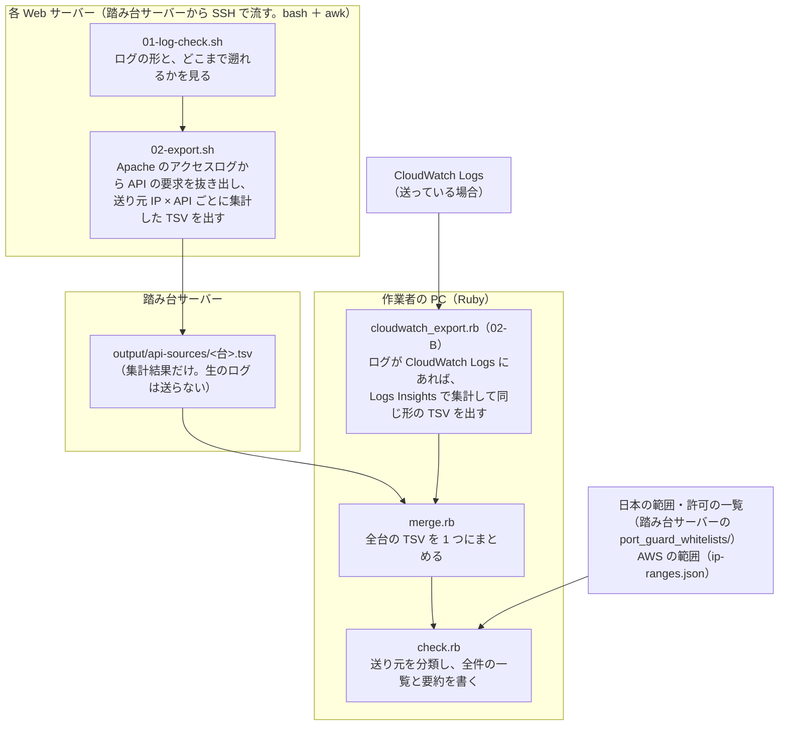

# API のアクセス元の洗い出し: 設計

> 位置付け: port-guard（80・443 番を日本と許可した IP アドレスに絞る。[port-guard-rollout](../port-guard-rollout/)）を本番で有効にする前に、**外部のプログラムが API を呼んでくる送り元の IP アドレス**を、今の EC2（Web サーバー）の Apache のアクセスログから洗い出し、**有効にすると止まってしまう相手**を見つけるための道具の設計。
>
> 状態: 設計の段階（2026-11-05。ログが CloudWatch Logs にある場合も含めた）。道具はまだ作っていない。末尾の「決めること」が決まったら、骨組み（ファイル、クラス、流れのメソッド）から作る。
>
> 作成日: 2026-11-05

## 目的

- 今、API を呼んできている送り元の IP アドレスを、API ごとに一覧にする
- その送り元を、日本の範囲・許可の一覧・AWS のアドレス・それ以外に分類し、**port-guard を有効にすると止まる相手**を、件数や最後に見た日時と一緒に示す
- 止まる相手について、許可の一覧（`port_guard_whitelists/allow-ipv4.txt`）に足すか、相手に呼び方を変えてもらうかを判断できる材料にする

この道具は**読み取りだけ**で、サーバーの設定は何も変えない。

## 全体の流れ



| 段階 | どこで | 書き方 | すること |
|---|---|---|---|
| 01 ログの形を確かめる | 各 Web サーバー（踏み台サーバーから `ssh ... 'bash' < ファイル`） | bash | Apache の `LogFormat`・`CustomLog` の設定、ログのファイルの一覧と大きさ、いちばん古い日時を表示する（読み取りだけ） |
| 02 エクスポーター | 同上 | bash ＋ awk | アクセスログから API の要求だけを抜き出し、送り元 IP × API ごとに集計して、TSV を標準出力に出す（読み取りだけ）。踏み台サーバーで `output/api-sources/<台>.tsv` に受ける |
| 02-B エクスポーター（CloudWatch Logs から） | 作業者の PC（AWS CLI） | Ruby（`cloudwatch_export.rb`） | アクセスログが CloudWatch Logs に送られている場合に、02 の代わり（または足りない期間の補い）に使う。CloudWatch Logs Insights で集計し、02 と同じ形の TSV を出す（下の「2-B」） |
| 03 まとめる | 作業者の PC | Ruby（`merge.rb`） | 踏み台サーバーから取ってきた全台の TSV を、1 つにまとめる |
| 04 チェッカー | 作業者の PC | Ruby（`check.rb`） | 送り元を分類し、全件の分類つきの一覧と、止まる相手の要約を書く |

## ログの置き場所（サーバーのファイルか、CloudWatch Logs か）

Apache のアクセスログは、各サーバーのファイル（`/var/log/httpd/`）にあるのが前提。ただし、CloudWatch エージェントなどで **CloudWatch Logs にも送っている可能性**がある。どちらにあるかで、エクスポーターを使い分ける（出力の形は同じにするので、03 のまとめる・04 のチェッカーは共通）。

| ログの置き場所 | 使うエクスポーター | 利点 | 欠点 |
|---|---|---|---|
| サーバーのファイルだけ | 02（各サーバーで bash ＋ awk） | 料金がかからない。AWS の権限が要らない | 遡れるのはローテートで残っている分だけ（既定なら約 1 か月）。台ごとに流す |
| CloudWatch Logs にもある | **02-B（作業者の PC から CloudWatch Logs Insights）** | ロググループの保持期間の分だけ遡れる（1 か月より長いことがある）。全台分を 1 回の問い合わせで集計できる（ログのストリームが台ごとに分かれていれば、台も分かる）。サーバーに入らなくてよい | 読んだログの量（圧縮前）に応じて料金がかかる。ロググループを作る前のログは問い合わせられない。サーバーで送っていない期間・ファイルは入っていない |
| 両方にある | 02-B を主にし、02 で足りない台・期間を補う | — | 同じ要求を 2 回数えないように、使う期間を分ける |

**どちらにあるかを確かめる**（01 に含める）

| どこで | 見るもの | 何が分かるか |
|---|---|---|
| 各サーバー（01-log-check.sh） | CloudWatch エージェント（`amazon-cloudwatch-agent`）や、古いエージェント（`awslogs`）が動いているか、その設定に `/var/log/httpd/` のファイルが入っているか | アクセスログを CloudWatch Logs に送っているか。送り先のロググループの名前 |
| 作業者の PC（AWS CLI） | `aws logs describe-log-groups` で、ロググループの一覧（名前、保持期間、作られた日時、大きさ） | 送り先のロググループがあるか。どこまで遡れるか（作られた日時と保持期間） |

エージェントの設定ファイルの場所（`/opt/aws/amazon-cloudwatch-agent/etc/`・`/etc/awslogs/`）は、AWS のドキュメントでまだ確かめていない（作るときに確かめる）。

## 言語の分担

| 部分 | 書き方 | 理由 |
|---|---|---|
| 01・02（各 Web サーバーで動く） | **bash ＋ awk** | port-guard の踏み台サーバーの手順と同じ流し方（`ssh ... 'bash' < ファイル`）にそろえる。サーバーにファイルを置かない。サーバーの Ruby（アプリの Ruby 2.7.7）は rbenv の中にあることが多く、SSH で入った `centos` の環境から確実に呼べるかが分からないので使わない |
| 02-B・03・04（作業者の PC で動く） | **Ruby**（02-B は、Ruby から AWS CLI を呼ぶ。ほかの Ruby の道具と同じく、AWS の SDK の gem は使わない） | IPv4・IPv6 の範囲の判定は標準の `IPAddr`、AWS の `ip-ranges.json` は標準の `JSON`、TSV は標準の `CSV` で扱える |

Ruby の書き方は、このリポジトリのほかの Ruby の道具（`sg-ssh-restrict/rb`・`al2-update/rb`）と同じにする。

- 標準のライブラリだけを使う（gem は rubocop だけ）
- Ruby 2.6 でも動く書き方にする
- rubocop の既定に従う（`cd api-access-sources/rb && bundle exec rubocop`）
- 1 つのスクリプトを 1 つのクラスにする。流れの大きな段階を公開のメソッドに、細かい処理を `private` のメソッドにする

## ファイルの分け方

```
api-access-sources/
├── design.md                        # この設計
├── README.md                        # 手順（作ったときに書く）
├── command/api_sources/             # 踏み台サーバーに置き、各 Web サーバーに送るもの（bash ＋ awk）
│   ├── 01-log-check.sh
│   └── 02-export.sh
└── rb/                              # 作業者の PC で動かすもの（Ruby）
    ├── cloudwatch_export.rb         # ApiSourcesCloudWatchExport（02-B。CloudWatch Logs Insights で集計する）
    ├── merge.rb                     # ApiSourcesMerge
    ├── check.rb                     # ApiSourcesCheck
    ├── ip_lists.rb                  # IpLists（範囲の一覧を読み、IP がどれに入るかを判定する）
    ├── Gemfile
    └── .rubocop.yml
```

`command/` の下には、踏み台サーバーから各 Web サーバーに送るファイルだけを置く（port-guard の踏み台サーバーの手順と同じ決まり）。

## 1. ログの形を確かめる（`01-log-check.sh`）

エクスポーターは、ログの項目の位置を決め打ちで読むので、先に形を確かめる。

| 表示するもの | 何のためか |
|---|---|
| `LogFormat`・`CustomLog` の設定（`/etc/httpd/conf/httpd.conf`・`/etc/httpd/conf.d/*.conf`） | 項目の並びが `combined`（`%h %l %u %t "%r" %>s %b "%{Referer}i" "%{User-Agent}i"`）と同じか。違えば、エクスポーターの項目の位置を合わせる |
| ログのファイルの一覧と大きさ（`/var/log/httpd/`） | どのファイルを読むか（`access_log`・`ssl_access_log`、ローテート済みの `*-YYYYMMDD`・`.gz`） |
| いちばん古いファイルの最初の日時 | どこまで遡れるか（下の「集める期間」） |
| CloudWatch エージェント（`amazon-cloudwatch-agent`・`awslogs`）が動いているか、その設定に `/var/log/httpd/` のファイルが入っているか | アクセスログを CloudWatch Logs にも送っているか（上の「ログの置き場所」） |

## 2. エクスポーター（`02-export.sh`）

| 項目 | 決めごと |
|---|---|
| 読むログ | Apache のアクセスログ（`/var/log/httpd/access_log*`・`ssl_access_log*`）。今と、ローテート済みのもの。`zcat -f` で、圧縮の有無に関係なく読む |
| 送り元の IP | ログの先頭の項目（`%h`。Apache が受けた接続の送り元）。今は前段（ロードバランサーなど）がないので、これが本当の送り元。`X-Forwarded-For` は利用者が書き換えられるので使わない |
| API の見分け方 | **パスの前方一致の一覧**（例: `/api/`・`/webhooks/`）を、ファイルの先頭の変数に書く。User-Agent での見分けは当てにならないので主にはしない |
| パスの型 | 問い合わせの部分（`?` から後）を落とし、数字だけの区切り（`/orders/123`）や長い 16 進の区切り（UUID など）を `:id` に置き換える（種類が増えすぎないように） |
| 集計の単位 | 送り元 IP × メソッド × パスの型 × 状態コードの種類（`2xx`・`3xx`・`4xx`・`5xx`） |
| 出すもの | 上の単位ごとに、件数・最初に見た日時・最後に見た日時・User-Agent の例（1 つ） |
| 送る量 | 生のログは送らず、集計結果だけを送る（ログは大きく、パスや問い合わせに個人に関わる情報が入りうるので、外に出さない） |
| 安全網（決めること） | API 以外の要求について、**送り元 IP ごとの件数だけ**を別の区切りで出す（パスは出さない）。API の一覧に漏れがあっても、海外からのまとまった通信に気付けるように |

出力の形（TSV。1 行目は項目の名前）:

```
ip	method	path_pattern	status_class	count	first_seen	last_seen	user_agent_sample
203.0.113.10	POST	/api/v1/orders	2xx	1520	2026-10-01T00:12:03+09:00	2026-11-04T23:58:41+09:00	ExampleClient/2.1
198.51.100.7	POST	/webhooks/payment	2xx	42	2026-10-03T10:00:00+09:00	2026-11-03T10:00:02+09:00	PaymentNotifier
```

## 2-B. エクスポーター（CloudWatch Logs から。`cloudwatch_export.rb`）

アクセスログが CloudWatch Logs に送られている場合に、作業者の PC から CloudWatch Logs Insights（ロググループに対する問い合わせの仕組み）で集計する。サーバーには入らない。出力は 02 と同じ形の TSV にする。

| 項目 | 決めごと |
|---|---|
| 呼び方 | Ruby から AWS CLI の `aws logs start-query`（問い合わせを始める）と `aws logs get-query-results`（結果を取る。終わるまで待つ）を呼ぶ |
| 対象 | アクセスログのロググループ（1 回の問い合わせで 50 個まで）と、期間（始まりと終わり） |
| 問い合わせ | `parse` で、ログの 1 行から送り元 IP・日時・メソッド・パス・状態コード・User-Agent を取り出し、API のパスの前方一致で `filter` し、`stats` で送り元 IP × メソッド × パス × 状態コードの種類ごとに、件数（`count()`）・最初と最後の日時（`min(@timestamp)`・`max(@timestamp)`）・User-Agent の例（`latest(...)`）を数える。ログのストリームが台ごとなら、台（`@logStream`）も集計の単位に入れる |
| パスの型 | 数字の区切りを `:id` に置き換える処理は、問い合わせの中ではなく、結果を受け取った Ruby で行い、同じ型になった行を足し合わせる（02 と同じ規則にそろえる） |
| 件数の上限 | 1 回の問い合わせで返る結果は最大 100,000 行（`get-query-results` 1 回で最大 10,000 行。続きは取り直す）。集計後の行数がこれを超えそうなら、期間を分けて問い合わせ、Ruby で足し合わせる |
| 時間の上限 | 問い合わせは 60 分で打ち切られる。長い期間・大きなロググループは、期間を分ける |
| 料金 | 読んだログの量（圧縮前）に応じてかかる。先に `describe-log-groups` でロググループの大きさを見て、目安を出してから流す（目安を出して確認を取る） |
| 作業者の PC に要る権限 | `logs:DescribeLogGroups`・`logs:StartQuery`・`logs:GetQueryResults` |

問い合わせの形（`combined` の形のログの場合の例。実際のログの形に合わせて直す。まだ流して確かめていない）:

```
parse @message /^(?<ip>\S+) \S+ \S+ \[(?<time>[^\]]+)\] "(?<method>\S+) (?<path>[^ ?"]+)[^"]*" (?<status>\d{3}) \S+ "[^"]*" "(?<ua>[^"]*)"/
| filter path like /^\/api\// or path like /^\/webhooks\//
| stats count() as requests, min(@timestamp) as first_seen, max(@timestamp) as last_seen, latest(ua) as user_agent_sample
    by ip, method, path, substr(status, 0, 1) as status_class, @logStream
```

`parse` は、形に合わない行も結果に含める（取り出した項目が空になる）ので、`filter` で API のパスに合う行だけに絞る。`substr` などの関数の細かい書き方は、作るときに AWS のドキュメントで確かめる。

## 3. まとめる（`merge.rb`）

| 項目 | 決めごと |
|---|---|
| 入力 | 踏み台サーバーの `output/api-sources/<台>.tsv` を、作業者の PC に取ってきたもの（ファイル名から台の名前を取る） |
| まとめ方 | 送り元 IP・メソッド・パスの型・状態コードの種類が同じ行は、件数を足し、最初の日時は早い方、最後の日時は遅い方を取る。見た台の名前を `hosts` に並べる |
| 出力 | `merged.tsv`（エクスポーターの項目に `hosts` を足したもの） |

## 4. チェッカー（`check.rb`）

送り元の IP アドレスを、上から順に当てはめて分類する。

| 分類（`category`） | 判定の元 | 有効にすると |
|---|---|---|
| `private` | プライベートのアドレス（`10.0.0.0/8`・`172.16.0.0/12`・`192.168.0.0/16`、IPv6 の `fc00::/7`）。許可の一覧の VPC の範囲に入るかも合わせて見る | 許可の一覧に入っていれば通る。入っていなければ止まる |
| `allow` | 許可の一覧（`port_guard_whitelists/allow-ipv4.txt`・`allow-ipv6.txt`） | 通る |
| `jp` | 日本の範囲（`port_guard_whitelists/jp-ipv4.txt`・`jp-ipv6.txt`。APNIC から作った一覧） | 通る |
| `aws` | AWS の範囲（`ip-ranges.json`。AWS が公開しているもの。サービスとリージョンも取る） | **止まる**。Lambda や他社の EC2 など。固定でないことが多いので、相手に呼び方を変えてもらう候補 |
| `other` | どれにも入らない | **止まる**。許可の一覧に足すか、相手に確かめる候補 |

| 出力 | 中身 |
|---|---|
| `classified.tsv` | まとめた TSV の全行に、`category`・`aws_service`・`aws_region`・`blocked`（有効にすると止まるか）を足したもの |
| `summary.md`（または画面への表示） | 止まる相手（`blocked` が真のもの）を、送り元 IP ごとに件数の多い順に並べ、API・最後に見た日時・User-Agent の例・見た台を添える。分類ごとの件数の合計も出す |

`check.rb` の流れ（公開のメソッドが流れの段階）:

```ruby
class ApiSourcesCheck
  def run
    sources = load_merged_sources          # merged.tsv を読む
    lists = load_ip_lists                  # 日本・許可・プライベート・AWS の範囲を読む
    rows = classify_sources(sources, lists)
    write_classified(rows)                 # classified.tsv
    write_summary(rows)                    # 止まる相手の要約
  end

  private

  # TSV の項目の解釈、範囲の判定、AWS のサービスとリージョンの取り出し など
end
```

範囲の判定は、`IPAddr#include?` で 1 件ずつ全部の範囲と比べる単純な形から始める（範囲は数千件、送り元はまとめた後で多くても数千件の見込み）。遅ければ、範囲を数に直して並べ替え、二分探索にする。

チェッカーが読むもの:

| もの | 取り方 |
|---|---|
| 日本の範囲・許可の一覧 | 踏み台サーバーの `port_guard_whitelists/` から取ってくる（port-guard の一覧と同じものを使い、判定をそろえる） |
| AWS の範囲（`ip-ranges.json`） | `https://ip-ranges.amazonaws.com/ip-ranges.json` から取る（数 MB の見込み。取る前に確認する）。いつの版かを、ファイルの中の `createDate` で出力に書く |

## 気を付けること

| 点 | 内容 |
|---|---|
| 集める期間 | logrotate の既定（毎週・4 世代）なら、約 1 か月分しか遡れない。月に 1 回だけ呼ぶ相手（月末の集計、決済の通知など）を取りこぼすおそれがある。01 でいちばん古い日時を確かめ、短ければ、数週間おきに流して貯めるか、下の「ほかの調べ方」を併用する |
| 出力の扱い | 送り元 IP と User-Agent は、扱いに注意が要るデータ。`output/` と Ruby の出力は、踏み台サーバーと作業者の PC にだけ置き、リポジトリには入れない（`.gitignore`） |
| ログの形が違う台 | 01 で台ごとに確かめる。違う台があれば、エクスポーターで項目の位置を変数にして合わせる |
| 日本の範囲の判定 | APNIC の割り当ての国による（port-guard と同じ）。利用者の実際の場所とは違うことがある |

## 参考（AWS のドキュメント。2026-11-05 に確かめた）

- [Analyzing log data with CloudWatch Logs Insights](https://docs.aws.amazon.com/AmazonCloudWatch/latest/logs/AnalyzingLogData.html)（同時に 100 個まで、60 分で打ち切り、結果は 7 日間残る、読んだ量（圧縮前）で料金、ロググループを作る前のログは問い合わせられない）
- [start-query（AWS CLI）](https://docs.aws.amazon.com/cli/latest/reference/logs/start-query.html)（ロググループは 50 個まで、始まりと終わりは秒、結果は最大 100,000 行・1 回の取り出しで 10,000 行）
- [parse](https://docs.aws.amazon.com/AmazonCloudWatch/latest/logs/CWL_QuerySyntax-Parse.html)（正規表現の名前付きの取り出し。形に合わない行も結果に残る）
- [stats](https://docs.aws.amazon.com/AmazonCloudWatch/latest/logs/CWL_QuerySyntax-Stats.html)（`count()`・`min`・`max`・`latest` と `by`）

## ほかの調べ方（今回の設計には含めない）

iptables に、**捨てずに記録だけする**ルールを一時的に入れる方法もある。日本の範囲にも許可の一覧にも入らない 80・443 番の送り元を、`LOG` だけして通す（`ACCEPT`）。有効にした場合に止まる相手を、パスに関係なく、これから先の分を記録できる。ログが短い期間しか残っていないときの補いになる。必要になったら足す。

## 決めること

| 項目 | 選択肢・決めること |
|---|---|
| API の見分け方 | API のパスの前方一致の一覧（例: `/api/`・`/webhooks/`）。分からなければ、アプリのルーティング（`rake routes`）から拾う手順を用意する |
| 読むログ | Apache のアクセスログだけでよいか（Rails の `production.log` も対象にするか） |
| ログの置き場所 | 01 と `describe-log-groups` で、CloudWatch Logs にも送っているかを確かめる。送っていれば 02-B を主にするか |
| CloudWatch Logs の期間と料金 | 02-B を使う場合、どこまで遡るか（読む量と料金の目安を出してから決める） |
| 安全網 | API 以外の要求も、送り元 IP ごとの件数だけ集めるか |
| 要約の形 | Markdown のファイル（`summary.md`）か、画面への表示か |
| AWS の範囲 | `ip-ranges.json` を取ってよいか（数 MB） |
