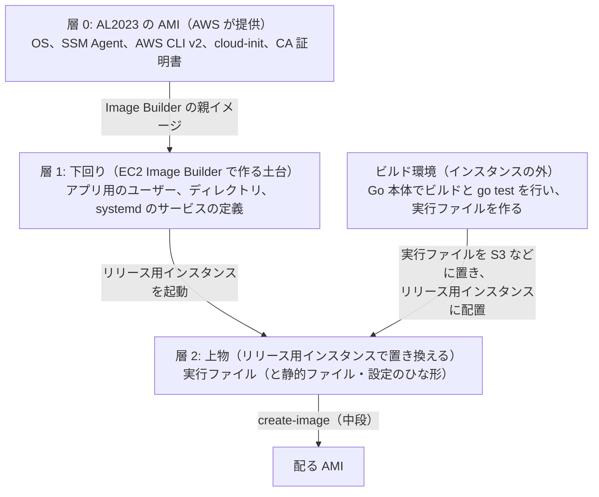

# 土台の構成（アプリが Go の場合）: Amazon Linux 2023 と Go

> 位置付け: [土台の構成: Amazon Linux 2023 と Ruby / Rails](./base-image-composition.md) と同じ観点で、**アプリが Go だった場合**を評価したもの。比較のための検討で、採用済みの構成ではない。OS（Amazon Linux 2023）は同じ前提にする。
>
> 調査日: 2026-10-27

## 前提

| # | 項目 | 前提 |
|---|---|---|
| B1 | OS | **Amazon Linux 2023**（以下 AL2023）。Ruby / Rails の場合と同じ |
| B2' | アプリ | **Go**。バージョンは流動的なため**確定を保留**する |

構成全体（土台は EC2 Image Builder、配る AMI はリリース用インスタンスからの `create-image`）も、Ruby / Rails の場合と同じ前提で評価する。

## 結論

- **Go は「サーバーに入れるミドルウェア」ではなく、「ビルドに使う道具」になる。** Go のアプリは 1 つの実行ファイルにビルドされ、動かすのに Go 本体は要らない。そのため、土台（下回り）に入れるものがほとんどなくなり、層の境目がはっきりする
- **Go のバージョンを変えても、土台を作り直す必要がない**（Ruby のバージョンは土台の作り直しが必要だった）。変わるのは、実行ファイルをビルドする環境だけ
- **新しく決めることは「どこでビルドするか」**。リリース用インスタンスの上でビルドすると、Go 本体を土台に入れることになり、利点が消える。インスタンスの外（CodeBuild や手元のコンテナ）でビルドし、実行ファイルを配る形が合う
- **構成全体への影響**: 上物が「実行ファイルを置き換えるだけ」になるので、常時起動のリリース用インスタンスを使い続ける理由が弱くなる。リリース用インスタンスを使い捨てにする形や、リリースごとに Image Builder で作る形との差が小さくなる（[構成全体への影響](#構成全体への影響)）

## Ruby / Rails の場合との比較

| 観点 | Ruby / Rails | Go |
|---|---|---|
| 動かすのに要るもの | Ruby、gem、gem が使うライブラリ | **実行ファイルだけ**（cgo を使わない場合） |
| 土台（下回り）に入れるもの | Ruby、コンパイラ、開発用ヘッダー、gem が使うライブラリ | アプリ用のユーザー、ディレクトリ、systemd のサービスの定義。ほかはほぼ AL2023 の既定のまま |
| 上物（リリースのたびに変えるもの） | アプリのソース、Rails を含む gem（`bundle install`） | **実行ファイル 1 つ**（と、必要なら静的ファイル・設定のひな形） |
| 言語のバージョンを変えるとき | 土台を作り直し、リリース用インスタンスを入れ替える | **ビルド環境の Go を変えるだけ**。土台は変えない |
| ビルドする場所 | リリース用インスタンスの上（`bundle install`、ネイティブ拡張のビルド） | **インスタンスの外**（CodeBuild、手元のコンテナなど）が合う |
| テストを実行する場所 | リリース用インスタンスの上（RSpec） | ビルドと同じ、インスタンスの外（`go test`）が合う。インスタンスの上では起動とヘルスチェックだけ |
| ドリフトの起きやすさ | 起きやすい（gem、ビルドの成果物、キャッシュが積み重なる） | 起きにくい（置き換えるのは実行ファイルだけ）。ただし手作業の変更をすれば同じことが起きる |
| OS のライブラリとの結び付き | 強い（ネイティブ拡張が OS のライブラリに対してビルドされる） | 弱い（cgo を使わなければ、OS のライブラリに依存しない） |

## 層の分け方

| 層 | 中身 | 誰がいつ変えるか |
|---|---|---|
| ビルド環境 | Go 本体、ビルドとテストの手順 | Go のバージョンを変えるとき。**AMI には入らない** |
| 0. AL2023 の AMI | OS、SSM Agent、AWS CLI v2、CA 証明書 | AWS が新しいリリースを出す。取り込むのは土台を作り直すとき |
| 1. 下回り（土台） | アプリ用の OS のユーザー、実行ファイルを置くディレクトリ、systemd のサービスの定義、（必要なら）前段の Web サーバー | Image Builder の定義を直して、土台を作り直すときだけ |
| 2. 上物 | 実行ファイル（リリースごとのディレクトリと、現在の版への切り替え）、静的ファイル、設定のひな形 | リリースのたびに、リリース用インスタンスで |

### Go 本体は土台に入れない

Go 本体を土台に入れてリリース用インスタンスの上でビルドすることもできるが、勧めない。

- 土台に Go のバージョンが入り込み、Go のバージョンを変えるたびに土台の作り直しが必要になる（Ruby と同じ状態に戻る）
- ビルドのキャッシュやモジュールのダウンロードがリリース用インスタンスに積み重なり、ドリフトの原因になる
- 本番の AMI に、動かすのに要らないコンパイラが入る

### 実行ファイルをどこでビルドするか

| 場所 | 内容 | 評価 |
|---|---|---|
| **CodeBuild（推奨）** | 中段と同じく CodePipeline / CodeBuild でビルドし、`go test` も行い、実行ファイルを S3 に置く。CodeBuild の標準イメージには Go が入っている | 中段の仕組みと揃う。ビルドの記録が残る |
| 手元のコンテナ | `amazonlinux:2023` のコンテナや Go の公式イメージでビルドする | 試すには手軽。本番用にするなら、手元の環境に左右されない形にする |
| リリース用インスタンスの上 | 土台に Go 本体を入れてビルドする | 勧めない（上の理由） |

この場合、前段（[release-verification](../release-verification/README.md)）の役割が変わる。テスト（Ruby の場合の RSpec）はビルド環境で行い、リリース用インスタンスでは「実行ファイルの配置、切り替え、再起動、ヘルスチェック」だけを行う。

### cgo を使うかどうか

| 場合 | 実行ファイル | 注意 |
|---|---|---|
| cgo を使わない（`CGO_ENABLED=0`） | OS のライブラリに依存しない | どこでビルドしても AL2023 で動く。**こちらに寄せるのが望ましい** |
| cgo を使う（C のライブラリを呼ぶ gem 相当のものを使う） | AL2023 の glibc などのライブラリに依存する | **AL2023 と同じ（または古い）ライブラリの環境でビルドする**必要がある。`amazonlinux:2023` のコンテナでのビルドが合う。依存するライブラリは土台に入れる |

### 実行ファイルが OS から借りるもの

cgo を使わなくても、Go の実行ファイルは次のものを OS から読む。

| もの | AL2023 での扱い |
|---|---|
| CA 証明書（HTTPS で外部に接続するとき） | AL2023 の既定に入っている（`ca-certificates`）。OS の更新で新しくなる |
| タイムゾーンの情報 | AL2023 の `tzdata` を使うか、実行ファイルに埋め込む（Go の `time/tzdata`） |
| DNS の名前解決の設定 | AL2023 の既定のまま |

## バージョンを保留していることの扱い

- Go のバージョンは、アプリの `go.mod`（`go` と `toolchain` の指定）と、ビルド環境で決まる。**土台の定義には出てこない**
- そのため、バージョンが流動的でも土台の作業（作業計画の W2・W3）は進められる。Ruby の場合の「1 か所のパラメーターにして、仮のバージョンで作る」という手当ても要らない
- 決める必要があるのは、ビルド環境の Go のバージョンを `go.mod` とどう合わせるか（CodeBuild のイメージに入っている版を使うか、`toolchain` の指定で自動で取得させるか）

## OS の更新の方針

Ruby / Rails の場合と同じ方針（OS の更新は土台の作り直しで行い、リリース用インスタンスでは OS を更新しない）がそのまま使える（[Ruby / Rails の場合の方針](./base-image-composition.md#os-の更新の方針)）。

Go の場合は、OS のライブラリとの結び付きが弱い（cgo を使わない場合）ため、**土台を作り直してもアプリを作り直す必要がない**。Ruby の場合は、土台を作り直したら `bundle install` のやり直しが必要だった。

## OS の自動更新と無停止での更新（Kernel Live Patching）

「AL2023 は無停止で、自動で OS の更新が走る」という話があるが、**正確ではない**。

| よくある理解 | 実際（調査日時点の AWS の文書） |
|---|---|
| OS の更新が自動で走る | **走らない**。パッケージのリポジトリは AMI の AL2023 のリリースで固定され、起動時にも追加のセキュリティ更新は自動では入らない。新しいリリースに上げるには、`dnf upgrade --releasever=<版>` で明示的に行う |
| 無停止で更新できる | **カーネルに限って、条件付きで**できる。Kernel Live Patching で、動いているカーネルに再起動なしでセキュリティ修正（重要度が important / critical のもの）と重大なバグの修正を当てられる |

Kernel Live Patching の条件と制約:

| 項目 | 内容 |
|---|---|
| 既定 | **無効**。`kpatch-dnf` を入れ、`dnf kernel-livepatch -y auto` で有効にし、`kpatch-runtime` と `kpatch` のサービスを入れて動かす |
| 適用 | 自動では当たらない。`dnf upgrade --security`（または個別の `dnf install`）で当てる。複数台なら Systems Manager からまとめて当てられる |
| 対象 | **カーネルだけ**。OpenSSL・glibc などのユーザー空間のパッケージは対象外で、更新後にサービスの再起動（または OS の再起動）が要る |
| 範囲 | ベストエフォート。すべての CVE がライブパッチで提供されるわけではなく、ライブパッチでは直せず通常のカーネルの更新と再起動が必要なものもある |
| 期間 | 1 つのカーネルの版に提供されるのは**リリースから 3 か月まで**。その後もライブパッチを受けるには、新しいカーネルに上げて再起動する |
| 条件 | x86_64 または ARM64、対応するカーネルの版（6.1 など） |
| 制約 | 適用中は、ハイバネーションや eBPF などの一部のデバッグツールが使えない |

この構成での扱い（案）:

| 対象 | 扱い |
|---|---|
| 土台とリリース用インスタンス | 方針は変えない（OS の更新は土台の作り直しで行う）。Kernel Live Patching は、作り直しまでの間の**一時的な手当て**であり、OS の更新の代わりにはならない |
| 配った本番などのインスタンス | 重大なカーネルの脆弱性で、土台の作り直しと入れ替えが間に合わないときの**緊急の手段**として使える。使うなら、土台で Kernel Live Patching を有効にしておくかを決める（有効にするかは未決） |
| アプリ | **OS の更新でも Kernel Live Patching でも、Go の実行ファイルは更新されない**。Go の標準ライブラリ（TLS などの暗号処理を含む）はビルド時に実行ファイルへ取り込まれ、OS の OpenSSL などは使わない。Go や依存モジュールのセキュリティ修正は、ビルド環境の Go や `go.mod` を上げて実行ファイルを作り直し、アプリのリリースとして取り込む |

参考: [Deterministic upgrades through versioned repositories on AL2023](https://docs.aws.amazon.com/linux/al2023/ug/deterministic-upgrades.html)、[Kernel Live Patching on AL2023](https://docs.aws.amazon.com/linux/al2023/ug/live-patching.html)

サイクル（いつ・何が・どの層を更新するか）の図は [更新のサイクル](./update-cycles.md)。

## AL2023 の性質とこの構成での扱い

Ruby / Rails の場合の一覧（[AL2023 の性質](./base-image-composition.md#al2023-の性質とこの構成での扱い)）がそのまま当てはまる。Go の場合に違う点だけを挙げる。

| 性質 | Go の場合の扱い |
|---|---|
| cron が入っていない | 定期実行は、systemd のタイマーで実行ファイルのサブコマンドを呼ぶ形にしやすい（cron を入れる必要が薄い） |
| systemd | アプリは systemd のサービスとして動かす。1024 番より小さいポート（80・443）で直接待ち受けるなら、サービスの定義で権限（`AmbientCapabilities=CAP_NET_BIND_SERVICE`）を与えるか、前段に Web サーバーを置く |
| AL2023 のパッケージの Go（`golang`） | 使わない（Go 本体はビルド環境に置き、土台には入れない） |

## 構成全体への影響

「土台は Image Builder、配る AMI は常時起動のリリース用インスタンスから `create-image`」という構成は、Go でもそのまま使える。ただし、評価のバランスが変わる。

| 観点 | Ruby / Rails | Go |
|---|---|---|
| 常時起動のリリース用インスタンスを使う利点 | 大きい（`bundle install` やネイティブ拡張のビルドを毎回まっさらな状態から行わずに済み、速い） | **小さい**（上物の更新は実行ファイルの置き換えだけで、まっさらなインスタンスでも速い） |
| 常時起動のリリース用インスタンスの欠点（ドリフト、固有の状態、常時起動の費用） | 利点と釣り合う | **利点に対して目立つ** |

そのため、Go の場合は次の形も現実的な候補になる（いずれも今は採用していない）。

| 候補 | 内容 | 中段への影響 |
|---|---|---|
| リリース用インスタンスを使い捨てにする | リリースのたびに土台の AMI から起動し、実行ファイルを置いて確かめ、AMI を作ったら終了する | 中段は「常時起動のインスタンス ID を設定値に持つ」前提なので、作り替えが要る |
| リリースごとに Image Builder で作る | 土台の AMI を親にして、実行ファイルを置くコンポーネントだけのレシピで AMI を作る | 中段の AMI の作成を Image Builder に置き換えることになる（[メモ: EC2 Image Builder を使う案](../notes/ami-publish/ami-build-image-builder-options-memo.md)の案 3 に近い。Go なら「毎回 `bundle install` で遅い」という欠点がほぼない） |

中段はすでに常時起動のリリース用インスタンスを前提に実装済みなので、Go の場合も、まずは今の構成で始め、上の候補は運用の負担（ドリフトの管理、常時起動の費用）が見えてから比べるのが順当である。

## 未決のこと

| 項目 | 決めるときの材料 |
|---|---|
| Go のバージョンと、ビルド環境での合わせ方 | アプリの `go.mod`。CodeBuild のイメージに入っている版 |
| cgo を使うか | 使うライブラリ（例: SQLite の一部のドライバーは cgo を使う） |
| ビルドの場所と、実行ファイルの置き場所 | CodeBuild にするか。S3 のバケットとキーの決め方 |
| 前段の Web サーバーを置くか | TLS をどこで終端するか（Let's Encrypt の扱い）、80・443 で直接待ち受けるか |
| 静的ファイル・設定のひな形の扱い | 実行ファイルに埋め込む（Go の `embed`）か、別のファイルとして配るか |
| データベースのマイグレーション | どこで実行するか（実行ファイルのサブコマンドにするか、別の手順にするか） |
| アプリ用の OS のユーザー、ディレクトリ、ログ | systemd のサービスの定義の中身（ログは journald に出すか、ファイルにするか） |
| 前段（release-verification）の作り直し | テストをビルド環境に移したときの、リリース用インスタンスでの確認の範囲 |
| Kernel Live Patching を土台で有効にするか | 配ったインスタンスで、緊急のカーネルの修正を再起動なしで当てる手段を持つか（[OS の自動更新と無停止での更新](#os-の自動更新と無停止での更新kernel-live-patching)） |
