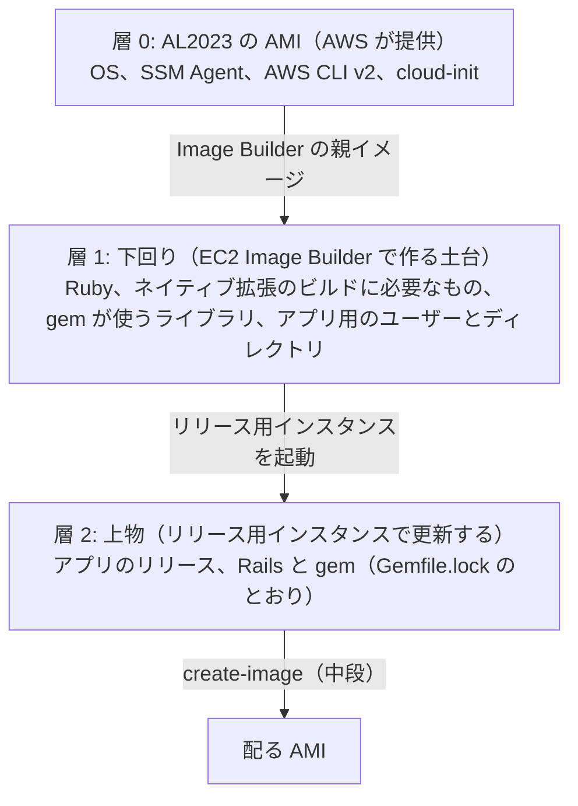

# 土台の構成: Amazon Linux 2023 と Ruby / Rails

> 位置付け: 起点（[initial-image-build](./README.md)）で作る最初のイメージ（土台）の構成のうち、**OS と、アプリを動かすミドルウェア**について決めたことと、そこから決まる構成をまとめる。[作業計画](./work-plan.md)の論点 I2（親イメージ）・I3（下回りと上物の境目）の一部にあたる。
>
> 調査日: 2026-10-27（AWS の文書の内容は変わることがあるため、実装時に出典で確認する）
>
> 比較: アプリが Go だった場合の評価は [土台の構成（アプリが Go の場合）](./base-image-composition-go.md)

## 決めたこと

| # | 項目 | 決定 |
|---|---|---|
| B1 | OS | **Amazon Linux 2023**（以下 AL2023）。EC2 Image Builder の親イメージに、AWS が提供する AL2023 の AMI を使う |
| B2 | アプリを動かすミドルウェア | **Ruby / Rails**。バージョンは流動的なため**確定を保留**する（下の「バージョンを保留していることの扱い」） |

Web サーバー・アプリサーバー（Apache / nginx、Passenger / Puma）、データベースのクライアント、JavaScript の実行環境などは、この文書では決めない（[未決のこと](#未決のこと)）。

## 前回の評価からの変化

「土台は EC2 Image Builder、配布物はリリース用インスタンスから `create-image`」という構成の評価で挙げた懸念のうち、B1・B2 で次のように変わる。

| 前回の懸念 | B1・B2 の後 |
|---|---|
| 今の OS（CentOS 系）を Image Builder で扱えるか、サポートが終了している | **解消**。AL2023 は Image Builder の親イメージとして AWS が提供している。サポートの終了は 2029-06-30 |
| OS のセキュリティ更新を、リリース用インスタンスでその場で行うか、土台を作り直すか | **土台の作り直しに寄せやすくなる**。AL2023 はパッケージのリポジトリが版（リリース）で固定され、`dnf upgrade` だけでは新しいリリースのパッケージに上がらない。OS の更新を「新しい AL2023 の AMI を親にして土台を作り直す」に一本化すると、リリース用インスタンスで OS を変えずに済む（[OS の更新の方針](#os-の更新の方針)） |
| ヘルスチェックの Basic 認証で使う AWS CLI が v1（Python に依存）かもしれない | **解消**。AL2023 の AMI には AWS CLI v2 と SSM Agent が最初から入っている |
| リリース用インスタンスが土台からずれていく（ドリフト） | **残る**。OS を変えても、リリース用インスタンスで手作業の変更をすれば同じことが起きる。「リリース用インスタンスで変えてよいのは上物のアプリだけ」のルールは引き続き必要 |
| AMI にインスタンス固有の状態が残る | **残る**。AL2023 でも `create-image` はインスタンスの中身をそのまま写す |
| 土台の版を配る AMI から追えない | **残る**。配る AMI のタグに土台の版を入れる対応は引き続き必要 |
| 今の構成（CentOS 系）からの移行 | **新しく増える**。OS が変わるため、今の手作業の手順（ユーザー名、cron など）をそのまま移せない（[今の構成からの移行で変わること](#今の構成からの移行で変わること)） |

## 層の分け方

配る AMI は、次の 3 つの層を重ねたものになる。

| 層 | 中身 | 誰がいつ変えるか |
|---|---|---|
| 0. AL2023 の AMI | OS、SSM Agent、AWS CLI v2、cloud-init | AWS が新しいリリースを出す。取り込むのは土台を作り直すとき |
| 1. 下回り（土台） | Ruby、ビルドに必要なもの（コンパイラ、ヘッダー）、gem が使うライブラリ、アプリ用の OS のユーザー、アプリを置くディレクトリ、定期実行の仕組み | **Image Builder の定義を直して、土台を作り直すときだけ** |
| 2. 上物 | アプリのリリース（`releases/<バージョン>` と `current`）、Rails を含む gem | リリースのたびに、リリース用インスタンスで（[前段](../release-verification/README.md)） |

### Rails は上物に入る

**Rails は OS に入れるミドルウェアではなく、アプリの gem である。** バージョンはアプリの `Gemfile.lock` が決め、リリース用インスタンスでの `bundle install` で入る。そのため、Rails のバージョンを上げても土台は作り直さない（アプリのリリースとして扱う）。

土台が用意するのは、「Rails とその依存の gem を `bundle install` できる環境」である。

| 土台に入れるもの | 理由 |
|---|---|
| Ruby（アプリの `.ruby-version` と同じバージョン） | アプリを動かす |
| C コンパイラ、make、Ruby のビルドに必要な開発用ヘッダー | ネイティブ拡張を持つ gem の `bundle install` に必要 |
| gem が使うライブラリ（データベースのクライアントのライブラリ、画像処理など） | 何が要るかは、アプリの `Gemfile.lock` から決める（未決） |

### Ruby は下回りに入る

Ruby のバージョンを変えるときは、**土台を作り直す**。リリース用インスタンスで新しい Ruby を入れると、土台の定義に入っていない変更（ドリフト）になるため。

- アプリの `.ruby-version` を上げるリリースは、先に新しい Ruby の土台を作り、リリース用インスタンスを入れ替えてから行う
- gem のネイティブ拡張は、その Ruby とライブラリに対してビルドされる。土台を作り直したら、リリース用インスタンスでは `bundle install` をやり直す（入れ替えの手順の一部）

## Ruby の入れ方

AL2023 には、OS のパッケージとしての Ruby がある。ただし、提供される版が限られる。

| 方式 | 内容 | 利点 | 欠点 |
|---|---|---|---|
| A. AL2023 のパッケージ（`dnf install ruby3.4` など） | AL2023 が提供する Ruby。版ごとに名前が分かれていて（`ruby3.2`・`ruby3.4` など）、並べて入れられる | 早い（コンパイルしない）。セキュリティ更新が OS のリポジトリから来る | **AL2023 が提供する版しか選べない**（ユーザーガイドで確認できたのは 3.2 と 3.4）。コマンドの名前が版付き（`ruby3.4`）で、`ruby` や `bundle` をどれに向けるかの設定が要る。パッチバージョンは AL2023 のリリースに従う |
| B. rbenv と ruby-build でソースからビルド | 土台のビルド中に、指定したバージョンの Ruby をコンパイルして入れる | **アプリの `.ruby-version` と同じバージョンを、パッチバージョンまで選べる**。中段の CodeBuild や手元と同じ rbenv の流儀になる | 土台のビルドが数分長くなる。Ruby のセキュリティ更新は、バージョンを上げて土台を作り直して取り込む |

**仮の推奨: B（rbenv と ruby-build）。** バージョンが流動的な間は、アプリが求めるバージョンにそのまま合わせられる方が都合がよい。アプリの Ruby が AL2023 の提供する版と一致し、パッチバージョンを OS に任せてよいと決まった時点で、A に切り替える余地がある。最終的な決定は、バージョンの確定と合わせて行う。

どちらの方式でも、**アプリ・systemd のサービス・定期実行が使う `ruby` と `bundle` のパスを 1 つに決めて、土台の定義に書く**（シェルの初期化ファイルに頼ると、systemd から起動したときに別の Ruby が使われることがある）。

## バージョンを保留していることの扱い

Ruby のバージョンは確定していないが、土台の定義は先に作れるようにする。

- Ruby のバージョンは、土台の定義の中に直接書かず、**1 か所のパラメーター**にする（Image Builder のコンポーネントのパラメーター、または中段と同じく設定値ファイルから生成する値）
- 骨組みの段階（作業計画の W2）では仮のバージョンで作り、確定したらパラメーターを変えて土台を作り直す
- Rails のバージョンは土台に関係しない（上物）。ただし、Rails のバージョンが求める Ruby の最低バージョンは、Ruby のバージョンを決めるときの条件になる

## OS の更新の方針

AL2023 では、インスタンスが使うパッケージのリポジトリは、その AMI の AL2023 のリリース（例: `2023.x.YYYYMMDD`）で固定されている。新しいリリースのパッケージに上げるには、上げる先のリリースを明示する必要がある。

この性質を使って、OS の更新を次の形に一本化する（案）。

| 方針 | 内容 |
|---|---|
| OS の更新は土台の作り直しで行う | Image Builder の親イメージに新しい AL2023 の AMI を使って土台を作り直し、リリース用インスタンスを入れ替える |
| リリース用インスタンスでは OS を更新しない | `dnf upgrade` でリリースを上げる操作をしない。上物のアプリの更新だけを行う |
| 緊急の更新 | 重大な脆弱性のときだけ例外を認めるかは、別途決める（例外にするなら、同じ変更を土台の定義にも入れて作り直す） |
| 頻度 | 土台を定期的に作り直す（定義が壊れていないかの確認を兼ねる）。頻度は別途決める |

## OS の自動更新と無停止での更新（Kernel Live Patching）

「AL2023 は無停止で、自動で OS の更新が走る」という話があるが、**正確ではない**。

| よくある理解 | 実際（調査日時点の AWS の文書） |
|---|---|
| OS の更新が自動で走る | **走らない**。パッケージのリポジトリは AMI の AL2023 のリリースで固定され、起動時にも追加のセキュリティ更新は自動では入らない。新しいリリースに上げるには、`dnf upgrade --releasever=<版>` で明示的に行う |
| 無停止で更新できる | **カーネルに限って、条件付きで**できる。Kernel Live Patching で、動いているカーネルに再起動なしでセキュリティ修正（重要度が important / critical のもの）と重大なバグの修正を当てられる |

Kernel Live Patching の条件と制約:

| 項目 | 内容 |
|---|---|
| 既定 | **無効**。`kpatch-dnf` を入れ、`dnf kernel-livepatch -y auto` で有効にし、`kpatch-runtime` と `kpatch` のサービスを入れて動かす |
| 適用 | 自動では当たらない。`dnf upgrade --security`（または個別の `dnf install`）で当てる。複数台なら Systems Manager からまとめて当てられる |
| 対象 | **カーネルだけ**。OpenSSL・glibc などのユーザー空間のパッケージは対象外で、更新後にサービスの再起動（または OS の再起動）が要る |
| 範囲 | ベストエフォート。すべての CVE がライブパッチで提供されるわけではなく、ライブパッチでは直せず通常のカーネルの更新と再起動が必要なものもある |
| 期間 | 1 つのカーネルの版に提供されるのは**リリースから 3 か月まで**。その後もライブパッチを受けるには、新しいカーネルに上げて再起動する |
| 条件 | x86_64 または ARM64、対応するカーネルの版（6.1 など） |
| 制約 | 適用中は、ハイバネーションや eBPF などの一部のデバッグツールが使えない |

この構成での扱い（案）:

| 対象 | 扱い |
|---|---|
| 土台とリリース用インスタンス | 方針は変えない（OS の更新は土台の作り直しで行う）。Kernel Live Patching は、作り直しまでの間の**一時的な手当て**であり、OS の更新の代わりにはならない |
| 配った本番などのインスタンス | 重大なカーネルの脆弱性で、土台の作り直しと入れ替えが間に合わないときの**緊急の手段**として使える。使うなら、土台で Kernel Live Patching を有効にしておくかを決める（有効にするかは未決） |
| アプリを動かすミドルウェア | **OS の更新でも Kernel Live Patching でも、rbenv と ruby-build で入れた Ruby と gem は更新されない**。Ruby のセキュリティ修正は、Ruby のバージョンを上げて土台を作り直して取り込む。gem（Rails を含む）の修正は、アプリのリリースとして取り込む |

参考: [Deterministic upgrades through versioned repositories on AL2023](https://docs.aws.amazon.com/linux/al2023/ug/deterministic-upgrades.html)、[Kernel Live Patching on AL2023](https://docs.aws.amazon.com/linux/al2023/ug/live-patching.html)

サイクル（いつ・何が・どの層を更新するか）の図は [更新のサイクル](./update-cycles.md)。

## AL2023 の性質とこの構成での扱い

| 性質 | この構成での扱い |
|---|---|
| SSM Agent が入っている | 中段（リリース用インスタンスのヘルスチェック）と、Session Manager での接続にそのまま使える。自動起動になっていることを土台の検証で確かめる |
| AWS CLI v2 が入っている | ヘルスチェックの Basic 認証の読み取りに使える。OS の Python には依存しない |
| 既定のユーザーは `ec2-user` | 今の手順の `centos` ユーザーはない。アプリを動かす OS のユーザーは、土台で別に作る（名前は未決） |
| cron が入っていない（`cronie` が既定で入っていない） | AWS は systemd のタイマーへの移行を勧めている。今のアプリが cron を使っているなら、`cronie` を入れるか、systemd のタイマーに移すかを決める |
| SELinux は有効で、モードは permissive | 拒否は記録されるが、止めはしない。enforcing にするかは別途決める |
| 標準サポートは 2027-06-30 まで、その後メンテナンス（セキュリティと重大なバグの修正だけ）が 2029-06-30 まで | それまでに次の OS への移行が必要になる。土台を定義で作れるようにしておくことが、その移行の準備にもなる |
| EPEL が使えない | EPEL にしかないパッケージは使えない。今の構成で EPEL のパッケージを使っていれば、代わりを探す（例: Let's Encrypt の certbot は pip で入れる。[自動化の設計](../notes/ec2-operations/letsencrypt-automation.md)） |

## 今の構成からの移行で変わること

今の手作業の手順（[整理](../instance-provisioning/manual-procedure-analysis.md)）は CentOS 系を前提にしているため、次の点がそのままでは移せない。

| 今の手順 | AL2023 での扱い |
|---|---|
| centos ユーザーの `.bashrc` | `ec2-user`、またはアプリ用のユーザーに置き換える |
| cron を使う処理（あれば） | `cronie` を入れるか、systemd のタイマーに移す |
| パッケージ名・設定ファイルの場所 | AL2023 の dnf のパッケージで置き換える。Web サーバーの設定の場所も、使うものが決まってから確かめる |
| EPEL などの追加のリポジトリのパッケージ | 代わりを探す |

作業計画の W0（今の下回りの棚卸し）では、「今の構成に何があるか」に加えて、「AL2023 で何に置き換えるか」も一覧に入れる。

## 未決のこと

| 項目 | 決めるときの材料 |
|---|---|
| Ruby のバージョン | アプリの `.ruby-version`、Rails のバージョンが求める最低バージョン |
| Ruby の入れ方（A / B） | バージョンの確定。AL2023 が提供する版と一致するか |
| Web サーバー・アプリサーバー | 今の構成（手順書は Apache、全体の設計は nginx + Passenger）。W0 で実態を確定してから決める |
| データベースのクライアントのライブラリ | アプリの `Gemfile.lock`（例: MySQL なら `mysql2` が使うクライアントのライブラリ） |
| JavaScript の実行環境（Node.js など） | アセットのプリコンパイルに必要か（アプリの構成による） |
| 画像処理などのライブラリ | アプリの `Gemfile.lock` |
| アプリ用の OS のユーザー | 名前と権限 |
| 定期実行 | cron（`cronie`）か systemd のタイマーか |
| SELinux のモード | permissive のままか、enforcing にするか |
| タイムゾーン・ロケール | AL2023 の既定（UTC）のままか、日本時間にするか |
| Kernel Live Patching を土台で有効にするか | 配ったインスタンスで、緊急のカーネルの修正を再起動なしで当てる手段を持つか（[OS の自動更新と無停止での更新](#os-の自動更新と無停止での更新kernel-live-patching)） |

## 参考

- [Package support information - Amazon Linux 2023](https://docs.aws.amazon.com/linux/al2023/release-notes/support-information.html)（サポートの終了日）
- [Ruby in AL2023 - Amazon Linux 2023](https://docs.aws.amazon.com/linux/al2023/ug/ruby.html)（AL2023 が提供する Ruby の版とパッケージ名）
- [systemd timers replace cron - Amazon Linux 2023](https://docs.aws.amazon.com/linux/al2023/ug/cron.html)
- [Default SELinux status and modes for AL2023 - Amazon Linux 2023](https://docs.aws.amazon.com/linux/al2023/ug/default-SELinux-modes-states.html)
- [Deterministic upgrades through versioned repositories on AL2023 - Amazon Linux 2023](https://docs.aws.amazon.com/linux/al2023/ug/deterministic-upgrades.html)
- [Kernel Live Patching on AL2023 - Amazon Linux 2023](https://docs.aws.amazon.com/linux/al2023/ug/live-patching.html)
