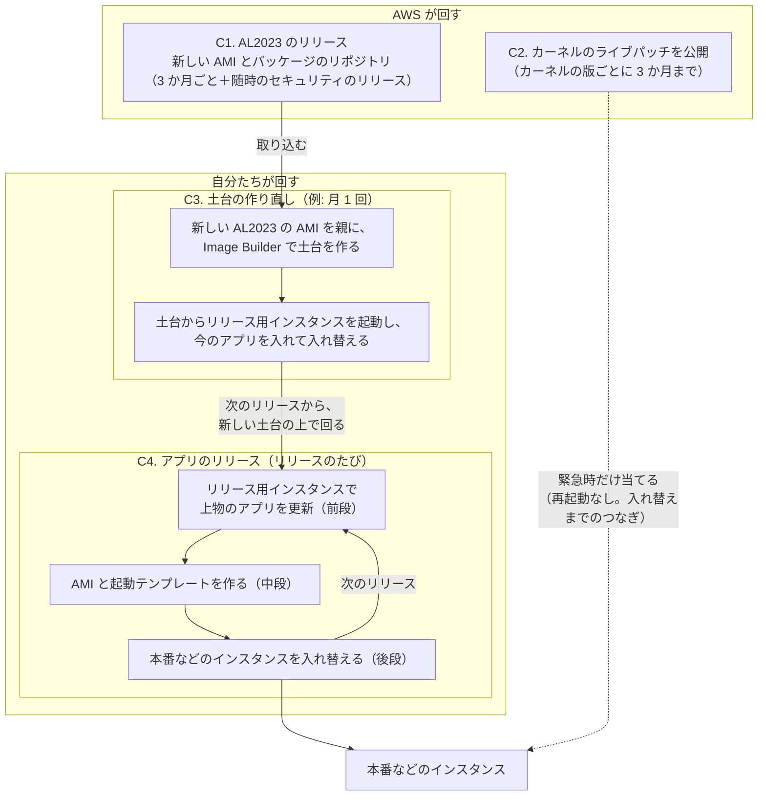
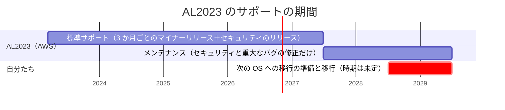
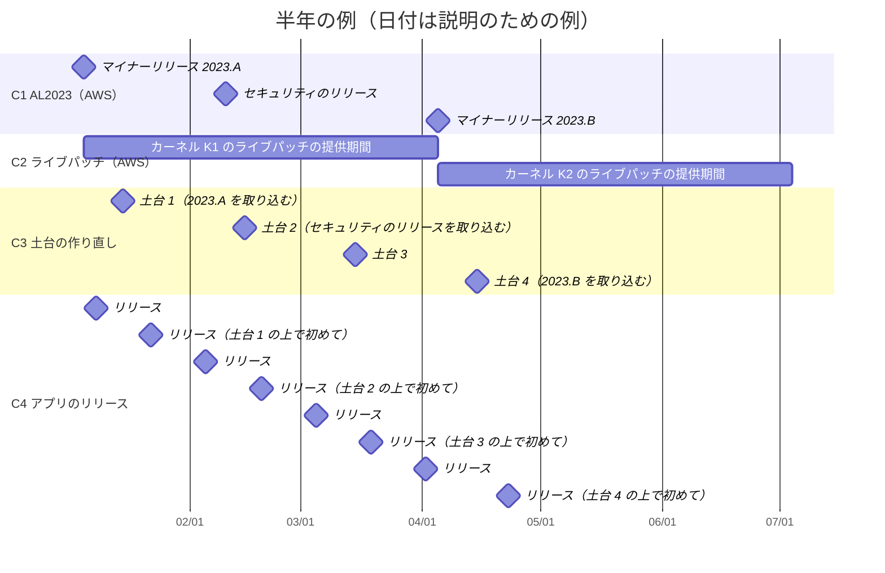
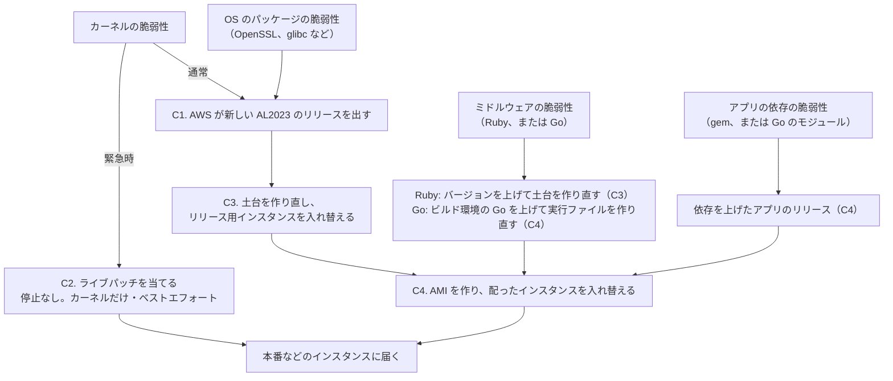

# 更新のサイクル: AL2023 の更新、ライブパッチ、土台の作り直し、アプリのリリース

> 位置付け: [土台の構成](./base-image-composition.md)（Go の場合は [こちら](./base-image-composition-go.md)）の「OS の更新の方針」と「OS の自動更新と無停止での更新（Kernel Live Patching）」を、**いつ・何が・どの層を更新するか**の図で示す。土台の作り直しの頻度などは未決のため、図の中の頻度と日付は説明のための例である。
>
> 調査日: 2026-10-27（AWS の文書の内容は変わることがあるため、実装時に出典で確認する）

## 1. 4 つのサイクル

更新の仕組みは、回る速さの違う 4 つのサイクルに分かれる。**AWS が回すもの**と**自分たちが回すもの**があり、AWS が新しいものを出しても、自分たちのサイクルで取り込むまでは、配ったインスタンスには届かない。

| # | サイクル | 誰が回すか | 速さ | 更新される層 | 停止 |
|---|---|---|---|---|---|
| C1 | AL2023 のリリース（新しい AMI とパッケージのリポジトリ） | AWS | マイナーリリースは 3 か月ごと（標準サポートの間）。間にセキュリティのリリースが入り、そのたびに新しい AMI が出る | 層 0（OS） | — （出るだけで、何も更新されない） |
| C2 | カーネルのライブパッチ | AWS が出し、**自分たちが当てる** | 脆弱性に応じて随時。1 つのカーネルの版に出るのはリリースから 3 か月まで | 動いているカーネル（メモリ上）だけ | **なし** |
| C3 | 土台の作り直し（EC2 Image Builder）と、リリース用インスタンスの入れ替え | 自分たち | 例: 月 1 回（未決）。C1 の新しい AMI を取り込む | 層 0・層 1（OS、下回り） | リリース用インスタンスの入れ替え。配ったインスタンスは C4 で入れ替わるまで変わらない |
| C4 | アプリのリリース（中段の AMI 公開 → 後段の配布） | 自分たち | リリースのたび（最も速い） | 層 2（上物）。C3 の後なら層 0・層 1 も一緒に届く | 配ったインスタンスの入れ替え |

## 2. サイクルの入れ子

C4（アプリのリリース）は、C3（土台の作り直し）で作ったリリース用インスタンスの上で回る。C3 で取り込んだ OS の更新は、**次の C4 で AMI になり、配布で入れ替えたときに初めて本番などのインスタンスに届く**。C2（ライブパッチ）は、この流れとは別に、配ったインスタンスに直接当てる緊急の手段である。

## 3. 時間の流れ（例）

### AL2023 の一生

AL2023 は、標準サポートの間は 3 か月ごとにマイナーリリースが出る。標準サポートの後はメンテナンスの期間で、セキュリティと重大なバグの修正だけが出る。その後はサポートが終わり、次の OS への移行が必要になる。

### 半年の例

日付はすべて説明のための例である（実際の AL2023 のリリース日とは関係ない）。土台の作り直しは月 1 回、アプリのリリースは月 2 回と仮定している。

この例から読み取れること:

- 2/10 に AWS がセキュリティのリリースを出しても、本番などのインスタンスに届くのは、2/15 の土台 2 を経て、**2/19 のリリースで配ったインスタンスを入れ替えたとき**である。その間（約 9 日）は、本番などのインスタンスは古い OS のまま動いている
- その間にカーネルの重大な脆弱性があれば、C2 のライブパッチで、配ったインスタンスに再起動なしで当てられる（ライブパッチが出ていれば）
- カーネル K1 のライブパッチは 4 月初めで提供が終わる。それ以降もライブパッチを受けるには、新しいカーネル（K2）を含む土台に入れ替わっている必要がある。**C3 と C4 が 3 か月以上止まると、ライブパッチという緊急の手段も使えなくなる**

## 4. 修正が本番などのインスタンスに届くまでの道筋

種類によって、届く道筋と停止の有無が違う。

| 脆弱性の種類 | 通常の道筋 | 停止なしで当てる手段 |
|---|---|---|
| カーネル | C1 → C3 → C4（入れ替え） | **C2 のライブパッチ**（出ていれば。カーネルの版ごとに 3 か月まで） |
| OS のパッケージ（OpenSSL、glibc など） | C1 → C3 → C4（入れ替え） | なし（更新しても、使っているサービスの再起動が要る） |
| Ruby（Ruby / Rails の場合） | Ruby のバージョンを上げて C3 → C4 | なし |
| Go（Go の場合） | ビルド環境の Go を上げて C4 | なし。**OS の OpenSSL を更新しても Go のアプリには効かない**（Go は暗号処理を実行ファイルに取り込んでいる） |
| アプリの依存（gem、Go のモジュール） | C4 | なし |

## 5. 決めること

| # | 論点 | 図から見えること |
|---|---|---|
| U1 | C3（土台の作り直し）の頻度 | AWS のセキュリティのリリースから本番などに届くまでの最大の遅れは、ほぼ「C3 の間隔＋次の C4 までの間隔」になる |
| U2 | C3 を AWS のセキュリティのリリースに合わせて臨時に回すか | 重要度の高いリリースのときだけ、定期の C3 を待たずに回すか |
| U3 | アプリのリリースがない期間の扱い | C4 が回らないと、C3 で取り込んだ OS の更新は本番などに届かない。アプリに変更がなくても、土台を更新するためだけのリリース（同じアプリの版で AMI を作り直して配る）を行うか |
| U4 | Kernel Live Patching を使うか | 使うなら土台で有効にしておく。C3・C4 が 3 か月以上止まると使えなくなる |
| U5 | 次の OS への移行の時期 | 標準サポートの終了（2027-06-30）からメンテナンスの終了（2029-06-30）までの間に移行する |

## 参考

- [Amazon Linux 2023 の運用のチップス](../notes/ec2-operations/amazon-linux-2023-operations-tips.md)（セキュリティ更新の実行のしかた、その場での更新の注意）
- [Release cadence - Amazon Linux 2023](https://docs.aws.amazon.com/linux/al2023/ug/release-cadence.html)（3 か月ごとのマイナーリリース、標準サポートとメンテナンスの期間、リリースごとの新しい AMI）
- [Deterministic upgrades through versioned repositories on AL2023](https://docs.aws.amazon.com/linux/al2023/ug/deterministic-upgrades.html)
- [Kernel Live Patching on AL2023](https://docs.aws.amazon.com/linux/al2023/ug/live-patching.html)
