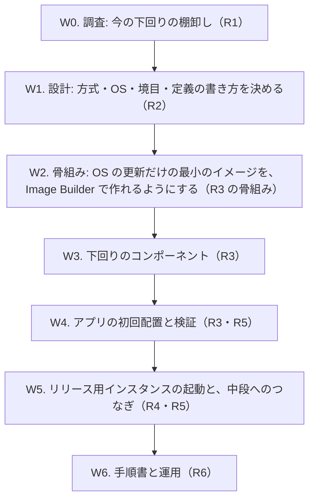

# 作業計画: 起点 — ソースからの最初のイメージの作成

> 位置付け: [initial-image-build](./README.md)（全体のフローの手順 1・2）で用意する成果と、その作業の順番。方式などの決定は W1 で行い、決まったら設計のドキュメントに書く。
>
> 進め方: 先に**骨組み**（最小の内容で「ソース → 最初のイメージ → リリース用インスタンス → 中段のパイプラインが動く」までを一度つなぐ）を作り、その後に下回りの中身を詰める。

## 用意する成果

| # | 成果 | 内容 | 作る作業 |
|---|---|---|---|
| R1 | 下回りの構成の一覧 | 今のリリース用インスタンス（または今の AMI）の OS、パッケージ、Ruby、Web サーバー、アプリサーバー、systemd のサービス、定期実行、ユーザー、ディレクトリ構成と、アプリの配置の形 | W0 |
| R2 | 設計（決定事項） | 方式、親イメージ（OS）、下回りと上物の境目、起動時に入れるもの、定義の書き方と生成、名前と権限 | W1 |
| R3 | 最初のイメージのビルドの定義 | EC2 Image Builder のコンポーネント（下回りの導入、アプリの初回配置、検証）・イメージレシピ・インフラストラクチャ設定・パイプラインと、それをデプロイする CloudFormation テンプレート | W2〜W4 |
| R4 | リリース用インスタンスの起動の定義 | 最初のイメージからリリース用インスタンスを起動する定義（または手順）。中段の前提（インスタンスプロファイルを付けない、SSM Agent の自動起動、リリース用インスタンスの IAM ロールのスタック）を満たす | W5 |
| R5 | 検証 | 最初のイメージの検証（Image Builder の test フェーズ）と、リリース用インスタンスから中段のパイプラインを 1 回通した結果 | W4・W5 |
| R6 | 手順書 | 最初のイメージの作成、リリース用インスタンスの起動、下回りを作り直したときのリリース用インスタンスの入れ替え、トラブルシューティング | W6 |
| （R7） | Docker の定義（W1 で採用した場合だけ） | 下回りの導入の処理を手元で試すための Dockerfile。EC2 は起動できないので、AMI の作成には使わない | W1 で判断 |

## 作業

W2 で骨組みができたら、W5 のつなぎ（最小のイメージからリリース用インスタンスを起動し、中段のパイプラインが通るか）を先に一度試してもよい。つなぎの問題を早く見つけられる。

### W0. 調査: 今の下回りの棚卸し

| 項目 | 内容 |
|---|---|
| やること | 今の AMI から開発用のインスタンスを起動し、下回りの構成を集めて一覧にする（[開発手順: AMI から開発用のインスタンスを起動し、ファイルを S3 に集める](../instance-provisioning/development-collect-files-from-ami.md)）。手作業の手順書（[現状の手作業の構築手順の整理](../instance-provisioning/manual-procedure-analysis.md)）とも突き合わせる |
| 集めるもの | OS とバージョン、導入済みのパッケージの一覧、Ruby のバージョンと入れ方（rbenv など）、Web サーバー・アプリサーバーの設定、systemd のサービス、定期実行、OS のユーザー、アプリの配置のディレクトリ、SSM Agent・AWS CLI の有無とバージョン |
| 成果 | R1（下回りの構成の一覧） |
| 完了条件 | 「ソースと R1 だけで、同じ構成を作れる」と言える粒度になっている |

**確認が必要な食い違い**: 手作業の手順書では Web サーバーが Apache（httpd）、OS が CentOS 系だが、[全体の設計](../ami-build-pipeline.md)は nginx + Passenger を前提にしている。どちらが実態かを W0 で確定する。

### W1. 設計: 決めること

| # | 論点 | 選択肢・考えること |
|---|---|---|
| I1 | 方式 | EC2 Image Builder（AMI を作る）。Docker は、下回りの導入の処理を手元で試す用途に限って併用するかどうか（systemd やカーネルの違いがあり、手元の確認と AMI の結果は一致しない） |
| I2 | 親イメージ（OS） | **決定: Amazon Linux 2023**（[土台の構成](./base-image-composition.md)の B1）。今の構成（CentOS 系）からの移行になるため、アプリとミドルウェアの動作確認が別に必要 |
| I3 | 下回りと上物の境目 | **一部決定**: Ruby は下回り（変えるときは土台を作り直す）、Rails は gem として上物（[土台の構成](./base-image-composition.md)の B2。バージョンは保留）。Web サーバー・アプリサーバー、gem が使うライブラリなどは未決 |
| I4 | 起動時に入れるもの | 設定値、シークレット（DB の接続情報、`master.key` など）、サーバーごとの値。イメージには入れない。test フェーズ（シークレットなし）でアプリをどこまで確かめるか |
| I5 | 定義の書き方と生成 | 実装言語の方針（[決定事項 D10](../ami-publish-development-plan.md)）に合わせ、中段と同じく「設定値ファイル + Go の生成ツールで CloudFormation テンプレートを生成し、担当者が AWS CLI でデプロイする」形にするか。コンポーネントの中身はシェルになるので、「シェルは最小限」との兼ね合い |
| I6 | 置き場所と名前 | 実装を置く場所（例: このフォルダの下に中段の `ami-publish/` と同じ構成で置く）。リソースの名前の規則（中段の命名規則 `<application_name>-<環境>-...` に合わせる） |
| I7 | 権限とネットワーク | Image Builder のビルド用インスタンスのロール、ビルドを動かすサブネットと外への経路（パッケージの取得、SSM） |
| I8 | 手順 2 の起動のしかた | リリース用インスタンスを CloudFormation のスタックで作るか、AWS CLI の手順にするか。下回りを作り直したときの入れ替え（新旧のリリース用インスタンスの切り替えと、中段の設定値 `release_instance_id` の更新） |

| 項目 | 内容 |
|---|---|
| 成果 | R2（設計。決定事項を I1〜I8 の番号で残す） |
| 完了条件 | I1〜I8 が決まり、W2 以降の作業の形が決まっている |

### W2. 骨組み: 最小のイメージ

| 項目 | 内容 |
|---|---|
| やること | 親イメージに OS の更新だけを行う最小のコンポーネントで、Image Builder のパイプラインを作る。I5 で決めた形（生成ツールと CloudFormation など）で、定義からデプロイまでを一通りつなぐ |
| 成果 | R3 の骨組み（中身は最小） |
| 完了条件 | 開発用のアカウントで、パイプラインの実行から AMI ができる。定義を直して作り直せる |

### W3. 下回りのコンポーネント

| 項目 | 内容 |
|---|---|
| やること | R1 と I3 にもとづき、下回りの導入をコンポーネントにする（パッケージ、Ruby、Web サーバー・アプリサーバー、ユーザー、ディレクトリ、SSM Agent の自動起動）。コンポーネントの validate で、入ったことを確かめる |
| 成果 | R3（下回り） |
| 完了条件 | 作った AMI から起動したインスタンスが、R1 の下回りの構成と一致する |

### W4. アプリの初回配置と検証

| 項目 | 内容 |
|---|---|
| やること | アプリの初回の版を、前段と同じディレクトリ構成（`releases/<バージョン>` と `current`）で配置する。test フェーズで、アプリが起動して応答するかを確かめる（I4 で決めた範囲） |
| 成果 | R3（アプリの初回配置）、R5（最初のイメージの検証） |
| 完了条件 | 最初のイメージから起動したインスタンスで、手順 3 の「上物のアプリだけの更新」がそのまま行える状態になっている |

### W5. リリース用インスタンスの起動と、中段へのつなぎ

| 項目 | 内容 |
|---|---|
| やること | 最初のイメージからリリース用インスタンスを起動する（I8）。中段の前提を満たすことを確かめ、中段の設定値 `release_instance_id` を設定して、AMI 公開パイプラインを 1 回通す |
| 成果 | R4、R5（中段のパイプラインを通した結果） |
| 完了条件 | 最初のイメージから起動したリリース用インスタンスで、手順 3（手作業でよい）→ 手順 4（中段のパイプライン）が成功し、起動テンプレートの新しいバージョンができる |

### W6. 手順書と運用

| 項目 | 内容 |
|---|---|
| やること | 最初のイメージの作成、リリース用インスタンスの起動、下回りを作り直したときの入れ替え、トラブルシューティングを書く。全体の [README](../README.md) の状態を更新する |
| 成果 | R6 |
| 完了条件 | 担当者が手順書だけで、最初のイメージの作成からリリース用インスタンスの入れ替えまでを行える |

## 前提とリスク

| 項目 | 内容 |
|---|---|
| 今の構成が手作業で作られている | ソースに含まれない設定（手で入れたパッケージや設定ファイルの変更）が残っている可能性が高い。W0 の棚卸しの漏れが、そのまま最初のイメージの漏れになる |
| OS の乗り換え（I2） | 乗り換える場合、W3・W4 の作業と動作確認が大きく増える。乗り換えと「ソースから作れるようにすること」を同時に行うか、分けるかを W1 で決める |
| シークレットのない検証 | Image Builder の test フェーズには本番の設定がないため、アプリの起動確認の範囲が限られる（[メモ: EC2 Image Builder を使う案](../notes/ami-publish/ami-build-image-builder-options-memo.md)の課題と同じ） |
| 費用と時間 | ビルドのたびにビルド用・テスト用のインスタンスとスナップショットの費用がかかる。行うのは最初と下回りの作り直しのときだけなので、回数は少ない見込み |

## 関連ドキュメント

- [EC2 Image Builder の仕組み（AMI ができるまで）](./ec2-image-builder-how-it-works.md)
- [メモ: AMI 作成に EC2 Image Builder を使う案（未採用）](../notes/ami-publish/ami-build-image-builder-options-memo.md)
- [開発計画: AMI 作成以降](../ami-publish-development-plan.md)（中段の決定事項 D1〜D10。定義の書き方と生成の参考）
