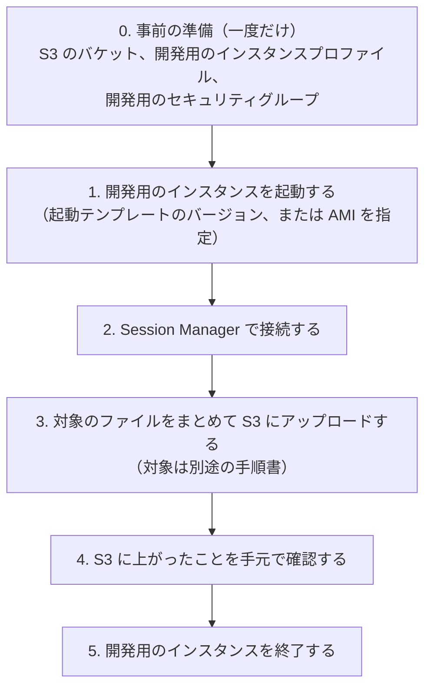

# 開発手順: AMI から開発用のインスタンスを起動し、ファイルを S3 に集める（フェーズ 2）

> 位置付け: フェーズ 2（インスタンスの構築の仕組み）を開発するための作業手順。本番などのインスタンスの構築手順ではない。
>
> 目的: 手元にあるのは AMI と[現状の手作業の構築手順](./manual-procedure-analysis.md)だけで、手順が書き換えている設定ファイルの実物が手元にない。そこで、AMI から開発用のインスタンスを起動し、対象のファイルを S3 に集める。集めたファイルを元に、構築の仕組みで配る内容（サーバーごとの値を参照する形の設定ファイルなど）を調整する
>
> スコープ: 開発用のインスタンスの起動、接続、対象のファイルの S3 へのアップロード、後片付け
>
> スコープ外: どのファイルを集めるか（**別途の手順書を参照する**）、集めたファイルの内容の調整

## 全体の流れ



## 注意: AMI のアプリは起動時に自動で動き出す

AMI はリリース用インスタンスから作っているため、起動するとアプリ（Apache、Rails、定期実行の処理など）が**本番と同じ設定のまま自動で動き出す**（AMI 公開パイプラインのヘルスチェックは、この自動起動を前提にしている）。開発用のインスタンスから、本番のデータベースへの書き込みや、メールの送信、外部への通知が起きないようにする。

| 対策 | 内容 |
|---|---|
| **開発用のセキュリティグループを使う（必須）** | インバウンドはなし。アウトバウンドは **TCP 443 だけ**を許可する（Session Manager と S3 に必要なのはこれだけ）。データベース（3306 など）やメール（25・587 など）への通信はここで止まる |
| データベース側で許可していないことを確認する | データベースのセキュリティグループが、開発用のセキュリティグループからの接続を許可していないこと |
| 外部の HTTPS の API | アウトバウンド 443 は外部の HTTPS の API にも届く。アプリが起動時や定期実行で外部の API を呼ぶ場合は、接続後すぐに該当するサービスや定期実行を止める |
| Elastic IP と DNS を付けない | 開発用のインスタンスは公開しない。Route 53 のレコードも作らない |

## 0. 事前の準備（一度だけ）

### S3 のバケット

集めたファイルの置き場所。成果物の配布用のバケットとは分ける。

| 設定 | 値 |
|---|---|
| パブリックアクセスのブロック | すべて有効 |
| 暗号化 | SSE-S3 または SSE-KMS |
| バージョニング | 有効（調整の途中で上書きしても前の版に戻せるようにする） |
| アクセスできる人 | 開発の担当者と、下の開発用のインスタンスプロファイルだけ |

以下では、バケット名を `<開発用のバケット>`、キーの接頭辞を `collected/` とする。

### 開発用のインスタンスプロファイル

起動テンプレートのインスタンスプロファイル（フェーズ 1 の起動テンプレートのスタックが作るもの）には `AmazonSSMManagedInstanceCore` しか付いておらず、S3 に書き込めない。起動テンプレートのものは変えず、開発用のインスタンスプロファイルを別に用意し、起動時に差し替える。

- AWS マネージドポリシー `AmazonSSMManagedInstanceCore`（Session Manager での接続に必要）
- 次のインラインポリシー（集める先の接頭辞への書き込みだけ）

```json
{
  "Version": "2012-10-17",
  "Statement": [
    {
      "Effect": "Allow",
      "Action": "s3:PutObject",
      "Resource": "arn:aws:s3:::<開発用のバケット>/collected/*"
    }
  ]
}
```

SSE-KMS のバケットにする場合は、そのキーへの `kms:GenerateDataKey` も付ける。

### 開発用のセキュリティグループ

[注意](#注意-ami-のアプリは起動時に自動で動き出す)のとおり、インバウンドはなし、アウトバウンドは TCP 443 だけ。

### 手元の PC

| 必要なもの | 確認 |
|---|---|
| AWS CLI | `aws --version` |
| Session Manager プラグイン | `session-manager-plugin --version`（macOS は `brew install --cask session-manager-plugin`） |
| 担当者の IAM の権限 | `ec2:RunInstances`・`ec2:CreateTags`・`ec2:TerminateInstances`、開発用のインスタンスプロファイルのロールへの `iam:PassRole`、`ssm:StartSession`、バケットの読み取り |

## 1. 開発用のインスタンスを起動する

フェーズ 1 の起動テンプレートのバージョンを指定して起動する。起動テンプレートの AMI・インスタンスタイプ・メタデータの設定を使い、セキュリティグループとインスタンスプロファイルだけを開発用に差し替える。

```bash
export AWS_PROFILE=<profile>
export AWS_REGION=ap-northeast-1

# 起動テンプレートのバージョンと AMI・アプリのバージョンの対応を確認する
aws ec2 describe-launch-template-versions \
  --launch-template-name myapp-staging \
  --query 'LaunchTemplateVersions[].[VersionNumber,VersionDescription,LaunchTemplateData.ImageId]' \
  --output table

LAUNCH_TEMPLATE_VERSION=5   # 集めたい AMI を指すバージョン

INSTANCE_ID=$(aws ec2 run-instances \
  --launch-template "LaunchTemplateName=myapp-staging,Version=${LAUNCH_TEMPLATE_VERSION}" \
  --subnet-id <サブネットの ID> \
  --security-group-ids <開発用のセキュリティグループの ID> \
  --iam-instance-profile Name=<開発用のインスタンスプロファイル> \
  --tag-specifications "ResourceType=instance,Tags=[{Key=Name,Value=dev-collect-myapp-$(date +%Y%m%d)},{Key=Purpose,Value=development}]" \
  --query 'Instances[0].InstanceId' --output text)
echo "${INSTANCE_ID}"
```

- サブネットは、Session Manager と S3 に 443 で出られる場所にする（パブリックサブネットでパブリック IP を付ける、NAT ゲートウェイがある、または VPC エンドポイントがある。[ネットワーク](../notes/ec2-operations/ssm-session-manager-operations.md#3-ネットワーク)）
- キーペアは指定しない（Session Manager で接続するため不要）
- 起動テンプレートを使わず AMI を直接指定する場合は、`--launch-template` の代わりに `--image-id <AMI の ID> --instance-type t3a.medium` を指定し、メタデータの設定（`--metadata-options HttpTokens=required`）も付ける
- 起動したら、タグ（`Name`・`Purpose` と、起動テンプレートの `App`・`AppVersion`）が付いていることをコンソールで確認する

起動と、Systems Manager の管理対象になるのを待つ。

```bash
aws ec2 wait instance-status-ok --instance-ids "${INSTANCE_ID}"

aws ssm describe-instance-information \
  --filters "Key=InstanceIds,Values=${INSTANCE_ID}" \
  --query 'InstanceInformationList[0].PingStatus' --output text
# Online になれば接続できる。数分たっても出てこない場合は、サブネットの経路とセキュリティグループのアウトバウンドを確認する
```

## 2. Session Manager で接続する

```bash
aws ssm start-session --target "${INSTANCE_ID}"
```

接続すると `ssm-user` の `sh` が開く。ファイルを集める作業は root で行う。

```bash
sudo -i                 # root のログインシェル
# centos ユーザーとして確認したいとき: sudo -iu centos
```

[注意](#注意-ami-のアプリは起動時に自動で動き出す)に書いたとおり、外部の API を呼ぶ処理がある場合は、ここで止める（例: `systemctl stop <サービス>`、`crontab -l -u <ユーザー>` で定期実行を確認する）。

ブラウザから接続する場合は、EC2 コンソールでインスタンスを選び、「接続」→「セッションマネージャー」。

## 3. 対象のファイルをまとめて S3 にアップロードする

**集めるファイルは、別途の手順書を参照する。** ここでは、その一覧を `paths.txt` に書いて、まとめてアップロードする方法を示す。

S3 にはファイルの所有者とパーミッションが残らないため、ファイルは **tar でまとめ**、所有者・パーミッション・ハッシュの一覧を添える。

```bash
# root で実行する
STAMP=$(date +%Y%m%d-%H%M%S)
WORK=/tmp/collect-${STAMP}
mkdir -p "${WORK}"

# 集めるファイル・ディレクトリを 1 行に 1 つ、絶対パスで書く（内容は別途の手順書のとおり）
vi "${WORK}/paths.txt"

# まとめる（所有者とパーミッションを保つ）
tar czf "${WORK}/files.tar.gz" --numeric-owner -P -T "${WORK}/paths.txt"

# 所有者・パーミッション・ハッシュの一覧
while read -r path; do
  find "${path}" -type f -exec stat -c '%a %U:%G %n' {} +
done < "${WORK}/paths.txt" > "${WORK}/stat.txt"
while read -r path; do
  find "${path}" -type f -exec sha256sum {} +
done < "${WORK}/paths.txt" > "${WORK}/sha256.txt"

# どのインスタンス・AMI から集めたか
TOKEN=$(curl -sX PUT http://169.254.169.254/latest/api/token -H "X-aws-ec2-metadata-token-ttl-seconds: 300")
{
  echo "instance_id=$(curl -s -H "X-aws-ec2-metadata-token: ${TOKEN}" http://169.254.169.254/latest/meta-data/instance-id)"
  echo "ami_id=$(curl -s -H "X-aws-ec2-metadata-token: ${TOKEN}" http://169.254.169.254/latest/meta-data/ami-id)"
  echo "collected_at=${STAMP}"
} > "${WORK}/source.txt"

ls -l "${WORK}"
```

アップロードする。キーには AMI の ID と日時を入れ、どの AMI から集めたかがわかるようにする。

```bash
AMI_ID=$(sed -n 's/^ami_id=//p' "${WORK}/source.txt")
aws s3 cp "${WORK}/" "s3://<開発用のバケット>/collected/${AMI_ID}/${STAMP}/" --recursive
```

| S3 のキー | 内容 |
|---|---|
| `collected/<AMI の ID>/<日時>/files.tar.gz` | 集めたファイル（元の絶対パスのまま） |
| `collected/<AMI の ID>/<日時>/paths.txt` | 集めたファイル・ディレクトリの一覧 |
| `collected/<AMI の ID>/<日時>/stat.txt` | 所有者とパーミッション |
| `collected/<AMI の ID>/<日時>/sha256.txt` | ハッシュ |
| `collected/<AMI の ID>/<日時>/source.txt` | 集めたインスタンスと AMI、日時 |

- **AWS CLI が AMI に入っていない場合**: `aws --version` でコマンドが見つからなければ、開発用のインスタンスにだけ AWS CLI v2 を入れる（[公式のインストール手順](https://docs.aws.amazon.com/cli/latest/userguide/getting-started-install.html)。ダウンロードは 443 で行える）。開発用のインスタンスは使い捨てなので、AMI には影響しない
- **シークレットを含むファイル**（`config/master.key`、`config/credentials*`、`database.yml`、`.env`、`/etc/letsencrypt` の秘密鍵など）は、別途の手順書で対象になっていない限り集めない。対象になっている場合は、バケットを SSE-KMS にし、読める人を絞る

## 4. S3 に上がったことを手元で確認する

```bash
aws s3 ls "s3://<開発用のバケット>/collected/" --recursive

# 手元に取得して中身を確認する
mkdir -p ./collected && cd ./collected
aws s3 cp "s3://<開発用のバケット>/collected/<AMI の ID>/<日時>/" . --recursive
tar tzvf files.tar.gz | head
```

手元で展開するときは、所有者を復元しない（`tar xzf files.tar.gz --no-same-owner`）。tar は絶対パスで作っているため、展開先を必ず指定し、`-P` を付けない（付けると手元の `/etc` などに書き込まれる）。

```bash
mkdir -p ./files && tar xzf files.tar.gz -C ./files --no-same-owner
```

## 5. 開発用のインスタンスを終了する

```bash
aws ec2 terminate-instances --instance-ids "${INSTANCE_ID}"
aws ec2 wait instance-terminated --instance-ids "${INSTANCE_ID}"
```

- 集め直す可能性があっても、終了してよい（同じ起動テンプレートのバージョンから、いつでも同じ状態で起動し直せる）
- 終了し忘れを防ぐため、`Purpose=development` のタグで残っているインスタンスを確認する

```bash
aws ec2 describe-instances \
  --filters "Name=tag:Purpose,Values=development" "Name=instance-state-name,Values=pending,running,stopped" \
  --query 'Reservations[].Instances[].[InstanceId,Tags[?Key==`Name`]|[0].Value,LaunchTime]' --output table
```

## トラブルシューティング

| 症状 | 確認すること |
|---|---|
| `describe-instance-information` に出てこない（Online にならない） | サブネットから 443 で外に出られるか（パブリック IP・NAT・VPC エンドポイント）。セキュリティグループのアウトバウンドに 443 があるか。インスタンスプロファイルに `AmazonSSMManagedInstanceCore` があるか。AMI の SSM Agent が自動起動になっているか |
| `start-session` で `SessionManagerPlugin is not found` | 手元に Session Manager プラグインが入っていない |
| `run-instances` で `iam:PassRole` の `AccessDenied` | 担当者の権限に、開発用のインスタンスプロファイルのロールへの `iam:PassRole` がない |
| `aws s3 cp` で `AccessDenied` | 開発用のインスタンスプロファイルの許可がキーの接頭辞（`collected/`）と合っているか。SSE-KMS の場合は `kms:GenerateDataKey` |
| `tar` で `Cannot stat: No such file or directory` | `paths.txt` のパスが AMI に存在しない。別途の手順書のパスと、AMI の作成元のバージョンを確認する |

## 関連ドキュメント

- [現状の手作業によるインスタンスの構築手順の整理](./manual-procedure-analysis.md)（集めたファイルを使って、段階 2 の設定を「サーバーごとの値を参照する形」に調整する）
- [SSM Session Manager による EC2 運用](../notes/ec2-operations/ssm-session-manager-operations.md)（接続の構成と権限の詳細）
- [EC2 へのファイル配備 — CloudFormation + S3 + UserData](../notes/ec2-operations/cfn-s3-userdata-provisioning.md)（調整したファイルを、構築時に S3 から配る方法）
