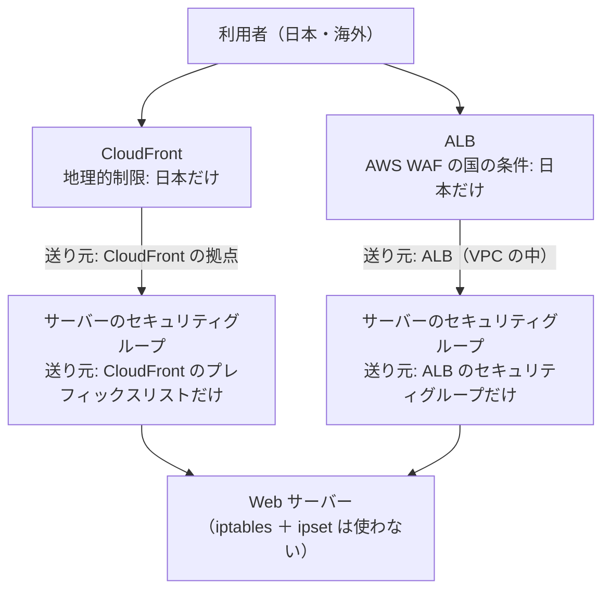

# ロードバランサー（ALB・NLB）や CloudFront を前に置くときの、国での絞り込み

> 位置付け: 80・443 番を日本（と許可した IP アドレス）からだけにする要件を、Web サーバーの前にロードバランサーや CloudFront を置いた構成で満たすときの考え方の**検討メモ**。2026-11-04 の時点では、ロードバランサーも CloudFront も置いておらず、今の環境ではサーバーの中の iptables ＋ ipset（[踏み台サーバーから入れる手順](../../port-guard-rollout/bastion-install-commands.md)）で絞っている。前に置くことを決めたときに、ここから考え始める。**動かして確かめてはいない**。
>
> 同じ要件のほかの層: [OS（iptables ＋ ipset、または firewalld）で絞る](./access-restriction-os-firewall.md)、[Apache で絞る](./access-restriction-apache.md)、[アプリ（Rails）で絞る](./access-restriction-rails-app.md)
>
> 作成日: 2026-11-04

## 結論

- 前に **ALB や CloudFront を置くと、サーバーの中の iptables ＋ ipset では国で絞れなくなる**。サーバーから見た送り元が、利用者ではなく ALB や CloudFront になるため。
  - そのまま入れておくと、CloudFront の場合はすべての通信が止まる。ALB の場合は、VPC の範囲を許可していれば、すべてが通る（絞り込みが効かない）。
- 役割を 2 つに分けるのが普通の形。
  1. **国で絞るのは、前に置いたものの側**で行う。CloudFront は組み込みの地理的制限、ALB は AWS WAF の国の条件。
  2. **サーバーは、前に置いたものからだけ受け付ける**。これはセキュリティグループで行う。
- この形にすると、サーバーの中の iptables ＋ ipset は要らなくなる見込み。
- **NLB** は、利用者の IP アドレスをそのまま届ける設定にできるので、今の iptables ＋ ipset を続けて使える。ただし、NLB のヘルスチェックのために VPC の範囲の許可が要る。

## 読む前に知っておくこと

| 用語 | 意味 |
|---|---|
| ALB（Application Load Balancer） | AWS のロードバランサーの一種。利用者からの HTTP・HTTPS をいったん受け取り（HTTPS の暗号はここでほどく）、**新しい接続を張り直して**後ろのサーバーへ送る。後ろのサーバーから見た送り元は ALB の VPC の中のアドレス（プライベートのアドレス）になる |
| NLB（Network Load Balancer） | AWS のロードバランサーの一種。TCP の通信を、中身を見ずにそのまま後ろのサーバーへ流す。設定によっては、**利用者の IP アドレスを送り元のまま**届ける |
| CloudFront | AWS の CDN（世界中の拠点で利用者からの接続を受け、内容を一時的に保存（キャッシュ）して速く返す仕組み）。保存していない内容は、拠点から元のサーバー（**オリジン**）へ取りに行く。オリジンから見た送り元は、世界中の CloudFront の拠点のアドレスになる |
| `X-Forwarded-For` | ALB や CloudFront が、後ろへ送る HTTP の要求に付ける見出し（ヘッダー）。元の利用者の IP アドレスが書かれている。HTTP の中身なので、iptables（送り元のアドレスとポートしか見ない）からは読めない |
| AWS WAF | ALB や CloudFront の前で、要求を条件で止める AWS のサービス。国の条件（geo match）で、日本以外からの要求を止められる。月額の固定料金と、要求の数に応じた料金がかかる |
| セキュリティグループ | AWS の側で、インスタンスの手前に置く通信の許可の一覧。送り元に、IP アドレスの範囲だけでなく、**ほかのセキュリティグループ**や、**AWS が用意したアドレスの一覧（プレフィックスリスト）**を指定できる |

## 前に置くものごとの違い

| 前に置くもの | サーバーから見た送り元 | 利用者の IP アドレスがどこにあるか | サーバーの中の iptables ＋ ipset |
|---|---|---|---|
| なし（今） | 利用者 | 送り元そのもの | 使える |
| ALB | ALB の VPC の中のアドレス | `X-Forwarded-For` の中 | **使えない**。VPC の範囲を許可していれば全部通り、許可していなければ全部止まる（ALB のヘルスチェックも止まり、サーバーが ALB から外される） |
| NLB（利用者の IP アドレスを届ける設定） | 利用者 | 送り元そのもの | 使える。NLB のヘルスチェックは NLB の VPC の中のアドレスから来るので、VPC の範囲の許可が要る（今の手順は、許可する IP アドレスの一覧に VPC の範囲を入れている） |
| CloudFront | 世界中の CloudFront の拠点のアドレス | `X-Forwarded-For`・`CloudFront-Viewer-Address` の中 | **使えない**。CloudFront の拠点のアドレスは日本の範囲の一覧にほとんど入らないので、CloudFront 自体が止められ、すべての通信が止まる |
| CloudFront の後ろに ALB | ALB の VPC の中のアドレス | `X-Forwarded-For` の中（利用者、CloudFront の拠点の順に並ぶ） | 使えない |

NLB が利用者の IP アドレスを届けるかどうかは、リスナーの種類と、後ろのサーバーの登録の仕方（インスタンスとして登録するか、IP アドレスとして登録するか）で既定が変わる。使うときは、AWS のドキュメントの「クライアント IP の保持」で確かめる。

## 構成の案

### 案 A: CloudFront の地理的制限 ＋ セキュリティグループで CloudFront だけ

| 項目 | 内容 |
|---|---|
| 国で絞る | CloudFront の地理的制限（Geographic restrictions）。許可する国の一覧に日本だけを入れる。追加の料金はかからない。止めた要求には 403 を返す |
| サーバーは CloudFront からだけ | サーバーのセキュリティグループの 80・443 番の送り元に、AWS が用意したプレフィックスリスト `com.amazonaws.global.cloudfront.origin-facing`（CloudFront がオリジンへ接続するときのアドレスの一覧）を指定し、`0.0.0.0/0` などの許可を消す |
| 許可する IP アドレス（海外の拠点など） | 地理的制限は国の単位なので、個別の IP アドレスの許可はできない。要るなら、地理的制限の代わりに AWS WAF を CloudFront に付けて、「国が日本、または送り元が許可の一覧」の条件にする |
| 国の判定 | AWS が持つ位置のデータベースによる。APNIC の割り当ての国より、利用者の実際の場所に近い |
| 気を付けること | プレフィックスリストは、セキュリティグループの規則の数の上限に、その一覧の最大の件数（数十）として数えられる。ほかの規則と合わせて上限（既定で 60）を超えるなら、上限の引き上げを申請する。CloudFront を通さずにサーバーへ直接来る通信は、セキュリティグループで止まる |

### 案 B: ALB ＋ AWS WAF の国の条件 ＋ セキュリティグループで ALB だけ

| 項目 | 内容 |
|---|---|
| 国で絞る | ALB に AWS WAF の web ACL を付け、国の条件（geo match statement）で「日本以外を止める」規則を入れる |
| 許可する IP アドレス | WAF の IP セット（IP アドレスの一覧）を作り、「許可の一覧に入っていれば通す」規則を、国の規則より先に置く |
| サーバーは ALB からだけ | サーバーのセキュリティグループの 80・443 番の送り元に、**ALB のセキュリティグループ**を指定し、ほかの許可を消す。ALB のアドレスは変わるが、セキュリティグループで指定すればアドレスを気にしなくてよい |
| 料金 | ALB の時間の料金と処理量の料金、WAF の web ACL と規則の月額、要求の数の料金。最新の料金は AWS の料金のページで確かめる |

### 案 C: NLB ＋ 今の iptables ＋ ipset

| 項目 | 内容 |
|---|---|
| 国で絞る | 今と同じ、サーバーの中の iptables ＋ ipset。NLB を、利用者の IP アドレスを届ける設定にする |
| 要ること | 許可する IP アドレスの一覧に VPC の範囲（NLB のヘルスチェックの送り元）。今の手順ではすでに入れている |
| 向いている場面 | HTTPS の暗号をサーバーでほどき続けたい（証明書をサーバーに置いたままにする）、複数台に振り分けたいだけ、という場合 |

### 案 D: ALB ＋ Apache で国を判定（参考）

ALB の後ろの Apache で、`mod_remoteip` によって `X-Forwarded-For` から利用者の IP アドレスを取り出し、[Apache で絞る](./access-restriction-apache.md) の `mod_maxminddb` で判定する。AWS WAF の料金はかからないが、位置のデータベースの更新をサーバーで行う必要があり、設定も各サーバーに要る。`X-Forwarded-For` は利用者が偽って付けることもできるので、`mod_remoteip` には ALB のアドレス（VPC の範囲）から来たものだけを信じる設定（`RemoteIPInternalProxy`）を入れる。

## 切り替えるときの順番

今は、サーバーの中の iptables ＋ ipset で 80・443 番を絞っている。前に置くものへ切り替えるときに、順番を誤ると、すべての通信が止まるか、絞り込みが効かない時間ができる。

| 順番 | ALB（案 B）の場合 | CloudFront（案 A）の場合 |
|---|---|---|
| 1 | ALB と WAF を用意し、ALB の DNS 名で、日本から通る・海外から止まるを確かめる | CloudFront を用意し、地理的制限を入れる |
| 2 | サーバーのセキュリティグループに、ALB のセキュリティグループからの 80・443 番の許可を**足す**（今の許可は残す） | サーバーのセキュリティグループに、CloudFront のプレフィックスリストからの許可を**足す** |
| 3 | iptables ＋ ipset はそのままでよい（ALB の送り元は VPC の範囲なので、許可する IP アドレスの一覧で通る） | **iptables ＋ ipset を外す**（CloudFront の拠点のアドレスは日本の範囲に入らないので、入れたままだと CloudFront からの通信が止まる）。外してから 5 までの間は、サーバーへ直接来る海外の通信が通る。この間を短くする |
| 4 | 利用者向けの DNS を ALB へ向ける | 利用者向けの DNS を CloudFront へ向ける |
| 5 | DNS の切り替えが行き渡った後（古い DNS の情報の保持期間（TTL）が過ぎた後）、サーバーのセキュリティグループから、ALB 以外からの 80・443 番の許可を消す | 同じく、CloudFront 以外からの 80・443 番の許可を消す |
| 6 | iptables ＋ ipset を外す（`systemctl disable port-guard` と、ルールを外すコマンド） | — |

## そのほかに変わること

| 項目 | 内容 |
|---|---|
| HTTPS の証明書 | ALB や CloudFront で HTTPS の暗号をほどく場合、証明書は AWS Certificate Manager（ACM。無料で、更新も自動）で用意するのが普通。CloudFront で使う証明書は、バージニア北部（`us-east-1`）のリージョンで作る。今のサーバーの Let's Encrypt の更新の問題（国で絞ると、海外から来る更新の確認が止まる）は、この形にするとなくなる |
| ALB・CloudFront からサーバーへの通信 | HTTP（80 番）にするか、HTTPS（443 番）にするかを決める。VPC の中なら HTTP にすることが多い（その場合、サーバーの証明書は要らなくなる） |
| アプリ・Apache のログの送り元 | 送り元が ALB や CloudFront のアドレスになる。利用者の IP アドレスを残すには、Apache の `mod_remoteip` で `X-Forwarded-For` を読む設定が要る |
| Rails の `request.remote_ip` | Rails（4.2）は、既定でプライベートのアドレスを中継（プロキシ）として信じるので、ALB の後ろなら `X-Forwarded-For` から利用者の IP アドレスが取れる見込み。CloudFront を通る場合は、CloudFront の拠点のアドレスが信じる中継に入っていないので、そのアドレスが利用者の IP アドレスとして出る。正しく取るには `config.action_dispatch.trusted_proxies` に CloudFront のアドレスの範囲を足す（配列で渡すと既定のプライベートのアドレスを置き換えるので、既定の範囲も含めて書く。実際の動きは Rails 4.2 のコードで確かめる） |
| アプリが IP アドレスで判定している処理 | ログインの回数の制限、管理画面の IP アドレスでの制限などがあれば、上の `remote_ip` が正しく取れることが前提になる |
| CloudFront の内容の保存（キャッシュ） | ログインした後の画面など、利用者ごとに違う応答を保存すると、ほかの利用者に見えてしまう。Rails のアプリなら、まずは**何も保存しない**設定（AWS が用意している `CachingDisabled` のポリシー）から始め、画像などの変わらないものだけを保存の対象にしていくのが安全 |
| ヘルスチェック | ALB・NLB は、決めたパスに定期的に接続して、応答しないサーバーを外す。応答が軽いパス（たとえば静的なファイル）を決める |
| 22 番（SSH） | 変わらない。前に置くのは 80・443 番だけ |
| IPv6 | ALB・CloudFront は、利用者側を IPv6 でも受けられる（デュアルスタック）。後ろのサーバーへは IPv4 で送れるので、サーバーの IPv6 の絞り込みは要らなくなる |

## 決めること

- 前に置くのは、ALB か、CloudFront か、両方か、NLB か（何のために置くか: 国での絞り込みだけか、複数台への振り分け、速さ、証明書の管理も含むか）
- 個別に許可する IP アドレス（海外の拠点など）が要るか（要るなら、CloudFront でも AWS WAF を使う）
- HTTPS の暗号をどこでほどくか（前に置いたものか、サーバーか）と、証明書をどうするか（ACM か、今の Let's Encrypt か）
- ALB・CloudFront からサーバーへの通信を、HTTP にするか HTTPS にするか
- アプリのログと `remote_ip` を、利用者の IP アドレスにする設定をどこまで入れるか
- 切り替えの日程（DNS の TTL を前もって短くしておくか）

## 参考

- [CloudFront の地理的制限](https://docs.aws.amazon.com/AmazonCloudFront/latest/DeveloperGuide/georestrictions.html)
- [CloudFront のマネージドプレフィックスリスト](https://docs.aws.amazon.com/AmazonCloudFront/latest/DeveloperGuide/LocationsOfEdgeServers.html)
- [AWS WAF の国の条件（geo match）](https://docs.aws.amazon.com/waf/latest/developerguide/waf-rule-statement-type-geo-match.html)
- [NLB のクライアント IP の保持](https://docs.aws.amazon.com/elasticloadbalancing/latest/network/edit-target-group-attributes.html#client-ip-preservation)
- [Apache の mod_remoteip](https://httpd.apache.org/docs/2.4/mod/mod_remoteip.html)
