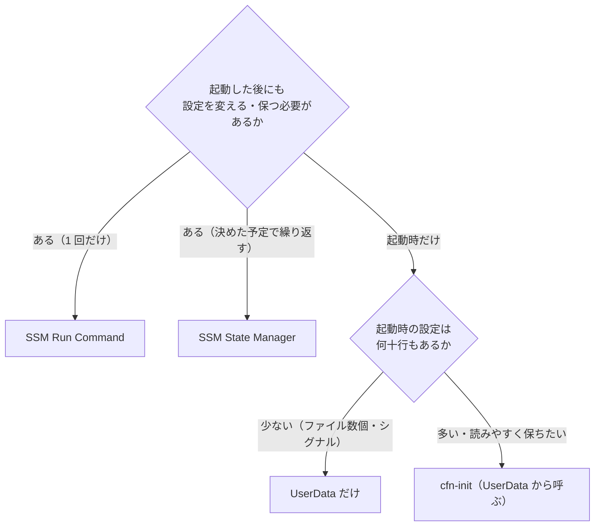
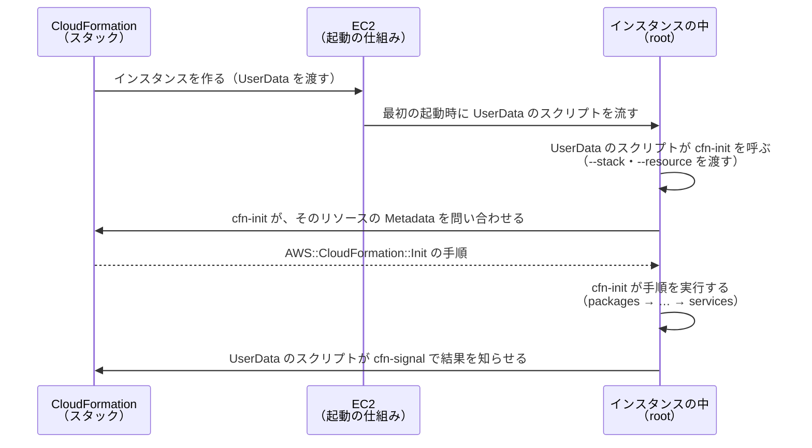

# EC2 の起動時と起動後の設定: UserData・cfn-init・SSM Run Command の使い分け

> 位置付け: CloudFormation で EC2 を起動して設定するときの、UserData（起動時のスクリプト）・cfn-init（CloudFormation の定義に書いた設定を入れる道具）・SSM Run Command（起動後にコマンドを流す仕組み）と SSM State Manager（決めた予定で流し続ける仕組み）の用途と使い分けを、コードの例でまとめたもの。
>
> 状態: 仕様は AWS のドキュメント（末尾の「参考」）と照らし合わせた（2026-11-05）。コードの例は、そのまま動かして確かめてはいない（AWS のドキュメントの例をもとに書いた）。
>
> 関連: [CloudFormation + S3 + UserData でのファイル配備](./cfn-s3-userdata-provisioning.md)、[UserData・cfn-init の実行権限](./userdata-cfn-init-privileges.md)
>
> 作成日: 2026-11-05

## 結論

| やりたいこと | 使うもの |
|---|---|
| 決まった AMI から起動して、**ちょっとしたファイルの配置**や、**CloudFormation への完了の通知（シグナル）** をするだけ | **UserData だけ**で完結させる。新しい仕組みを覚えなくてよく、いちばん簡単 |
| 起動時に設定する項目が**何十行もあり**、読みやすさ・直しやすさを保ちたい | **cfn-init**（CloudFormation の定義に、パッケージ・ファイル・コマンド・サービスを分けて書く） |
| **起動した後も、続けて設定を直したい・保ちたい** | **SSM**。1 回だけ流すなら **Run Command**、決めた予定で流し続けるなら **State Manager** |

迷ったら、UserData から始めて、行数が増えて読みにくくなったら cfn-init に、起動後の作業が出てきたら SSM を足す。



起動時（UserData・cfn-init）と起動後（SSM）は、組み合わせて使ってよい。

## 比べる

| 観点 | UserData | cfn-init | SSM Run Command | SSM State Manager |
|---|---|---|---|---|
| いつ動くか | インスタンスを**最初に起動したとき 1 回**（既定） | UserData から呼んだとき（普通は最初の起動時 1 回）。cfn-hup を入れれば、スタックを更新したときにも | **作業者が流したとき**（いつでも、何度でも） | **決めた予定**（cron・rate の式）ごと。作ったときにも 1 回 |
| どこに書くか | インスタンス（起動テンプレート）の `UserData` | CloudFormation の定義の、インスタンスの `Metadata` の `AWS::CloudFormation::Init` | 流すときのコマンド（SSM のドキュメント `AWS-RunShellScript` など） | 関連付け（association）。SSM のドキュメントと、対象と、予定 |
| 書き方 | シェルのスクリプト（または cloud-init の指示） | パッケージ・グループ・利用者・取得物・ファイル・コマンド・サービスに分けた YAML / JSON | シェルのコマンド | シェルのコマンド（Run Command と同じ形） |
| 実行する人 | root | root（UserData から呼ぶので） | root（SSM Agent が流す） | root（同） |
| 前提 | なし | `aws-cfn-bootstrap`（Amazon Linux には入っている） | SSM Agent、SSM 用のインスタンスプロファイル、SSM の窓口への通信 | Run Command と同じ |
| 結果の確認 | `/var/log/cloud-init-output.log` | `/var/log/cfn-init.log` など | AWS の側にコマンドの結果が残る（`get-command-invocation`・コンソール） | AWS の側に、関連付けの実行の結果と、守れているか（準拠）が残る |
| 大きさの制限 | **16 KB**（base64 にする前） | CloudFormation の定義の大きさの制限の範囲 | — | — |
| 料金 | かからない | かからない | EC2 では追加の料金なし | 追加の料金なし |

## 1. UserData だけで完結させる

**向いている用途**: 決まった AMI から起動して、設定のファイルを数個置く、サービスを起動し直す、CloudFormation に完了を知らせる、くらいのとき。

**例: 環境の名前を書いたファイルを置き、httpd を起動し直し、CloudFormation に完了を知らせる**

```yaml
Parameters:
  AmiId:
    Type: AWS::EC2::Image::Id
  Env:
    Type: String
    AllowedValues: [staging, production]

Resources:
  WebInstance:
    Type: AWS::EC2::Instance
    # 完了の通知（シグナル）を 1 つ受け取るまで、このインスタンスの作成を「完了」にしない
    CreationPolicy:
      ResourceSignal:
        Count: 1
        Timeout: PT10M          # 10 分以内に通知がなければ失敗として、スタックを元に戻す
    Properties:
      ImageId: !Ref AmiId
      InstanceType: t3.small
      UserData:
        Fn::Base64: !Sub |
          #!/bin/bash
          # ( ) の中のどれかが失敗したら、そこで止めて、その終了コードを CloudFormation に知らせる
          (
            set -eu
            mkdir -p /etc/myapp
            echo "APP_ENV=${Env}" > /etc/myapp/env
            systemctl restart httpd
          )
          /opt/aws/bin/cfn-signal -e $? --stack ${AWS::StackName} --resource WebInstance --region ${AWS::Region}
```

| 点 | 内容 |
|---|---|
| `CreationPolicy` の `ResourceSignal` | `Count` 個の成功の通知を受け取るまで、リソースを作成完了にしない。失敗の通知を受け取るか、`Timeout` を過ぎたら、作成は失敗し、スタックは元に戻る。`Timeout` の既定は 5 分、最大 12 時間 |
| `cfn-signal -e $?` | 直前のコマンドの終了コード（0 なら成功、それ以外は失敗）を、CloudFormation に知らせる。認証情報は要らない（スタックの中のインスタンスからの通知に限られる） |
| `( set -eu; ... )` | まとめて実行し、途中で失敗したらそこで止める。外側の `$?` に、その結果が入る |
| `!Sub` の `${Env}`・`${AWS::StackName}` | CloudFormation が置き換える。**シェルの変数を書くときは `${!変数}` と書く**（`!Sub` に置き換えられないように） |

**気を付けること**

| 点 | 内容 |
|---|---|
| 動くのは最初の起動時 1 回 | 既定では、最初に起動したときだけ動く。動いているインスタンスの UserData は変えられない（止めてから変える）。変えて起動しても、スクリプトは動かない |
| 実行する人は root | `sudo` は要らない。作ったファイルは root の持ち物になる |
| 大きさは 16 KB まで | 大きくなるなら、S3 に置いたスクリプトを取ってきて動かすか、cfn-init にする |
| 記録 | `/var/log/cloud-init-output.log` |
| 秘密を書かない | UserData は、インスタンスの中からインスタンスメタデータ（`169.254.169.254`）で誰でも読める（認証や暗号で守られていない）。パスワードなどは書かず、Secrets Manager や SSM のパラメーターストアから取る |
| AMI にする前に | 動いたスクリプトは `/var/lib/cloud/instances/<インスタンスの ID>/` に残る。そのインスタンスから AMI を作るなら、先に消す（消さないと、その AMI から起動したインスタンスにも残る） |
| AWS の API を呼ぶなら | インスタンスプロファイル（インスタンスに付ける権限）が要る |

## 2. cfn-init で書く

### cfn-init は何か（UserData との関係）

**EC2 そのものが持っている起動時の仕組みは UserData だけ**。cfn-init は EC2 の機能ではなく、**UserData のスクリプトから呼ばれる、インスタンスの中のプログラム**。呼ばれると、CloudFormation に問い合わせて、CloudFormation の定義に書いた手順（`AWS::CloudFormation::Init`）を取ってきて、決まった順番で実行する。



| 点 | 内容 |
|---|---|
| EC2 の機能は UserData だけ | EC2 は、最初の起動時に UserData のスクリプトを root で流すだけ。cfn-init のことは知らない |
| cfn-init はインスタンスの中のプログラム | CloudFormation が提供する補助のスクリプト（helper scripts）の 1 つ。Amazon Linux の AMI には最初から入っている（`/opt/aws/bin/cfn-init`。パッケージは `aws-cfn-bootstrap`）。ほかの OS では自分で入れる。**呼ばなければ動かない**（入っているだけでは何もしない） |
| 手順は UserData の中にはない | UserData に書くのは「cfn-init を、このスタック（`--stack`）の、このリソース（`--resource`。CloudFormation の定義の中の名前）で呼ぶ」の 1 行だけ。手順そのものは、CloudFormation の定義の、そのリソースの `Metadata` にあり、cfn-init が実行したときに CloudFormation から取ってくる |
| CloudFormation への通信が要る | インスタンスから CloudFormation の窓口（`--region` で指定したリージョンの窓口）に通信できること。認証情報は要らない（指定しなければ、CloudFormation が「そのスタックのインスタンスか」を確かめ、そのスタックの中だけに限って答える）。認証情報を指定する場合は、`cloudformation:DescribeStackResource` の権限が要る |
| CloudFormation のスタックで作ったインスタンスでしか使えない | `--stack` と `--resource` で、手順の置き場所を指すため。CloudFormation で作っていないインスタンスには使えない（その場合は SSM を使う） |
| 呼ぶのは UserData でなくてもよい | ただのコマンドなので、ログインして手で流しても、cfn-hup（Metadata の変化を見張る道具。後述）から呼んでも、SSM Run Command で流しても動く。UserData から呼ぶのが普通の使い方というだけ |
| 実行する人 | 呼んだ人の権限で動く。UserData から呼べば root |
| 既存のファイルを書き換えたとき | 元のファイルを、同じフォルダに `.bak` を付けて残す |

まとめると、**EC2 の UserData がきっかけになり、インスタンスの中の cfn-init というプログラムが、CloudFormation から手順を取ってきて実行する**。結果を CloudFormation に返すのは、同じく UserData から呼ぶ cfn-signal。

### cfn-init の手順の書き方

**向いている用途**: 起動時に入れる設定が多く（パッケージ、設定のファイル、利用者、サービスの有効化など）、シェルのスクリプトに並べると読みにくくなるとき。何をどう設定するかを、種類ごとに分けて CloudFormation の定義に書ける。

**例: パッケージを入れ、設定のファイルを置き、コマンドを流し、サービスを有効にする**

```yaml
Resources:
  WebInstance:
    Type: AWS::EC2::Instance
    CreationPolicy:
      ResourceSignal:
        Timeout: PT15M
    Metadata:
      AWS::CloudFormation::Init:
        configSets:
          default: [install, configure]     # install → configure の順に流す
        install:
          packages:
            yum:
              httpd: []                     # 空のリストは「最新」
              mod_ssl: []
        configure:
          files:
            /etc/httpd/conf.d/myapp.conf:
              content: !Sub |
                ServerName ${DomainName}
                DocumentRoot /var/www/myapp
              mode: "000644"
              owner: root
              group: root
            /etc/myapp/env:
              content: !Sub |
                APP_ENV=${Env}
              mode: "000600"
              owner: root
              group: root
          commands:
            01_make_docroot:                # コマンドは名前の順に流れる
              command: mkdir -p /var/www/myapp
            02_migrate:
              command: /opt/myapp/bin/migrate
              test: test -x /opt/myapp/bin/migrate   # 成功したときだけ command を流す
          services:
            systemd:
              httpd:
                enabled: "true"             # 起動時に動くようにする
                ensureRunning: "true"       # cfn-init の後に動いている状態にする
                files:                      # このファイルを cfn-init が変えたら、起動し直す
                  - /etc/httpd/conf.d/myapp.conf
    Properties:
      ImageId: !Ref AmiId
      InstanceType: t3.small
      UserData:
        Fn::Base64: !Sub |
          #!/bin/bash
          # Metadata の設定を入れ、その結果を CloudFormation に知らせる
          /opt/aws/bin/cfn-init -v --stack ${AWS::StackName} --resource WebInstance --region ${AWS::Region}
          /opt/aws/bin/cfn-signal -e $? --stack ${AWS::StackName} --resource WebInstance --region ${AWS::Region}
```

| 点 | 内容 |
|---|---|
| 処理の順番 | 1 つの config の中は、**packages → groups → users → sources → files → commands → services** の順に決まっている。違う順番にしたいときは、config を分けて `configSets` で並べる（上の例の `install` → `configure`） |
| `commands` | 名前の順（アルファベット順）に流れる。`01_`・`02_` のように番号を付けると順番が分かりやすい。`test` を書くと、それが成功したときだけ流す（何度流しても同じ結果にしやすい） |
| `files` | 中身をその場で書く（`content`）か、URL から取る（`source`）。持ち主と権限も書ける |
| `services` | Amazon Linux 2 以降で `aws-cfn-bootstrap` 2.0-29 以上なら systemd で扱える。`files`・`packages` などを書くと、cfn-init がそれを変えたときにサービスを起動し直す |
| `configSets` を指定しない呼び方 | `config` という名前の 1 つの config だけを探す。`configSets` に `default` を作っておけば、`-c` を付けずに呼んでも `default` が流れる |
| 記録 | `/var/log/cfn-init.log`（詳しい記録は `/var/log/cfn-init-cmd.log`） |

### 起動した後に Metadata を変えたら入れ直す（cfn-hup）

cfn-init は、そのままでは最初の起動時に 1 回動くだけ。スタックを更新して `Metadata` を変えたときにも入れ直したいなら、**cfn-hup**（Metadata の変化を見張って、決めたコマンドを流す常駐の道具）を、cfn-init 自身で置いて動かす。

```yaml
        configure:
          files:
            # cfn-hup の設定: どのスタックを見張るか（既定では 15 分ごとに確かめる）
            /etc/cfn/cfn-hup.conf:
              content: !Sub |
                [main]
                stack=${AWS::StackId}
                region=${AWS::Region}
              mode: "000400"
              owner: root
              group: root
            # Metadata の AWS::CloudFormation::Init が変わったら、cfn-init を流し直す
            /etc/cfn/hooks.d/cfn-auto-reloader.conf:
              content: !Sub |
                [cfn-auto-reloader-hook]
                triggers=post.update
                path=Resources.WebInstance.Metadata.AWS::CloudFormation::Init
                action=/opt/aws/bin/cfn-init -v --stack ${AWS::StackName} --resource WebInstance --region ${AWS::Region}
                runas=root
              mode: "000400"
              owner: root
              group: root
          services:
            systemd:
              cfn-hup:
                enabled: "true"
                ensureRunning: "true"
                files:
                  - /etc/cfn/cfn-hup.conf
                  - /etc/cfn/hooks.d/cfn-auto-reloader.conf
```

`services` の `systemd` で cfn-hup を扱うには、cfn-hup の systemd のユニットのファイルが要る（AWS のドキュメントの例。`/usr/bin/cfn-hup` の場所は環境によって違い、Amazon Linux では `/opt/aws/bin/cfn-hup` のことがある。使う前にインスタンスで場所とユニットのファイルの有無を確かめる）。なければ、`files` で次も置く。

```yaml
            /etc/systemd/system/cfn-hup.service:
              content: |
                [Unit]
                Description=cfn-hup daemon
                [Service]
                ExecStart=/opt/aws/bin/cfn-hup -v
                PIDFile=/var/run/cfn-hup.pid
                [Install]
                WantedBy=multi-user.target
              mode: "000644"
              owner: root
              group: root
```

cfn-hup で入れ直せるのは、CloudFormation の定義に書いた設定だけ。定義の外の作業（アプリのデプロイ、手順の都度の作業）や、CloudFormation で作っていないインスタンスには、次の SSM を使う。

## 3. SSM Run Command で、起動後にコマンドを流す

**向いている用途**: 起動した後に、決まったコマンドを 1 回流したい（設定の直し、パッケージの更新、状態の確認など）。SSH でログインせずに、複数台にまとめて流し、結果を AWS の側で見られる。CloudFormation で作ったかどうかに関係なく使える。

**前提**: インスタンスに SSM Agent が入って動いていること、SSM 用の権限（`AmazonSSMManagedInstanceCore`）を持つインスタンスプロファイルが付いていること、インスタンスから SSM の窓口に通信できること。

**例: タグ `Role=web` の台すべてで、設定のファイルを直して httpd を読み直す**

```bash
# 流す（作業者の PC の AWS CLI で）
aws ssm send-command \
  --document-name AWS-RunShellScript \
  --targets Key=tag:Role,Values=web \
  --comment "myapp.conf の ServerName を直す" \
  --parameters 'commands=["sed -i \"s/^ServerName .*/ServerName www.example.com/\" /etc/httpd/conf.d/myapp.conf","apachectl configtest","systemctl reload httpd"]' \
  --query 'Command.CommandId' --output text
# → コマンドの ID（例: 1234abcd-...）が出る

# 台ごとの結果を見る
aws ssm list-command-invocations --command-id <コマンドの ID> --details \
  --query 'CommandInvocations[].[InstanceId,Status,CommandPlugins[0].Output]' --output text
```

| 点 | 内容 |
|---|---|
| `AWS-RunShellScript` | AWS が用意した、シェルのコマンドを流すための SSM のドキュメント（Linux 用） |
| `--targets` | タグで対象を選ぶ（`--instance-ids` で ID を並べてもよい） |
| `commands` | 上から順に流れる。途中のコマンドが失敗しても、既定では次へ進むので、止めたいなら最初に `set -e` を入れる |
| 結果 | 台ごとに、成功・失敗と、出力（長いと途中で切れる。全部残すなら `--output-s3-bucket-name` で S3 に出す）が AWS の側に残る |
| 実行する人 | root |

## 4. SSM State Manager で、決めた予定で流し続ける

**向いている用途**: 起動した後も、決めた状態を保ち続けたい（ある設定のファイルが置かれている、あるサービスが動いている、SSM Agent が新しい版になっている、など）。崩れていたら、次の実行で直る。新しく起動した台も、タグが合えば対象になる。

**例: タグ `Role=web` の台で、毎日 1 回、httpd が動いていなければ起動する**

```bash
aws ssm create-association \
  --association-name ensure-httpd-running \
  --name AWS-RunShellScript \
  --targets Key=tag:Role,Values=web \
  --parameters 'commands=["systemctl is-active httpd || systemctl start httpd"]' \
  --schedule-expression "rate(1 day)"
```

| 点 | 内容 |
|---|---|
| 関連付け（association） | 「どの SSM のドキュメントを、どの対象に、どの予定で流すか」の組み合わせ。作ると、まず 1 回すぐに流れ、その後は予定ごとに流れる（すぐに流さない設定もある） |
| 予定 | cron の式か rate の式（例: `rate(30 minutes)`、`cron(0 4 ? * * *)`） |
| 対象 | タグ、リソースグループ、インスタンスの ID、その地域のすべての管理対象の台 |
| 結果 | 実行のたびの結果が AWS の側に残る。出力を S3 に残すこともできる |
| 料金 | 追加の料金なし |
| コマンドの書き方 | **何度流しても同じ結果になる形にする**（例: 「動いていなければ起動する」「なければ置く」）。毎回流れるので、流すたびに状態が変わるコマンド（追記など）は使わない |

## 組み合わせの例

| 構成 | 起動時 | 起動後 |
|---|---|---|
| 小さい（今の環境に近い） | UserData でファイル数個と `cfn-signal` | 必要なときに SSM Run Command |
| 設定が多い | UserData から cfn-init（と `cfn-signal`） | 定義の変更は cfn-hup、定義の外の作業は SSM Run Command |
| 台数が多い・状態を保ちたい | UserData（または cfn-init）で最低限 | SSM State Manager で、決めた状態を保ち続ける |

どの構成でも、**起動時の設定は AMI に焼き込める部分を増やすほど、起動が速く、失敗しにくくなる**（パッケージの導入などは AMI を作るときに済ませ、起動時は環境ごとに違う値だけを入れる）。

## 参考（AWS のドキュメント。2026-11-05 に確かめた）

- [Run commands when you launch an EC2 instance with user data input](https://docs.aws.amazon.com/AWSEC2/latest/UserGuide/user-data.html)（UserData。root で動く、既定では最初の起動時だけ、16 KB、`/var/log/cloud-init-output.log`、`/var/lib/cloud/instances/` に残る、止めて書き換えて起動してもスクリプトは動かない）
- [Use instance metadata to manage your EC2 instance](https://docs.aws.amazon.com/AWSEC2/latest/UserGuide/ec2-instance-metadata.html)（インスタンスの中から UserData が読め、認証や暗号で守られていないので、秘密を書かない）
- [cfn-init](https://docs.aws.amazon.com/AWSCloudFormation/latest/TemplateReference/cfn-init.html)（`AWS::CloudFormation::Init` を読み、CloudFormation から Metadata を取って解釈する。普通は UserData から流す。`--stack`・`--resource` が必須。認証情報は要らない。既存のファイルは `.bak` を残す。記録は `/var/log/cfn-init.log`）
- [CloudFormation helper scripts reference](https://docs.aws.amazon.com/AWSCloudFormation/latest/TemplateReference/cfn-helper-scripts-reference.html)（補助のスクリプトは Amazon Linux の AMI では `/opt/aws/bin` に入っている。呼ばなければ動かない。権限: cfn-signal は `cloudformation:SignalResource`、ほかは `cloudformation:DescribeStackResource`）
- [`AWS::CloudFormation::Init`](https://docs.aws.amazon.com/AWSCloudFormation/latest/TemplateReference/aws-resource-init.html)（cfn-init の書き方。処理の順番、configSets、commands は名前の順、services の systemd 対応）
- [cfn-signal](https://docs.aws.amazon.com/AWSCloudFormation/latest/TemplateReference/cfn-signal.html)（`-e $?` で結果を知らせる。認証情報は要らない。cfn-init と組み合わせた例）
- [`CreationPolicy` attribute](https://docs.aws.amazon.com/AWSCloudFormation/latest/TemplateReference/aws-attribute-creationpolicy.html)（`ResourceSignal` の `Count`・`Timeout`。既定 5 分、最大 12 時間）
- [cfn-hup](https://docs.aws.amazon.com/AWSCloudFormation/latest/TemplateReference/cfn-hup.html)（Metadata の変化を見張る。`cfn-hup.conf`、`hooks.d`、既定の間隔 15 分）
- [AWS Systems Manager Run Command](https://docs.aws.amazon.com/systems-manager/latest/userguide/run-command.html)（ログインせずに設定を管理する。1 回限りの変更をまとめて行う。EC2 では追加の料金なし）
- [AWS Systems Manager State Manager](https://docs.aws.amazon.com/systems-manager/latest/userguide/systems-manager-state.html)（決めた状態を保つ。関連付け、予定（cron・rate）、対象、追加の料金なし）

確かめていないこと: 上のコードの例は、そのまま流して確かめてはいない。`aws ssm send-command`・`list-command-invocations`・`create-association` の引数の細かい書き方は、使う前に AWS CLI のリファレンスで確かめる。次は、今回照らし合わせた AWS のドキュメントには書かれておらず、知識による（使う前に確かめる）: cfn-init の詳しい記録の場所（`/var/log/cfn-init-cmd.log`）、Amazon Linux での cfn-hup の場所とユニットのファイルの有無、`AWS-RunShellScript` で途中のコマンドが失敗したときに次へ進むこと、Run Command の出力が長いと途中で切れること。
