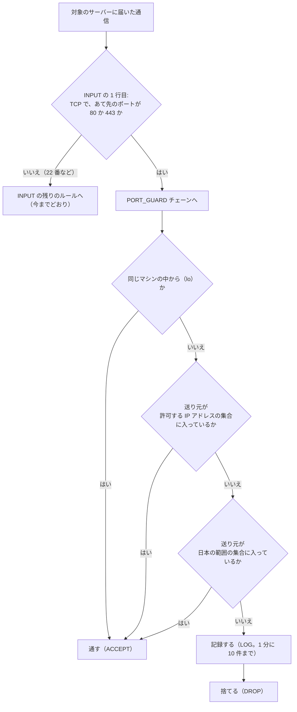

# 踏み台サーバーから対象のサーバーに iptables と ipset を入れて、80・443 番の受け付けを日本と許可した IP アドレスに絞る手順

> 位置付け: 踏み台サーバーから SSH で、対象のサーバー（Amazon Linux 2 の Web サーバー）に iptables と ipset の設定を入れるためのコマンドを、ステップごとのファイルにまとめたもの。どのファイルも、**上から順に実行するコマンドを並べただけ**（関数や、条件で分ける処理は使わない）。複数台に流すのは、踏み台サーバーにある今のスクリプトで行う。
>
> Linux・iptables・ipset に詳しくない人が、**このドキュメントだけで**、何をしているのか、なぜそうするのかを読み解けるように書いている。前半の「読む前に知っておくこと」で仕組みを説明し、各ステップでは 1 行ずつの意味を説明する。
>
> 状態: 対象のサーバー（Amazon Linux 2）ではまだ流していない。手元（macOS）で確かめたことは、末尾の「手元で確かめたこと」。
>
> 更新日: 2026-11-04

## このドキュメントで行うこと

対象のサーバーが受け付ける **80 番（HTTP）と 443 番（HTTPS）の通信を、次の 2 つから来たものだけ**にする。それ以外から来た 80・443 番の通信は、対象のサーバーが捨てる（相手には何も返さない）。

- 日本に割り当てられた IP アドレス（APNIC という組織が公開している一覧から作る）
- 個別に許可した IP アドレス。**対象のサーバーが入っている VPC の範囲**（同じ VPC の中のほかのサーバー、監視、踏み台サーバーなど、VPC の中から来る通信）と、日本の外から受ける必要がある相手（海外の拠点、外部のサービス、監視など）

**22 番（SSH）は絞らない**。踏み台サーバーからの SSH は今までどおり入れる（設定を誤っても、SSH で入って直せる）。外部からの SSH は、AWS のセキュリティグループ（AWS の側でインスタンスの手前に置く通信の許可の一覧）で防ぐ前提。

設定は、対象のサーバーの中の Linux が持つ通信の選り分けの仕組み（iptables と ipset）で行う。AWS の設定は変えない。

**前提: 対象のサーバーは、インターネットから直接 80・443 番を受けている**（ロードバランサー（ALB）や CloudFront を前に置いていない）。前に置くと、対象のサーバーから見た送り元が利用者ではなくなるので、この手順では国で絞れない（そのまま入れると、すべての通信が止まることもある）。前に置くときの考え方は [ロードバランサー・CloudFront を前に置くときの国での絞り込み](../notes/ec2-operations/access-restriction-alb-cloudfront.md)。

## 読む前に知っておくこと

### 登場するマシンと、作業する人

| マシン | 役割 |
|---|---|
| 踏み台サーバー | 作業の起点。ここから対象のサーバーへ SSH でコマンドを流す。日本の IP アドレスの範囲の一覧も、ここで作る（インターネットから元のデータを取る） |
| 対象のサーバー | 設定を入れる Web サーバー。OS は Amazon Linux 2（AWS が提供する Linux。中身は Red Hat 系で、パッケージは `yum` で入れる） |
| 海外の確認用のマシン | 設定が効いたかを、日本の外から確かめるためのマシン（任意。たとえば海外のリージョンに立てた小さなインスタンス） |

対象のサーバーには、利用者 `centos` で SSH ログインする。通信の設定を変えるには、Linux の管理者（`root`）の権限が要る。そのため、権限が要るコマンドの頭には `sudo -n` を付ける。

- `sudo`: その 1 つのコマンドだけを `root` の権限で実行する
- `-n`: パスワードを聞かれる設定のときは、聞かずにすぐ失敗する（標準入力でスクリプトを流しているので、パスワードを聞かれると止まってしまうため）

### IP アドレス・CIDR・ポート

| 用語 | 意味 |
|---|---|
| IP アドレス | インターネットの上の住所。通信には「送り元」と「あて先」の IP アドレスが付いている。この手順では、**送り元の IP アドレス**で受け付けるかを決める |
| IPv4 | 今いちばん使われている形の IP アドレス。`203.0.113.10` のように 4 つの数（0〜255）を `.` でつなぐ。全体で約 43 億個 |
| IPv6 | 新しい形の IP アドレス。`2001:db8::1` のように 16 進数を `:` でつなぐ。IPv4 とは**まったく別の通信**として扱われ、設定も別に要る |
| プライベートのアドレス | インターネットでは使わず、VPC などの閉じたネットワークの中だけで使う IPv4 アドレス。`10.0.0.0/8`・`172.16.0.0/12`・`192.168.0.0/16` の 3 つの範囲。**どこの国にも割り当てられていないので、日本の範囲の一覧には入らない**。VPC の中から来る通信は、送り元がこのアドレスになるので、許可する IP アドレスの一覧に VPC の範囲を入れる（ステップ 0-2） |
| CIDR（サイダー） | IP アドレスの範囲の書き方。`1.0.16.0/20` は「先頭の 20 ビットが `1.0.16.0` と同じアドレス全部」（`1.0.16.0`〜`1.0.31.255` の 4,096 個）。`/` の後ろの数が大きいほど範囲は狭い。`/32`（IPv4）・`/128`（IPv6）は 1 個だけ。`/` を書かなければ 1 個だけ |
| ポート | 1 台のサーバーの中で、どのサービスあての通信かを表す番号。80 番は HTTP、443 番は HTTPS、22 番は SSH |
| TCP | Web や SSH が使う通信の方式。接続を張ってからやりとりする。この手順で絞るのは TCP の 80・443 番 |

### 対象のサーバーの中で、届いた通信がどう扱われるか（iptables）

Linux の中心部分（**カーネル**）には、届いた通信（パケット。通信を小分けにした 1 つ 1 つ）を、ルールに沿って通したり捨てたりする仕組みがある。**iptables** は、そのルールを登録・確認するためのコマンド。

| 用語 | 意味 |
|---|---|
| ルール | 「こういう通信なら、こうする」の 1 行。条件（送り元、あて先のポートなど）と、行き先（下の「ターゲット」）からなる |
| チェーン | ルールの並び。上から順に照合して、**最初に合ったルールの行き先に従う**。どれにも合わなければ、チェーンの既定の扱い（ポリシー）に従う |
| `INPUT` チェーン | このサーバーあてに届いた通信が必ず通る、最初から用意されているチェーン。Amazon Linux 2 の初期の状態は、ルールが空で、ポリシーは「通す」 |
| 自前のチェーン | 自分で名前を付けて作るチェーン。この手順では `PORT_GUARD` を作り、80・443 番の判定をここにまとめる。自前のチェーンの最後まで行っても決まらなければ、呼び出し元（`INPUT`）の次のルールへ戻る |
| ターゲット（行き先） | `ACCEPT`（通す。そこで判定終わり）、`DROP`（捨てる。相手には何も返さないので、相手は時間切れまで待つ）、`LOG`（記録だけして、次のルールへ進む）、チェーンの名前（そのチェーンへ飛ぶ） |
| `ip6tables` | IPv6 用の iptables。**IPv4 のルールと IPv6 のルールは完全に別**。IPv6 も絞るなら、`ip6tables` で同じルールを入れる |

この手順で入れるルールの流れ（IPv6 も同じ形）:



知っておくべき性質:

| 性質 | 内容 |
|---|---|
| **ルールはカーネルのメモリーにしかない** | ファイルには保存されない。**再起動すると消える**。残すには、起動のたびに入れ直す仕組みが要る（ステップ 5・6） |
| ルールは 1 つ 1 つのパケットに効く | ルールを入れた瞬間から、すでにつながっている接続のパケットにも効く。海外からつながっていた 80・443 番の接続は、ルールを入れたところで切れる |
| このサーバーから外へ出る通信には効かない | ルールの条件は「**このサーバーの** 80・443 番あて」。このサーバーが外部の API（相手の 443 番）を呼ぶ通信は、返ってくるパケットのあて先がこのサーバーの別の番号なので、当てはまらない |
| 同時に 2 つは動けない（ロック） | `iptables` と `ip6tables` は、ルールを変える間、同じロック（`/run/xtables.lock` というファイル）を持つ。ほかのものがロックを持っている間に動くと、`-w` を付けていなければ `Another app is currently holding the xtables lock` で失敗する。この手順では、どの `iptables`・`ip6tables` にも `-w 10`（最大 10 秒待つ）を付ける |

### 数千の範囲をまとめて照合する（ipset）

日本に割り当てられた範囲は、IPv4 で約 4,700 件ある。iptables のルールを 4,700 行並べると、80・443 番のパケットが届くたびに 4,700 行を上から照合することになり、重い。

**ipset** は、カーネルの中に「IP アドレスの範囲の集まり（集合）」を名前を付けて置く仕組み。iptables のルールからは、「送り元がこの名前の集合に入っているか」の 1 行で照合できる（`-m set --match-set <集合の名前> src`）。集合は、件数が多くても速く照合できる形（ハッシュ）で持つ。

| 性質 | 内容 |
|---|---|
| 集合の型 | この手順では `hash:net`（CIDR の範囲を入れる型。範囲の長さはばらばらでよい） |
| IPv4 と IPv6 | 1 つの集合には、IPv4 か IPv6 のどちらかしか入らない（作るときに `family inet`（IPv4）か `family inet6`（IPv6）を決める）。`iptables` は IPv4 の集合を、`ip6tables` は IPv6 の集合を参照する |
| **集合もカーネルのメモリーにしかない** | 再起動すると消える。ファイルに保存して、起動時に読み込み直す（ステップ 5・6） |
| 集合だけでは何も起きない | 集合は、iptables のルールから参照されて初めて効く。集合を作って中身を入れても、ルールを入れるまでは通信に何の影響もない |
| ルールより先に集合が要る | ルールは集合を名前で参照する。集合がないと、ルールを入れるコマンドが失敗する。逆に、ルールから参照されている集合は消せない |

### 日本の IP アドレスの範囲はどこから来るか（APNIC）

IP アドレスは、地域ごとの組織が通信事業者などに割り当てている。アジア太平洋の地域（日本を含む）は **APNIC**。APNIC は、割り当ての一覧を毎日、無料・登録なしで公開している（`https://ftp.apnic.net/stats/apnic/delegated-apnic-latest`、約 4 MB）。1 行が 1 件の割り当てで、国の記号が付いている。

```
apnic|JP|ipv4|1.0.16.0|4096|20110412|allocated
apnic|JP|ipv6|2001:200::|35|19990813|allocated
```

| 項目（`|` で区切った位置） | 意味 |
|---|---|
| 2 番目 | 国の記号（`JP` が日本） |
| 3 番目 | `ipv4` か `ipv6` |
| 4 番目 | 範囲の先頭のアドレス |
| 5 番目 | IPv4 は**個数**（例: `4096`）、IPv6 は **CIDR の長さ**（例: `35`） |
| 7 番目 | 状態。使われている割り当ては `allocated` か `assigned` |

注意: 「日本に割り当てられた IP アドレス」は、「日本にいる人」と同じではない。日本の人が海外の VPN やクラウドを通せば、送り元は日本の範囲にならない。逆もある。この手順は、海外からの機械的な大量のアクセスを減らすための、おおまかな絞り込みとして使う。

### 再起動の後も設定を残す仕組み（systemd）

**systemd** は、Linux の起動のときに、決められた処理やサービスを順に動かす仕組み。動かすものは「**ユニット**」というファイル（`/etc/systemd/system/<名前>.service`）に書く。

| 用語 | 意味 |
|---|---|
| ユニット（サービス） | 何を、いつ、どう動かすかを書いた設定のファイル。この手順では `port-guard.service` を 1 つ置く |
| `ExecStart=` | 動かすコマンド。`Type=oneshot` のユニットでは何行でも並べられ、**上から順に 1 つずつ**実行される（前の行が終わるまで次は始まらない）。どれかが失敗すると、そこで止まる |
| `enable` | 次の起動から、起動のときに自動で動くようにする（今すぐは動かさない） |
| `start` | 今すぐ動かす |
| 追加の設定（ドロップイン） | ユニットの本体とは別のファイル（`/etc/systemd/system/<名前>.service.d/*.conf`）に、設定の続きを書ける仕組み。systemd はユニットを読むときに、これらを**ファイルの名前の順に**読んで本体に足す。`ExecStart=` は足されていく |
| `daemon-reload` | ユニットのファイルを置いたり変えたりした後に、systemd に読み直させる |
| ターゲット | 起動の途中の区切り。`network-pre.target` は「ネットワークをつなぐ直前」、`multi-user.target` は「普通の起動が終わったところ」 |

### 踏み台サーバーからコマンドを流す形

どのステップも、踏み台サーバーで次の形で流す（`<ステップ>` はファイルの名前）。

```bash
ssh -oStrictHostKeyChecking=no -i ~/.ssh/key.pem centos@server 'bash' < ./command/port_guard/<ステップ>.sh >> ./output/result.txt
```

| 部分 | 意味 |
|---|---|
| `ssh ... centos@server 'bash'` | 対象のサーバーに `centos` で入り、`bash`（コマンドを実行するプログラム）を起動する |
| `< ./command/port_guard/<ステップ>.sh` | 踏み台サーバーのファイルの中身を、対象のサーバーの `bash` の**標準入力**（キーボードから打つ代わりに流し込む入り口）に送る。`bash` はそれを 1 行ずつ読んで実行する。対象のサーバーにファイルを置く必要はない |
| `>> ./output/result.txt` | 対象のサーバーの画面への出力を、踏み台サーバーのファイルに書き足す。エラーの出力も残すなら `>> ./output/result.txt 2>&1` |

**標準入力で流すときの注意**: `bash` はスクリプトを標準入力から少しずつ読みながら実行する。そのため、スクリプトの途中で**標準入力を読むコマンド**を使うと、残りのスクリプトをそのコマンドが読んでしまい、そこから後が実行されない。

- 標準入力を読むかもしれないコマンドには `< /dev/null`（空の入力）を付ける。この手順では `yum` に付けている
- `<<'EOF'` から `EOF` までの行（ヒアドキュメント。複数行の文字列をその場に書く書き方）は、スクリプトの一部として読まれるので問題ない。`ipset restore` や `tee` に渡す中身は、この形で書いている

各ファイルで共通に使う書き方:

| 書き方 | 意味 |
|---|---|
| `#!/bin/bash` | このファイルは `bash` で実行するもの、という印 |
| `set -euo pipefail` | どれかのコマンドが失敗したら、そこで止める（`-e`）。書き間違えた変数を使ったら止める（`-u`）。`|` でつないだコマンドの途中の失敗も失敗とみなす（`pipefail`）。**途中で失敗したまま先へ進まない**ための指定 |
| `echo "== $(hostname) $(date '+%F %T') <ステップ>"` | 結果のファイルに、どの台の、いつの、どのステップの結果かの見出しを書く |
| `# 確認` から後 | 設定を変えるコマンドではなく、結果を表示するだけのコマンド |
| `<コマンド> || true` | そのコマンドが失敗しても、失敗とみなさない（`set -e` で止めない） |
| `sudo -n sh -c '<コマンド> > <ファイル>'` | `>`（ファイルへの書き出し）も `root` の権限で行うための書き方。`sudo -n <コマンド> > <ファイル>` と書くと、書き出しは `centos` の権限で行われ、`/etc` などには書けない |
| `sudo -n tee <ファイル> > /dev/null <<'EOF'` 〜 `EOF` | 間の行を、`root` の権限でファイルに書く（`tee` は受け取った中身をファイルに書くコマンド。画面への表示は `/dev/null` に捨てる） |

## このドキュメントの前提

| 項目 | 内容 |
|---|---|
| 流し方 | 上の「踏み台サーバーからコマンドを流す形」。複数台へは、踏み台サーバーにある今のスクリプトで |
| ファイルの置き場所（踏み台サーバー） | **`command/port_guard/` の下には、対象のサーバーに送るファイルだけを置く**（ステップ 0-2 の `00-vpc-cidr.sh`、ステップ 1〜6）。踏み台サーバーで実行するもの（ステップ 0-1 の `make-jp-lists.sh`、ステップ 3-1 の 1 行ずつのコマンド）は、カレントのフォルダに置く・カレントのフォルダで実行する。一覧は `port_guard_whitelists/` |
| 日本の範囲の一覧を作る場所 | **踏み台サーバー**（IPv4 と IPv6）。対象のサーバーは APNIC に取りに行かない（対象のサーバーに `curl`・`python3` は要らない） |
| 一覧の渡し方 | 一覧を、ステップ 3 のファイルの中に `ipset` に読ませる行（`add <集合> <範囲>`）として並べて送る。そのファイルは、踏み台サーバーで一覧から 1 行のコマンドで作る |
| 実行する人 | `centos`。`root` の権限が要るコマンドは `sudo -n` |
| 絞るポート | 80・443 番。22 番は絞らない |
| IPv6 | 対象のサーバーに IPv6 のアドレスがあり、セキュリティグループで IPv6 の 80・443 番を通しているときだけ要る。**IPv6 の分は、どのステップも別のファイル**（名前が `-ipv6.sh` で終わるもの）にしているので、IPv6 を絞らないなら流さない |

### IPv4 と IPv6 は、ファイルも集合も分ける

| 種類 | 踏み台サーバーの一覧 | ipset の集合の名前（型） | 再起動のために保存するファイル（対象のサーバー） |
|---|---|---|---|
| 日本の範囲（IPv4） | `port_guard_whitelists/jp-ipv4.txt` | `port_guard_jp`（`hash:net family inet`） | `/etc/port-guard/ipset-ipv4.save` |
| 許可する IP アドレス（IPv4） | `port_guard_whitelists/allow-ipv4.txt` | `port_guard_allow`（`hash:net family inet`） | `/etc/port-guard/ipset-ipv4.save` |
| 日本の範囲（IPv6） | `port_guard_whitelists/jp-ipv6.txt` | `port_guard_jp6`（`hash:net family inet6`） | `/etc/port-guard/ipset-ipv6.save` |
| 許可する IP アドレス（IPv6） | `port_guard_whitelists/allow-ipv6.txt` | `port_guard_allow6`（`hash:net family inet6`） | `/etc/port-guard/ipset-ipv6.save` |

2026-11-02 の版で作った一覧のサンプルは [`samples/apnic-jp-20261102/`](./samples/apnic-jp-20261102/README.md) に置いている（取り直した一覧と比べて、大きく変わっていないかを見るのに使える）。

### ステップの一覧

| ステップ | どこで | ファイル | すること | このステップの後の状態 |
|---|---|---|---|---|
| 0 | 踏み台サーバー（VPC の範囲を調べるときだけ対象のサーバー） | `make-jp-lists.sh`・`command/port_guard/00-vpc-cidr.sh` | 踏み台サーバーが、APNIC の一覧から日本の IPv4・IPv6 の範囲の一覧を作る。許可する IP アドレスの一覧（VPC の範囲を含む）を作業者が書く | 対象のサーバーは何も変わらない |
| 1 | 対象のサーバー | `command/port_guard/01-install.sh` | 対象のサーバーに ipset を入れ、邪魔になるものがないかを確かめる（iptables は最初から入っている） | 通信は今までどおり |
| 2 | 対象のサーバー | `command/port_guard/02-sets-ipv4.sh`（IPv6 は `-ipv6.sh`） | 対象のサーバーに、空の集合を作る | 通信は今までどおり |
| 3 | 踏み台サーバーで作り、対象のサーバーで流す | `command/port_guard/03-jp-ipv4.sh`・`03-allow-ipv4.sh`（IPv6 は `-ipv6.sh`） | 対象のサーバーの集合に、一覧を入れる | 通信は今までどおり（集合はルールから参照されるまで何もしない） |
| 4 | 対象のサーバー | `command/port_guard/04-rules-ipv4.sh`（IPv6 は `-ipv6.sh`） | 対象のサーバーに iptables のルールを入れる | **ここから 80・443 番の絞り込みが効く**（再起動すると消える） |
| 5 | 対象のサーバー | `command/port_guard/05-persist-ipv4.sh`（IPv6 は `-ipv6.sh`） | 対象のサーバーで、集合をファイルに保存し、起動時に入れ直すコマンドの並びを置く | 再起動するとまだ消える（ステップ 6 で有効にする） |
| 6 | 対象のサーバー | `command/port_guard/06-service.sh` | 対象のサーバーに、起動時に動くサービス `port-guard.service` を置いて有効にする | **再起動の後も効く** |

各ステップの結果（`result.txt`）を見てから、次のステップを流す。

### 注意: ステップ 6 の前に対象のサーバーを再起動したら、ステップ 2 から流し直す

ステップ 6（起動時に動くサービスを有効にする）を流す前に対象のサーバーを再起動すると、**集合もルールも消えて、80・443 番の絞り込みも外れる**（集合とルールはカーネルのメモリーにしかないため）。ステップ 6 まで流してあれば、起動時にサービスが入れ直すので、流し直しは要らない。

| もの | 再起動の後 |
|---|---|
| ipset の集合（ステップ 2・3） | **消える**（カーネルのメモリーにしかない） |
| iptables・ip6tables のルール（ステップ 4） | **消える**（同じくカーネルのメモリー） |
| ipset のパッケージ（ステップ 1） | 残る（ディスクに入っている） |
| 保存したファイルと、起動時のコマンドの並び（ステップ 5） | 残る（ただし、ステップ 6 がないと起動時には使われない） |
| 踏み台サーバーの一覧（ステップ 0）と、ステップ 3 のファイル | 残る（踏み台サーバーの上にある） |

流し直す順番（IPv6 も絞る台は、IPv6 の分も）:

1. `02-sets-ipv4.sh`（空の集合を作る）
2. `03-jp-ipv4.sh`・`03-allow-ipv4.sh`（集合に一覧を入れる。前に作ったファイルをそのまま使える。ステップ 0 と、ステップ 3 のファイルの作り直しは、一覧を新しくしたいときだけ）
3. `04-rules-ipv4.sh`（ルールを入れる。ここで絞り込みが効く）
4. 再起動の後も残すなら、`05-persist-ipv4.sh` と `06-service.sh`

ステップ 2 と 3 は飛ばせない。ステップ 4 のルールは集合を名前で参照するので、集合がないとルールを入れられずに失敗する。また、ステップ 4 は日本の集合が 1,000 件（IPv6 は 200 件）未満だと止まる。

## ステップ 0: 踏み台サーバーで、日本の範囲の一覧と、許可する IP アドレスの一覧を作る

### 0-1. 踏み台サーバーが、日本の IP アドレスの範囲の一覧を作る

踏み台サーバーが APNIC の一覧を取り、日本（`JP`）の行だけを取り出して、1 行 1 件の CIDR の一覧にする。`awk`（行ごとに文字列を加工するコマンド。どの Linux にも入っている）だけで行うので、踏み台サーバーに Python は要らない。

- **IPv6** は「先頭のアドレス」と「CIDR の長さ」で書かれているので、`/` でつなぐだけで CIDR になる（例: `2001:200::` と `35` → `2001:200::/35`）
- **IPv4** は「先頭のアドレス」と「個数」で書かれている。個数は 2 のべき乗（256、512、1024…）とは限らないので、CIDR で書ける区切りに分ける。例: 先頭 `10.0.0.0`・個数 768 → `10.0.0.0/23`（512 個）と `10.0.2.0/24`（256 個）。下の `while` の部分が、この分け方をしている（先頭から、区切りのよい、なるべく大きな塊を切り出していく）

`make-jp-lists.sh`（踏み台サーバーで `bash make-jp-lists.sh` と実行する）:

```bash
#!/bin/bash
# 踏み台サーバーで実行する。APNIC の割り当ての統計から、日本の IPv4・IPv6 の範囲の一覧を port_guard_whitelists/ に作る
set -euo pipefail
mkdir -p port_guard_whitelists
curl -fsS --max-time 120 -o port_guard_whitelists/delegated-apnic-latest https://ftp.apnic.net/stats/apnic/delegated-apnic-latest

# IPv4: 先頭のアドレスと個数を、CIDR に分ける
awk -F'|' '
function ip2n(s,  a) { split(s, a, "."); return ((a[1] * 256 + a[2]) * 256 + a[3]) * 256 + a[4] }
function n2ip(n) { return sprintf("%d.%d.%d.%d", int(n / 16777216) % 256, int(n / 65536) % 256, int(n / 256) % 256, n % 256) }
$2 == "JP" && $3 == "ipv4" && ($7 == "allocated" || $7 == "assigned") {
  start = ip2n($4); count = $5
  while (count > 0) {
    size = 1; bits = 32
    while (size * 2 <= count && start % (size * 2) == 0) { size *= 2; bits-- }
    print n2ip(start) "/" bits
    start += size; count -= size
  }
}' port_guard_whitelists/delegated-apnic-latest > port_guard_whitelists/jp-ipv4.txt

# IPv6: 先頭のアドレスと長さを、そのまま CIDR にする
awk -F'|' '$2 == "JP" && $3 == "ipv6" && ($7 == "allocated" || $7 == "assigned") { print $4 "/" $5 }' \
  port_guard_whitelists/delegated-apnic-latest > port_guard_whitelists/jp-ipv6.txt

echo "IPv4: $(wc -l < port_guard_whitelists/jp-ipv4.txt) 件、IPv6: $(wc -l < port_guard_whitelists/jp-ipv6.txt) 件"
```

| 行 | 意味 |
|---|---|
| `curl -fsS --max-time 120 -o <ファイル> <URL>` | APNIC の一覧を取ってファイルに保存する。`-f` は、取れなかったとき（サーバーのエラー）に失敗を返す。`--max-time 120` は 120 秒で諦める |
| `awk -F'|' '...'` | 各行を `|` で区切り、`$2`（2 番目）・`$3`・`$4`… で項目を参照する。条件に合う行だけを処理する |
| `ip2n`・`n2ip` | IPv4 のアドレスと数とを行き来する計算（`1.0.16.0` ↔ 16,781,312）。範囲を数として扱って区切るため |
| `wc -l` | 行数（件数）を数える |

| 点 | 内容 |
|---|---|
| 件数の目安 | 2026-11-02 の時点で IPv4 4,738 件、IPv6 766 件。ステップ 4 は、日本の集合がこの約 5 分の 1（IPv4 1,000 件・IPv6 200 件）より少なければ止まる（一覧の取得や加工に失敗して空に近い一覧を入れると、日本からも受け付けなくなるため）。件数が大きく変わったら、この基準を見直す |
| 取得に失敗したとき | `curl` が失敗すれば、そこで止まる（`set -e`）。前回の `port_guard_whitelists/jp-*.txt` はそのまま残る |

### 0-2. 作業者が、許可する IP アドレスの一覧を書く

踏み台サーバーに `port_guard_whitelists/allow-ipv4.txt`（と、IPv6 も絞るなら `port_guard_whitelists/allow-ipv6.txt`）を手で置く。1 行 1 件、CIDR でもよい、`#` から後はコメント、空の行は無視される。ここに書いた送り元は、日本の範囲に入っていなくても 80・443 番を受け付ける。

書くもの:

| 送り元 | 書く理由 |
|---|---|
| **対象のサーバーが入っている VPC の範囲**（必ず書く） | VPC の中から来る通信の送り元はプライベートのアドレスで、日本の範囲の一覧に入らない。書かないと、同じ VPC のほかのサーバーからの呼び出し、VPC の中からの監視、踏み台サーバーからプライベートのアドレスで行う確認（ステップ 4 の `curl`）が、すべて捨てられる |
| VPC とつながったほかのネットワーク（あれば） | VPC のピアリング（VPC 同士の接続）、VPN、Direct Connect（専用線）でつながった先から 80・443 番へ来る通信があれば、その範囲 |
| 日本の外から受ける必要がある相手（あれば） | 海外の拠点、外部のサービス（決済などの通知）、海外からの外形監視など |
| 同じリージョンのほかの EC2 から、公開のアドレスで来る通信（あれば） | AWS の公開のアドレスは、多くが米国の組織（ARIN）の登録で、東京リージョンのものでも日本の範囲の一覧にほとんど入らない。公開のアドレスで呼んでくる EC2 があれば、その Elastic IP を書く |

`port_guard_whitelists/allow-ipv4.txt` の例:

```
# 対象のサーバーの VPC（command/port_guard/00-vpc-cidr.sh の結果）
10.0.0.0/16
# 海外の拠点
203.0.113.10
```

VPC の範囲は、対象のサーバーのどれか 1 台に次のファイルを流すと分かる（同じ VPC の台なら、どの台でも同じ結果）。対象のサーバーが、自分の情報を AWS から聞く仕組み（インスタンスメタデータ。サーバーの中から `169.254.169.254` に問い合わせる。AWS の操作の権限は要らない）を使う。**読み取るだけで、何も変えない**。

`command/port_guard/00-vpc-cidr.sh`:

```bash
#!/bin/bash
# 対象のサーバーが入っている VPC の範囲（CIDR）を表示する（読み取りだけ）
set -euo pipefail
echo "== $(hostname) $(date '+%F %T') 00-vpc-cidr"

TOKEN=$(curl -fsS -m 5 -X PUT -H 'X-aws-ec2-metadata-token-ttl-seconds: 60' http://169.254.169.254/latest/api/token)
MAC=$(curl -fsS -m 5 -H "X-aws-ec2-metadata-token: $TOKEN" http://169.254.169.254/latest/meta-data/mac)
echo "IPv4 の VPC の範囲:"
curl -fsS -m 5 -H "X-aws-ec2-metadata-token: $TOKEN" "http://169.254.169.254/latest/meta-data/network/interfaces/macs/$MAC/vpc-ipv4-cidr-blocks"; echo
echo "IPv6 の VPC の範囲:"
curl -fsS -m 5 -H "X-aws-ec2-metadata-token: $TOKEN" "http://169.254.169.254/latest/meta-data/network/interfaces/macs/$MAC/vpc-ipv6-cidr-blocks" || echo "（なし）"; echo
```

| 行 | 意味 |
|---|---|
| `TOKEN=$(curl ... -X PUT ... /latest/api/token)` | インスタンスメタデータに問い合わせるための、60 秒だけ使える合言葉（トークン）をもらう（インスタンスメタデータの新しい形（IMDSv2）の決まり。古い形しか許していない台でも、この形で問い合わせられる） |
| `MAC=$(curl ... /meta-data/mac)` | このサーバーのネットワークの口の識別子（MAC アドレス）を聞く。VPC の情報は、口ごとに聞く形になっているため |
| `curl ... /vpc-ipv4-cidr-blocks` | その口が入っている VPC の IPv4 の範囲を聞く。VPC に範囲を足してある場合は、複数行で出る。`; echo` は、結果の末尾に改行がないので足すだけ |
| `curl ... /vpc-ipv6-cidr-blocks || echo "（なし）"` | VPC の IPv6 の範囲を聞く。VPC が IPv6 の範囲を持っていなければ、問い合わせが失敗するので「（なし）」と出す |

結果の例:

```
== web01 2026-11-04 10:00:00 00-vpc-cidr
IPv4 の VPC の範囲:
10.0.0.0/16
IPv6 の VPC の範囲:
（なし）
```

出た IPv4 の範囲を `port_guard_whitelists/allow-ipv4.txt` に、IPv6 の範囲が出たら（IPv6 も絞る台では）`port_guard_whitelists/allow-ipv6.txt` に書く。AWS CLI が使える場所からなら、`aws ec2 describe-vpcs --query 'Vpcs[].[VpcId,CidrBlock]' --output text` でも分かる。

**VPC の範囲を丸ごと許可するのは、VPC の中を信頼する前提**。VPC の中の特定のサーバーからだけ受けたいなら、VPC の範囲の代わりに、そのサーバーのプライベートのアドレスを 1 件ずつ書く（ただし、踏み台サーバーからの確認もそのアドレスを書かないと止まる）。

## ステップ 1: 対象のサーバーに ipset を入れ、邪魔になるものがないかを確かめる（`command/port_guard/01-install.sh`）

iptables は Amazon Linux 2 に最初から入っている。ipset は入っていないことがあるので入れる。あわせて、このあと入れるルールを起動時に上書きしてしまうものが動いていないかを確かめる。

```bash
#!/bin/bash
# ipset を入れる（iptables は最初から入っている）。iptables-services は入れない・使わない
set -euo pipefail
echo "== $(hostname) $(date '+%F %T') 01-install"

sudo -n yum install -y -q ipset < /dev/null

# 確認
rpm -q iptables ipset
iptables -V
sudo -n ipset version
command -v ipset iptables ip6tables                                  # /usr/sbin/... の場所（ステップ 5 のユニットに書く）
systemctl is-enabled iptables ip6tables ipset 2>&1 | paste -sd' ' -   # どれも enabled でないこと
systemctl is-active iptables ip6tables ipset 2>&1 | paste -sd' ' -    # どれも active でないこと
```

| 行 | 意味 |
|---|---|
| `yum install -y -q ipset < /dev/null` | パッケージ（ソフトウェアの配布の単位）`ipset` を入れる。`-y` は確認の問い合わせに自動で「はい」、`-q` は表示を減らす。`< /dev/null` は標準入力を読ませないため（「標準入力で流すときの注意」）。すでに入っていれば何もしない |
| `rpm -q iptables ipset` | パッケージが入っているかと、その版を表示する |
| `iptables -V` | iptables の版を表示する |
| `ipset version` | ipset の版を表示する |
| `command -v ipset iptables ip6tables` | 各コマンドのファイルの場所を表示する |
| `systemctl is-enabled ...`・`is-active ...` | `iptables`・`ip6tables`・`ipset` という名前のサービスが、起動時に動く設定か（enabled）、今動いているか（active）を表示する。`paste -sd' ' -` は、複数行の結果を 1 行にまとめるだけ |

| 結果の見方 | 内容 |
|---|---|
| `iptables -V` | `v1.6` 以上であること（ステップ 4 以降の `-w 10`（秒数を付けたロック待ち）が使える。Amazon Linux 2 は 1.8 系の見込み）。`(legacy)` と付くのが Amazon Linux 2 の普通の形 |
| `ipset version` | 版が出れば入っている |
| `command -v` | `/usr/sbin/ipset`・`/usr/sbin/iptables`・`/usr/sbin/ip6tables` であること。ステップ 5 のファイルにはこの場所を書いている（違えば、ステップ 5 の `ExecStart=` の場所を直す） |
| `iptables`・`ip6tables`・`ipset` のサービス | **どれも `enabled`・`active` でないこと**（`disabled`・`inactive`、またはサービスがないと表示される）。これらは `iptables-services` などのパッケージが入れるサービスで、起動時に、保存されたルールの一式でカーネルのルールを**丸ごと置き換える**。動いていると、この手順のルールが起動時に消されたり、この手順のサービスとぶつかったりする（`iptables` のサービスの既定のルールは、SSH 以外の受信を拒否する）。見つかったら、その台は先へ進めずに理由を調べる |

ipset に要るカーネルの部品（モジュール `ip_set`・`xt_set`）は、集合を作ったときや、ルールから参照したときに自動で読み込まれる。再起動は要らない。

## ステップ 2: 対象のサーバーに、空の集合を作る（`command/port_guard/02-sets-ipv4.sh`・`02-sets-ipv6.sh`）

日本の範囲の集合と、許可する IP アドレスの集合を、中身が空の状態で作る。**通信には何も影響しない**。

`command/port_guard/02-sets-ipv4.sh`:

```bash
#!/bin/bash
# IPv4 の空の集合を作る（日本の範囲と、許可する IP）
set -euo pipefail
echo "== $(hostname) $(date '+%F %T') 02-sets-ipv4"

sudo -n ipset create -exist port_guard_jp hash:net family inet maxelem 65536
sudo -n ipset create -exist port_guard_allow hash:net family inet maxelem 65536

# 確認
sudo -n ipset list -t port_guard_jp
sudo -n ipset list -t port_guard_allow
```

`command/port_guard/02-sets-ipv6.sh`（IPv6 も絞るときだけ）:

```bash
#!/bin/bash
# IPv6 の空の集合を作る（日本の範囲と、許可する IP）
set -euo pipefail
echo "== $(hostname) $(date '+%F %T') 02-sets-ipv6"

sudo -n ipset create -exist port_guard_jp6 hash:net family inet6 maxelem 65536
sudo -n ipset create -exist port_guard_allow6 hash:net family inet6 maxelem 65536

# 確認
sudo -n ipset list -t port_guard_jp6
sudo -n ipset list -t port_guard_allow6
```

| 指定 | 意味 |
|---|---|
| `ipset create <名前> <型> ...` | 集合を作る |
| `-exist` | 同じ名前の集合がすでにあっても失敗にしない（もう一度流してもよい） |
| `hash:net` | CIDR の範囲を入れる型（範囲の長さはばらばらでよい） |
| `family inet` / `family inet6` | IPv4 用 / IPv6 用 |
| `maxelem 65536` | 入れられる件数の上限（日本の範囲は数千件なので足りる） |
| `ipset list -t <名前>` | 集合の情報（中身の一覧は除く）を表示する |

結果の例（`ipset list -t port_guard_jp`。数値は環境で変わる）:

```
Name: port_guard_jp
Type: hash:net
Revision: 6
Header: family inet hashsize 1024 maxelem 65536
Size in memory: 448
References: 0
Number of entries: 0
```

`Number of entries`（入っている件数）が 0、`References`（この集合を参照しているルールの数）が 0 であること。

## ステップ 3: 踏み台サーバーで集合に入れるファイルを作り、対象のサーバーで流して集合に一覧を入れる（`command/port_guard/03-*.sh`）

一覧は件数が多い（IPv4 は約 4,700 件）ので、手で書くのではなく、踏み台サーバーで一覧からファイルを作る。**作られるファイルの中身は、集合を空にするコマンドと、ipset に読ませる `add <集合> <範囲>` の行を並べたものだけ**。作ったファイルを、ほかのステップと同じ形で対象のサーバーに流す。

### 3-1. 踏み台サーバーで、ファイルを作る

踏み台サーバーで、次の 1 行ずつを実行する（一覧の `#` から後のコメントと、空の行は除く）。

```bash
mkdir -p command/port_guard
{ echo '#!/bin/bash'; echo 'set -euo pipefail'; echo 'sudo -n ipset flush port_guard_jp'; echo "sudo -n ipset restore -exist <<'EOF'"; sed 's/#.*//' port_guard_whitelists/jp-ipv4.txt | awk 'NF { print "add port_guard_jp " $1 }'; echo 'EOF'; echo 'sudo -n ipset list -t port_guard_jp'; } > command/port_guard/03-jp-ipv4.sh
{ echo '#!/bin/bash'; echo 'set -euo pipefail'; echo 'sudo -n ipset flush port_guard_allow'; echo "sudo -n ipset restore -exist <<'EOF'"; sed 's/#.*//' port_guard_whitelists/allow-ipv4.txt | awk 'NF { print "add port_guard_allow " $1 }'; echo 'EOF'; echo 'sudo -n ipset list -t port_guard_allow'; } > command/port_guard/03-allow-ipv4.sh

# IPv6 も絞るときだけ
{ echo '#!/bin/bash'; echo 'set -euo pipefail'; echo 'sudo -n ipset flush port_guard_jp6'; echo "sudo -n ipset restore -exist <<'EOF'"; sed 's/#.*//' port_guard_whitelists/jp-ipv6.txt | awk 'NF { print "add port_guard_jp6 " $1 }'; echo 'EOF'; echo 'sudo -n ipset list -t port_guard_jp6'; } > command/port_guard/03-jp-ipv6.sh
{ echo '#!/bin/bash'; echo 'set -euo pipefail'; echo 'sudo -n ipset flush port_guard_allow6'; echo "sudo -n ipset restore -exist <<'EOF'"; sed 's/#.*//' port_guard_whitelists/allow-ipv6.txt | awk 'NF { print "add port_guard_allow6 " $1 }'; echo 'EOF'; echo 'sudo -n ipset list -t port_guard_allow6'; } > command/port_guard/03-allow-ipv6.sh
```

1 行の読み方（1 行目の例）:

| 部分 | 意味 |
|---|---|
| `{ ...; ...; } > command/port_guard/03-jp-ipv4.sh` | `{ }` の中の各コマンドの出力を、順に 1 つのファイルに書く |
| `echo '...'` | その文字列を 1 行として書く（ファイルの先頭の `#!/bin/bash` などと、末尾の確認の行） |
| `sed 's/#.*//' port_guard_whitelists/jp-ipv4.txt` | 一覧の各行の `#` から後（コメント）を消す |
| `awk 'NF { print "add port_guard_jp " $1 }'` | 空でない行（`NF` は項目の数。空の行は 0）ごとに、`add port_guard_jp <範囲>` の行を書く |

### 3-2. 作られるファイルの中身

`command/port_guard/03-jp-ipv4.sh`（途中の行は省略。2026-11-02 の一覧で 4,744 行、約 160 KB）:

```bash
#!/bin/bash
set -euo pipefail
sudo -n ipset flush port_guard_jp
sudo -n ipset restore -exist <<'EOF'
add port_guard_jp 1.0.16.0/20
add port_guard_jp 1.0.64.0/18
add port_guard_jp 1.1.64.0/18
...
EOF
sudo -n ipset list -t port_guard_jp
```

`command/port_guard/03-allow-ipv4.sh`（許可する IP アドレスが 1 件のとき）:

```bash
#!/bin/bash
set -euo pipefail
sudo -n ipset flush port_guard_allow
sudo -n ipset restore -exist <<'EOF'
add port_guard_allow 203.0.113.10
EOF
sudo -n ipset list -t port_guard_allow
```

| 行 | 意味 |
|---|---|
| `ipset flush <集合>` | 集合を空にする（もう一度流したときに、古い中身を残さない） |
| `ipset restore -exist <<'EOF'` 〜 `EOF` | 間の `add` の行をまとめて読み込む（1 件ずつ `ipset add` を 4,700 回呼ぶより、ずっと速い）。`-exist` は、同じ範囲が重なっても失敗にしない |
| `ipset list -t <集合>` | 結果の確認。`Number of entries` が一覧の件数と同じになっていること |

### 3-3. 対象のサーバーで流す

ほかのステップと同じ形で、`command/port_guard/03-jp-ipv4.sh` と `command/port_guard/03-allow-ipv4.sh`（IPv6 も絞るなら `-ipv6.sh` の 2 つも）を流す。

| 点 | 内容 |
|---|---|
| まだ効かない | 集合は、ステップ 4 のルールから参照されるまで何もしない。このステップの後も、80・443 番は今までどおり |
| 入っているかを 1 件ずつ確かめる | 対象のサーバーで `sudo ipset test port_guard_jp 1.0.16.1`。入っていれば `is in set` と表示される（終了コード 0） |
| 一覧を作り直したら | ステップ 0 の後に、3-1 の 1 行ずつでファイルを作り直す |
| 絞り込みが効いた後に流し直すとき | `flush` してから入れ直すまでの短い間（1 秒もかからない）、集合が空になり、日本からの接続も捨てられる。入れ直した後は、ステップ 5 の保存（`ipset save` の 2 行）も流し直す（後の「日本の範囲の一覧を新しくするとき」） |

## ステップ 4: 対象のサーバーに iptables のルールを入れる。ここから絞り込みが効く（`command/port_guard/04-rules-ipv4.sh`・`04-rules-ipv6.sh`）

**ここから 80・443 番の絞り込みが効く**。80・443 番は、日本の範囲と許可する IP アドレスからだけ受け付ける。22 番は絞らないので、踏み台サーバーからの SSH は今までどおり入れる。

**この時点では、再起動するとルールも集合も消える**（ステップ 5・6 で残す。その前に再起動したら、上の「注意: ステップ 6 の前に対象のサーバーを再起動したら、ステップ 2 から流し直す」のとおり流し直す）。

`command/port_guard/04-rules-ipv4.sh`:

```bash
#!/bin/bash
# iptables のルールを入れる（ここから IPv4 の 80・443 番の遮断が効く）
set -euo pipefail
echo "== $(hostname) $(date '+%F %T') 04-rules-ipv4"

# 日本の範囲が入っていなければ止める（空のまま入れると、日本からも受け付けなくなる）
[ "$(sudo -n ipset list -t port_guard_jp | awk -F': ' '/Number of entries/ { print $2 }')" -ge 1000 ] || { echo "日本の範囲が 1000 件未満なので止める"; exit 1; }

# 今のルールを控える（戻すときの手がかり）
sudo -n install -d -m 700 /var/lib/port-guard
sudo -n sh -c "iptables-save > /var/lib/port-guard/iptables-before-$(date +%Y%m%d%H%M%S).txt"

sudo -n iptables -w 10 -N PORT_GUARD
sudo -n iptables -w 10 -A PORT_GUARD -i lo -j ACCEPT
sudo -n iptables -w 10 -A PORT_GUARD -m set --match-set port_guard_allow src -j ACCEPT
sudo -n iptables -w 10 -A PORT_GUARD -m set --match-set port_guard_jp src -j ACCEPT
sudo -n iptables -w 10 -A PORT_GUARD -m limit --limit 10/min -j LOG --log-prefix "port-guard drop: "
sudo -n iptables -w 10 -A PORT_GUARD -j DROP
sudo -n iptables -w 10 -I INPUT 1 -p tcp -m multiport --dports 80,443 -j PORT_GUARD

# 確認
sudo -n iptables -w 10 -S PORT_GUARD
sudo -n iptables -w 10 -S INPUT | grep -- '-j PORT_GUARD'
```

`command/port_guard/04-rules-ipv6.sh`（IPv6 も絞るときだけ。`iptables` が `ip6tables` に、集合が IPv6 のものに、件数の基準が 200 件に変わるだけ）:

```bash
#!/bin/bash
# ip6tables のルールを入れる（ここから IPv6 の 80・443 番の遮断が効く）
set -euo pipefail
echo "== $(hostname) $(date '+%F %T') 04-rules-ipv6"

[ "$(sudo -n ipset list -t port_guard_jp6 | awk -F': ' '/Number of entries/ { print $2 }')" -ge 200 ] || { echo "日本の範囲（IPv6）が 200 件未満なので止める"; exit 1; }

sudo -n install -d -m 700 /var/lib/port-guard
sudo -n sh -c "ip6tables-save > /var/lib/port-guard/ip6tables-before-$(date +%Y%m%d%H%M%S).txt"

sudo -n ip6tables -w 10 -N PORT_GUARD
sudo -n ip6tables -w 10 -A PORT_GUARD -i lo -j ACCEPT
sudo -n ip6tables -w 10 -A PORT_GUARD -m set --match-set port_guard_allow6 src -j ACCEPT
sudo -n ip6tables -w 10 -A PORT_GUARD -m set --match-set port_guard_jp6 src -j ACCEPT
sudo -n ip6tables -w 10 -A PORT_GUARD -m limit --limit 10/min -j LOG --log-prefix "port-guard drop: "
sudo -n ip6tables -w 10 -A PORT_GUARD -j DROP
sudo -n ip6tables -w 10 -I INPUT 1 -p tcp -m multiport --dports 80,443 -j PORT_GUARD

# 確認
sudo -n ip6tables -w 10 -S PORT_GUARD
sudo -n ip6tables -w 10 -S INPUT | grep -- '-j PORT_GUARD'
```

ルールを入れる前の 2 つ:

| 行 | 意味 |
|---|---|
| `[ "$(... Number of entries ...)" -ge 1000 ] || { ...; exit 1; }` | 日本の集合の件数（`ipset list -t` の `Number of entries` の数）を取り出し、1,000 以上でなければ、メッセージを出して止める。ステップ 3 を流し忘れた・失敗したまま進むと、日本からの接続も全部捨ててしまうため |
| `install -d -m 700 /var/lib/port-guard` | 控えを置くフォルダを作る（`root` だけが読める。すでにあれば何もしない） |
| `iptables-save > .../iptables-before-<日時>.txt` | 今のルールの一式を、日時付きのファイルに書き出して控える（何か問題があったときに、入れる前の状態を見る手がかり） |

ルールの 1 行ずつ:

| 行 | 意味 |
|---|---|
| `-w 10` | ほかのものが iptables を操作している（ロックを持っている）間は、終わるまで最大 10 秒待つ。1 回のコマンドがロックを持つのは一瞬なので、普通はすぐ空く。10 秒たっても空かなければ失敗して、`set -e` でそこで止まる（秒数なしの `-w` は空くまで待ち続けるので、止まったまま気付かないことがある）。秒数を付けた形は iptables 1.6 以上（ステップ 1 の `iptables -V`） |
| `-N PORT_GUARD` | 自前のチェーン `PORT_GUARD` を作る。**すでにあれば失敗して、そこで止まる**（二重に入れないため。入れ直すときは、下の「うまくいかなかったときに外す」の後に流す） |
| `-A PORT_GUARD -i lo -j ACCEPT` | `-A` はチェーンの末尾に足す。`-i lo` は「同じマシンの中から来た通信」（`lo` はマシンの中だけの仮の通信の口）。対象のサーバーの中から自分の 80・443 番を呼ぶ通信（動作確認の `curl localhost` など）は通す |
| `-A PORT_GUARD -m set --match-set port_guard_allow src -j ACCEPT` | `-m set --match-set <集合> src` は「送り元（`src`）の IP アドレスが、その集合に入っている」。許可する IP アドレスなら通す |
| `-A PORT_GUARD -m set --match-set port_guard_jp src -j ACCEPT` | 送り元が日本の範囲なら通す |
| `-A PORT_GUARD -m limit --limit 10/min -j LOG --log-prefix "port-guard drop: "` | ここまで来た（通さなかった）通信を記録する。`-m limit --limit 10/min` は「1 分に 10 件まで」（大量に来ても記録があふれないように）。記録には `port-guard drop: ` が頭に付き、`sudo journalctl -k | grep port-guard` か `/var/log/messages` で見られる。`LOG` は記録するだけで、次の行へ進む |
| `-A PORT_GUARD -j DROP` | 残りを捨てる。相手には何も返さないので、相手は時間切れまで待つ |
| `-I INPUT 1 -p tcp -m multiport --dports 80,443 -j PORT_GUARD` | `-I INPUT 1` は `INPUT` チェーンの 1 番目（いちばん上）に入れる（すでにあるルールより先に照合させるため）。`-p tcp -m multiport --dports 80,443` は「TCP で、あて先のポートが 80 か 443」。その通信を `PORT_GUARD` へ飛ばす。**この 1 行が入った時点で絞り込みが効く**（だから最後に入れる） |
| `-S <チェーン>` | チェーンのルールを、入れたときのコマンドの形で表示する。`grep -- '-j PORT_GUARD'` は、そのうち `PORT_GUARD` へ飛ばす行だけを表示する |

結果のファイルに出る確認の部分（おおむね次の形）:

```
-N PORT_GUARD
-A PORT_GUARD -i lo -j ACCEPT
-A PORT_GUARD -m set --match-set port_guard_allow src -j ACCEPT
-A PORT_GUARD -m set --match-set port_guard_jp src -j ACCEPT
-A PORT_GUARD -m limit --limit 10/min -j LOG --log-prefix "port-guard drop: "
-A PORT_GUARD -j DROP
-A INPUT -p tcp -m multiport --dports 80,443 -j PORT_GUARD
```

| 確かめること | どこで | 内容 |
|---|---|---|
| ルールが入ったか | 結果のファイル | 上の 7 行（`PORT_GUARD` の 6 行と、`INPUT` の 1 行）があること |
| VPC の中からつながるか | 踏み台サーバー（同じ VPC にあれば） | `curl -s -o /dev/null -m 5 -w '%{http_code}\n' http://<server のプライベートのアドレス>/` と `curl -sk -o /dev/null -m 5 -w '%{http_code}\n' https://<server のプライベートのアドレス>/`。`200` や `301` など、`000` 以外の数が出れば応答がある（`-m 5` は 5 秒で諦める。`000` は応答がなかったという意味）。`000` なら、ステップ 0-2 の VPC の範囲が抜けている |
| 日本からつながるか | 日本にある、VPC の外のマシン（作業者の PC など） | 同じ `curl` を、対象のサーバーの公開のアドレスあてに流す。`000` 以外が出ること |
| 海外から止まるか | 海外の確認用のマシン | 同じ `curl` が `000`（5 秒で時間切れ）になること |

### うまくいかなかったときに外す

次の 1 行で、80・443 番の絞り込みを外せる（`INPUT` から `PORT_GUARD` へ飛ばす 1 行を消す。集合と `PORT_GUARD` チェーンは残るが、どこからも飛んでこないので何もしない）。IPv6 は `iptables` を `ip6tables` にして同じ。

```bash
#!/bin/bash
# 遮断を外す（INPUT から PORT_GUARD への 1 行を消す）
sudo -n iptables -w 10 -D INPUT -p tcp -m multiport --dports 80,443 -j PORT_GUARD
```

`-D` は、指定したのと同じ内容のルールを消す。チェーンも消して、ステップ 4 を流し直せる状態に戻すなら、続けて `sudo -n iptables -w 10 -F PORT_GUARD`（チェーンの中身を空にする）と `sudo -n iptables -w 10 -X PORT_GUARD`（空のチェーンを消す）。

ステップ 6 まで流してある台では、外しても、次の再起動でサービスがまた入れる。起動時にも入れないようにするなら、あわせて `sudo -n systemctl disable port-guard`。

## ステップ 5: 対象のサーバーで集合を保存し、起動時に集合とルールを入れ直すコマンドの並びを置く（`command/port_guard/05-persist-ipv4.sh`・`05-persist-ipv6.sh`）

集合とルールは、カーネルのメモリーにしかないので、再起動すると消える。そこで、

1. 今の集合の中身を、ファイルに保存する（`ipset save`）
2. 起動時に「保存した集合を読み込み、ステップ 4 と同じルールを入れる」コマンドの並びを、systemd の**追加の設定（ドロップイン）のファイル**に書いておく
3. ステップ 6 で、それを動かすサービス `port-guard.service` を置いて有効にする

IPv4 の分と IPv6 の分は、**別々の追加の設定のファイル**に置く。サービスは IPv4・IPv6 で 1 つ。

| ファイル（対象のサーバー） | 置くステップ | 中身 |
|---|---|---|
| `/etc/port-guard/ipset-ipv4.save` | 5（IPv4） | IPv4 の集合を `ipset save` で保存したもの |
| `/etc/systemd/system/port-guard.service.d/10-ipv4.conf` | 5（IPv4） | 起動時に IPv4 の集合を読み込み、ステップ 4 と同じルールを入れる `ExecStart=` の並び |
| `/etc/port-guard/ipset-ipv6.save` | 5（IPv6） | IPv6 の集合を保存したもの |
| `/etc/systemd/system/port-guard.service.d/20-ipv6.conf` | 5（IPv6） | IPv6 の分の `ExecStart=` の並び |
| `/etc/systemd/system/port-guard.service` | 6 | サービスの本体。`ExecStart=` は書かない（上の 2 つから集まる） |

systemd は、`port-guard.service` を読むときに、`port-guard.service.d/` の中の `*.conf` を**ファイルの名前の順に**読み、`ExecStart=` を本体に足していく。この仕組みで、次のようになる。

- **IPv4・IPv6 のどちらも、入れるかどうかを選べる**: 置いたファイルの分だけが動く。IPv6 を絞らない台では `05-persist-ipv6.sh` を流さない。後から外すときは、そのファイルを消して `systemctl daemon-reload` するだけ（後の「IPv4・IPv6 を後から外す・足す」）
- **IPv4 → IPv6 の順に、1 つずつ動く**: `10-` が `20-` より先に読まれ、1 つのサービスの `ExecStart=` は上から順に 1 つずつ動く。IPv4 と IPv6 が同じ時刻に iptables を操作することがないので、ロックの取り合いが起きない（IPv4 と IPv6 で 2 つのサービスに分けると、systemd が 2 つを同時に起動して、ロックを取り合う。実際に起きた。後の「前の形（IPv4・IPv6 で 2 つのサービス）で入れた台を直す」）
- ステップ 1〜5 は、IPv4・IPv6 で別のファイルのまま。1 つにまとまるのは、サービスだけ

ステップ 4 の結果を確かめてから流す。

`command/port_guard/05-persist-ipv4.sh`:

```bash
#!/bin/bash
# IPv4 の集合を保存し、起動時に IPv4 の集合とルールを入れ直す行をユニットの追加の設定として置く
set -euo pipefail
echo "== $(hostname) $(date '+%F %T') 05-persist-ipv4"

sudo -n install -d -m 755 /etc/port-guard
sudo -n sh -c 'ipset save port_guard_jp > /etc/port-guard/ipset-ipv4.save'
sudo -n sh -c 'ipset save port_guard_allow >> /etc/port-guard/ipset-ipv4.save'

sudo -n install -d -m 755 /etc/systemd/system/port-guard.service.d
sudo -n tee /etc/systemd/system/port-guard.service.d/10-ipv4.conf > /dev/null <<'EOF'
# IPv4: 保存した集合を読み込み、ステップ 4 と同じルールを入れる
[Service]
ExecStart=/usr/sbin/ipset restore -exist -file /etc/port-guard/ipset-ipv4.save
ExecStart=-/usr/sbin/iptables -w 10 -N PORT_GUARD
ExecStart=/usr/sbin/iptables -w 10 -F PORT_GUARD
ExecStart=/usr/sbin/iptables -w 10 -A PORT_GUARD -i lo -j ACCEPT
ExecStart=/usr/sbin/iptables -w 10 -A PORT_GUARD -m set --match-set port_guard_allow src -j ACCEPT
ExecStart=/usr/sbin/iptables -w 10 -A PORT_GUARD -m set --match-set port_guard_jp src -j ACCEPT
ExecStart=/usr/sbin/iptables -w 10 -A PORT_GUARD -m limit --limit 10/min -j LOG --log-prefix "port-guard drop: "
ExecStart=/usr/sbin/iptables -w 10 -A PORT_GUARD -j DROP
ExecStart=-/usr/sbin/iptables -w 10 -D INPUT -p tcp -m multiport --dports 80,443 -j PORT_GUARD
ExecStart=/usr/sbin/iptables -w 10 -I INPUT 1 -p tcp -m multiport --dports 80,443 -j PORT_GUARD
EOF

sudo -n systemctl daemon-reload

# 確認
head -3 /etc/port-guard/ipset-ipv4.save
grep -c '^add port_guard_jp ' /etc/port-guard/ipset-ipv4.save || true    # 日本の範囲の件数（0 件のとき grep は失敗を返すので || true）
grep -c '^add port_guard_allow ' /etc/port-guard/ipset-ipv4.save || true # 許可する IP の件数
grep -c '^ExecStart=' /etc/systemd/system/port-guard.service.d/10-ipv4.conf   # 10
```

`command/port_guard/05-persist-ipv6.sh`（IPv6 も絞るときだけ）:

```bash
#!/bin/bash
# IPv6 の集合を保存し、起動時に IPv6 の集合とルールを入れ直す行をユニットの追加の設定として置く
set -euo pipefail
echo "== $(hostname) $(date '+%F %T') 05-persist-ipv6"

sudo -n install -d -m 755 /etc/port-guard
sudo -n sh -c 'ipset save port_guard_jp6 > /etc/port-guard/ipset-ipv6.save'
sudo -n sh -c 'ipset save port_guard_allow6 >> /etc/port-guard/ipset-ipv6.save'

sudo -n install -d -m 755 /etc/systemd/system/port-guard.service.d
sudo -n tee /etc/systemd/system/port-guard.service.d/20-ipv6.conf > /dev/null <<'EOF'
# IPv6: 保存した集合を読み込み、ステップ 4 と同じルールを入れる
[Service]
ExecStart=/usr/sbin/ipset restore -exist -file /etc/port-guard/ipset-ipv6.save
ExecStart=-/usr/sbin/ip6tables -w 10 -N PORT_GUARD
ExecStart=/usr/sbin/ip6tables -w 10 -F PORT_GUARD
ExecStart=/usr/sbin/ip6tables -w 10 -A PORT_GUARD -i lo -j ACCEPT
ExecStart=/usr/sbin/ip6tables -w 10 -A PORT_GUARD -m set --match-set port_guard_allow6 src -j ACCEPT
ExecStart=/usr/sbin/ip6tables -w 10 -A PORT_GUARD -m set --match-set port_guard_jp6 src -j ACCEPT
ExecStart=/usr/sbin/ip6tables -w 10 -A PORT_GUARD -m limit --limit 10/min -j LOG --log-prefix "port-guard drop: "
ExecStart=/usr/sbin/ip6tables -w 10 -A PORT_GUARD -j DROP
ExecStart=-/usr/sbin/ip6tables -w 10 -D INPUT -p tcp -m multiport --dports 80,443 -j PORT_GUARD
ExecStart=/usr/sbin/ip6tables -w 10 -I INPUT 1 -p tcp -m multiport --dports 80,443 -j PORT_GUARD
EOF

sudo -n systemctl daemon-reload

# 確認
head -3 /etc/port-guard/ipset-ipv6.save
grep -c '^add port_guard_jp6 ' /etc/port-guard/ipset-ipv6.save || true
grep -c '^add port_guard_allow6 ' /etc/port-guard/ipset-ipv6.save || true
grep -c '^ExecStart=' /etc/systemd/system/port-guard.service.d/20-ipv6.conf   # 10
```

| 行 | 意味 |
|---|---|
| `install -d -m 755 <フォルダ>` | フォルダを作る（すでにあれば何もしない） |
| `ipset save <集合> > <ファイル>` | 集合を作る行（`create ...`）と、中身の行（`add ...`）を、`ipset restore` で読める形でファイルに書き出す。2 つ目の集合は `>>`（書き足す）で同じファイルに続ける |
| `[Service]` | ファイルの中で、ここから後がサービスの動かし方の設定であることを示す見出し |
| `ExecStart=/usr/sbin/ipset restore -exist -file <ファイル>` | 起動時に、保存した集合を読み込む（集合がなければ作り、中身を入れる）。`-exist` は、集合や中身がすでにあっても失敗にしない |
| `ExecStart=-...` の `-` | その行が失敗しても、次の行へ進む（systemd の書き方）。`-N` は「チェーンがすでにある」とき、`-D` は「`INPUT` から飛ばす 1 行がまだない」ときに失敗するが、どちらも失敗してかまわないので `-` を付けている |
| `-F PORT_GUARD` | チェーンの中身を空にしてから、5 つのルールを入れ直す（何度流しても二重に入らない） |
| `-D INPUT ...` の後に `-I INPUT 1 ...` | `INPUT` から飛ばす 1 行を消してから入れ直す（何度流しても二重に入らない） |
| `-w 10` | ロックが空くまで最大 10 秒待つ。起動時に iptables を操作するほかのもの（Docker など）とも、取り合いで失敗しない。10 秒で空かなければ、その行で止まってサービスは `failed`（失敗）になる（`journalctl -b -u port-guard` で分かる） |
| `systemctl daemon-reload` | systemd に、置いたファイルを読み直させる |
| 確認の `head -3` | 保存したファイルの先頭 3 行（`create port_guard_jp hash:net family inet ...` と `add ...`）を表示する |
| 確認の `grep -c '^add port_guard_jp '` | 保存したファイルの中の、日本の範囲の件数。ステップ 3 の件数と同じであること |
| 確認の `grep -c '^ExecStart='` | 置いたファイルの `ExecStart=` の行数。10 であること |

`-`・`-F`・`-D` によって、**このコマンドの並びは何度流しても同じ状態になる**（起動時に何かが先にチェーンを作っていても、動いている OS の上でサービスを `start`・`restart` しても、失敗せず、二重にもならない）。ただし、動いている OS の上で流し直すと、`-F` から `DROP` を入れ直すまでの一瞬（1 秒もかからない）、80・443 番が素通りになる。起動時は、ネットワークがつながる前に流れるので関係ない。

## ステップ 6: 対象のサーバーに、起動時に動くサービスを置いて有効にする（`command/port_guard/06-service.sh`）

サービスの本体 `port-guard.service` を置き、次の起動から自動で動くようにする。ステップ 5 を（IPv4 だけ、または IPv4 と IPv6）流した後に流す。

`command/port_guard/06-service.sh`:

```bash
#!/bin/bash
# IPv4・IPv6 で 1 つのユニットを置いて有効にする（ExecStart= はステップ 5 の追加の設定から集まる）
set -euo pipefail
echo "== $(hostname) $(date '+%F %T') 06-service"

sudo -n tee /etc/systemd/system/port-guard.service > /dev/null <<'EOF'
[Unit]
Description=port-guard: accept 80/443 only from Japan and allowed addresses (IPv4 and IPv6)
Before=network-pre.target
Wants=network-pre.target

[Service]
Type=oneshot
RemainAfterExit=yes
# ExecStart= は port-guard.service.d/10-ipv4.conf・20-ipv6.conf にある（置いた分だけ動く）

[Install]
WantedBy=multi-user.target
EOF

sudo -n systemctl daemon-reload
sudo -n systemctl enable port-guard

# 確認
ls /etc/systemd/system/port-guard.service.d/        # 10-ipv4.conf（と 20-ipv6.conf）
systemctl cat port-guard | grep -c '^ExecStart='      # 10（IPv4 だけ）か 20（IPv4 と IPv6）。本体と追加の設定をまとめて表示する
systemctl is-enabled port-guard                      # enabled
```

| 行 | 意味 |
|---|---|
| `[Unit]` の `Description=` | サービスの説明（`systemctl status` などで表示される） |
| `Before=network-pre.target`・`Wants=network-pre.target` | ネットワークをつなぐ前に動かす。起動の途中に、絞り込みが入っていない状態で 80・443 番を受け付ける時間ができない |
| `[Service]` の `Type=oneshot` | `ExecStart=` を上から順に 1 つずつ実行して終わる（ずっと動き続けるサービスではない）。どれかが失敗すると（`-` の付いた行を除く）、そこで止まり、サービスは `failed` になる。IPv4 の行が先なので、IPv6 の行で失敗しても、IPv4 の絞り込みは入っている |
| `RemainAfterExit=yes` | 実行が終わっても「動いている（`active`）」と表示する。入れたことが `systemctl is-active port-guard` で分かる |
| `[Install]` の `WantedBy=multi-user.target` | `enable` したときに、普通の起動の流れに組み込む |
| `systemctl enable port-guard` | 次の起動から自動で動くようにする |
| 確認の `systemctl cat port-guard` | 本体と追加の設定を、systemd が読んだとおりにまとめて表示する。`ExecStart=` の行数が、IPv4 だけなら 10、IPv4 と IPv6 なら 20 であること |
| 確認の `systemctl is-enabled port-guard` | `enabled` であること |

| 点 | 内容 |
|---|---|
| `enable` だけで、`start` はしない | ルールはステップ 4 ですでに入っているので、今 `start` する必要はない（`start` しても失敗はしないが、ステップ 5 の最後に書いた一瞬の素通りがある） |
| 本体に `ExecStart=` がない | ステップ 5 の追加の設定が 1 つもないと、systemd は「`ExecStart=` がない」としてこのサービスを読み込まない。ステップ 5 を先に流す |
| 再起動の後に確かめる | 保守の時間帯に対象のサーバーを再起動して、ステップ 4 の「確認」の 2 行（IPv6 も入れたなら `ip6tables` でも）、`systemctl is-active port-guard`（`active` であること）、`journalctl -b -u port-guard`（今回の起動での、このサービスの記録。失敗した行があれば出る） |

## 気を付けること: Let's Encrypt の証明書の更新

対象のサーバーが Let's Encrypt（無料の HTTPS の証明書を発行するサービス）の証明書を、`certbot` の webroot の方式（HTTP-01 の確認）で更新している場合、**この手順を入れた後は、そのままでは更新が失敗する**。Let's Encrypt は、証明書を出してよいかを確かめるために、海外を含む複数の場所から 80 番（`/.well-known/acme-challenge/`）に接続してくる。その送り元の IP アドレスは公開されていないので、許可する IP アドレスの一覧にも書けない。

証明書の期限（90 日）が来る前に、更新の方法を決める必要がある（たとえば、更新のときだけ絞り込みを外す、DNS での確認（DNS-01）に変える、AWS Certificate Manager の証明書を使える形（ロードバランサー・CloudFront）に変えるなど）。この手順では決めていない。

## 日本の範囲の一覧を新しくするとき

APNIC の割り当ては少しずつ変わる。一覧を新しくするときは、次の順に流す。

1. 踏み台サーバーでステップ 0（`make-jp-lists.sh`）
2. 踏み台サーバーで、ステップ 3-1 の 1 行ずつでファイルを作り直す
3. 対象のサーバーにステップ 3 のファイルを流す（集合の中身が入れ替わる。ルールはそのまま）
4. 対象のサーバーに、ステップ 5 の `ipset save` の 2 行を流す（流し直さないと、次の再起動のときに古い一覧に戻る）。`05-persist-ipv4.sh` を丸ごと流し直してもよい（同じ中身のファイルを置き直すだけ）

許可する IP アドレスの一覧（VPC の範囲を足した、許可する相手が増えた・減ったなど）を変えるときも同じ。ステップ 0-2 の `port_guard_whitelists/allow-ipv4.txt` を書き直し、3-1 で `03-allow-ipv4.sh` を作り直して、3・5 を流す（ステップ 0-1 は要らない）。

## IPv4・IPv6 を後から外す・足す

| したいこと | すること |
|---|---|
| IPv6 を、起動時に入れないようにする | `sudo -n rm /etc/systemd/system/port-guard.service.d/20-ipv6.conf` と `sudo -n systemctl daemon-reload`（今入っている IPv6 のルールは、ステップ 4 の「うまくいかなかったときに外す」を `ip6tables` で流して外す） |
| IPv6 を後から足す | IPv6 のステップ 2〜4（`-ipv6.sh`）の後に、`05-persist-ipv6.sh` を流す（ステップ 6 は流し直さなくてよい） |

## 前の形（IPv4・IPv6 で 2 つのサービス）で入れた台を直す

前の版のこのドキュメントでは、IPv4 を `port-guard.service`、IPv6 を `port-guard6.service` の 2 つのサービスに分けていた。この形では、次の 2 つが起きる（Amazon Linux 2 の上で実際に起きた）。

| 起きたこと | 原因 |
|---|---|
| 起動時に `Another app is currently holding the xtables lock. Perhaps you want to use the -w option?` | 2 つのサービスに順番の指定がないので、systemd が同時に起動し、`iptables` と `ip6tables` が同じロックを取り合って、片方が失敗した（`-w` もなかった） |
| `iptables: Chain already exists.` | 前の形は `-N PORT_GUARD`（チェーンを作る。すでにあると失敗）で始まり、何度流しても同じ状態になる書き方ではなかった。チェーンがすでにある状態でサービスが流れた（何がチェーンを先に作ったかは未確認） |

今の形（1 つのサービス、`-w 10`、何度流しても同じ状態になる書き方）に直すには、次を流してから、ステップ 5・6 を流し直す（本体の `port-guard.service` はステップ 6 で上書きされる）。

`command/port_guard/06-migrate.sh`:

```bash
#!/bin/bash
# 前の形の IPv6 のユニット（port-guard6.service）を止めて消す
set -euo pipefail
echo "== $(hostname) $(date '+%F %T') 06-migrate"
sudo -n systemctl disable port-guard6 || true      # すでに外していれば失敗するので || true
sudo -n rm -f /etc/systemd/system/port-guard6.service
sudo -n systemctl daemon-reload
ls /etc/systemd/system/ | grep port-guard || true   # port-guard.service（と port-guard.service.d）だけになっていること
```

| 行 | 意味 |
|---|---|
| `systemctl disable port-guard6` | IPv6 の古いサービスを、起動時に動かないようにする |
| `rm -f <ファイル>` | 古いサービスのファイルを消す（なくても失敗にしない） |
| `ls ... | grep port-guard` | `/etc/systemd/system/` の中の `port-guard` の付くものを表示する。`port-guard.service`（とステップ 5 の後なら `port-guard.service.d`）だけであること |

## 手元で確かめたこと

手元（macOS）で、2026-11-02 に確かめた（ステップ 4〜6 は 2026-11-04 に確かめ直した）。対象のサーバー（Amazon Linux 2）では、まだ流していない。

| 確かめたこと | 結果 |
|---|---|
| ステップ 0 を、実際の APNIC の一覧で流す | IPv4 4,738 件・IPv6 766 件。IPv4 は全件が Python の標準のライブラリ（`ipaddress`）での変換と一致、IPv6 は全件が正しい CIDR として読める（[サンプル](./samples/apnic-jp-20261102/README.md)）。`1.0.16.1` は入り、`8.8.8.8`（海外の公開 DNS）は入らない |
| ステップ 0-2 の `00-vpc-cidr.sh` | `curl` を、インスタンスメタデータの応答を返すだけの偽物に置き換えて流した。IPv4 の範囲が出ること、IPv6 の範囲がないとき（問い合わせが失敗するとき）も止まらずに「（なし）」と出ることを確かめた。本物のインスタンスメタデータでは流していない |
| ステップ 3-1 の 1 行ずつで作るファイル | `add <集合> <範囲>` の行が一覧の件数と同じだけ並ぶ。コメントと空の行は除かれる |
| ステップ 1〜6 を `bash < ファイル` の形（標準入力で送る形）で、IPv4・IPv6 とも順に流す | 最後まで流れる。`sudo`・`ipset`・`iptables`・`systemctl` などは、呼ばれ方と状態（集合の件数、チェーンがあるか）を覚えるだけの偽物に置き換え、`/etc` などは作業用のフォルダに読み替えた。集合の件数、ステップ 4 のルールの並び（チェーンの 6 行と `INPUT` の 1 行）、保存のファイルの件数、追加の設定の `ExecStart=` の 10 行（IPv4・IPv6 それぞれ）と、`systemctl cat` で集まる 20 行が、どれも狙いどおり。`iptables`・`ip6tables` の呼び出しは、すべて `-w 10` 付き |
| 止まるべきときに止まるか | ステップ 4 をもう一度流すと `-N PORT_GUARD` で止まる（二重に入れない）。日本の集合が空なら、ルールを入れずに止まる |
| 起動時のコマンドの並びを何度流しても同じ状態になるか | 追加の設定の `ExecStart=` を、systemd と同じ扱い（上から順、`-` の行は失敗しても進む）で流す偽物で確かめた。ステップ 4 の後（チェーンがある状態）で 2 回、起動直後と同じ状態（チェーンがない）で流して、どれもチェーンの 5 行と `INPUT` の 1 行だけになる（二重に入らない） |
| 見つけて直した誤り | 許可する IP アドレスが 0 件のとき、ステップ 5 の確認の `grep -c` が失敗を返して、`set -e` でそこで止まっていた（`|| true` を付けた） |
| 構文 | どのファイルも `bash -n`（実行せずに書き方だけを確かめる）で通る（手元の bash 3.2。Amazon Linux 2 は bash 4.2） |

対象のサーバー（Amazon Linux 2）の上で確かめたいこと:

- `ipset restore` と `ipset save` の実際の動き
- 追加の設定の `ExecStart=` が本体に集まって、起動時に IPv4 → IPv6 の順に通るか（`systemctl cat port-guard` と `journalctl -b -u port-guard`）。ネットワークをつなぐ前（`Before=network-pre.target`）に、ipset のカーネルの部品が読み込めるか
- 標準入力で約 160 KB（ステップ 3 の IPv4 のファイル）を送れるか

## 付録: 自動化の道具（`py/`・`sh/`・`rb/`）との違い

このフォルダには、同じ設定を SSM（AWS のサービス。SSH を使わずにインスタンスでコマンドを実行できる）経由で入れる自動化の道具もある。このドキュメントの手順は、それとは別の入れ方。

| 項目 | 自動化の道具 | このドキュメント |
|---|---|---|
| 入り方 | SSM の Run Command（Python 版は SSH も） | 踏み台サーバーからの SSH |
| 書き方 | 適用のスクリプト（`port-guard-apply`）が、一覧のファイル（`jp.txt`・`allow.txt`）から集合とルールを作る | ステップごとに、実行するコマンドを並べただけ |
| 日本の範囲の取得 | 対象のサーバーで `curl` と `python3`（`port-guard-update-jp`） | 踏み台サーバーで `curl` と `awk` |
| 再起動の後に残す | サービスが `port-guard-apply` を呼ぶ | 1 つのサービス `port-guard.service` に、IPv4・IPv6 の追加の設定（`10-ipv4.conf`・`20-ipv6.conf`）から、保存した集合の読み込みとルールのコマンドが集まる |
| IPv6 | 絞らない | `-ipv6.sh` を流せば絞れる |
| 入れる前の確認 | 道具が既存のルール・既存の集合などを見て、問題があれば入れない | ステップ 1 の確認の行を見て、作業者が判断する |
| 有効にするとき | 自動で元に戻る予約を入れてから有効にし、確かめて確定する | 予約は入れない（22 番は絞らないので、SSH で入って外せる） |

対象のサーバーのファイルの置き方が違うので、自動化の道具の運用の手順（[operations.md](./operations.md) の `port-guard-apply`・`port-guard-update-jp` を使う手順）は、このドキュメントで入れた台には当てはまらない（一覧の入れ替えは、上の「日本の範囲の一覧を新しくするとき」）。

iptables と ipset について、さらに詳しくは [iptables と ipset の基本](./iptables-ipset-basics.md)（読まなくても、この手順は進められる）。
