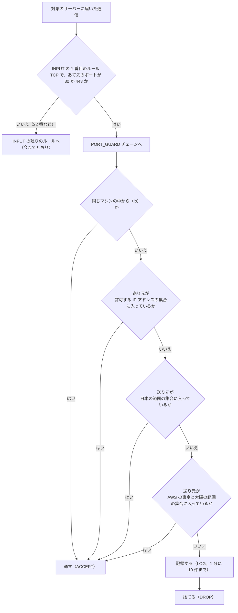
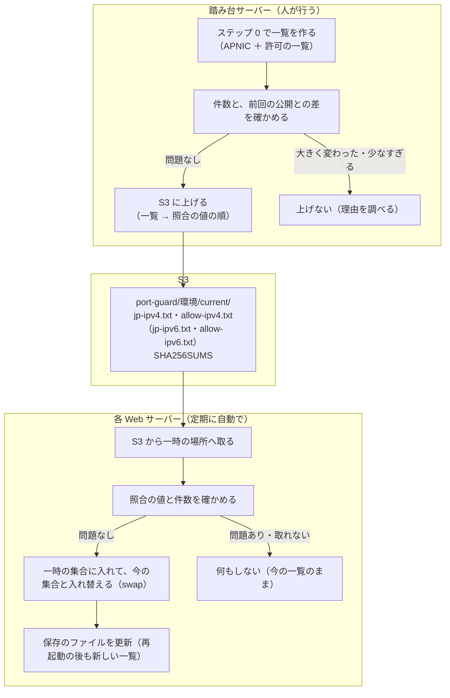

# 踏み台サーバーからの iptables・ipset の導入: 補足（仕組みの説明・運用の設計）

> 位置付け: [踏み台サーバーから iptables と ipset を入れる手順（コマンドの一覧）](./bastion-install-commands.md) の補足。手順のドキュメントには手順とコマンド、各ステップの説明、結果の見方を置き、長い前置きと補足（仕組みの説明、運用の仕組みの設計、手元で確かめたこと、自動化の道具との違い）をここにまとめている。各ステップの説明と、コマンドの 1 行ずつの意味は、手順のドキュメントにある。Linux・iptables・ipset に詳しくない人が、手順のドキュメントとこのドキュメントだけで、何をしているのか、なぜそうするのかを読み解けるように書いている。
>
> 更新日: 2026-11-04

## この手順で行うこと

対象のサーバーが受け付ける **80 番（HTTP）と 443 番（HTTPS）の通信を、次の 2 つから来たものだけ**にする。それ以外から来た 80・443 番の通信は、対象のサーバーが捨てる（相手には何も返さない）。

- 日本に割り当てられた IP アドレス（APNIC という組織が公開している一覧から作る）
- 個別に許可した IP アドレス。**対象のサーバーが入っている VPC の範囲**（同じ VPC の中のほかのサーバー、監視、踏み台サーバーなど、VPC の中から来る通信）と、日本の外から受ける必要がある相手（海外の拠点、外部のサービス、監視など）
- AWS の東京（`ap-northeast-1`）と大阪（`ap-northeast-3`）のリージョンの範囲（AWS が公開している一覧 `ip-ranges.json` から作る。リージョンを丸ごと許可するので、そこに EC2 などを借りれば誰でも通れる）

**22 番（SSH）は絞らない**。踏み台サーバーからの SSH は今までどおり入れる（設定を誤っても、SSH で入って直せる）。外部からの SSH は、AWS のセキュリティグループ（AWS の側でインスタンスの手前に置く通信の許可の一覧）で防ぐ前提。

設定は、対象のサーバーの中の Linux が持つ通信の選り分けの仕組み（iptables と ipset）で行う。AWS の設定は変えない。

**注意: Let's Encrypt の証明書を certbot で更新している台は、この手順を入れると、そのままでは証明書の更新が失敗する**。対応は、[手順のドキュメント](./bastion-install-commands.md) のステップ 7（更新の間だけ 80 番を開ける hook）。設計の理由は、後の「これから入れる運用の仕組み」の「A. Let's Encrypt の更新の間だけ 80 番を開ける」。本番で絞り込みを有効にしたら、次の証明書の更新の前に、これを入れる。

**前提: 対象のサーバーは、インターネットから直接 80・443 番を受けている**（ロードバランサー（ALB）や CloudFront を前に置いていない）。前に置くと、対象のサーバーから見た送り元が利用者ではなくなるので、この手順では国で絞れない（そのまま入れると、すべての通信が止まることもある）。前に置くときの考え方は [ロードバランサー・CloudFront を前に置くときの国での絞り込み](../notes/ec2-operations/access-restriction-alb-cloudfront.md)。

## 読む前に知っておくこと

### 登場するマシンと、作業する人

| マシン | 役割 |
|---|---|
| 踏み台サーバー | 作業の起点。ここから対象のサーバーへ SSH でコマンドを流す。日本の IP アドレスの範囲の一覧も、ここで作る（インターネットから元のデータを取る） |
| 対象のサーバー | 設定を入れる Web サーバー。OS は Amazon Linux 2（AWS が提供する Linux。中身は Red Hat 系で、パッケージは `yum` で入れる） |
| 海外の確認用のマシン | 設定が効いたかを、日本の外から確かめるためのマシン（任意。たとえば海外のリージョンに立てた小さなインスタンス） |

対象のサーバーには、利用者 `centos` で SSH ログインする。通信の設定を変えるには、Linux の管理者（`root`）の権限が要る。そのため、権限が要るコマンドの頭には `sudo -n` を付ける。

- `sudo`: その 1 つのコマンドだけを `root` の権限で実行する
- `-n`: パスワードを聞かれる設定のときは、聞かずにすぐ失敗する（標準入力でスクリプトを流しているので、パスワードを聞かれると止まってしまうため）

### IP アドレス・CIDR・ポート

| 用語 | 意味 |
|---|---|
| IP アドレス | インターネットの上の住所。通信には「送り元」と「あて先」の IP アドレスが付いている。この手順では、**送り元の IP アドレス**で受け付けるかを決める |
| IPv4 | 今いちばん使われている形の IP アドレス。`203.0.113.10` のように 4 つの数（0〜255）を `.` でつなぐ。全体で約 43 億個 |
| IPv6 | 新しい形の IP アドレス。`2001:db8::1` のように 16 進数を `:` でつなぐ。IPv4 とは**まったく別の通信**として扱われ、設定も別に要る |
| プライベートのアドレス | インターネットでは使わず、VPC などの閉じたネットワークの中だけで使う IPv4 アドレス。`10.0.0.0/8`・`172.16.0.0/12`・`192.168.0.0/16` の 3 つの範囲。**どこの国にも割り当てられていないので、日本の範囲の一覧には入らない**。VPC の中から来る通信は、送り元がこのアドレスになるので、許可する IP アドレスの一覧に VPC の範囲を入れる（ステップ 0-2） |
| CIDR（サイダー） | IP アドレスの範囲の書き方。`1.0.16.0/20` は「先頭の 20 ビットが `1.0.16.0` と同じアドレス全部」（`1.0.16.0`〜`1.0.31.255` の 4,096 個）。`/` の後ろの数が大きいほど範囲は狭い。`/32`（IPv4）・`/128`（IPv6）は 1 個だけ。`/` を書かなければ 1 個だけ |
| ポート | 1 台のサーバーの中で、どのサービスあての通信かを表す番号。80 番は HTTP、443 番は HTTPS、22 番は SSH |
| TCP | Web や SSH が使う通信の方式。接続を張ってからやりとりする。この手順で絞るのは TCP の 80・443 番 |

### 対象のサーバーの中で、届いた通信がどう扱われるか（iptables）

Linux の中心部分（**カーネル**）には、届いた通信（パケット。通信を小分けにした 1 つ 1 つ）を、ルールに沿って通したり捨てたりする仕組みがある。**iptables** は、そのルールを登録・確認するためのコマンド。

| 用語 | 意味 |
|---|---|
| ルール | 「こういう通信なら、こうする」の決まり 1 つ。条件（送り元、あて先のポートなど）と、行き先（下の「ターゲット」）からなる。**ルールはカーネルのメモリーの中の表に入っているもので、ファイルの中の行ではない**。`iptables` のコマンドで、動いているカーネルの表に直接、差し込む（`-I`）・末尾に足す（`-A`）・削除する（`-D`）。`iptables -S` で見ると 1 つのルールが 1 行で表示されるが、それは表示の形にすぎない |
| チェーン | ルールの並び。上から順に照合して、**最初に合ったルールの行き先に従う**。どれにも合わなければ、チェーンの既定の扱い（ポリシー）に従う |
| `INPUT` チェーン | このサーバーあてに届いた通信が必ず通る、最初から用意されているチェーン。Amazon Linux 2 の初期の状態は、ルールが空で、ポリシーは「通す」 |
| 自前のチェーン | 自分で名前を付けて作るチェーン。この手順では `PORT_GUARD` を作り、80・443 番の判定をここにまとめる。自前のチェーンの最後まで行っても決まらなければ、呼び出し元（`INPUT`）の次のルールへ戻る |
| ターゲット（行き先） | `ACCEPT`（通す。そこで判定終わり）、`DROP`（捨てる。相手には何も返さないので、相手は時間切れまで待つ）、`LOG`（記録だけして、次のルールへ進む）、チェーンの名前（そのチェーンへ飛ぶ） |
| `ip6tables` | IPv6 用の iptables。**IPv4 のルールと IPv6 のルールは完全に別**。IPv6 も絞るなら、`ip6tables` で同じルールを入れる |

この手順で入れるルールの流れ（IPv6 も同じ形）:



知っておくべき性質:

| 性質 | 内容 |
|---|---|
| **ルールはカーネルのメモリーにしかない** | ファイルには保存されない。**再起動すると消える**。残すには、起動のたびに入れ直す仕組みが要る（ステップ 5・6） |
| ルールは 1 つ 1 つのパケットに効く | ルールを入れた瞬間から、すでにつながっている接続のパケットにも効く。海外からつながっていた 80・443 番の接続は、ルールを入れたところで切れる |
| このサーバーから外へ出る通信には効かない | ルールの条件は「**このサーバーの** 80・443 番あて」。このサーバーが外部の API（相手の 443 番）を呼ぶ通信は、返ってくるパケットのあて先がこのサーバーの別の番号なので、当てはまらない |
| 同時に 2 つは動けない（ロック） | `iptables` と `ip6tables` は、ルールを変える間、同じロック（`/run/xtables.lock` というファイル）を持つ。ほかのものがロックを持っている間に動くと、`-w` を付けていなければ `Another app is currently holding the xtables lock` で失敗する。この手順では、どの `iptables`・`ip6tables` にも `-w 10`（最大 10 秒待つ）を付ける |

### 数千の範囲をまとめて照合する（ipset）

日本に割り当てられた範囲は、IPv4 で約 4,700 件ある。iptables のルールを 4,700 行並べると、80・443 番のパケットが届くたびに 4,700 行を上から照合することになり、重い。

**ipset** は、カーネルの中に「IP アドレスの範囲の集まり（集合）」を名前を付けて置く仕組み。iptables のルールからは、「送り元がこの名前の集合に入っているか」という 1 つのルールで照合できる（`-m set --match-set <集合の名前> src`）。集合は、件数が多くても速く照合できる形（ハッシュ）で持つ。

| 性質 | 内容 |
|---|---|
| 集合の型 | この手順では `hash:net`（CIDR の範囲を入れる型。範囲の長さはばらばらでよい） |
| IPv4 と IPv6 | 1 つの集合には、IPv4 か IPv6 のどちらかしか入らない（作るときに `family inet`（IPv4）か `family inet6`（IPv6）を決める）。`iptables` は IPv4 の集合を、`ip6tables` は IPv6 の集合を参照する |
| **集合もカーネルのメモリーにしかない** | 再起動すると消える。ファイルに保存して、起動時に読み込み直す（ステップ 5・6） |
| 集合だけでは何も起きない | 集合は、iptables のルールから参照されて初めて効く。集合を作って中身を入れても、ルールを入れるまでは通信に何の影響もない |
| ルールより先に集合が要る | ルールは集合を名前で参照する。集合がないと、ルールを入れるコマンドが失敗する。逆に、ルールから参照されている集合は消せない |

### 日本の IP アドレスの範囲はどこから来るか（APNIC）

IP アドレスは、地域ごとの組織が通信事業者などに割り当てている。アジア太平洋の地域（日本を含む）は **APNIC**。APNIC は、割り当ての一覧を毎日、無料・登録なしで公開している（`https://ftp.apnic.net/stats/apnic/delegated-apnic-latest`、約 4 MB）。1 行が 1 件の割り当てで、国の記号が付いている。

```
apnic|JP|ipv4|1.0.16.0|4096|20110412|allocated
apnic|JP|ipv6|2001:200::|35|19990813|allocated
```

| 項目（`|` で区切った位置） | 意味 |
|---|---|
| 2 番目 | 国の記号（`JP` が日本） |
| 3 番目 | `ipv4` か `ipv6` |
| 4 番目 | 範囲の先頭のアドレス |
| 5 番目 | IPv4 は**個数**（例: `4096`）、IPv6 は **CIDR の長さ**（例: `35`） |
| 7 番目 | 状態。使われている割り当ては `allocated` か `assigned` |

注意: 「日本に割り当てられた IP アドレス」は、「日本にいる人」と同じではない。日本の人が海外の VPN やクラウドを通せば、送り元は日本の範囲にならない。逆もある。この手順は、海外からの機械的な大量のアクセスを減らすための、おおまかな絞り込みとして使う。

### 再起動の後も設定を残す仕組み（systemd）

**systemd** は、Linux の起動のときに、決められた処理やサービスを順に動かす仕組み。動かすものは「**ユニット**」というファイル（`/etc/systemd/system/<名前>.service`）に書く。

| 用語 | 意味 |
|---|---|
| ユニット（サービス） | 何を、いつ、どう動かすかを書いた設定のファイル。この手順では `port-guard.service` を 1 つ置く |
| `ExecStart=` | 動かすコマンド。`Type=oneshot` のユニットでは何行でも並べられ、**上から順に 1 つずつ**実行される（前の行が終わるまで次は始まらない）。どれかが失敗すると、そこで止まる |
| `enable` | 次の起動から、起動のときに自動で動くようにする（今すぐは動かさない） |
| `start` | 今すぐ動かす |
| 追加の設定（ドロップイン） | ユニットの本体とは別のファイル（`/etc/systemd/system/<名前>.service.d/*.conf`）に、設定の続きを書ける仕組み。systemd はユニットを読むときに、これらを**ファイルの名前の順に**読んで本体に足す。`ExecStart=` は足されていく |
| `daemon-reload` | ユニットのファイルを置いたり変えたりした後に、systemd に読み直させる |
| ターゲット | 起動の途中の区切り。`network-pre.target` は「ネットワークをつなぐ直前」、`multi-user.target` は「普通の起動が終わったところ」 |

### 踏み台サーバーからコマンドを流す形

どのステップも、踏み台サーバーで次の形で流す（`<ステップ>` はファイルの名前）。

```bash
ssh -oStrictHostKeyChecking=no -i ~/.ssh/key.pem centos@server 'bash' < ./command/port_guard/<ステップ>.sh >> ./output/result.txt
```

| 部分 | 意味 |
|---|---|
| `ssh ... centos@server 'bash'` | 対象のサーバーに `centos` で入り、`bash`（コマンドを実行するプログラム）を起動する |
| `< ./command/port_guard/<ステップ>.sh` | 踏み台サーバーのファイルの中身を、対象のサーバーの `bash` の**標準入力**（キーボードから打つ代わりに流し込む入り口）に送る。`bash` はそれを 1 行ずつ読んで実行する。対象のサーバーにファイルを置く必要はない |
| `>> ./output/result.txt` | 対象のサーバーの画面への出力を、踏み台サーバーのファイルに書き足す。エラーの出力も残すなら `>> ./output/result.txt 2>&1` |

**標準入力で流すときの注意**: `bash` はスクリプトを標準入力から少しずつ読みながら実行する。そのため、スクリプトの途中で**標準入力を読むコマンド**を使うと、残りのスクリプトをそのコマンドが読んでしまい、そこから後が実行されない。

- 標準入力を読むかもしれないコマンドには `< /dev/null`（空の入力）を付ける。この手順では `yum` に付けている
- `<<'EOF'` から `EOF` までの行（ヒアドキュメント。複数行の文字列をその場に書く書き方）は、スクリプトの一部として読まれるので問題ない。`ipset restore` や `tee` に渡す中身は、この形で書いている

各ファイルで共通に使う書き方:

| 書き方 | 意味 |
|---|---|
| `#!/bin/bash` | このファイルは `bash` で実行するもの、という印 |
| `set -euo pipefail` | どれかのコマンドが失敗したら、そこで止める（`-e`）。書き間違えた変数を使ったら止める（`-u`）。`|` でつないだコマンドの途中の失敗も失敗とみなす（`pipefail`）。**途中で失敗したまま先へ進まない**ための指定 |
| `echo "== $(hostname) $(date '+%F %T') <ステップ>"` | 結果のファイルに、どの台の、いつの、どのステップの結果かの見出しを書く |
| `# 確認` から後 | 設定を変えるコマンドではなく、結果を表示するだけのコマンド |
| `<コマンド> || true` | そのコマンドが失敗しても、失敗とみなさない（`set -e` で止めない） |
| `sudo -n sh -c '<コマンド> > <ファイル>'` | `>`（ファイルへの書き出し）も `root` の権限で行うための書き方。`sudo -n <コマンド> > <ファイル>` と書くと、書き出しは `centos` の権限で行われ、`/etc` などには書けない |
| `sudo -n tee <ファイル> > /dev/null <<'EOF'` 〜 `EOF` | 間の行を、`root` の権限でファイルに書く（`tee` は受け取った中身をファイルに書くコマンド。画面への表示は `/dev/null` に捨てる） |

## 運用の仕組みの設計（A は手順のステップ 7、一覧の更新は手順の `make-refresh.sh` に用意。S3 の案は見送り）

> 状態（2026-11-05）: A（Let's Encrypt）は、スクリプトを [手順のドキュメント](./bastion-install-commands.md) のステップ 7 に用意した（対象のサーバーではまだ流していない）。B（一覧の更新）は、2026-11-09 に踏み台サーバーから配る形（手順の「一覧を新しくするとき」）を想定して実装した。下の B の S3 の案は、無人で回す必要が出たときのために残している。確認が要ることは [確認すること](./confirmation-items.md)。

絞り込みを入れた後の運用で、次の 2 つが要る。

| 要ること | なぜ要るか | 決めた方針 |
|---|---|---|
| A. Let's Encrypt の証明書の更新を通す | 絞り込みを入れると、証明書の更新が失敗する（下の A-1） | **certbot の更新の前後に動く処理（hook）で、更新している間だけ 80 番を開ける**。スクリプトは [手順のドキュメント](./bastion-install-commands.md) のステップ 7 に用意した（2026-11-05。手元の偽物のコマンドでだけ確かめた） |
| B. 日本の範囲の一覧を定期に新しくする | APNIC の割り当ては少しずつ変わる（月に数件〜数十件）。古いままだと、新しく日本に割り当てられた範囲からの接続を捨てる | **踏み台サーバーで作って確かめた一覧を S3 に置き、各サーバーが取りに行って入れ替える**。定期の実行の仕方と、S3 を読む権限は、それぞれ 2 つの案を用意して、環境を見て決める |

2 つは**処理をつなげず、時刻だけそろえる**（A は certbot が動く毎月 1 日・16 日の 4:00、B はその 30 分後の 4:30 など）。片方の失敗が、もう片方を巻き込まないようにするため。変更が起きる時刻はそろうので、何か起きたときに調べる時間帯は 1 つで済む。

### A. Let's Encrypt の更新の間だけ 80 番を開ける

#### A-1. なぜ更新が失敗するか

Let's Encrypt（無料の HTTPS の証明書を発行するサービス）は、証明書を出す・更新するときに、「このドメインのサーバーを本当に管理しているか」を確かめる。今のサーバーは、`certbot`（Let's Encrypt の証明書を取る・更新するコマンド）の webroot という方式（HTTP-01 の確認）で更新していると見込んでいる。この方式では、Let's Encrypt が**海外を含む複数の場所から**、サーバーの 80 番の `/.well-known/acme-challenge/` に接続してきて、certbot が置いた合言葉のファイルを読む。

この送り元の IP アドレスは公開されていない（わざと変えている）ので、許可する IP アドレスの一覧にも書けない。絞り込みを入れたままだと、海外からの確認の接続が捨てられて、更新が失敗する。証明書の期限は 90 日で、certbot は期限の 30 日前から更新を試みるので、**絞り込みを入れてから最大 60 日ほどで更新が失敗し始め、さらに 30 日で証明書が切れる**（ブラウザーが警告を出し、サイトが見られなくなる）。

#### A-2. 方針: certbot の hook で、更新している間だけ 80 番を開ける

certbot には、更新の前と後に、決めたスクリプトを動かす仕組み（hook）がある。`/etc/letsencrypt/renewal-hooks/pre/`（更新の前）と `/etc/letsencrypt/renewal-hooks/post/`（更新の後）に実行できるファイルを置くと、`certbot renew` が自動で動かす。cron の設定は変えなくてよい。

```
cron（毎月 1 日・16 日 4:00）→ certbot renew
  └ 期限の 30 日前を切った証明書があるときだけ:
      1. 更新の前の処理（pre）: iptables のコマンドで、カーネルの INPUT チェーンの一番上に
                                「TCP の 80 番は、どこからでも通す」ルールを 1 つ差し込む
                                ＋「30 分後にそのルールを削除する」予約を入れる（安全のため）
      2. Let's Encrypt が海外を含む場所から 80 番に確認に来る → 通る
      3. 更新の後の処理（post）: iptables のコマンドで、そのルールを削除する
  └ 更新が要る証明書がなければ、何もしない（pre も post も動かない）
```

cron の時刻に合わせて絞り込みを外す・戻す案と比べて、この形にした理由:

| 観点 | cron の時刻で外す・戻す（採らない） | certbot の hook（採る） |
|---|---|---|
| 開く回数 | cron が動くたび（毎月 2 回） | 更新が要るときだけ（約 60 日に 1 回） |
| 開く時間 | 余裕を見て 15〜30 分。certbot は自動で動くとき、始める前に最大 8 分ほどランダムに待つので、cron の時刻ちょうどには始まらない | 更新している数秒〜数分だけ |
| 開くもの | 絞り込みを丸ごと外す（80・443 番） | **80 番だけ**（443 番は絞ったまま） |
| cron の時刻を変えたとき | 外す・戻す時刻も直す必要がある | 何もしなくてよい |
| 更新が失敗したとき | 時刻が来れば戻る | 後の処理か、30 分後の予約で戻る（更新が失敗した場合に後の処理が動くかは、certbot の説明に明記がない） |

#### A-3. 開け方の決めごと

| 決めごと | 内容 | 理由 |
|---|---|---|
| 差し込むルール | カーネルの `INPUT` チェーンの一番上に、「TCP の 80 番は通す（`ACCEPT`）」ルールを 1 つ。目印の注釈（`-m comment --comment port-guard-acme`）を付ける | `PORT_GUARD` へ飛ばす行より上に置けば、80 番は絞り込みの前に通る。注釈で、ほかのルールと見分けて確実に消せる |
| 絞り込みのルールには触らない | `PORT_GUARD` チェーンと、`INPUT` から飛ばす行はそのまま | 開ける・閉じるが、絞り込みの設定と独立する。port-guard のサービスを流し直しても、このルールは削除されない |
| 開きっぱなしを防ぐ | 前の処理で、systemd の一時の予約（`systemd-run --on-active=30min ...`。30 分後に 1 回だけコマンドを動かす）で「そのルールを削除する」も入れる | certbot が途中で落ちて、後の処理が動かなかったときでも、30 分で閉じる |
| 再起動したら | 差し込んだルールはどこにも保存しないので、再起動で消える。起動時は port-guard のサービスが普通のルールだけを入れる | 開いたまま再起動しても、閉じた状態で起動する |
| IPv6 | 証明書のドメインに IPv6 のアドレス（DNS の AAAA の登録）があり、IPv6 も絞っている台では、`ip6tables` でも同じことをする | Let's Encrypt は、IPv6 のアドレスがあれば IPv6 でも確認に来る |
| 開いている間 | 80 番は世界中から受け付ける。80 番が HTTPS（443 番）へ転送するだけの台なら、影響は小さい。80 番でアプリを出している台（`old_app_a` など）は、その間（最大 30 分）アプリの国の絞り込みが外れる | 許容するかは [確認すること](./confirmation-items.md) の L14 |

#### A-3-2. 何を操作するか（ファイルの編集ではない）

hook が操作するのは、**カーネルのメモリーの中にある iptables のルールの表（`INPUT` チェーン）だけ**。`iptables` のコマンドで、動いている表に直接ルールを差し込み、後で削除する。設定のファイルを書き換えるのではなく、ipset の集合にも触らない。

| 置き場所 | 中身 | hook で操作するか |
|---|---|---|
| カーネルの iptables のルールの表（`INPUT` チェーン） | 今効いているルール | **操作する**。ルールを 1 つ差し込み、後で削除する |
| カーネルの iptables のルールの表（`PORT_GUARD` チェーン） | 絞り込みのルール | 操作しない |
| カーネルの ipset の集合（`port_guard_jp`・`port_guard_allow` など） | 日本の範囲、許可する IP アドレス | 操作しない（許可の集合に「すべてのアドレス」を入れる形にすると、集合は 80・443 番の両方の判定に使われているので、443 番まで開いてしまう） |
| ファイル（`/etc/port-guard/*.save`、`/etc/systemd/system/port-guard.service.d/*.conf`） | 起動時に入れ直すための保存と、コマンドの並び | 操作しない。差し込んだルールはどこにも保存しないので、再起動すると消える |

コマンドの形（実際のスクリプトは [手順のドキュメント](./bastion-install-commands.md) のステップ 7。ここでは要点だけを抜き出している）:

```bash
# 更新の前の処理（/etc/letsencrypt/renewal-hooks/pre/ に置くファイルの中身の案）
# カーネルの INPUT チェーンの 1 番目に、「TCP の 80 番は通す」ルールを差し込む（目印の注釈付き）
iptables -w 10 -I INPUT 1 -p tcp --dport 80 -m comment --comment port-guard-acme -j ACCEPT
# 30 分後に、そのルールを削除する予約を、systemd の一時の予約として入れる（ファイルには残らない。再起動で消える）
systemd-run --on-active=30min --unit=port-guard-acme-close   /usr/sbin/iptables -w 10 -D INPUT -p tcp --dport 80 -m comment --comment port-guard-acme -j ACCEPT

# 更新の後の処理（/etc/letsencrypt/renewal-hooks/post/ に置くファイルの中身の案）
# 同じ条件のルールを、削除できなくなるまで削除する（何かの理由で 2 つ入っていても残さない）
while iptables -w 10 -D INPUT -p tcp --dport 80 -m comment --comment port-guard-acme -j ACCEPT 2>/dev/null; do :; done
# 30 分後の予約を取り消す
systemctl stop port-guard-acme-close.timer 2>/dev/null || true
```

| 点 | 内容 |
|---|---|
| 削除の仕方 | `iptables -D` に、差し込んだときと**同じ条件**を書くと、カーネルの表から、その内容のルールを探して削除する。ルールの番号や、別の管理の記録は要らない。目印の注釈まで一致するものだけが削除されるので、ほかの 80 番のルールを誤って削除しない |
| 30 分後の予約 | `systemd-run --on-active=30min` は、systemd に「30 分後に、このコマンドを 1 回だけ動かす」一時の予約を作らせる。更新の後の処理が動けば、予約は取り消される。取り消されずに動いても、削除する相手がなければ失敗するだけで害はない |

差し込んでいる間の `INPUT` チェーン（`iptables -S INPUT` の表示。1 つのルールが 1 行で表示される）:

```
-A INPUT -p tcp -m tcp --dport 80 -m comment --comment port-guard-acme -j ACCEPT   ← 一時的に差し込んだルール
-A INPUT -p tcp -m multiport --dports 80,443 -j PORT_GUARD                          ← いつもの絞り込みへ飛ばすルール
```

ルールは上から順に照合される。80 番は 1 番目のルールで通るので、`PORT_GUARD` まで行かない。443 番は 1 番目のルールに当たらないので、いつもどおり `PORT_GUARD` で絞られる。削除した後は、2 番目のルールだけに戻る。

#### A-4. 前提を確かめる

hook の置き場所（`/etc/letsencrypt/renewal-hooks/`）が効くのは、証明書の更新を **`certbot renew`** で行っている場合。確かめるコマンドと、結果の見方は、[手順のドキュメント](./bastion-install-commands.md) のステップ 7-1（`07-letsencrypt-check.sh`）。

もう 1 つの前提は、**80 番の確認のパスが HTTPS へ転送されていないこと**。Let's Encrypt の確認はリダイレクトをたどるので、転送されていると確認が 443 番（絞ったまま）へ進み、更新が失敗する。ステップ 7-1 で確かめ、転送していれば確認のパスだけを転送から外す。

#### A-5. ほかの方法（採らない）

| 方法 | 採らない理由 |
|---|---|
| DNS で確かめる方式（DNS-01、Route 53） | 80 番を開ける必要がなくなるが、certbot の Route 53 用の追加の部品の導入（Amazon Linux 2 では入れにくい）と、サーバーに Route 53 を書き換える権限を持たせることが要る |
| ロードバランサー・CloudFront で AWS Certificate Manager の証明書を使う | 今は前に何も置いていない。構成を大きく変える（[ロードバランサー・CloudFront を前に置くときの国での絞り込み](../notes/ec2-operations/access-restriction-alb-cloudfront.md)） |

#### A-6. 今の仕様での、証明書の期限切れのリスク

90 日の証明書を、毎月 1 日と 16 日の cron の `certbot renew` で更新している場合の整理である（cron の時刻と `certbot renew` の使用は見込みで、実環境では未確認。手順のステップ 7-1 で確かめる）。**この仕様だけなら、重大な問題が起きる可能性は低い**。

90 日の証明書は残り 30 日から更新の対象になるので、更新は次のように進む。

- 1 回目の試行は、たいてい残り約 29 日のとき
- 失敗しても、2 回目が残り約 14 日のときにある（日付の並びによっては、1 回目が残り約 16 日で、2 回目が期限の当日ごろになることがある）
- 2 回とも失敗して初めて期限切れになる

一時的な障害で 1 回失敗する程度なら問題にならない。問題になるのは、**失敗し続ける原因があり、それに誰も気づかない場合**だけである。

| 発生する問題 | 原因 |
|---|---|
| 更新が毎回失敗する | 80 番の絞り込みで確認の接続が止まる（port-guard を入れて、この hook が効かない場合） |
| 更新が毎回失敗する | セキュリティグループ、80 番の HTTPS への転送、DNS の向き先の誤り |
| 失敗に気づかない | Let's Encrypt の通知メールは 2025-06-04 に終了している。cron の失敗にも通知がない |
| 更新はできたのに古い証明書のまま | 更新の後に httpd を読み直していない |

期限切れの原因になりそうなのは、実質的に port-guard の導入で 80 番を絞ることである。今の運用で更新が通っているなら、その状態自体に危険はない。絞り込みを入れた後も、この hook が効いていることを 1 度確かめれば、cron の頻度を今すぐ変える必要はない。

Let's Encrypt の有効期間は短くなる予定なので（[有効期間の短縮の予定](../notes/instance-provisioning/letsencrypt-certificate-timing.md#有効期間の短縮の予定)）、そのときに cron の頻度を見直す。残り日数の確かめ方は [証明書の期限の確認](./certificate-expiry-check.md)。

### B. 日本の範囲の一覧を定期に新しくする（S3 の案。2026-11-09 に見送り）

> 2026-11-09 に、一覧は踏み台サーバーから配る形（[手順](./bastion-install-commands.md) の「一覧を新しくするとき」）を想定して実装した。理由: 一覧の変化は月に数件〜数十件で、自動化の仕組みを増やすほどの鮮度が要らない。踏み台サーバーから S3 に上げる権限の問題があり、S3 の入り口や各サーバーの定期の実行も増える。この節は、無人で回す必要が出たとき、または AMI から台を増やす運用になったときの案として残している。
>
> 2026-11-14 に、方針を「踏み台サーバーで作って人が確認してから S3 に上げ、各サーバーが定期に取得・照合して入れ替える」とし、**S3 に上げるまで**を、人の作業フローと、それをそのまま自動化したパイプラインの両方で用意した（[list-refresh-pipeline](./list-refresh-pipeline/README.md)。未検証）。この節の案から変えた点: S3 に置くのは一覧ではなく **ipset 入れ替えスクリプト**（`make-refresh.sh` が作る `refresh-ipv4.sh`・`refresh-ipv6.sh`。一時の集合に入れてから `ipset swap`）と照合の値で、比較の基準（前回分の IP の一覧）と個別許可の IP の一覧も S3 に置く。各サーバーが取って入れ替える側（B-2・B-3）は、まだ作っていない。

#### B-1. 全体の形



| 部分 | 決めごと | 理由 |
|---|---|---|
| 一覧を作る場所 | 今のとおり**踏み台サーバー**（ステップ 0） | 作り方を 1 か所にまとめる。各サーバーは APNIC に取りに行かない |
| 公開の前の確認 | **人が確かめてから上げる**。件数の基準（IPv4 1,000 件・IPv6 200 件）と、前回の公開との差（足された・消えた件数）を見て、大きく変わっていれば（目安 5% 超）上げない | 誤った一覧を上げると、全台に配られて、日本からも受け付けなくなる。配る前に止める |
| S3 の置き場所 | `s3://<バケット>/port-guard/<環境>/current/`。環境（VPC）ごとに分ける | 許可の一覧には VPC の範囲が入るので、環境ごとに中身が違う |
| 上げる順番 | 一覧のファイルを上げてから、最後に照合の値（`SHA256SUMS`。各ファイルの中身から計算した値の一覧）を上げる | 上げている途中に各サーバーが取ると、新しいファイルと古いファイルが混ざる。照合の値が合わなければその回は入れ替えないので、混ざった組は使われない |
| 戻せるように | バケットの版の管理（バージョニング。上書きしても前の版を残す機能）を有効にする | 誤った一覧を上げてしまったときに、前の版に戻せる |
| サーバーでの入れ替え | 新しいスクリプト（`/usr/local/sbin/port-guard-refresh` の予定）が、図の W1〜W4 を行う。iptables のルールには触らず、集合の中身だけを入れ替える | — |
| 入れ替えの方法 | 一時の集合（`port_guard_jp_new` など）に入れてから、`ipset swap`（2 つの集合の中身を一瞬で入れ替える）で切り替え、一時の集合を消す | 今の手順（ステップ 3）の「空にしてから入れる」と違い、集合が空になる時間ができない |
| 確かめて止める | 取れない・照合の値が合わない・件数が基準未満のときは、何もせずに終える（今の一覧のまま） | 失敗しても、絞り込みは今の一覧で効き続ける |
| 記録 | 結果をログ（journal）に残し、最後に成功した日時を `/var/lib/port-guard/last-refresh` に書く | 長く更新されていない台を、監視で見つけられる |
| 踏み台サーバーからの手動の更新 | 「一覧を新しくするとき」の手順が本体（この案を採るなら予備になる） | S3 や定期の実行が使えないときの予備 |

#### B-2. 定期の実行: 2 つの案（環境を見て決める）

| | 案 1: 各サーバーの cron | 案 2: SSM State Manager |
|---|---|---|
| 仕組み | 各サーバーの cron に「毎月 1 日・16 日の 4:30 に `port-guard-refresh` を動かす」行を置く | AWS Systems Manager の State Manager（決めた予定で、タグで選んだ台にコマンドを流す AWS の仕組み）に、予定を 1 つ置く。SSM の Run Command と同じ経路で、各サーバーの `port-guard-refresh` を動かす |
| 予定を置く場所 | 各サーバー（台の数だけ） | AWS の側に 1 つ |
| 結果を見る | 各サーバーのログ | AWS のコンソールで、台ごとの成功・失敗の一覧が見られる（出力を S3 に残すこともできる） |
| 新しい台 | その台にも cron の行を置く | 決めたタグを付ければ対象になる |
| 前提 | なし | 全台で SSM が使えること（暫定対応のフェーズ 1 `ssm-setup` で進めている） |
| 向いている場面 | 台数が少ない。今の運用（certbot も cron）とそろえたい | 台数が多い。結果を一か所で見たい |

どちらにしても、各サーバーに置く `port-guard-refresh` は同じもの（動かすきっかけだけが違う）。

#### B-3. S3 を読む権限: 2 つの案（今は案 Y の見込み）

各サーバーが S3 の一覧を読むには、読んでよいという許可が要る。

| | 案 X: 各サーバーのロールに読む権限を足す | 案 Y: S3 のゲートウェイエンドポイント ＋ バケットのポリシー（見込み） |
|---|---|---|
| 仕組み | 各サーバーの IAM ロール（インスタンスに付ける AWS の権限の入れ物）に、`port-guard/<環境>/*` だけを読める権限（`s3:GetObject`）を足す。サーバーは AWS CLI（`aws s3 cp`）で取る | VPC に S3 への専用の入り口（**ゲートウェイエンドポイント**。無料）を置く。バケットのポリシー（バケットの側に書く許可の決まり）に「この入り口から来た、`port-guard/<環境>/*` の読み取りだけを許す」と書く。サーバーは認証なしで `curl` で取る |
| ロールの変更 | **要る**。`ssm-setup` で付けた `port-guard-ssm` に加え、もともと別のロールを持っていた台は、そのロールにも足す | **要らない** |
| VPC の変更 | 要らない | 要る（ゲートウェイエンドポイントを置き、VPC の経路の表に関連付ける。関連付けると、その VPC の中から S3 への通信はすべてこの入り口を通るようになる。普通は困らないが、ほかの S3 の利用に影響がないかは確かめる） |
| サーバーに要るもの | AWS CLI（Amazon Linux 2 に入っている） | `curl` だけ |
| 気を付けること | 「既存のロールに権限を足さない」という今の方針とぶつかる | 入り口を通らない場所（踏み台サーバーの外、作業者の PC など）からは読めない（上げる側の権限は別に要る）。一覧は秘密ではないが、VPC の範囲や許可の相手が入るので、外には出さない |
| 選ぶ場面 | VPC の設定を変えたくない | 既存のロールに触りたくない（今の方針に合う） |

#### B-4. 決まっていないこと

| 項目 | 内容 |
|---|---|
| S3 のバケット | 新しく作るか、既存のバケットを使うか。名前 |
| 環境の分け方 | `port-guard/<環境>/` の `<環境>` の名前（VPC ごと） |
| 定期の実行 | 案 1（cron）か 案 2（State Manager）か。時刻（4:30 の見込み） |
| S3 を読む権限 | 案 X か 案 Y か（今は Y の見込み）。Y なら、VPC にすでに S3 のゲートウェイエンドポイントがあるか |
| 公開の前の差の基準 | 前回との差が何 % を超えたら上げないか（目安 5%） |
| 上げる側の権限 | 踏み台サーバーから S3 に上げる権限を、どの認証情報で持つか |
| IPv6 | IPv6 も絞る台があるか（A の hook と、B の入れ替えの両方に関わる） |

## 手順のステップごとの補足

### ステップ 0-2: なぜインスタンスメタデータ（`169.254.169.254`）から調べるか（経緯）

2026-11-04 に、「VPC の中から来る通信の送り元はプライベートのアドレスで、日本の範囲の一覧に入らないので、VPC の範囲を許可の一覧に入れる必要がある」と分かった。そのとき、VPC の範囲をどこから調べるかを、次の 2 つから選んだ。

| 調べ方 | 要るもの | 選んだか |
|---|---|---|
| 対象のサーバーの中から、インスタンスメタデータ（`169.254.169.254`）に問い合わせる | `curl`（Amazon Linux 2 に最初から入っている）だけ。AWS の操作の権限も、AWS CLI も要らない | **選んだ** |
| AWS CLI で `aws ec2 describe-vpcs` を呼ぶ | AWS CLI と、EC2 の情報を読む権限（`ec2:DescribeVpcs`）。踏み台サーバーにあるとは限らない | 予備（AWS CLI が使える場所なら、これでもよい） |

選んだ理由:

- **ほかのステップと同じ形で流せる**。踏み台サーバーから SSH で `bash` に流すだけで、踏み台サーバーに AWS の権限を持たせなくてよい
- **取り違えない**。インスタンスメタデータは「問い合わせてきたインスタンス自身の情報」を返すので、その台が実際に入っている VPC の範囲が出る（VPC が複数あっても、どれがその台の VPC かを人が見分けなくてよい）
- **読み取りだけ**。何も変えない。問い合わせは料金もかからない

`169.254.169.254` は、AWS が EC2 のインスタンスに用意している決まったアドレス（インスタンスメタデータサービス、IMDS）。リンクローカル（そのインスタンスの中からだけ届くアドレス）で、インターネットや VPC のどこかにあるサーバーではない。インスタンスが載っている AWS の基盤が、そのインスタンスからの問い合わせにだけ答える。外（踏み台サーバーなど）から、別のインスタンスの情報を聞くことはできない。

**名前（DNS 名）ではなくアドレスで書く理由**: AWS のドキュメントは、インスタンスメタデータサービスをアドレス（IPv4 は `169.254.169.254`、IPv6 は `fd00:ec2::254`）でだけ案内していて、公式の名前はない（2026-11-04 に確かめた）。名前を使う形は DNS の設定に左右されるので使わない。その代わり、スクリプトの中では `IMDS` という名前の変数に入れて、何のアドレスかが分かるようにしている。

このやり方は、AWS が公開している仕組みに沿っている（2026-11-04 に、下の AWS のドキュメントと照らし合わせた）。

| 使っているもの | AWS のドキュメントでの説明 |
|---|---|
| `http://169.254.169.254/latest/meta-data/` | インスタンスメタデータの入り口。リンクローカルのアドレスで、インスタンスの中からだけ有効 |
| `PUT /latest/api/token`（`X-aws-ec2-metadata-token-ttl-seconds`）でトークンを取り、`X-aws-ec2-metadata-token` に付けて問い合わせる | IMDSv2（新しい形）の問い合わせ方。古い形（IMDSv1）しか許していない台でも、この形は使える。IMDSv2 が必須の台では、古い形は使えない |
| `meta-data/mac` | インスタンスの MAC アドレス（ネットワークの口が複数あるときは、最初の口 `eth0`） |
| `meta-data/network/interfaces/macs/<MAC>/vpc-ipv4-cidr-blocks` | その口が入っている VPC の IPv4 の範囲（複数あれば複数行） |
| `meta-data/network/interfaces/macs/<MAC>/vpc-ipv6-cidr-blocks` | その VPC の IPv6 の範囲（ない場合は `404 - Not Found` になるので、`curl -f` が失敗を返す） |
| `curl -f` | AWS のドキュメントにも、`-f` を付けると HTTP のエラーのときに失敗を返し、スクリプトで止められると書かれている |

AWS のドキュメント:

- [Use instance metadata to manage your EC2 instance（インスタンスメタデータとは。項目の一覧（Instance metadata categories）に `mac`・`vpc-ipv4-cidr-blocks`・`vpc-ipv6-cidr-blocks` がある）](https://docs.aws.amazon.com/AWSEC2/latest/UserGuide/ec2-instance-metadata.html)
- [Access instance metadata for an EC2 instance（`169.254.169.254` への問い合わせ方、IMDSv2 のトークン、エラーのときの応答）](https://docs.aws.amazon.com/AWSEC2/latest/UserGuide/instancedata-data-retrieval.html)
- [Use the Instance Metadata Service to access instance metadata（IMDSv1 と IMDSv2 の違い）](https://docs.aws.amazon.com/AWSEC2/latest/UserGuide/configuring-instance-metadata-service.html)
- [Link-local addresses（リンクローカルのアドレス）](https://docs.aws.amazon.com/AWSEC2/latest/UserGuide/using-instance-addressing.html#link-local-addresses)

### ステップ 0-3: AWS の範囲の一覧を分けて管理する理由

| 分けて管理する理由 | 内容 |
|---|---|
| 作り方と更新の頻度が違う | 許可の一覧（0-2）は人が書き、この一覧は AWS の公開の一覧から機械的に作る。混ぜると、作り直すたびに手で書いた行が消える |
| 単独で外せる | AWS の許可をやめるときは、この集合とルールだけを外せばよい（VPC の範囲などの許可に影響しない） |
| 何で通ったかが分かる | ルールが別なので、どの理由で許可したかを追える |

### ステップ 5: 起動時のコマンドの並びの仕組みと、サービスを 1 つにまとめた理由

systemd は、`port-guard.service` を読むときに、`port-guard.service.d/` の中の `*.conf` を**ファイルの名前の順に**読み、`ExecStart=` を本体に足していく。この仕組みで、次のようになる。

- **IPv4・IPv6 のどちらも、入れるかどうかを選べる**: 置いたファイルの分だけが動く。IPv6 を絞らない台では `05-persist-ipv6.sh` を流さない。後から外すときは、そのファイルを消して `systemctl daemon-reload` するだけ（[手順](./bastion-install-commands.md) の「IPv4・IPv6 を後から外す・足す」）
- **IPv4 → IPv6 の順に、1 つずつ動く**: `10-` が `20-` より先に読まれ、1 つのサービスの `ExecStart=` は上から順に 1 つずつ動く。IPv4 と IPv6 が同じ時刻に iptables を操作することがないので、ロックの取り合いが起きない（IPv4 と IPv6 で 2 つのサービスに分けると、systemd が 2 つを同時に起動して、ロックを取り合い、片方が `Another app is currently holding the xtables lock` で失敗する。前の版の手順では 2 つに分けていて、Amazon Linux 2 の上で実際に起きたので、1 つにまとめた）
- ステップ 1〜5 は、IPv4・IPv6 で別のファイルのまま。1 つにまとまるのは、サービスだけ

## 手元で確かめたこと

手元（macOS）で、2026-11-02 に確かめた（ステップ 4〜6 は 2026-11-04 に確かめ直した）。対象のサーバー（Amazon Linux 2）では、まだ流していない。

| 確かめたこと | 結果 |
|---|---|
| ステップ 0 を、実際の APNIC の一覧で流す | IPv4 4,738 件・IPv6 766 件。IPv4 は全件が Python の標準のライブラリ（`ipaddress`）での変換と一致、IPv6 は全件が正しい CIDR として読める（[サンプル](./samples/apnic-jp-20261102/README.md)）。`1.0.16.1` は入り、`8.8.8.8`（海外の公開 DNS）は入らない |
| ステップ 0-1・0-3 の一覧（TSV。2026-11-06） | APNIC の 2026-11-02 の版から作った日本の一覧は、情報の列を足しても 1 列目が前の版と全件同じ。Python で作ったサンプルとも全件同じ。AWS の 2026-11-06 の版から作った東京と大阪の一覧は IPv4 305 件・IPv6 149 件（台北のローカルゾーンの 2 件を除く）で、Python の JSON の読み込みで同じ条件で取り出したものと全件同じ。ステップ 3-1 の 1 行で、情報の列とコメント（行の途中の `#` も）が削られ、1 列目だけが `add` の行になる |
| 一覧の更新（`make-refresh.sh`。2026-11-09） | 偽物のコマンドで確かめた。2 回目の比較（増 0 件・減 0 件）、下限割れでは `FORCE=1` でも止まること、増減 5% 超で止まり `FORCE=1` で進むこと。作られたファイルで 6 つの集合が新しい中身に入れ替わり、保存のファイルに 3 つの集合が入る。サーバーで件数が足りないときと、集合が 1 つないときは、今の集合が変わらない。一時の集合が残っていても流れる。本物の `ipset swap` は確かめていない |
| AWS の集合とルールを足した後の流れ（2026-11-06） | ステップ 2〜6 を偽物のコマンドで流し、集合 6 つ（日本・許可・AWS の IPv4・IPv6）と、`PORT_GUARD` の 6 つのルールが入る。起動時のコマンドの並びを、動いている状態で 2 回・何もない状態で 1 回流しても同じ状態。保存のファイルに集合が 3 つずつ入る。前の版で入れた台に AWS のルールを足す手順を 2 回流しても 1 つだけ。`purge.sh` で集合とチェーンが全部消える |
| ステップ 0-2 の `00-vpc-cidr.sh` | `curl` を、インスタンスメタデータの応答を返すだけの偽物に置き換えて流した。IPv4 の範囲が出ること、IPv6 の範囲がないとき（問い合わせが失敗するとき）も止まらずに「（なし）」と出ることを確かめた。本物のインスタンスメタデータでは流していない |
| ステップ 3-1 のスクリプトで作るファイル | `add <集合> <範囲>` の行が一覧の件数と同じだけ並ぶ。コメントと空の行は除かれる |
| ステップ 1〜6 を `bash < ファイル` の形（標準入力で送る形）で、IPv4・IPv6 とも順に流す | 最後まで流れる。`sudo`・`ipset`・`iptables`・`systemctl` などは、呼ばれ方と状態（集合の件数、チェーンがあるか）を覚えるだけの偽物に置き換え、`/etc` などは作業用のフォルダに読み替えた。集合の件数、ステップ 4 のルールの並び（チェーンの 6 行と `INPUT` の 1 行）、保存のファイルの件数、追加の設定の `ExecStart=` の 10 行（IPv4・IPv6 それぞれ）と、`systemctl cat` で集まる 20 行が、どれも狙いどおり。`iptables`・`ip6tables` の呼び出しは、すべて `-w 10` 付き |
| 止まるべきときに止まるか | ステップ 4 をもう一度流すと `-N PORT_GUARD` で止まる（二重に入れない）。日本の集合が空なら、ルールを入れずに止まる |
| 起動時のコマンドの並びを何度流しても同じ状態になるか | 追加の設定の `ExecStart=` を、systemd と同じ扱い（上から順、`-` の行は失敗しても進む）で流す偽物で確かめた。ステップ 4 の後（チェーンがある状態）で 2 回、起動直後と同じ状態（チェーンがない）で流して、どれも `PORT_GUARD` チェーンのルール（AWS を足した後は 6 つ）と、`INPUT` チェーンの 1 つのルールだけになる（二重に入らない） |
| 見つけて直した誤り | 許可する IP アドレスが 0 件のとき、ステップ 5 の確認の `grep -c` が失敗を返して、`set -e` でそこで止まっていた（`|| true` を付けた） |
| 構文 | どのファイルも `bash -n`（実行せずに書き方だけを確かめる）で通る（手元の bash 3.2。Amazon Linux 2 は bash 4.2） |

対象のサーバー（Amazon Linux 2）の上で確かめたいこと:

- `ipset restore` と `ipset save` の実際の動き
- 追加の設定の `ExecStart=` が本体に集まって、起動時に IPv4 → IPv6 の順に通るか（`systemctl cat port-guard` と `journalctl -b -u port-guard`）。ネットワークをつなぐ前（`Before=network-pre.target`）に、ipset のカーネルの部品が読み込めるか
- 標準入力で約 160 KB（ステップ 3 の IPv4 のファイル）を送れるか

## 付録: 自動化の道具（`py/`・`sh/`・`rb/`）との違い

このフォルダには、同じ設定を SSM（AWS のサービス。SSH を使わずにインスタンスでコマンドを実行できる）経由で入れる自動化の道具もある。[踏み台サーバーから入れる手順](./bastion-install-commands.md) は、それとは別の入れ方。

| 項目 | 自動化の道具 | 踏み台サーバーから入れる手順 |
|---|---|---|
| 入り方 | SSM の Run Command（Python 版は SSH も） | 踏み台サーバーからの SSH |
| 書き方 | 適用のスクリプト（`port-guard-apply`）が、一覧のファイル（`jp.txt`・`allow.txt`）から集合とルールを作る | ステップごとに、実行するコマンドを並べただけ |
| 日本の範囲の取得 | 対象のサーバーで `curl` と `python3`（`port-guard-update-jp`） | 踏み台サーバーで `curl` と `awk` |
| 再起動の後に残す | サービスが `port-guard-apply` を呼ぶ | 1 つのサービス `port-guard.service` に、IPv4・IPv6 の追加の設定（`10-ipv4.conf`・`20-ipv6.conf`）から、保存した集合の読み込みとルールのコマンドが集まる |
| IPv6 | 絞らない | `-ipv6.sh` を流せば絞れる |
| 入れる前の確認 | 道具が既存のルール・既存の集合などを見て、問題があれば入れない | ステップ 1 の確認の行を見て、作業者が判断する |
| 有効にするとき | 自動で元に戻る予約を入れてから有効にし、確かめて確定する | 予約は入れない（22 番は絞らないので、SSH で入って外せる） |

対象のサーバーのファイルの置き方が違うので、自動化の道具の運用の手順（[operations.md](./operations.md) の `port-guard-apply`・`port-guard-update-jp` を使う手順）は、踏み台サーバーの手順で入れた台には当てはまらない（一覧の入れ替えは、[手順のドキュメント](./bastion-install-commands.md)の「一覧を新しくするとき」）。

iptables と ipset について、さらに詳しくは [iptables と ipset の基本](./iptables-ipset-basics.md)（読まなくても、この手順は進められる）。
