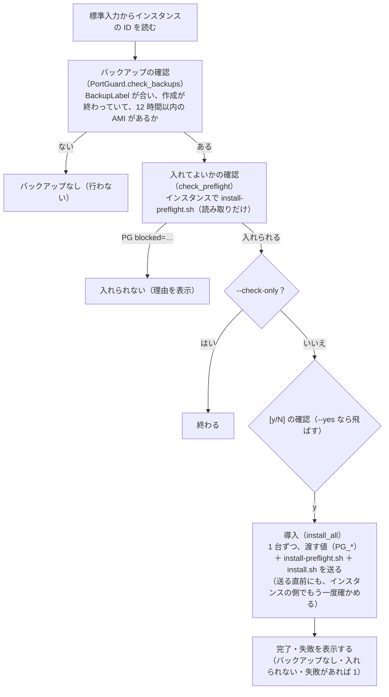
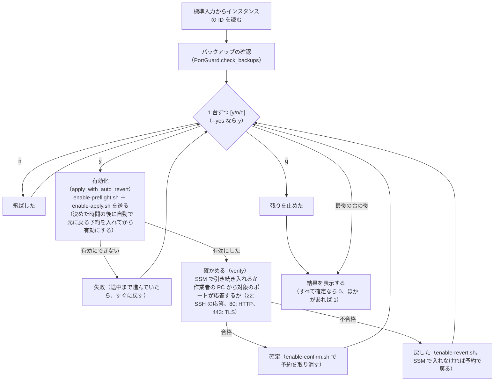

# install・enable の処理の流れ（sh 版・Ruby 版）

`install` と `enable` を、機能を絞って sh と Ruby で書き直した版の処理の流れ。作業の手順（どの順にコマンドを使うか）は [手順](./steps.md) が正本で、ここは 1 つのコマンドの中で何をしているかを書く。ssm-setup にも同じ作りの sh 版・Ruby 版があったが、ssm-setup の側は Python 版だけに絞った。

> 状態: 書いただけ（構文と rubocop の確認だけ済み）。実際の AWS ではまだ動かしていない。Python 版（`py/`）は残してあり、どれを使うかは決めていない。

## ファイル

| ファイル | 内容 |
|---|---|
| `sh/install.sh`・`rb/install.rb` | ipset の導入と設定（遮断はまだ効かせない） |
| `sh/enable.sh`・`rb/enable.rb` | 遮断の有効化（台ごとに y/n/q で確かめ、自動で元に戻る予約を入れてから有効にし、確かめて確定か戻す） |
| `rb/port_guard.rb` | Ruby 版のこのフェーズだけの部品。バックアップの確認、送った結果（`PG <キー>=<値>`・`PG blocked=<理由>`・`PGSTEP`）の読み取り、作業者の PC からの応答の確認 |
| `sh/lib.sh`・`rb/lib.rb` | 共通の部品（ssm-setup の `sh/lib.sh`・`rb/lib.rb` の写し） |
| `rb/Gemfile`・`rb/.rubocop.yml` | 書き方の確認の rubocop だけを入れる（道具は標準のライブラリだけで動く） |
| `remote/` | インスタンスに送るもの（Python 版・sh 版・Ruby 版で共用）。sh 版・Ruby 版は、入れてよいか・有効にできるかを `install-preflight.sh`・`enable-preflight.sh` でインスタンスの側で確かめる |

```bash
cd port-guard-rollout
ruby rb/install.rb --backup-label 2026-10 [--allow-file allow.txt] [--include-ssh] [--check-only] [--yes] < ok.txt
ruby rb/enable.rb --backup-label 2026-10 [--revert-minutes 10] [--yes] < ok.txt
sh/install.sh --backup-label 2026-10 [--allow-file allow.txt] [--include-ssh] [--check-only] [--yes] < ok.txt
sh/enable.sh --backup-label 2026-10 [--revert-minutes 10] [--yes] < ok.txt

# Ruby 版の書き方の確認（rubocop を入れるのは初回だけ）
cd rb && bundle install && bundle exec rubocop
```

| 前提 | 内容 |
|---|---|
| 作業者の PC | AWS CLI（v2）。sh 版は bash（macOS の bash 3.2 でも動く書き方）と `curl`。Ruby 版は Ruby 2.6 以上、標準のライブラリだけ |
| 送り方 | SSM の Run Command だけ（SSH の経路はない。手元の再現の環境では試せない） |
| 認証情報・リージョン | AWS CLI の設定をそのまま使う（`AWS_PROFILE`・`AWS_REGION` など） |

Ruby 版は、どちらも 1 つのクラスで、流れの大枠を公開のメソッドとして上に並べ、ヘルパは `private` の下に分けている。

## install（rb/install.rb の `PortGuardInstall`）

流れは「バックアップの確認 → 入れてよいかの確認 → 導入」。



## enable（rb/enable.rb の `PortGuardEnable`）

流れは「バックアップの確認 → 1 台ずつ、確かめながら有効にする → 結果を表示する」。1 台の中は「予約を入れて有効にする → 確かめる → 確定か戻す」。



## Python 版との違い

| 項目 | Python 版（`py/`） | sh 版・Ruby 版 |
|---|---|---|
| 送り方 | SSH か SSM の Run Command（`--via`） | SSM の Run Command だけ |
| 入れてよいか・有効にできるかの確認 | 作業者の PC で、インスタンスから読んだ状態を判定する | インスタンスの側で `*-preflight.sh` が判定し、理由を返す |
| dry 実行、前回の設定からの差分の表示、`--port-map`・`--probe`・`--check-in-jp` など | ある | ない |
| テスト | `py/tests/`（AWS・SSH に接続しない偽物） | まだない（構文と rubocop の確認だけ） |
