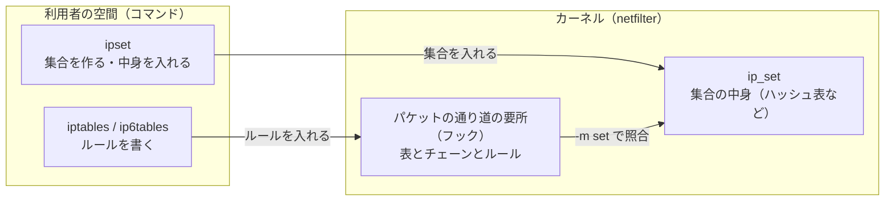
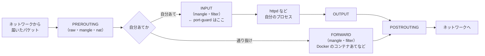

# iptables と ipset の基本

> 位置付け: iptables と ipset **そのもの**の説明（仕組み、用語、コマンド、気を付けること）。port-guard がこれらをどう使っているかは [iptables ＋ ipset の仕組みと確認](./iptables-ipset.md)、入れる手順は [手順](./steps.md)、入れた後の運用は [運用の手順](./operations.md)。
>
> 対象は Amazon Linux 2（AL2）の iptables 1.8 系と ipset。資料と port-guard の作りからの整理で、AL2 の実機での確認は、port-guard の手元の再現の環境（Docker）で行った範囲だけ。
>
> 更新日: 2026-11-02

## 全体の関係



| 部品 | 内容 |
|---|---|
| netfilter | Linux のカーネルの中で、パケットの通り道の要所（フック）ごとに、登録された処理を呼ぶ仕組み。実際にパケットを通す・捨てるのはここ |
| iptables | netfilter に「どのパケットをどうするか」のルールを入れるコマンド。IPv4 用。IPv6 用は別のコマンド `ip6tables` |
| ipset | IP アドレスや CIDR の**集合**をカーネルに作るコマンド。集合だけでは何もせず、iptables のルールから `-m set --match-set` で参照されて初めて効く |
| 常駐するプロセス | **ない**。どちらもコマンドで入れたものがカーネルの中に残って効く。そのかわり、**再起動するとすべて消える**（起動時に入れ直す仕組みが要る） |

AL2 の iptables は 1.8 系で、従来の仕組み（legacy）で動く（`iptables -V` の表示で確かめられる）。AL2023 などの新しい OS では、同じ `iptables` のコマンドが nftables という新しい仕組みの上で動くことがある。port-guard は AL2 だけを対象にしている。

## iptables

### 表（テーブル）とチェーン

ルールは「表」に分かれ、表の中の「チェーン」（ルールの並び）に入る。

| 表 | 役割 | 主なチェーン |
|---|---|---|
| `filter`（既定） | 通す・捨てるを決める。**port-guard が使うのはこれだけ** | `INPUT`（自分あて）、`FORWARD`（通り抜け）、`OUTPUT`（自分から出る） |
| `nat` | アドレスやポートを書き換える（Docker の公開ポートなど） | `PREROUTING`、`OUTPUT`、`POSTROUTING` |
| `mangle` | パケットの印付けなど | すべて |
| `raw` | 接続の追跡（後述）の対象から外す、など | `PREROUTING`、`OUTPUT` |

`-t` を付けなければ `filter` の表を操作する。

外から自分（このインスタンスのプロセス、たとえば httpd）あての通信は、次の順に通る。



**Docker で公開したポートは、`nat` の表で書き換えられてコンテナあて（通り抜け）になるので、`INPUT` ではなく `FORWARD` を通る**。`INPUT` に入れたルール（port-guard）は効かない。Docker あてを絞るときは、Docker が用意する `DOCKER-USER` のチェーンを使う（今の構成は httpd がホストで動いているので関係しない）。

### ルールの評価のされ方

| 決まり | 内容 |
|---|---|
| 上から順 | チェーンのルールを上から順に見て、**最初に条件に合ったルールの行き先（ターゲット）**で決まる |
| 決まる行き先と、決まらない行き先 | `ACCEPT`（通す）・`DROP`（捨てる）・`REJECT`（拒否を返す）は、そこで決まる。`LOG`（記録する）は記録してから次のルールへ進む |
| 自前のチェーン | `-N` で作る。`-j <チェーン>` で飛び込み、最後まで決まらなければ、飛び込んだ元の次のルールへ戻る（`RETURN` で途中から戻ることもできる） |
| 既定の方針（ポリシー） | 組み込みのチェーン（`INPUT` など）の最後まで決まらなければ、チェーンの方針で決まる。AL2 の既定は `ACCEPT`（何も入れていなければ、すべて通る）。`iptables -P INPUT DROP` のように変えられるが、port-guard は変えない |

port-guard は、`INPUT` の先頭に「80・443 番あてなら `PORT_GUARD` へ」という 1 つのルールを入れ、`PORT_GUARD` の中で「許可する集合 → 日本の集合 → 記録 → 破棄」と並べる。80・443 番以外は `PORT_GUARD` に入らず、今までどおり（方針の `ACCEPT`）になる。

### 行き先（ターゲット）

| 行き先 | 起きること | 相手から見ると |
|---|---|---|
| `ACCEPT` | 通す | つながる |
| `DROP` | 何も返さずに捨てる。**port-guard はこれ** | 応答がなく、タイムアウトまで待たされる |
| `REJECT` | 拒否を返す（既定は ICMP の到達不能。TCP なら `--reject-with tcp-reset` で接続のリセット） | すぐに「拒否された」とわかる |
| `LOG` | カーネルの記録（`journalctl -k`、`/var/log/messages`）に 1 行書き、次のルールへ | 変わらない |
| `<チェーン名>` | 自前のチェーンへ飛び込む | — |
| `RETURN` | 呼んだ元のチェーンへ戻る | — |

`DROP` は相手に何も知らせないので、ポートの存在を隠せる一方、正しい利用者にも「つながらない」理由が伝わらない。

### 条件（照合）

| 書き方 | 意味 |
|---|---|
| `-p tcp` | 通信の種類（`tcp`・`udp`・`icmp`、`all`） |
| `--dport 443`、`-m multiport --dports 80,443` | あて先のポート（`multiport` で複数をまとめて書ける。最大 15） |
| `-s 203.0.113.0/24` | 送り元のアドレス |
| `-i lo`、`-i eth0` | 受け取ったネットワークインターフェース（`lo` は同じマシンの中） |
| `-m set --match-set <集合> src` | 送り元が ipset の集合に入っているか（`dst` ならあて先） |
| `-m limit --limit 10/min` | 回数を絞る（記録の量を抑えるのに使う。port-guard の `LOG` はこれで 1 分に 10 件まで） |
| `-m conntrack --ctstate ESTABLISHED,RELATED` | 接続の追跡の状態（後述） |
| `!` | 否定（`! -s 10.0.0.0/8` など） |

### 接続の追跡（conntrack）と、port-guard への影響

netfilter は、通った接続を覚えておく（接続の追跡）。これで「自分から始めた接続の返事」を見分けられる。セキュリティグループが「状態を覚える」のと似た仕組みが、OS の中にもある。

port-guard のルールは接続の追跡を使っていない（`--ctstate` の条件がない）。そのため、次のようになる。

| 場面 | 起きること |
|---|---|
| 遮断を有効にした瞬間に、海外からつながっていた 80・443 番の接続 | 以降のパケットが捨てられるので、**その接続も止まる**（新しい接続だけでなく） |
| このインスタンスから外の 443 番へ出る通信（API の呼び出し、`yum`、`curl` など） | 返事のパケットは「あて先のポート」が手元の一時的なポート（大きい番号）になるので、`--dports 80,443` に当たらない。**影響しない** |
| 日本の範囲や許可した IP からの接続 | パケットごとに集合で照合されて通る |

### よく使うコマンド

| コマンド | 意味 |
|---|---|
| `iptables -S [チェーン]` | ルールを、入れたときの書き方で一覧する（差分を見るのに向く） |
| `iptables -L [チェーン] -n -v --line-numbers` | ルールを表の形で一覧する。`-v` で各ルールに当たったパケットの数と量、`-n` で名前を引かない（速い） |
| `iptables -A <チェーン> <ルール>` | 末尾に足す |
| `iptables -I <チェーン> [番号] <ルール>` | 先頭（または番号の位置）に差し込む |
| `iptables -D <チェーン> <ルール>`、`-D <チェーン> <番号>` | 消す |
| `iptables -C <チェーン> <ルール>` | そのルールがあるかを確かめる（あれば終了コード 0。port-guard は二重に入れないためにこれを使う） |
| `iptables -N <チェーン>`、`-F <チェーン>`、`-X <チェーン>` | 自前のチェーンを作る・中を空にする・消す（参照されていると消せない） |
| `iptables -Z [チェーン]` | 数えた回数を 0 に戻す |
| `iptables-save`、`iptables-restore` | すべての表のルールを書き出す・まとめて読み込む |

### 再起動の後に残す方法

ルールはカーネルの中にしかないので、再起動すると消える。残し方はいくつかある。

| 方法 | 内容 | port-guard での扱い |
|---|---|---|
| `iptables-services` | `iptables.service` が、起動時に `/etc/sysconfig/iptables` を読み込む（`service iptables save` で今のルールを保存）。**既定の中身は SSH 以外の受信を拒否する** | 使わない（入っていて有効なら、`install` が止める） |
| firewalld | ゾーンとサービスで設定する別の仕組み。動き出すと、手で入れたルールを置き換える | 使わない |
| 自前の systemd のユニット | 起動時にスクリプトでルールを入れ直す | **これを使う**（`port-guard.service` が `port-guard-apply` を呼ぶ）。ルールの中身はファイル（`/etc/port-guard/`）から毎回作るので、保存の操作が要らない |

## ipset

### なぜ集合を使うか

日本の IP の範囲は約 4,700 件（2026-10 の時点）ある。これを iptables のルールとして 1 件ずつ並べると、パケットごとに上から何千件も比べることになり、遅く、ルールの入れ替えも重い。ipset はハッシュ表などで持つので、何千件でも**1 回の照合で、ほぼ一定の時間**で済む。iptables 側のルールは「この集合に入っていれば通す」の 1 行で済む。

### 集合の型

| 型 | 入れるもの | 使いどころ |
|---|---|---|
| `hash:ip` | 1 つずつの IP アドレス | 個別のアドレスの一覧 |
| `hash:net` | CIDR（`203.0.113.0/24` など。長さはばらばらでよい） | **国の範囲・許可する範囲。port-guard はこれ** |
| `hash:ip,port`、`hash:net,port` | アドレスとポートの組 | 相手とポートの組で絞るとき |
| `bitmap:ip` | 連続した狭い範囲の IP | 小さなネットワークの中 |
| `list:set` | ほかの集合の一覧 | 集合をまとめて扱うとき |

`hash:net` の照合の重さは、件数よりも「入っている CIDR の長さの種類の数」で決まる（長さごとに 1 回ずつ引く）。日本の範囲でも長さの種類は 20 前後に収まるので、十分に速い。

### 作るときの指定

| 指定 | 意味 | port-guard |
|---|---|---|
| `family inet` / `family inet6` | IPv4 用か IPv6 用か（1 つの集合にはどちらか一方しか入らない） | `inet`（IPv4 だけ） |
| `maxelem` | 入れられる件数の上限（既定 65536） | 65536 |
| `hashsize` | ハッシュ表の初めの大きさ（足りなければ自動で広がる） | 既定のまま |
| `timeout` | 入れた項目が自動で消えるまでの秒数（一時的な締め出しなどに使う） | 使わない |
| `counters`、`comment` | 項目ごとの当たった回数、メモ | 使わない |

### よく使うコマンド

| コマンド | 意味 |
|---|---|
| `ipset create <名前> hash:net family inet` | 集合を作る（`-exist` を付けると、すでにあっても失敗にしない） |
| `ipset add <名前> 203.0.113.0/24`、`ipset del <名前> ...` | 項目を足す・消す |
| `ipset test <名前> 203.0.113.10` | ある IP が集合に入っているか（入っていれば終了コード 0） |
| `ipset list -t [名前]`、`ipset list -n` | 集合の見出しだけ（件数 `Number of entries`、使っているメモリ、参照の数）、名前だけ |
| `ipset list <名前>` | 中身まで全部（件数が多いと長い） |
| `ipset save`、`ipset restore` | 書き出す・まとめて読み込む（1 件ずつ `add` するより速い。port-guard はファイルの中身を `restore` で入れる） |
| `ipset flush <名前>` | 中身を空にする |
| `ipset swap <名前1> <名前2>` | 2 つの集合の中身を一瞬で入れ替える（同じ型どうし） |
| `ipset destroy <名前>` | 集合を消す（**iptables のルールから参照されていると消せない**） |

### 中身の入れ替え（swap）

集合を空にしてから入れ直すと、その間は集合が空になり、日本からの接続も捨てられる。port-guard は、一時的な集合（`<名前>_tmp`）に新しい中身を入れてから `ipset swap` で入れ替え、一時的な集合を消す。入れ替えは一瞬で、途中で空になる時間がない。iptables のルールは集合を名前で参照しているので、ルールは触らずに済む。

### 再起動の後に残す方法

集合もカーネルの中にしかなく、再起動すると消える。`ipset-service`（`/etc/sysconfig/ipset` を読み込むユニット）もあるが、port-guard は使わない。起動時に `port-guard-apply` がファイル（`/etc/port-guard/jp.txt`・`allow.txt`）から集合を作り直す。**iptables のルールより先に集合がないと、集合を参照するルールは入れられない**ので、`port-guard-apply` は集合を作ってからルールを入れる。

## iptables と ipset の組み合わせ

port-guard の `PORT_GUARD` のチェーンを例にすると、次の形になる（`iptables -S PORT_GUARD` の表示）。

```
-N PORT_GUARD
-A PORT_GUARD -i lo -j ACCEPT
-A PORT_GUARD -m set --match-set port_guard_allow src -j ACCEPT
-A PORT_GUARD -m set --match-set port_guard_jp src -j ACCEPT
-A PORT_GUARD -m limit --limit 10/min -j LOG --log-prefix "port-guard drop: "
-A PORT_GUARD -j DROP
```

```
-A INPUT -p tcp -m multiport --dports 80,443 -j PORT_GUARD
```

| 行 | 意味 |
|---|---|
| `INPUT` の 1 行 | 80・443 番あての TCP だけを `PORT_GUARD` へ。**この 1 行が「遮断が有効」の印**。消せば、80・443 番は今までどおり通る |
| `-i lo -j ACCEPT` | 同じマシンの中からの接続は通す（ヘルスチェックなど） |
| 許可する集合 → 日本の集合 | どちらかに入っていれば通す（許可する集合を先に見る） |
| `LOG` | 捨てる前に記録する（1 分に 10 件まで） |
| `DROP` | 残りを捨てる |

## ほかの仕組みとの関係

| 仕組み | 関係 |
|---|---|
| セキュリティグループ | AWS の側（インスタンスの手前）の仕組み。セキュリティグループで止まった通信は OS まで届かない。iptables はその後ろで、さらに絞る。規則の件数の上限があるので、国の範囲のような数千件はセキュリティグループには入らない |
| ネットワーク ACL | サブネットの境目の仕組み。同じく OS より手前 |
| firewalld | iptables を内側で使う別の管理の仕組み。動き出すと、手で入れたルールを置き換える。併用しない |
| Docker | 起動・再起動のときに、自分のルール（`nat` の表、`DOCKER` のチェーンなど）を入れ直す。公開ポートは `FORWARD` を通る（上の「表とチェーン」） |
| ip6tables | IPv6 は別のルール。port-guard は IPv4 だけを絞るので、IPv6 で届く通信は絞られない |

## 用語

| 用語 | 意味 |
|---|---|
| チェーン | ルールの並び。組み込み（`INPUT` など）と、自前（`PORT_GUARD` など）がある |
| ターゲット（行き先） | ルールの条件に合ったときにすること（`ACCEPT`・`DROP`・別のチェーンへ、など） |
| 方針（ポリシー） | 組み込みのチェーンの最後まで決まらなかったときの扱い |
| 集合（セット） | ipset が作る、アドレスや CIDR の集まり |
| CIDR | `203.0.113.0/24` のように、先頭のアドレスと長さで表した範囲 |
| 接続の追跡（conntrack） | カーネルが、通った接続を覚えておく仕組み |

## 出典

- [iptables(8)](https://man7.org/linux/man-pages/man8/iptables.8.html)、[iptables-extensions(8)](https://man7.org/linux/man-pages/man8/iptables-extensions.8.html)（`multiport`・`set`・`limit`・`conntrack` などの照合）
- [ipset(8)](https://ipset.netfilter.org/ipset.man.html)
- [netfilter のプロジェクト](https://www.netfilter.org/)
- [Docker と iptables](https://docs.docker.com/engine/network/packet-filtering-firewalls/)（`DOCKER-USER` のチェーン）
