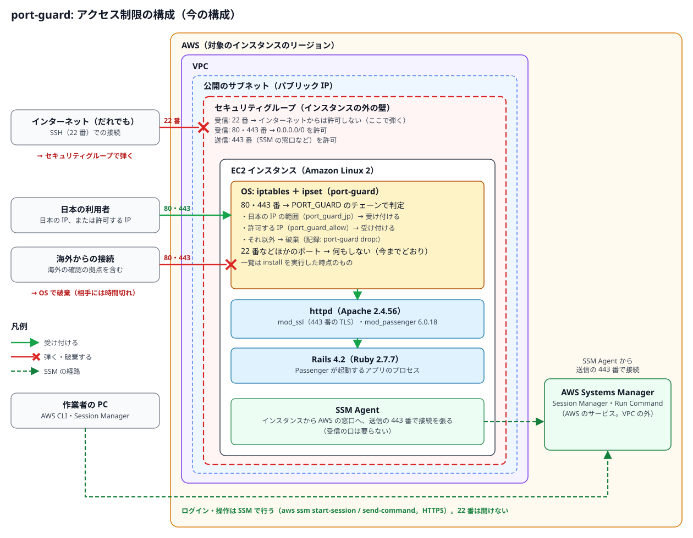

# iptables ＋ ipset の仕組みと確認（port-guard）

> 位置付け: `port-guard-rollout` がインスタンスに入れる仕組み（iptables ＋ ipset）の詳細。道具での手順は [手順](./steps.md)。もとは [暫定対応: OS で絞る（note）](../notes/ec2-operations/access-restriction-os-firewall.md) にあった iptables ＋ ipset の記述を、確定した内容に合わせてここに移した。
>
> 更新日: 2026-10-29

## 確定した内容

| 項目 | 内容 |
|---|---|
| 方式 | OS の **iptables ＋ ipset** |
| 絞るポート | **80 番と 443 番だけ**（道具が設定する） |
| 絞らないポート | **SSH の 22 番は既定では絞らない**（ほかのシステムからの SSH の接続がありうるため。外部からの SSH は、基本はセキュリティグループで弾く前提）。必要になったときだけ `install --include-ssh` で対象にできる（`PORT_GUARD_PORTS=22,80,443`）。ほかのポートは今までどおり |
| 受け付ける相手 | 日本の IP の範囲（APNIC の割り当ての統計）と、許可する IP の一覧 |
| 受け付けない相手 | それ以外。破棄（`DROP`）する |
| インスタンスでの操作 | SSM（Session Manager・Run Command）の導入を前提にする。SSM Agent がない台は SSH で入れる |
| 一覧の中身 | `install` を実行した時点のもの（日本の IP の範囲も、許可する IP も） |

## 仕組み



今の構成では、**80・443 番は OS の iptables ＋ ipset** で国内と許可した IP に絞り、**22 番はセキュリティグループ**で弾き、**外からのログインは SSM**（Session Manager）で行う。図は [`images/make_access_svg.py`](images/make_access_svg.py) で作り直せる（構成を変えたら、図とこの節をそろえて直す）。

OS の中の判定の流れ:

```
接続 → INPUT チェーン
         └ 対象のポート（80・443） → PORT_GUARD チェーン
                              ├ ループバック（同じマシンの中）      → 受け付ける
                              ├ 許可する IP の集合（port_guard_allow）→ 受け付ける
                              ├ 日本の IP の集合（port_guard_jp）     → 受け付ける
                              ├ 記録（回数を絞って）
                              └ 破棄
         └ 対象外のポート（22 など） → 今までどおり（何もしない）
```

| 部品 | 内容 |
|---|---|
| ipset の集合 | `hash:net` 型。CIDR を数千件入れても、照合は速い。`port_guard_allow`（許可する IP）と `port_guard_jp`（日本の IP の範囲）の 2 つ |
| iptables のチェーン | 自前のチェーン `PORT_GUARD` を作り、INPUT の先頭から「対象のポートならこのチェーンへ」と飛ばす。ほかのルールに混ぜないので、外すときは飛ばすルールを消すだけでよい |
| 一覧のファイル | `/etc/port-guard/allow.txt`（許可する IP。担当者が書く）と `/etc/port-guard/jp.txt`（日本の IP の範囲。更新のスクリプトが書く） |
| 設定のファイル | `/etc/port-guard/port-guard.conf`（`PORT_GUARD_PORTS=80,443` と `JP_MIN_ENTRIES`） |
| 適用のスクリプト | `/usr/local/sbin/port-guard-apply`。集合を作って中身を入れ、ルールを入れる（`--sets-only` なら集合だけ）。起動時に systemd（`port-guard.service`）から呼ぶ |
| 更新のスクリプト | `/usr/local/sbin/port-guard-update-jp`。日本の IP の範囲を取り直し、集合の中身だけを入れ替える（`install` のときに実行する） |
| 中身の正本 | [`port_guard_rollout/remote/`](./port_guard_rollout/remote/) の `port-guard-apply`・`port-guard-update-jp`・`port-guard.service` |

集合の中身の入れ替えは、一時的な集合に新しい中身を入れてから `ipset swap` で入れ替える。入れ替えは一瞬で済み、途中で空になる時間がない。


## 日本の IP の範囲の取り方

**APNIC の割り当ての統計**（`https://ftp.apnic.net/stats/apnic/delegated-apnic-latest`）を使う。無料、登録なし、毎日更新。IP アドレスが**どの国の組織に割り当てられたか**を表す（実際に使われている場所とは限らない。海外の拠点に割り当てた範囲など）。

APNIC の統計の 1 行は `apnic|JP|ipv4|1.0.16.0|4096|20110412|allocated` の形で、「先頭のアドレス」と「個数」で範囲を表す。個数が 2 のべき乗とは限らないので、CIDR への変換には Python の `ipaddress` を使う（`install` が `python3` を入れる）。件数が最低件数（`JP_MIN_ENTRIES`、既定 1000）より少なければ、取得の失敗とみなして集合を入れ替えない。2026-10-28 の時点で約 4,700 件。

## 事前の確認: すでに入っているか・有効になっているか

iptables ＋ ipset、firewalld、Session Manager は、入っていない前提で道具を作っている（道具の確認の処理も同じことを見る）。ただし、運用中のインスタンスによっては、誰かが入れて有効にしている可能性がある。**手を入れる前に、インスタンスごとに次の確認をする**。どのコマンドも読み取りだけで、設定は変えない。

### 「有効」の見分け方

「有効かどうか」は、次の 4 つを分けて見る。特に、**起動時の有効と今の動作がずれている状態**は、再起動のときに挙動が変わるので見落とさない。

| 段階 | 意味 | 見るもの |
|---|---|---|
| 入っている | パッケージがある | `rpm -q <パッケージ>` |
| 起動時に有効 | 再起動のときに自動で動き出す | `systemctl is-enabled <ユニット>` が `enabled`（`disabled` なら自動では動かない、`masked` なら起動できないようにされている） |
| 今動いている | 今この時点で動いている | `systemctl is-active <ユニット>` が `active`（`inactive` なら止まっている） |
| ルールが効いている | カーネルにルールや集合が入っている | `iptables -S`、`ipset list`、`firewall-cmd --list-all` の中身。**サービスが入っていなくても、手でルールを入れていれば効いている** |

| ずれ | 起きること |
|---|---|
| 起動時に有効だが、今は止まっている | **次の再起動で動き出し、ポートが閉じる**ことがある（特に firewalld と、`iptables-services` の既定の設定） |
| 今は動いているが、起動時に有効ではない | 再起動するとルールが消える |
| サービスはないが、ルールが入っている | 誰かが手で入れたか、ほかのソフトウェア（Docker など）が入れたもの。再起動で消えるか、別の仕組みで入れ直されている |

### 全部をまとめて確かめる（インスタンスの中で実行）

```bash
sudo bash <<'EOS'
section() { printf '\n===== %s =====\n' "$1"; }
unit_state() {
  local enabled active
  enabled=$(systemctl is-enabled "$1" 2>/dev/null); active=$(systemctl is-active "$1" 2>/dev/null)
  printf '%-22s 起動時=%-10s 今=%s\n' "$1" "${enabled:-ユニットなし}" "${active:-ユニットなし}"
}

section 'パッケージ'
rpm -q iptables iptables-services ipset ipset-service firewalld amazon-ssm-agent

section 'サービス（起動時に有効か / 今動いているか）'
for unit in iptables ip6tables ipset firewalld amazon-ssm-agent docker fail2ban; do unit_state "$unit"; done

section 'iptables（今カーネルに入っているルール）'
iptables -V
for table in filter nat mangle raw; do echo "--- $table"; iptables -t "$table" -S; done
echo "--- ip6tables filter"; ip6tables -S
ls -l /etc/sysconfig/iptables /etc/sysconfig/ip6tables 2>&1

section 'ipset（今カーネルに入っている集合）'
if command -v ipset >/dev/null; then ipset list -t; else echo 'ipset のコマンドなし'; fi
ls -l /etc/sysconfig/ipset 2>&1
echo "--- iptables から参照している集合"; iptables -S | grep -- '--match-set' || echo 'なし'

section 'firewalld'
if command -v firewall-cmd >/dev/null; then
  firewall-cmd --state
  if firewall-cmd --state >/dev/null 2>&1; then
    firewall-cmd --get-active-zones
    firewall-cmd --list-all
    firewall-cmd --get-ipsets
    firewall-cmd --direct --get-all-rules
  fi
else
  echo 'firewall-cmd のコマンドなし'
fi

section 'カーネルのモジュール'
lsmod | grep -E '^(ip_tables|ip6_tables|iptable_|ip_set|xt_set|nf_tables|nf_conntrack) ' || echo 'なし'

section 'SSM Agent（Session Manager）'
rpm -q amazon-ssm-agent
command -v ssm-cli >/dev/null && ssm-cli get-diagnostics --output table
tail -n 20 /var/log/amazon/ssm/amazon-ssm-agent.log 2>/dev/null
token=$(curl -s -X PUT http://169.254.169.254/latest/api/token -H 'X-aws-ec2-metadata-token-ttl-seconds: 60')
echo "--- インスタンスプロファイル"
curl -s -H "X-aws-ec2-metadata-token: $token" http://169.254.169.254/latest/meta-data/iam/info || true
echo
EOS
```

### 結果の読み方

| 対象 | 入っていない・効いていない状態 | 注意が要る状態 |
|---|---|---|
| iptables | `iptables-services` が「インストールされていない」。`iptables -S` が `-P INPUT ACCEPT`・`-P FORWARD ACCEPT`・`-P OUTPUT ACCEPT` の 3 行だけ（ほかの表も同様） | `-A` で始まる行がある（ルールが効いている）。`iptables` のユニットが `enabled` で、`/etc/sysconfig/iptables` がある（再起動のときにそのファイルのルールが入る。既定の内容は SSH 以外を拒否する） |
| ipset | `ipset` のコマンドがないか、`ipset list -t` が何も表示しない | 集合がある。iptables から `--match-set` で参照されている。`ipset` のユニットが `enabled`（再起動のときに `/etc/sysconfig/ipset` から集合が入る） |
| firewalld | `firewalld` が「インストールされていない」、または `firewall-cmd --state` が `not running` で、ユニットが `disabled` | `running`（ゾーンで許可していないポートは閉じている。`--list-all` で許可しているサービスとポートを見る）。**ユニットが `enabled` で今は `not running`**（次の再起動で動き出す） |
| ほかに iptables を触るもの | `docker`・`fail2ban` のユニットがない | Docker は `nat` の表などに自分のルールを入れる。fail2ban は遮断のルールを足す。どちらも、自前のルールと並べて動かすときに確かめる |
| カーネルのモジュール | — | `nf_tables` が読み込まれていれば、nftables のルールが入っている可能性がある（`sudo nft list ruleset` で見る。コマンドがなければ使われていない） |

`iptables -V` の表示に `(nf_tables)` とあれば、iptables のコマンドは裏で nftables を使っている。`(legacy)` か何も付かなければ、昔ながらの iptables である。

### Session Manager で入れるか

Session Manager で入れるには、**インスタンスの側（SSM Agent が動き、AWS の窓口に届く）と、AWS の側（マネージドノードとして登録されている）**の両方がそろっている必要がある。

インスタンスの中で見るもの（上のまとめての確認に含めた）:

| 見るもの | 入れる状態 |
|---|---|
| `rpm -q amazon-ssm-agent` | 入っている（AL2 の AMI には最初から入っている） |
| `amazon-ssm-agent` のユニット | 起動時に有効で、今動いている |
| `ssm-cli get-diagnostics` | すべての項目が成功（AWS の窓口への接続、インスタンスのメタデータ、認証情報）。`ssm-cli` は新しめの SSM Agent にしかない |
| エージェントのログ | 認証情報が取れない、窓口につながらない、といった誤りが繰り返し出ていない |
| インスタンスプロファイル | `InstanceProfileArn` が表示される。404 ならインスタンスプロファイルがない（ただし、下の「既定のホスト管理の設定」が有効なら、なくても登録される） |

手元の PC（AWS CLI）で見るもの:

```bash
INSTANCE_ID=i-xxxxxxxxxxxxxxxxx

# マネージドノードとして登録されているか（PingStatus が Online なら入れる見込み）
aws ssm describe-instance-information \
  --filters "Key=InstanceIds,Values=$INSTANCE_ID" \
  --query 'InstanceInformationList[].[InstanceId,PingStatus,AgentVersion,LastPingDateTime]' --output table

# インスタンスプロファイルと、そのロールに AmazonSSMManagedInstanceCore が付いているか
aws ec2 describe-iam-instance-profile-associations \
  --filters "Name=instance-id,Values=$INSTANCE_ID" \
  --query 'IamInstanceProfileAssociations[].IamInstanceProfile.Arn' --output text
aws iam get-instance-profile --instance-profile-name <インスタンスプロファイルの名前> \
  --query 'InstanceProfile.Roles[].RoleName' --output text
aws iam list-attached-role-policies --role-name <ロールの名前> --output table

# 既定のホスト管理の設定（インスタンスプロファイルなしでも登録させる設定）が有効か
aws ssm get-service-setting \
  --setting-id "arn:aws:ssm:<リージョン>:<アカウント ID>:servicesetting/ssm/managed-instance/default-ec2-instance-management-role"

# 実際に入ってみる（手元に Session Manager のプラグインが要る）
aws ssm start-session --target "$INSTANCE_ID"
```

| 結果 | 意味 |
|---|---|
| 一覧に出ない | マネージドノードとして登録されていない。SSM Agent が動いていない、権限がない（インスタンスプロファイルも既定のホスト管理の設定もない）、AWS の窓口に届かない、のどれか |
| `PingStatus` が `ConnectionLost` | 以前は登録されていたが、今はつながっていない |
| `Online` | 登録されている。`start-session` で実際に入れることまで確かめれば確実 |

ネットワークの面では、インスタンスから AWS の窓口（`ssm`・`ssmmessages`・`ec2messages`）へ HTTPS（443 番）で出られる必要がある。インターネットに出られるか、VPC エンドポイントがあれば届く。セキュリティグループの受信の許可は要らない。Session Manager の使い方は [SSM Session Manager による EC2 運用](../notes/ec2-operations/ssm-session-manager-operations.md)。

### 補足: 受信のポートを全部閉じても、Session Manager でメンテナンスできるか

**できる**。Session Manager は、インスタンスの SSM Agent の方から AWS の窓口（`ssm`・`ssmmessages`・`ec2messages`）へ HTTPS で接続を張る仕組みで、外からの受信の口は要らない。セキュリティグループでも OS のファイアウォールでも、受信を全部閉じたまま入れる。ただし、SSM Agent が動いていることに加えて、次の条件がそろっている必要がある。

| # | 条件 | 「全閉じ」にするときに崩しやすい点 |
|---|---|---|
| 1 | SSM Agent が動いていて、**マネージドノードとして登録されている**（`PingStatus` が `Online`） | 権限（インスタンスプロファイルの `AmazonSSMManagedInstanceCore`、または既定のホスト管理の設定）がないと、動いていても登録されない |
| 2 | インスタンスから AWS の窓口へ、**送信の 443 番**で出られる | セキュリティグループの送信、ネットワーク ACL、OS の送信のルール（`OUTPUT`）で 443 番まで止めないこと。経路は、インターネット（パブリック IP か NAT ゲートウェイ）か VPC エンドポイント |
| 3 | **送信した接続の戻りの通信**を受け取れる | OS のファイアウォールで受信を全部破棄にするなら、確立済みの接続の戻りを通すルールが要る（iptables なら `-m conntrack --ctstate ESTABLISHED,RELATED -j ACCEPT`）。これがないと、受信を閉じた瞬間に SSM Agent もつながらなくなる。セキュリティグループは戻りを自動で通すが、ネットワーク ACL は通さないので、戻りの一時的なポート（1024〜65535）の受信の許可が要る |
| 4 | 名前の解決とインスタンスのメタデータに届く | OS のファイアウォールで、DNS（VPC の DNS への 53 番）と、メタデータ（`169.254.169.254`。認証情報を取る）を止めないこと |
| 5 | 入る側の権限と道具 | 操作する人の IAM に `ssm:StartSession` などがあり、手元に Session Manager のプラグインがある |

port-guard の形（対象のポートだけを専用のチェーンで絞る）なら、ほかの通信に触らないので、3 と 4 は崩れない。崩しやすいのは、「受信を全部破棄」のように OS で広く閉じる場合である。

受信を閉じたままでもできること:

| 作業 | 方法 |
|---|---|
| シェルでの作業 | `aws ssm start-session` |
| ファイルのやり取り | Session Manager の上で SSH を通す（`sshd` と鍵は要るが、22 番を外に開ける必要はない）か、S3 を経由する |
| ウェブの画面などの確認 | Session Manager のポートフォワード（インスタンスの中の 443 番などを手元に転送する） |
| コマンドの一括実行 | Run Command |

**SSM Agent そのものが動かなくなると入れない**（ディスクが一杯、メモリが尽きた、OS が固まった、エージェントの更新に失敗した、権限を外した、など）。受信を閉じたままの最後の手段は次の 2 つで、どちらも事前の用意が要る。

| 手段 | 事前に要ること |
|---|---|
| EC2 シリアルコンソール | アカウントでの有効化、Nitro のインスタンスタイプ（t3a は対象）、**OS にパスワードでログインできるユーザー**（事前に作っておかないと使えない） |
| ルートボリュームを外して、別のインスタンスで直す | 止めてもよい時間 |

EC2 Instance Connect は 22 番の受信が要るので、全閉じでは使えない。

まとめると、「SSM Agent が登録済みで、送信の 443 番と戻りの通信、DNS、メタデータが通る」なら、受信を全部閉じてもメンテナンスできる。エージェントが倒れたときに備えて、シリアルコンソールの用意（パスワードのあるユーザー）まで済ませておく。

### 入れて有効にするとき: 再起動の要否と、効き始める時点

入っていない環境に iptables・ipset・SSM Agent を入れて有効にするときの、再起動の要否と、いつから効くか（いつ効かなくなるか）をまとめる。資料からの整理で、AL2 の実機では確かめていない。

#### 再起動は要らない

| 対象 | 入れて有効にする操作 | 再起動 | 補足 |
|---|---|---|---|
| iptables | 最初から入っている（`iptables` のコマンド）。ルールを足せばその場で効く | 不要 | `iptables-services` で保存・復元するなら `systemctl enable --now iptables`。ただし既定の設定ファイルは SSH 以外を拒否する内容なので、port-guard では使わない |
| ip6tables | 同上（IPv6 用） | 不要 | IPv6 を使っているときだけ関係する |
| ipset | `yum install -y ipset` | 不要 | 必要なカーネルのモジュール（`ip_set`、`xt_set`）は、集合を作ったときやルールから参照したときに自動で読み込まれる |
| SSM Agent | AL2 には最初から入っている。なければ `yum install -y amazon-ssm-agent` → `systemctl enable --now amazon-ssm-agent` | 不要 | 動いているインスタンスにも、インスタンスプロファイルを後から付けられる（付け替えも再起動は不要） |
| （参考）EC2 シリアルコンソール | アカウントでの有効化と、パスワードでログインできるユーザーの作成 | 不要 | AL2 の AMI は、最初からシリアルコンソールに出力する設定になっている |

例外として、カーネルを更新した後でまだ再起動していないと、今動いているカーネル用のモジュールが見つからないことがある。ただし、yum は今動いているカーネルを消さないので、普通は起きない。

#### 効き始める時点と、効かなくなる時点

**常駐するプロセスがあるのは SSM Agent だけ**。iptables と ipset はプロセスではなく、コマンドでカーネルに入れたルールや集合が、その時点から効く。

| 対象 | 常駐するプロセス | 効き始める時点 | 効かなくなる時点 |
|---|---|---|---|
| iptables（コマンドで足したルール） | **ない** | `iptables` のコマンドでルールを足した瞬間（効くのはカーネルの中のルール） | ルールを消したとき。**再起動するとすべて消える**（起動時に入れ直す仕組みがなければ） |
| iptables（`iptables-services`） | **ない**（`iptables.service` は、設定ファイルを読み込んで終わる一回きりのユニット） | `systemctl start iptables` で `/etc/sysconfig/iptables` を読み込んだ瞬間。**既定の内容なら、ここで SSH 以外の受信が拒否される** | `systemctl stop iptables` か `restart` のとき。**止めると、手で足したものも含めてすべてのルールが消え、すべて受け付ける状態に戻る**（port-guard の `PORT_GUARD` のルールも消える） |
| ipset | **ない** | `ipset create` で集合を作った瞬間に集合ができる。ただし**集合だけでは何も起きず、iptables のルールから参照されて初めて効く** | 集合を消したとき（参照しているルールがあると消せない）。**再起動するとすべて消える**（起動時に入れ直す仕組みがなければ） |
| SSM Agent | **ある**（`amazon-ssm-agent`） | **プロセスの起動だけでは使えない**。起動した後に、インスタンスのメタデータから認証情報を取り、AWS に登録されて（`PingStatus` が `Online`）初めて入れる。権限がないと、起動していても試し直しを続けるだけ | 止めたとき（今つながっているセッションも切れる）。エージェントの自動更新や再起動のときも、セッションは切れる |

#### SSM Agent が使えるようになるまで

| 状況 | 使えるようになる時点 |
|---|---|
| インスタンスプロファイルがあり、エージェントを起動した | 起動から数十秒〜数分で `Online` になる |
| エージェントが動いている状態で、後からインスタンスプロファイルを付けた | エージェントが認証情報を取り直すまで待つ（試し直しの間隔が延びていると、数分以上かかることがある）。`systemctl restart amazon-ssm-agent` で早められる |
| 既定のホスト管理の設定（インスタンスプロファイルなしで登録させる設定）を使う | 設定を有効にした後、エージェントが試し直すまで待つ。新しめの SSM Agent と、IMDSv2 が使えることが要る |
| 送信の 443 番、DNS、インスタンスのメタデータのどれかが止まっている | 使えない（[補足: 受信のポートを全部閉じても](#補足-受信のポートを全部閉じてもsession-manager-でメンテナンスできるか) の条件） |

使えるかどうかは、エージェントのプロセスではなく、手元の `aws ssm describe-instance-information` の `PingStatus`（`Online`）と、実際の `aws ssm start-session` で確かめる。

#### インストールしただけで動き出すか

`yum install` では、普通はサービスは**起動しない**。ただし、パッケージによっては**入れただけで「起動時に有効」になる**ことがある（systemd の preset という仕組み）。たとえば firewalld が「起動時に有効、今は止まっている」状態になると、**次の再起動で動き出し、ポートが閉じる**。AL2 の firewalld・`iptables-services`・`ipset-service` がそうなるかは確かめていないので、**入れた直後に必ず状態を見る**。

```bash
# 入れた直後に見る（起動時に有効か / 今動いているか）
systemctl is-enabled firewalld iptables ip6tables ipset amazon-ssm-agent
systemctl is-active  firewalld iptables ip6tables ipset amazon-ssm-agent
```

意図せず `enabled` になっていたら、使わないものは `systemctl disable <ユニット>` で戻す。

#### 運用中に気を付ける操作

| 操作 | 起きること |
|---|---|
| `systemctl restart iptables`（`iptables-services` が入っている場合） | すべてのルールが消えてから `/etc/sysconfig/iptables` が読み込まれる。**手で足したルール（`PORT_GUARD` など）は消える** |
| `service iptables save` | 今のルールで `/etc/sysconfig/iptables` を上書きする。次に `iptables.service` が動いたとき、保存した時点のルールが入る（`PORT_GUARD` のルールも保存されるが、参照している ipset の集合が先にないと読み込みに失敗する） |
| `systemctl start firewalld` | 手で入れた iptables のルールが firewalld のものに置き換わる（port-guard の遮断が消える） |
| Docker の起動・再起動 | Docker が自分の iptables のルール（`nat` の表など）を入れ直す。自前のルールの並び順に影響することがある |
| 再起動 | iptables のルールと ipset の集合は消える。起動時に入れ直す仕組み（`port-guard.service`。enable で起動時に有効にする）があるものだけが戻る |

#### 再起動の後も効いているかの確かめ方

入れた直後に効いていても、次の再起動で戻らない、あるいは思わぬものが動き出すことがある。**保守の時間帯に一度再起動して**、次を確かめるのが確実。

```bash
sudo iptables -S PORT_GUARD                   # ルールが戻っているか
sudo ipset list -t                            # 集合が戻っているか（件数）
systemctl is-active port-guard firewalld amazon-ssm-agent
sudo journalctl -b -u port-guard              # 起動時の適用の記録
```

あわせて、手元から `aws ssm describe-instance-information` で `Online` に戻ったことと、外から対象のポートの許可と遮断が以前と同じであることを確かめる。


## 手で確かめる・外す

### 確かめる

```bash
sudo iptables -L PORT_GUARD -n -v --line-numbers   # 各ルールに当たった回数
sudo iptables -S INPUT | grep PORT_GUARD           # 遮断が有効か（INPUT からの参照）
sudo ipset list -t port_guard_jp                   # 集合の件数（Number of entries）
sudo ipset test port_guard_jp 1.0.16.1             # ある IP が日本の集合に入っているか
sudo journalctl -k | grep 'port-guard drop'        # 破棄した接続の記録（詳しくは「破棄の記録」）
```

外からの確認は、許可した IP、日本の一般の回線、海外の 3 か所から行う。

```bash
curl -sI -m 5 http://<ホスト名>/     # 海外からはタイムアウトする（破棄なので、拒否の応答も返らない）
curl -skI -m 5 https://<ホスト名>/
```

### 外す（元に戻す）

```bash
# すぐに外す（ルールを消すだけで、80・443 番は今までどおりになる）
sudo iptables -D INPUT -p tcp -m multiport --dports 80,443 -j PORT_GUARD
sudo systemctl disable port-guard     # 再起動のときに戻らないようにする

# 仕組みごと外す
sudo systemctl disable --now port-guard
sudo iptables -F PORT_GUARD && sudo iptables -X PORT_GUARD
sudo ipset destroy port_guard_jp && sudo ipset destroy port_guard_allow
```

`enable` の途中で確認に合格しなかったときは、道具がすぐにルールを外す。インスタンスに入れなくなったときは、`enable` が入れた予約（既定 10 分後）でルールが外れる。

## 破棄の記録

破棄した接続を、どこで・どう確かめるかをまとめる。資料（iptables・ipset・カーネル・rsyslog・AWS の文書、カーネル 5.10 のソース）からの整理で、AL2 の実機では確かめていない。「未確認」と書いた点は、実機で確かめてから使う。

### 記録の出る場所

`PORT_GUARD` のチェーンは、破棄の前に `-m limit --limit 10/min -j LOG --log-prefix "port-guard drop: "` で記録する。`-j LOG` は**カーネルのログ**に書く（重要度は warning）。

| 場所 | 内容 |
|---|---|
| `journalctl -k`・`dmesg -T` | カーネルのログなので、ここに必ず出る |
| `/var/log/messages` | rsyslog が journald から受け取って書く。AL2 では rsyslog が入っている、と見ている（資料が食い違っていて、**実機で `rpm -q rsyslog` で確かめる**） |

1 行の形（カーネル 5.10 の書式から組み立てた例。実機の出力を写したものではない）:

```
Oct 29 10:00:00 ip-10-0-1-23 kernel: port-guard drop: IN=eth0 OUT= MAC=... SRC=198.51.100.7 DST=10.0.1.23 LEN=60 TOS=0x00 PREC=0x00 TTL=48 ID=54321 DF PROTO=TCP SPT=51234 DPT=443 WINDOW=64240 RES=0x00 SYN URGP=0
```

`SRC` が接続元、`DPT` が 80 か 443 か。

### 数の数え方

| 点 | 内容 |
|---|---|
| 記録は間引いている | 1 分に 10 件まで（`--limit-burst` は既定の 5）。上限を超えた分は記録されずに破棄される |
| 記録されなかった数 | **DROP の規則のパケット数 − LOG の規則のパケット数**（`sudo iptables -L PORT_GUARD -n -v -x --line-numbers`） |
| 数の単位 | パケット。接続の数ではない（接続元は SYN を再送するので、1 回の接続の試みが数パケットになる） |
| 間引きの単位 | 接続元をまとめて全体で 1 つの上限。騒がしい接続元が 1 つあると、記録の枠を使い切る |
| 数が 0 に戻るとき | `iptables -Z`、ルールの入れ直し、再起動 |

**ipset 自身は記録を持たない**。集合の項目ごとに数える機能（作るときの `counters`）はあるが、破棄されるのは集合に入っていない接続元なので、どの項目の数も増えず、破棄の記録には使えない（数えられるのは、許可した側の項目に当たった回数だけ。port-guard の集合は `counters` を付けずに作っている）。

### 量とディスク

| 点 | 内容 |
|---|---|
| 量 | 間引きにより、最大で 1 日約 14,400 行（1 行 250 バイトほどとして数 MB）の見込み |
| rsyslog の受け取りの上限 | journald から読むときの上限（既定で 600 秒に 2 万件）があり、超えた分は捨てられる。上の量ならまず届かないが、ほかのログと合算の上限。AL2 の rsyslog での既定値は**未確認** |
| 保存とローテーション | `/var/log/messages` は logrotate の設定に従う。journald の保存先（ディスクか、メモリか）は、`/var/log/journal` があるかで決まる（AL2 での実際は**未確認**） |

### 別のファイルに分けるとき（任意）

rsyslog の振り分けで、`port-guard drop:` の行だけを別のファイルに出し、`/var/log/messages` には入れないようにできる（試していない）。

```
# /etc/rsyslog.d/port-guard.conf
:msg, contains, "port-guard drop: " /var/log/port-guard.log
& stop
```

別のファイルにしたら、logrotate の設定も足す。専用の記録の仕組み（`NFLOG` ＋ `ulogd`）は、AL2 で `ulogd` が手に入るか確かめられなかった（**未確認**）。

### インスタンスの外で見る

| 方法 | 内容 |
|---|---|
| CloudWatch エージェント | `/var/log/messages`（または上の別のファイル）を CloudWatch Logs に送れる。`filters` で `port-guard drop:` の行だけに絞れる。journald から直接集める設定もある（2026-08 から。AL2 の systemd 219 で動くかは**未確認**） |
| VPC フローログ | **OS で破棄したものは「拒否」として見分けられない**。セキュリティグループで拒否したものは REJECT として記録されるが、OS で破棄した通信はセキュリティグループを通っているので ACCEPT として残ると考えられる（AWS の文書に明記はなく、推測） |

### 手元の再現の環境（Docker）での注意

コンテナの中の `-j LOG` は、既定では**何も記録しない**。Linux は、コンテナごとの通信の区切り（ネットワーク名前空間）の中からの記録を既定で止めている（`net.netfilter.nf_log_all_netns=0`。コンテナの中からは変えられない）。[`al2-instance`](./al2-instance/README.md) で破棄を確かめるときは、ログではなく規則のパケット数（`iptables -L PORT_GUARD -n -v -x`）で判定する。EC2 の上では記録される。

参考に、Amazon Linux 2023 は rsyslog が既定で入っておらず、`/var/log/messages` もない。`journalctl -k` で見る。

### 確かめるコマンド（AL2）

```bash
# 記録の仕組みの状態
rpm -q rsyslog; systemctl is-active rsyslog systemd-journald
grep -nE 'imjournal|imklog|ratelimit|/var/log/messages' /etc/rsyslog.conf /etc/rsyslog.d/*.conf

# 記録の行
sudo grep 'port-guard drop: ' /var/log/messages | tail -50
sudo journalctl -k --since today | grep 'port-guard drop: '
sudo dmesg -T | grep 'port-guard drop: ' | tail

# 接続元ごとの件数（記録された分だけ）
sudo grep -o 'port-guard drop: .*' /var/log/messages | grep -o 'SRC=[^ ]*' | sort | uniq -c | sort -rn | head

# 数（記録されなかった数 = DROP の pkts − LOG の pkts）
sudo iptables -L PORT_GUARD -n -v -x --line-numbers

# 量とディスク
journalctl --disk-usage; df -h /var/log; cat /etc/logrotate.d/syslog
```

### 出典

- [iptables-extensions の man](https://ipset.netfilter.org/iptables-extensions.man.html)（LOG、limit、NFLOG、set のマッチ）
- [ipset の man](https://ipset.netfilter.org/ipset.man.html)（counters。記録の機能はない）
- [カーネル 5.10 の nf_log_common.c](https://git.kernel.org/pub/scm/linux/kernel/git/stable/linux.git/plain/net/netfilter/nf_log_common.c?h=v5.10.200)（1 行の書式）、[netfilter の sysctl の文書](https://docs.kernel.org/networking/netfilter-sysctl.html)（`nf_log_all_netns`）
- [rsyslog の imjournal](https://rsyslog.readthedocs.io/en/stable/configuration/modules/imjournal.html)（受け取りの上限）、[rsyslog の振り分け](https://docs.rsyslog.com/doc/configuration/filters.html)
- [AL2023 の journald](https://docs.aws.amazon.com/linux/al2023/ug/journald.html)（AL2 との違い）
- [CloudWatch エージェントの設定ファイル](https://docs.aws.amazon.com/AmazonCloudWatch/latest/monitoring/CloudWatch-Agent-Configuration-File-Details.html)
- [VPC フローログの項目](https://docs.aws.amazon.com/vpc/latest/userguide/flow-log-records.html)、[例](https://docs.aws.amazon.com/vpc/latest/userguide/flow-logs-records-examples.html)

## 気を付けること

| 点 | 内容 |
|---|---|
| **Let's Encrypt の更新** | **80 番を国内だけに絞ると、certbot の webroot での証明書の更新（HTTP-01 の確認）が失敗する**。Let's Encrypt は海外を含む複数の場所から 80 番に確認の接続を行い、その IP は公開されていないため。今の手順（certbot の webroot）で更新しているインスタンスは、遮断を有効にした後、そのままでは証明書が期限切れになる。対策は、この道具の範囲の外で別に決める |
| 位置の判定は完全ではない | 海外にいる日本の利用者、VPN、海外のクラウドや外形監視のサービス、決済などの外部サービスからの通知（webhook）は「日本以外」になりうる。必要な相手は許可する IP の一覧に足す |
| 破棄 | 破棄（`DROP`）は応答を返さないので、相手には「つながらない（タイムアウト）」に見える |
| IPv6 | 対象は IPv4 だけ。インスタンスに IPv6 のアドレスがあり、セキュリティグループが IPv6 を通しているなら、IPv6 では絞られない |
| セキュリティグループとの関係 | セキュリティグループで 80・443 番を開けていることが前提（セキュリティグループで止まった接続は、OS まで届かない） |
| 記録の量 | 破棄の記録は 1 分に 10 件までに絞っている。攻撃が多いと、記録は一部だけになる。詳しくは「[破棄の記録](#破棄の記録)」 |
| 再起動 | systemd のユニット（`port-guard.service`）が起動時にルールと集合を入れ直す（`enable` で起動時に有効にする） |
