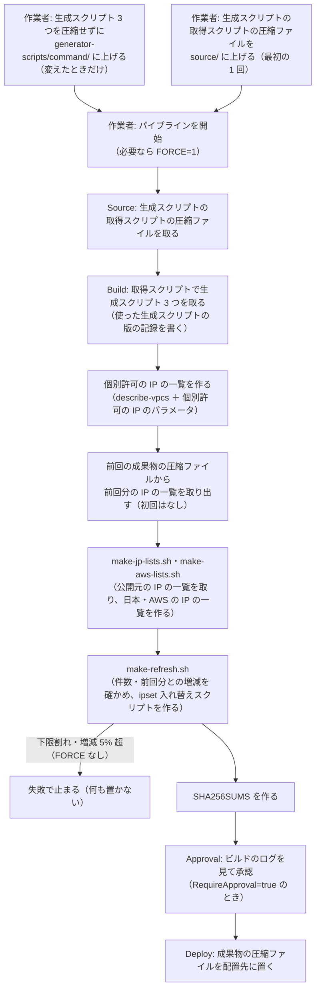

# list-refresh-pipeline — ipset に入れる IP の一覧と ipset 入れ替えスクリプトをパイプラインで作って S3 に置く（オプション）

> 状態（2026-11-13）: **オプションとして用意だけしたもの**。今の一覧の更新は、踏み台サーバーから人が流す形（[手順の「一覧を新しくするとき」](../bastion-install-commands.md#一覧を新しくするとき日本の範囲aws-の範囲許可する-ip-アドレス)）が本体。CloudFormation の定義は `cfn-lint` を通しただけで、AWS にはまだデプロイしていない。

## 用語

データは「公開元の IP の一覧 → ipset に入れる IP の一覧 → ipset 入れ替えスクリプト」の順に作られる。それを作るのが生成スクリプトで、生成スクリプトを CodeBuild の中に取ってくるのが生成スクリプトの取得スクリプト。

| 名前 | 指すもの |
|---|---|
| 公開元の IP の一覧 | Web 上にある元の一覧。APNIC の割り当ての統計 `delegated-apnic-latest`（`ftp.apnic.net`）と、AWS の IP アドレスの範囲 `ip-ranges.json`（`ip-ranges.amazonaws.com`）。成果物には入れない |
| ipset に入れる IP の一覧 | 各サーバーの ipset の集合に入れる IP の範囲を、1 行 1 件（1 列目が CIDR）で書いたファイル。次の 3 種類で、それぞれ IPv4 と IPv6 がある（`port_guard_whitelists/` の下） |
| 　日本の IP の一覧 | `jp-ipv4.txt`・`jp-ipv6.txt`。公開元の IP の一覧（APNIC）から日本の割り当てを取り出したもの |
| 　AWS の IP の一覧 | `aws-ipv4.txt`・`aws-ipv6.txt`。公開元の IP の一覧（`ip-ranges.json`）から東京・大阪のリージョンを取り出したもの |
| 　個別許可の IP の一覧 | `allow-ipv4.txt`・`allow-ipv6.txt`。サーバーの VPC の範囲と、個別許可の IP のパラメータの値を合わせたもの（踏み台サーバーの手順では、人が手で書いていたもの） |
| 個別許可の IP のパラメータ | 個別許可の IP の一覧のうち、VPC の範囲以外の相手（海外の拠点など）を書く SSM のパラメータストアの値 `<AllowListParameterPrefix>/<環境>/allow-ipv4`・`allow-ipv6`（既定は `/port-guard/<環境>/allow-ipv4` など） |
| 前回分の IP の一覧 | `port_guard_whitelists/last-refresh/*.txt`。前回の成果物に入っている ipset に入れる IP の一覧の、CIDR だけの写し。`make-refresh.sh` が今回の一覧との増減を比べるのに使う |
| ipset 入れ替えスクリプト | 各サーバーで流し、ipset の集合の中身を ipset に入れる IP の一覧に入れ替えるシェルスクリプト `command/port_guard/refresh-ipv4.sh`・`refresh-ipv6.sh`。ipset に入れる IP の一覧が中に書き込まれている |
| 生成スクリプト | 上のデータを作る既存のシェルスクリプト 3 つ。`command/make-jp-lists.sh`（公開元の IP の一覧を取り、日本の IP の一覧を作る）、`command/make-aws-lists.sh`（同じく AWS の IP の一覧を作る）、`command/make-refresh.sh`（ipset に入れる IP の一覧を確かめ、ipset 入れ替えスクリプトを作る）。**圧縮せずに**パイプライン用バケットの `generator-scripts/command/` に置く |
| 生成スクリプトの取得スクリプト | `source/fetch-generator-scripts.sh`（このフォルダ）。CodeBuild の中で、パイプライン用バケットの `generator-scripts/command/` から生成スクリプト 3 つを取ってくる。取った版を、使った生成スクリプトの版の記録に書く |
| 生成スクリプトの取得スクリプトの圧縮ファイル | 生成スクリプトの取得スクリプト 1 つだけを圧縮した `fetch-generator-scripts.zip`。パイプライン用バケットの `source/` に置き、パイプラインのソース（開始のきっかけ）になる。生成スクリプトは入れない |
| 使った生成スクリプトの版の記録 | `generator-scripts-versions.txt`。その回に使った生成スクリプトそれぞれの、S3 の版（VersionId）と SHA-256 |
| 成果物の圧縮ファイル | ビルドで作ったもの（ipset に入れる IP の一覧、ipset 入れ替えスクリプト、前回分の IP の一覧、使った生成スクリプトの版の記録、`SHA256SUMS`）を 1 つに圧縮した `ip-lists-and-ipset-refresh-scripts.zip`。配置先に置く |
| 一覧更新パイプライン | このフォルダの CloudFormation で作る CodePipeline（`port-guard-list-refresh-<環境>`）と、その中の CodeBuild のプロジェクト（同じ名前） |
| パイプライン用バケット | スタックが作るバケット。生成スクリプト（`generator-scripts/command/`）、生成スクリプトの取得スクリプトの圧縮ファイル（`source/fetch-generator-scripts.zip`）、パイプラインの中間の成果物を置く。バージョニングを有効にしている |
| 配置先バケット | 成果物の圧縮ファイルを置くバケット。パラメータ `DeployBucketName` で既存のものを指すか、空ならスタックが作る |
| 配置先 | 配置先バケットの `<DeployKeyPrefix>/<環境>/ip-lists-and-ipset-refresh-scripts.zip`（既定は `port-guard/<環境>/ip-lists-and-ipset-refresh-scripts.zip`） |

## 何をするか

[補足の「B」（S3 の案）](../bastion-install-supplement.md#b-日本の範囲の一覧を定期に新しくするs3-の案2026-11-09-に見送り) のうち、**踏み台サーバーで行う「一覧を作る → 確かめる → S3 に上げる」の部分**を、CodePipeline に置き換えたもの。各サーバーが S3 から取って入れ替える部分（W1〜W4）と、定期の実行は**含まない**。

CodePipeline は最初のステージにソースが要り、CodeBuild はソースを圧縮ファイルとして受け取って展開する（[パイプラインの構造の決まり](https://docs.aws.amazon.com/codepipeline/latest/userguide/pipeline-requirements.html)、[CodeBuild のアクション](https://docs.aws.amazon.com/codepipeline/latest/userguide/action-reference-CodeBuild.html)、[S3 のソースアクション](https://docs.aws.amazon.com/codepipeline/latest/userguide/action-reference-S3.html)。2026-11-13 に確かめた）。そこで、ソースには生成スクリプトの取得スクリプトだけを圧縮して置き、生成スクリプトは圧縮せずに置いて、取得スクリプトがビルドの中で取ってくる。

ビルドの中では、ipset に入れる IP の一覧と ipset 入れ替えスクリプトを**すべて作る**。生成スクリプトは、今の踏み台サーバーの手順と同じものをそのまま流す。個別許可の IP の一覧は、次の 2 つを合わせて作る（buildspec に書いている。buildspec は CloudFormation の定義の中に直接書いている）。

| 個別許可の IP の一覧の中身 | 取り方 |
|---|---|
| サーバーの VPC の範囲 | パラメータ `VpcId` の VPC を `aws ec2 describe-vpcs` で読み、関連付いている IPv4 の範囲（と IPv6 の範囲があればそれも）を書く。手順のステップ 0-2 で「AWS CLI が使える場所からなら」とした方法と同じ |
| ほかに許可する相手 | 個別許可の IP のパラメータの値を、そのまま書き足す（1 行 1 件、CIDR でもよい、`#` から後はコメント） |



成果物の圧縮ファイルの中身（踏み台サーバーと同じフォルダの形。踏み台サーバーで取って展開すれば、今の手順の 3・4 番がそのまま使える）:

```text
ip-lists-and-ipset-refresh-scripts.zip
  SHA256SUMS                                          # 下の各ファイルの照合の値
  generator-scripts-versions.txt                      # 使った生成スクリプトの版の記録
  command/port_guard/refresh-ipv4.sh                  # ipset 入れ替えスクリプト
  command/port_guard/refresh-ipv6.sh
  port_guard_whitelists/{jp,aws,allow}-ipv{4,6}.txt   # ipset に入れる IP の一覧
  port_guard_whitelists/last-refresh/*.txt            # 前回分の IP の一覧（次の実行の比較に使う）
```

## 決めごと

| 部分 | 決めごと | 理由 |
|---|---|---|
| 環境の分け方 | 1 つの環境（VPC）に 1 つのスタック | 個別許可の IP の一覧に VPC の範囲が入るので、環境ごとに中身が違う |
| 生成スクリプトの置き方 | 圧縮せずに、パイプライン用バケットの `generator-scripts/command/` に置く。リポジトリとはつながない | 1 つずつ差し替えられ、置いたものをそのまま見られる。Git の接続（CodeConnections）を足さずに済む。代わりに、リポジトリの生成スクリプトを変えたら上げ直す（上げ直さないとずれる） |
| パイプラインのソース | 生成スクリプトの取得スクリプトの圧縮ファイル | CodePipeline はソースが要り、CodeBuild はソースを圧縮ファイルとして受け取る。取得スクリプトはほとんど変わらないので、最初に 1 回置けばよい。取得先のバケットとフォルダは CodeBuild の環境変数で渡すので、環境ごとに作り分けなくてよい |
| 使った生成スクリプトの版 | 取得スクリプトが、今の版（VersionId）を決めてからその版を取り、版と SHA-256 を記録してログと成果物に残す | パイプラインの実行の記録に残るのは取得スクリプトの圧縮ファイルの版だけなので、生成スクリプトの版を別に残す。パイプライン用バケットのバージョニングで、あとから同じ版を取り出せる（前の版は 90 日で消える） |
| ipset に入れる IP の一覧 | すべてビルドの中で作る。人がファイルを置かない | 踏み台サーバーで人が書いていた個別許可の IP の一覧をなくし、取り違えを防ぐ |
| VPC の範囲 | `describe-vpcs` で毎回読む。取れない・IPv4 の範囲が空なら止まる | VPC に範囲を足したときに、書き足し忘れがない |
| ほかに許可する相手 | 個別許可の IP のパラメータ（スタックの外で作る）。パラメータがなければ止まる | 相手を変えるのに、スタックの更新が要らない。スタックで作ると、手で直した値をスタックの更新が上書きしうる |
| 成果物の置き方 | 1 つの圧縮ファイルにして置く（S3 のデプロイアクションの `Extract: false`） | 1 つのオブジェクトの置き換えなので、取る側が新旧の混ざった組を取ることがない。配置先バケットのバージョニングで前の版に戻せる |
| 開始 | **手動だけ**（`PollForSourceChanges=false`、EventBridge の規則なし）。生成スクリプトや取得スクリプトの圧縮ファイルを上げただけでは動かない | 上げたあとに中身を確かめてから流せるようにする |
| 前回との比較 | 配置先にある前回の成果物の圧縮ファイルから、前回分の IP の一覧を取り出して基準にする | 補足の B の「前回の公開との差」と同じ意味になる。承認で止めた回は配置されないので、基準も進まない |
| 増減が大きいとき | `make-refresh.sh` のとおり止まる。確かめたうえで進めるときは、パイプライン変数 `FORCE=1` で開始し直す | 今の手順の `FORCE=1` と同じ |
| 人の確認 | 既定で承認のステージを入れる（`RequireApproval`） | 補足の B の「人が確かめてから上げる」 |
| 権限 | CodeBuild のロールは、パイプライン用バケットの読み書き（中間の成果物と生成スクリプトの取得）、`ec2:DescribeVpcs`（リソースで絞れない）、この環境の個別許可の IP のパラメータ 2 つの読み取り、配置先の成果物の圧縮ファイルの読み取りだけ。配置先に書くのは CodePipeline のロールで、この環境の成果物の圧縮ファイル 1 つだけ | 書ける範囲を狭くする |
| 配置先バケットを作るとき | バージョニングを有効にし、スタックを消しても残す（`DeletionPolicy: Retain`） | 誤った一覧を置いたときに前の版に戻せる。配っている一覧を不意に消さない |

## 使い方

```bash
# 0. 個別許可の IP のパラメータを作る（環境ごと。スタックの外。相手がなければコメントだけでよい）
#    値は 1 行 1 件。変えるときは --overwrite を付けて上書きする
aws ssm put-parameter --name /port-guard/staging/allow-ipv4 --type String \
  --value $'# 海外の拠点\n203.0.113.10'
aws ssm put-parameter --name /port-guard/staging/allow-ipv6 --type String \
  --value '# なし'

# 1. スタックを作る（port-guard-rollout/list-refresh-pipeline/ で。環境ごと。
#    配置先バケットを既存のものにするなら DeployBucketName=<名前> を足す）
aws cloudformation deploy \
  --stack-name port-guard-list-refresh-staging \
  --template-file cloudformation/list-refresh-pipeline.yml \
  --capabilities CAPABILITY_IAM \
  --parameter-overrides EnvironmentName=staging VpcId=vpc-0123456789abcdef0

# 2. 生成スクリプト 3 つを、圧縮せずにパイプライン用バケットに上げる
#    （port-guard-rollout/ で。最初と、生成スクリプトを変えたときだけ。バケット名はスタックの出力 PipelineBucketName）
for name in make-jp-lists.sh make-aws-lists.sh make-refresh.sh; do
  aws s3 cp "command/${name}" "s3://<PipelineBucketName>/generator-scripts/command/${name}"
done

# 3. 生成スクリプトの取得スクリプトの圧縮ファイルを作って上げる（port-guard-rollout/list-refresh-pipeline/source/ で。最初の 1 回）
zip /tmp/fetch-generator-scripts.zip fetch-generator-scripts.sh
aws s3 cp /tmp/fetch-generator-scripts.zip s3://<PipelineBucketName>/source/fetch-generator-scripts.zip

# 4. 開始する（増減が大きくて止まったあと、内容を確かめて進めるときは value=1）
aws codepipeline start-pipeline-execution --name port-guard-list-refresh-staging \
  --variables name=FORCE,value=0

# 5. 承認のステージで止まったら、CodeBuild のログ（使った生成スクリプトの版、個別許可の IP の一覧の中身、件数、増減、SHA256SUMS）を見て、承認か却下をする
```

各サーバーへの反映は、今の手順（「一覧を新しくするとき」の 3・4 番。ipset 入れ替えスクリプトを流す）で行う。踏み台サーバーで成果物の圧縮ファイルを取って展開するなら、カレントのフォルダで次のとおり（踏み台サーバーに配置先を読む権限が要る）。

```bash
aws s3 cp s3://<配置先バケット>/port-guard/staging/ip-lists-and-ipset-refresh-scripts.zip /tmp/
unzip -o /tmp/ip-lists-and-ipset-refresh-scripts.zip
sha256sum -c SHA256SUMS
```

## 気を付けること

- **スタックを作った直後に、パイプラインが 1 回自動で動く**（CodePipeline の動き）。生成スクリプトの取得スクリプトの圧縮ファイルがまだなければ Source で失敗するだけで、何も置かれない
- VPC は、スタックと同じアカウント・リージョンにあるものに限る（`describe-vpcs` はビルドと同じリージョンを読む）
- 個別許可の IP のパラメータは、標準のパラメータ（`String`）で 4 KB まで。値を変えただけでは動かないので、変えたら開始する
- 既存のバケットを配置先にするときは、そのバケットの暗号化が SSE-S3 であること（SSE-KMS なら、両方のロールに KMS の権限を足す必要がある）。バケットのポリシーで書き込みを絞っていないかも確かめる
- CodeBuild は公開元の IP の一覧を、APNIC（`ftp.apnic.net`）と `ip-ranges.amazonaws.com` に外から取りに行く。VPC の中で動かす設定にはしていない（既定のまま、AWS の管理のネットワークから出る）
- 前回の成果物の圧縮ファイルの展開に `unzip` を使う。CodeBuild のイメージ（`aws/codebuild/amazonlinux-x86_64-standard:5.0`）に入っている前提で、確かめていない
- `make-refresh.sh` の下限の件数・増減の基準（5%）は、生成スクリプトの中の値がそのまま使われる

## 決まっていないこと

| 項目 | 内容 |
|---|---|
| 使うかどうか | 今は見送りの扱い。無人で回す必要が出たとき、または AMI から台を増やす運用になったときに検討する |
| 配置先バケット | 新しく作るか、既存のものを使うか |
| 各サーバーへの反映 | 踏み台サーバーが成果物の圧縮ファイルを取って ipset 入れ替えスクリプトを流すか、各サーバーが取りに行くか（補足の B-2・B-3） |
| 定期の実行 | 要るなら EventBridge Scheduler でパイプラインを開始する形を足す（今はない）。承認のステージがあると、無人では最後まで進まない |
