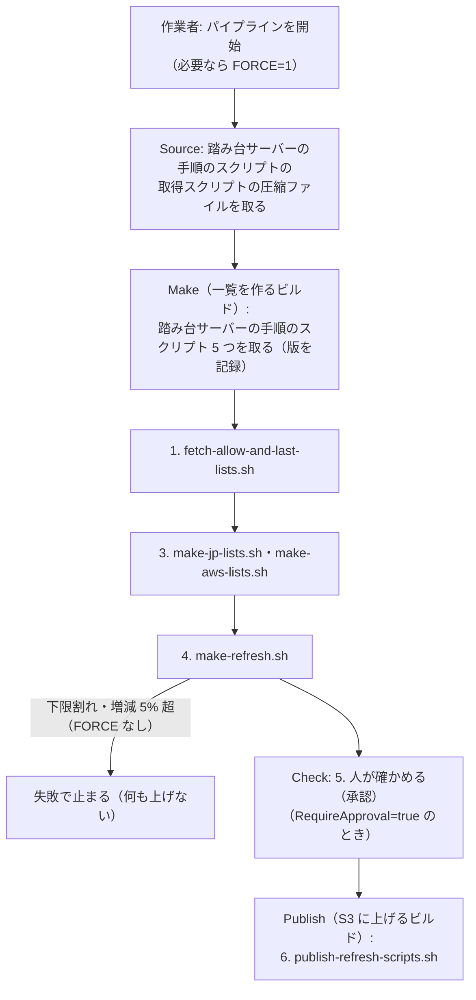

# list-refresh-pipeline — ipset 入れ替えスクリプトを S3 に上げる（人の作業フローと、それをそのまま自動化したパイプライン）

> 状態（2026-11-14）: **オプションとして用意だけしたもの**。今の一覧の更新は、踏み台サーバーから各サーバーへ SSH で流す形（[手順の「一覧を新しくするとき」](../bastion-install-commands.md#一覧を新しくするとき日本の範囲aws-の範囲許可する-ip-アドレス)）が本体。このドキュメントのスクリプトは `bash -n` の構文の確認だけ、CloudFormation の定義は `cfn-lint` を通しただけで、実際には流していない（AWS にもデプロイしていない）。各サーバーが S3 から取って入れ替える側は、まだ作っていない（[補足の B](../bastion-install-supplement.md#b-日本の範囲の一覧を定期に新しくするs3-の案2026-11-09-に見送り) の案のまま）。

インフラの定義は [CloudFormation 版](cloudformation/list-refresh-pipeline.yml)と [CDK（Python）版](cdk/python/README.md)を用意している。パラメータ・出力・パイプラインの動きは同じ。CDK 版もローカルでの合成・定義の照合・`cfn-lint` まで確認し、AWS にはデプロイしていない。

## 方針

iptables ＋ ipset の許可 IP の一覧は、**踏み台サーバーで作って人が確認してから S3 に上げ、各サーバーが定期に取得・照合して入れ替える**。

このうち「踏み台サーバーで作って人が確認してから S3 に上げる」部分を、次の 2 つで用意する。

| | 人の作業フロー | 一覧更新パイプライン |
|---|---|---|
| 動かす人・場所 | 作業者が踏み台サーバーで流す | CodePipeline と CodeBuild |
| 流すスクリプト | 踏み台サーバーの手順のスクリプト 5 つ | **同じスクリプトを同じ順に**流す（人の作業フローをそのまま自動化する） |
| 人の確認 | `make-refresh.sh` の表示を見て、上げてよいか決める | 承認のステージで、同じ表示（ビルドのログ）を見て承認する |

## 用語

| 名前 | 指すもの |
|---|---|
| 公開元の IP の一覧 | Web 上にある元の一覧。APNIC の割り当ての統計 `delegated-apnic-latest`（`ftp.apnic.net`）と、AWS の IP アドレスの範囲 `ip-ranges.json`（`ip-ranges.amazonaws.com`）。S3 には上げない |
| ipset に入れる IP の一覧 | 各サーバーの ipset の集合に入れる IP の範囲を、1 行 1 件（1 列目が CIDR）で書いたファイル。次の 3 種類で、それぞれ IPv4 と IPv6 がある（`port_guard_whitelists/` の下） |
| 　日本の IP の一覧 | `jp-ipv4.txt`・`jp-ipv6.txt`。公開元の IP の一覧（APNIC）から `make-jp-lists.sh` が作る |
| 　AWS の IP の一覧 | `aws-ipv4.txt`・`aws-ipv6.txt`。公開元の IP の一覧（`ip-ranges.json`）から `make-aws-lists.sh` が作る |
| 　個別許可の IP の一覧 | `allow-ipv4.txt`・`allow-ipv6.txt`。VPC の範囲や海外の拠点など、日本の範囲の外でも許可する相手。**人が手で書く**（[手順のステップ 0-2](../bastion-install-commands.md#0-2-作業者が許可する-ip-アドレスの一覧を書く)）。一度上げた後は、S3 の公開場所にあるものが正本 |
| 前回分の IP の一覧 | `port_guard_whitelists/last-refresh/*.txt`。前回 S3 に上げた ipset に入れる IP の一覧の、CIDR だけの写し。`make-refresh.sh` が今回の一覧との増減を比べる基準にし、終わりに今回の分で更新する |
| ipset 入れ替えスクリプト | 各サーバーで流し、ipset の集合の中身を入れ替えるシェルスクリプト `command/port_guard/refresh-ipv4.sh`・`refresh-ipv6.sh`。`make-refresh.sh` が作り、ipset に入れる IP の一覧が中に書き込まれている。一時の集合に入れて件数を確かめてから `ipset swap` で入れ替えるので、**集合が空になる時間はない** |
| 照合の値 | `SHA256SUMS`。S3 に上げたファイルそれぞれの SHA-256。最後に上げる |
| S3 の公開場所 | `s3://<公開バケット>/port-guard/<環境>/current/`。環境（VPC）ごとに分ける。人の作業フローとパイプラインで**同じ場所**を使う。スクリプトには環境変数 `PORT_GUARD_S3_URI`（末尾の `/` なし）で渡す |
| 公開バケット | S3 の公開場所があるバケット。パイプラインのスタックのパラメータ `PublishBucketName` で既存のものを指すか、空ならスタックが作る |
| 踏み台サーバーの手順のスクリプト | 人の作業フローで流すスクリプト 5 つ（`port-guard-rollout/command/` の下）。`fetch-allow-and-last-lists.sh`・`make-jp-lists.sh`・`make-aws-lists.sh`・`make-refresh.sh`・`publish-refresh-scripts.sh` |
| 一覧更新パイプライン | このフォルダの CloudFormation または CDK（Python）で作る CodePipeline（`port-guard-list-refresh-<環境>`）。中の CodeBuild は、一覧を作るビルド（`...-make`）と S3 に上げるビルド（`...-publish`）の 2 つ |
| パイプライン用バケット | パイプラインのスタックが作るバケット。踏み台サーバーの手順のスクリプト（`bastion-scripts/command/`。圧縮しない）、踏み台サーバーの手順のスクリプトの取得スクリプトの圧縮ファイル（`source/fetch-bastion-scripts.zip`）、パイプラインの中間の成果物を置く |
| 踏み台サーバーの手順のスクリプトの取得スクリプト | `source/fetch-bastion-scripts.sh`（このフォルダ）。一覧を作るビルドの最初に、パイプライン用バケットの `bastion-scripts/command/` から踏み台サーバーの手順のスクリプト 5 つを取ってくる。それだけを圧縮した `fetch-bastion-scripts.zip` が、パイプラインのソース（開始のきっかけ）になる |
| 使った踏み台サーバーの手順のスクリプトの版の記録 | `bastion-scripts-versions.txt`。パイプラインのその回に使った、踏み台サーバーの手順のスクリプトそれぞれの S3 の版（VersionId）と SHA-256 |

## S3 の公開場所に置かれるもの

人の作業フローとパイプラインのどちらで上げても同じ。フォルダの形は踏み台サーバーのカレントのフォルダと同じ。

```text
s3://<公開バケット>/port-guard/<環境>/current/
  command/port_guard/refresh-ipv4.sh           # ipset 入れ替えスクリプト（各サーバーが取って流すもの）
  command/port_guard/refresh-ipv6.sh
  port_guard_whitelists/allow-ipv4.txt         # 個別許可の IP の一覧（次の回に取って使う正本）
  port_guard_whitelists/allow-ipv6.txt
  port_guard_whitelists/last-refresh/*.txt     # 前回分の IP の一覧（次の回の比較の基準）
  SHA256SUMS                                   # 照合の値（最後に上げる）
```

## 人の作業フロー

踏み台サーバーのカレントのフォルダ（`command/` と `port_guard_whitelists/` があるところ）で流す。踏み台サーバーに、S3 の公開場所を読み書きする権限が要る。

| 順 | すること | スクリプト |
|---|---|---|
| 1 | S3 の公開場所から、個別許可の IP の一覧と前回分の IP の一覧を取る（初回は何もないので、個別許可の IP の一覧を手で書いて置く） | `command/fetch-allow-and-last-lists.sh` |
| 2 | 許可する相手を変えるときだけ、`port_guard_whitelists/allow-ipv4.txt`（と `allow-ipv6.txt`）を書き直す | 手で |
| 3 | 公開元の IP の一覧を取り、日本・AWS の IP の一覧を作る | `command/make-jp-lists.sh`・`command/make-aws-lists.sh` |
| 4 | 件数と前回分との増減を確かめ、ipset 入れ替えスクリプトを作る（下限割れ・増減 5% 超で止まる。確かめて進めるときは `FORCE=1`） | `command/make-refresh.sh` |
| 5 | **人が確かめる**。4 の表示（件数・増 / 減の件数）を見る。必要なら、ipset 入れ替えスクリプトを 1 台に流して結果を見る（[手順の「一覧を新しくするとき」の 3 番](../bastion-install-commands.md#一覧を新しくするとき日本の範囲aws-の範囲許可する-ip-アドレス)） | — |
| 6 | S3 の公開場所に上げる（ipset 入れ替えスクリプト・個別許可の IP の一覧・前回分の IP の一覧を上げ、最後に照合の値を上げる） | `command/publish-refresh-scripts.sh` |

```bash
export PORT_GUARD_S3_URI=s3://<公開バケット>/port-guard/staging/current

# 1. S3 の公開場所から、個別許可の IP の一覧と前回分の IP の一覧を取る
bash command/fetch-allow-and-last-lists.sh
# 2. 許可する相手を変えるときだけ、port_guard_whitelists/allow-ipv4.txt（と allow-ipv6.txt）を書き直す
# 3. 日本・AWS の IP の一覧を作る
bash command/make-jp-lists.sh
bash command/make-aws-lists.sh
# 4. 確かめて、ipset 入れ替えスクリプトを作る
bash command/make-refresh.sh
# 5. 表示を見て確かめる
# 6. S3 の公開場所に上げる
bash command/publish-refresh-scripts.sh
```

| 点 | 内容 |
|---|---|
| 1 で手元の個別許可の IP の一覧が置き換わる | S3 の公開場所のものが正本。手元のものが違っていたら、`allow-ipv4.txt.before-fetch` に残してから置き換える。書き直すのは 1 の後（2） |
| 前回分の IP の一覧 | 1 で S3 の公開場所のものに置き換える。手元に前の回の残りがあっても使わない（上げなかった回の残りで比べないため） |
| 5 で上げないと決めたとき | 何も上げずに終える。手元の前回分の IP の一覧は 4 で進んでいるが、次の回の 1 で S3 の公開場所のものに戻る |
| 踏み台サーバーから各サーバーへ SSH で流す今の手順 | そのまま使える（4 で作った ipset 入れ替えスクリプトを流す）。比較の基準が S3 の公開場所のものになる点だけが違う |

## 一覧更新パイプライン

人の作業フローの 1〜6 を、同じスクリプトでそのまま流す。2（手で書き直す）はパイプラインにはないので、許可する相手を変えるときは人の作業フローで上げる。



| 部分 | 決めごと | 理由 |
|---|---|---|
| 流すスクリプト | 踏み台サーバーの手順のスクリプトを、圧縮せずにパイプライン用バケットの `bastion-scripts/command/` に置き、一覧を作るビルドの最初に取ってくる | 人の作業フローと同じスクリプトを使う。リポジトリとはつながない（Git の接続を足さない）。代わりに、リポジトリのスクリプトを変えたら上げ直す |
| パイプラインのソース | 踏み台サーバーの手順のスクリプトの取得スクリプトの圧縮ファイル | CodePipeline は最初のステージにソースが要り、CodeBuild はソースを圧縮ファイルとして受け取って展開する（[パイプラインの構造の決まり](https://docs.aws.amazon.com/codepipeline/latest/userguide/pipeline-requirements.html)、[CodeBuild のアクション](https://docs.aws.amazon.com/codepipeline/latest/userguide/action-reference-CodeBuild.html)、[S3 のソースアクション](https://docs.aws.amazon.com/codepipeline/latest/userguide/action-reference-S3.html)。2026-11-13 に確かめた）。取得スクリプトはほとんど変わらないので、最初に 1 回置けばよい |
| 使ったスクリプトの版 | 取得スクリプトが、今の版（VersionId）を決めてからその版を取り、使った踏み台サーバーの手順のスクリプトの版の記録に残す。S3 に上げるビルドも、一覧を作るビルドで取った `publish-refresh-scripts.sh` をそのまま使う | パイプラインの実行の記録に残るのは取得スクリプトの圧縮ファイルの版だけなので、別に残す。前の版はパイプライン用バケットのバージョニングで 90 日取り出せる |
| 人の確認 | 承認のステージ（`RequireApproval`。既定で入れる） | 人の作業フローの 5 |
| S3 への上げ方 | 承認の後の、別の CodeBuild（S3 に上げるビルド）で `publish-refresh-scripts.sh` を流す。S3 のデプロイアクションは使わない | 人の作業フローと同じスクリプトで、同じ順番（照合の値を最後）にする。S3 のデプロイアクションはファイルを置く順番を決められない |
| 権限 | 一覧を作るビルドのロールは、S3 の公開場所を読むだけ。S3 の公開場所に書けるのは、S3 に上げるビルドのロールだけ（この環境の `current/` の下だけ） | 承認の前のビルドから S3 の公開場所を変えられないようにする |
| 開始 | **手動だけ**（`PollForSourceChanges=false`、EventBridge の規則なし） | 人の作業フローと同じく、人が始める |
| 環境の分け方 | 1 つの環境（VPC）に 1 つのスタック | S3 の公開場所が環境ごとに分かれ、個別許可の IP の一覧も環境ごとに違う |

### パイプラインの使い方

次の 1 は CloudFormation 版の場合。CDK（Python）版は [CDK 版の手順](cdk/python/README.md#テンプレートを確認して反映する)でスタックを作り、2〜5 は共通で行う。

```bash
# 1. スタックを作る（port-guard-rollout/list-refresh-pipeline/ で。環境ごと。
#    人の作業フローと同じ公開バケットを使うなら PublishBucketName=<名前> を足す）
aws cloudformation deploy \
  --stack-name port-guard-list-refresh-staging \
  --template-file cloudformation/list-refresh-pipeline.yml \
  --capabilities CAPABILITY_IAM \
  --parameter-overrides EnvironmentName=staging

# 2. 踏み台サーバーの手順のスクリプト 5 つを、圧縮せずにパイプライン用バケットに上げる
#    （port-guard-rollout/ で。最初と、スクリプトを変えたときだけ。バケット名はスタックの出力 PipelineBucketName）
for name in fetch-allow-and-last-lists.sh make-jp-lists.sh make-aws-lists.sh make-refresh.sh publish-refresh-scripts.sh; do
  aws s3 cp "command/${name}" "s3://<PipelineBucketName>/bastion-scripts/command/${name}"
done

# 3. 踏み台サーバーの手順のスクリプトの取得スクリプトの圧縮ファイルを作って上げる
#    （port-guard-rollout/list-refresh-pipeline/source/ で。最初の 1 回）
zip /tmp/fetch-bastion-scripts.zip fetch-bastion-scripts.sh
aws s3 cp /tmp/fetch-bastion-scripts.zip s3://<PipelineBucketName>/source/fetch-bastion-scripts.zip

# 4. 開始する（増減が大きくて止まったあと、内容を確かめて進めるときは value=1）
aws codepipeline start-pipeline-execution --name port-guard-list-refresh-staging \
  --variables name=FORCE,value=0

# 5. Check のステージで止まったら、一覧を作るビルドのログ（使ったスクリプトの版、取った個別許可の IP の一覧、件数、増減）を見て、承認か却下をする
```

## 気を付けること

- **初回は人の作業フローで上げる**。S3 の公開場所に個別許可の IP の一覧がまだないと、パイプラインでは `make-refresh.sh` が止まる（個別許可の IP の一覧は人が書くもので、パイプラインは作らない）
- **パイプラインのスタックを作った直後に、パイプラインが 1 回自動で動く**（CodePipeline の動き）。取得スクリプトの圧縮ファイルがまだなければ Source で失敗するだけで、何も上げない
- 人の作業フローとパイプラインを同時に流さない。両方が同じ S3 の公開場所に上げるので、後から上げた方が残り、比較の基準もずれる
- 既存のバケットを公開バケットにするときは、そのバケットの暗号化が SSE-S3 であること（SSE-KMS なら、ロールに KMS の権限を足す必要がある）。バケットのポリシーで書き込みを絞っていないかも確かめる
- CodeBuild は公開元の IP の一覧を、APNIC（`ftp.apnic.net`）と `ip-ranges.amazonaws.com` に外から取りに行く。VPC の中で動かす設定にはしていない（既定のまま、AWS の管理のネットワークから出る）
- `make-refresh.sh` の下限の件数・増減の基準（5%）は、スクリプトの中の値がそのまま使われる

## 決まっていないこと

| 項目 | 内容 |
|---|---|
| 使うかどうか | 今は見送りの扱い。無人で回す必要が出たとき、または AMI から台を増やす運用になったときに検討する |
| 公開バケット | 新しく作るか、既存のものを使うか。踏み台サーバーから読み書きする権限を、どの認証情報で持つか |
| 各サーバーが取得・照合して入れ替える側 | S3 の公開場所から ipset 入れ替えスクリプトと照合の値を取り、照合してから流す仕組み。定期の実行（cron か State Manager か）と、S3 を読む権限（補足の B-3 の案 X か Y か）。S3 から取ったスクリプトを root で流すので、S3 の公開場所に書ける人・ロールを絞ることが前提になる |
| 定期の実行（パイプライン） | 要るなら EventBridge Scheduler でパイプラインを開始する形を足す（今はない）。承認のステージがあると、無人では最後まで進まない |
