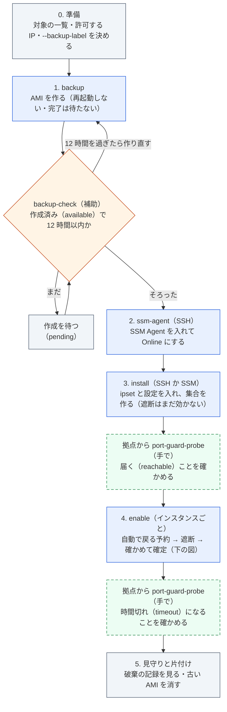
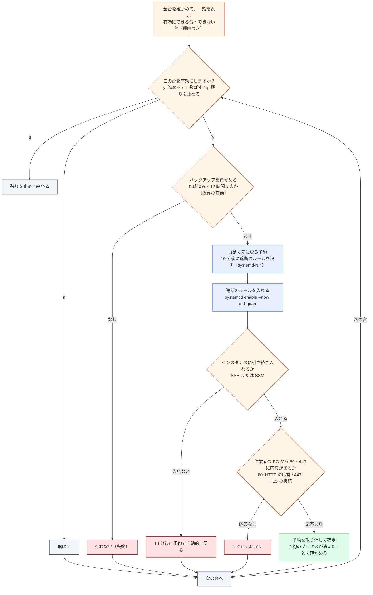

# 手順: 80・443 番を国内だけに絞る設定を、複数台に入れる

> 位置付け: `port-guard-rollout` を使った作業の手順の**正本**。インスタンスに入れる仕組み（iptables ＋ ipset）の詳細は [iptables ＋ ipset の仕組みと確認](./iptables-ipset.md)。もとは README の「使い方」と、note の [作業計画](../notes/ec2-operations/access-restriction-os-firewall-work-plan.md) にあった内容を、確定した内容に合わせてここに移した。
>
> 更新日: 2026-10-29

## 確定した内容

| 項目 | 内容 |
|---|---|
| 方式 | OS の iptables ＋ ipset |
| 絞るポート | **80 番と 443 番だけ**。SSH の 22 番は**既定では絞らない**（ほかのシステムからの SSH の接続がありうるため。外部からの SSH は、基本はセキュリティグループで弾く前提）。必要になったときだけ、`install --include-ssh` で 22 番も対象にできる |
| 受け付ける相手 | 日本の IP の範囲と、許可する IP の一覧 |
| インスタンスでの操作 | SSM（Session Manager・Run Command）の導入を前提にする。SSM Agent がない台は SSH で入れる |
| 作業の前提 | 各操作の前に、決めたバックアップ作業のタイミングのバックアップ（AMI）が、作成済みで 12 時間以内のものとしてあること |

## 流れ



青: 道具のコマンド、橙: 確認（道具）、緑の破線: 作業者が手で行う、灰: 準備・待ち・片付け。2〜4 は、操作の前にバックアップを自動で確かめる（台ごと、操作の直前にも）。どの手順も、OS の再起動は要らず、Apache とアプリも再起動しない。

SVG 版: [全体の流れ](images/flow-overall.svg)（`python3 images/make_svg.py images` で作り直す）

## 共通の使い方

### 入力

対象は標準入力から 1 行に 1 台で渡す。形は `<インスタンスの ID> [<SSH の接続先>]`。空の行と `#` から後は無視し、同じインスタンスの ID は最初の行だけを使う。

```
i-0123456789abcdef0                # 接続先は AWS CLI で引く（既定はパブリック IP。--address private でプライベート IP）
i-0fedcba9876543210  10.0.1.23     # 接続先を直接書く（host、host:port、user@host:port）
```

### 確認の形

どのコマンドも、次の順に進む。

1. 全台を確かめる（読み取りだけ）
2. 操作できるものと、できないもの（理由つき）を分けて表示する
3. 試行するかを確かめる（`enable` はインスタンスごとに確かめる）。答えは端末（`/dev/tty`）から読む（標準入力は対象の一覧に使うため）。端末がない環境では `--yes` を付けないと止まる
4. 1 台ずつ順に行う

`--check-only` を付けると、1・2 だけを行う。`install` と `enable` は `--dry-run` で、行う予定の処理も表示する（変更はしない）。

### バックアップの確認

`ssm-agent`・`install`・`enable` は、`--backup-label`（`backup` で指定したバックアップ作業のタイミング）が要る。インスタンスごとに、次の 3 つがそろった AMI があるときだけ操作する。一覧を出す前と、各インスタンスを操作する直前の 2 回確かめる。

| 条件 | 内容 |
|---|---|
| タイミングが一致 | AMI のタグ `BackupLabel` が、指定した値と同じ（`Purpose=port-guard-rollout-backup`、`SourceInstanceId` も一致） |
| 作成が終わっている | `State` が `available`（AMI の作成は非同期で進むので、作成中（`pending`）のものは使わない） |
| 12 時間以内 | 作成の時刻が、確かめた時点から 12 時間以内 |

同じ条件で、確かめるだけのコマンドもある（読み取りだけ。何も変えない）。操作できるもの（AMI の ID、作成の時刻、作成から何時間たったか、期限まであと何時間か）と、操作できないもの（理由つき）を分けて表示する。終了コードは、0: すべての台にバックアップがある、1: ないものがある、2: 入力・道具の問題。

```bash
python3 -m port_guard_rollout backup-check --backup-label 2026-10 < instance-ids.txt
```

手元の再現の環境（AWS にない偽物のインスタンス）で試すときだけ、`--skip-backup-check` で確かめずに進められる。

### 実行の手段（`install`・`enable`）

| `--via` | 内容 |
|---|---|
| `ssh`（既定） | 作業者の PC の `ssh` を呼び、インスタンスの中で `sudo -n bash -s` で実行する。`--ssh-user`（既定 `centos`）、`--ssh-key`、`--ssh-option`（`ssh -o` に渡す値）。踏み台などは作業者の SSH の設定に書いておけばそのまま使える。初めての接続先のホストの鍵は自動で登録する |
| `ssm` | AWS CLI の `aws ssm send-command`（`AWS-RunShellScript`）で送り、`get-command-invocation` で結果を待つ（root で実行される）。SSM に登録されて `Online` のインスタンスだけが対象。処理は base64 にして 1 行のコマンドとして送る |

### 終了コード

0: すべて成功（または中止した・確かめただけ）、1: 失敗した、または操作できないインスタンスがあった、2: 入力・確認・道具の問題。

### 前提と権限

作業者の PC に Python 3、AWS CLI（v2）、`ssh` が入っていること。認証情報・プロファイル・リージョンは AWS CLI の設定と、`--profile`・`--region`。

| 手順 | 作業者の IAM に要る権限 |
|---|---|
| すべて | `ec2:DescribeInstances`、`ec2:DescribeImages`（バックアップの確認） |
| `backup` | `ec2:CreateImage`、`ec2:CreateTags` |
| `ssm-agent` | `ssm:DescribeInstanceInformation` |
| `--via ssm` のとき | `ssm:DescribeInstanceInformation`、`ssm:SendCommand`（`AWS-RunShellScript`。対象のインスタンスだけに絞る）、`ssm:GetCommandInvocation` |

## 0. 準備

| # | 作業 | 内容 |
|---|---|---|
| 0-1 | 対象の一覧 | インスタンスの ID の一覧（必要なら SSH の接続先）を作る |
| 0-2 | 許可する IP の一覧 | 日本以外から 80・443 番に通す必要がある相手（海外の拠点、保守の委託先、外形監視、決済などの外部サービスの通知の送り元）。1 行 1 件、CIDR 可、`#` から後はコメント |
| 0-3 | バックアップ作業のタイミング | `--backup-label` に使う値を決める（例 `2026-10`、`2026-10-29`） |
| 0-4 | 作業者の道具と権限 | Python 3、AWS CLI、`ssh`、上の権限、SSH の鍵 |
| 0-5 | セキュリティグループ | 80・443 番が開いていること（ここで止まっていれば OS まで届かない）。SSM を使うなら送信の 443 番が許可されていること |
| 0-6 | 作業の時間帯と連絡 | 止まらない見込みの作業だが、念のため保守の時間帯にして、関係者に知らせる |
| 0-7 | 段階 | まず影響の小さい 1 台で最後まで通してから、残りに広げる |

## 1. バックアップ（`backup`）

インスタンスごとに AMI を作る（`create-image --no-reboot`。再起動しない）。**すでにバックアップがあっても、新しく作る**。作成は完了を待たない（取り始めた時点の中身が残る）。

```bash
cd port-guard-rollout
python3 -m port_guard_rollout backup --backup-label 2026-10 --check-only < instance-ids.txt   # 確かめるだけ
python3 -m port_guard_rollout backup --backup-label 2026-10 < instance-ids.txt
```

| 項目 | 内容 |
|---|---|
| 確かめること | インスタンスがあるか、状態が `running` か `stopped` か、ルートボリュームが EBS か、AMI を作る権限があるか（`create-image --dry-run` で、実際には作らずに確かめる） |
| AMI の名前 | `<Name タグ>-<インスタンスの ID>-before-port-guard-<実行の ID>`。使えない文字（日本語や空白など）は `-` に置き換える。実行の ID は実行した日時（`YYYYmmdd-HHMMSS`） |
| AMI とスナップショットのタグ | `Name`、`Purpose=port-guard-rollout-backup`、`SourceInstanceId`、`SourceInstanceName`、`BackupRunId`、`BackupLabel`（`--backup-label` の値） |
| `--backup-label` に使える文字 | 英数字と空白・`_ . : / = + @ -`、128 文字まで |

次の手順は、AMI の作成が終わって（`available`）から、12 時間以内に行う。**作成が終わったかは `backup-check` で確かめる**（`python3 -m port_guard_rollout backup-check --backup-label 2026-10 < instance-ids.txt`。全台が「操作できる」になれば次へ進める）。終わりに表示される `aws ec2 describe-images ...` でも見られる。

## 2. SSM Agent の導入（`ssm-agent`）

SSM Agent がまだないインスタンスが相手なので、**SSH** で入る。インスタンスプロファイルや IAM の権限の付与は行わない（別の作業）。

```bash
python3 -m port_guard_rollout ssm-agent --backup-label 2026-10 --check-only < instance-ids.txt
python3 -m port_guard_rollout ssm-agent --backup-label 2026-10 --ssh-key ~/.ssh/<鍵> < instance-ids.txt
```

| 段階 | 内容 |
|---|---|
| 確認（読み取りだけ） | SSH で SSM Agent の有無・起動時の有効化・動作、インスタンスのメタデータからインスタンスプロファイルの有無とリージョン、AWS の窓口（`ssm.<リージョン>.amazonaws.com`）に届くかを見る。AWS CLI で登録の状態（`Online` など）も見る |
| 行うこと | 入っていない → **インストール**、入っているが止まっている → **有効化と起動**、動いているのに登録されていない → **起動し直し**、`Online` → 何もしない |
| 操作できない | バックアップがない、SSH で入れない、`sudo` を使えない、Amazon Linux 2 ではない、動いているがインスタンスプロファイルがない・AWS の窓口に届かない |
| 導入 | `yum install amazon-ssm-agent`（入っていなければ）→ `systemctl enable` → `systemctl restart`（認証情報を取り直させる）→ `ssm-cli get-diagnostics`（あれば） |
| 登録の確認 | すべての台を処理した後、`--wait-online`（既定 300 秒）まで、AWS の側で `Online` になるのを待つ。ならなければ、見る場所（インスタンスプロファイル、送信の 443 番、エージェントのログ）を表示する |

インスタンスプロファイルがない台は、入れても `Online` にならない（注意として表示する）。

## 3. ipset の導入と設定（`install`）

**遮断はまだ効かせない**。80・443 番を対象にした設定と、日本の IP の範囲・許可する IP の集合を用意する。

```bash
# dry 実行: 確かめて、行う予定の処理と、前回の設定から変わること（ポート、許可する IP の増減）を表示する
python3 -m port_guard_rollout install --backup-label 2026-10 --allow-file allow.txt --dry-run --script-out /tmp/script.sh < instance-ids.txt

# 導入と設定（SSH で）
python3 -m port_guard_rollout install --backup-label 2026-10 --allow-file allow.txt \
  --ssh-key ~/.ssh/<鍵> --check-in-jp <日本の回線の IP> --check-outside <海外の IP> < instance-ids.txt

# 導入と設定（SSM の Run Command で）
python3 -m port_guard_rollout install --via ssm --backup-label 2026-10 --allow-file allow.txt < instance-ids.txt
```

| 段階 | 内容 |
|---|---|
| 確認（読み取りだけ） | 入れるか（または SSM で `Online` か）、`sudo` を使えるか、Amazon Linux 2 か。次のどれかなら**操作しない**: バックアップがない、firewalld が動いている・起動時に有効、iptables のサービスが起動時に有効、既存の iptables のルールがある、既存の ipset の集合がある、port-guard の遮断がすでに有効 |
| 導入と設定 | `yum install ipset python3` → 設定（`/etc/port-guard/port-guard.conf`、`allow.txt`）・2 つのスクリプト・systemd のユニットを置く（`daemon-reload` まで。enable しない）→ 日本の IP の範囲を取って集合を作る（`port-guard-update-jp`） |
| 導入の後の確認 | 集合の件数、遮断のルール（INPUT からの参照）がないこと、`port-guard` と `ipset` のユニットが起動時に有効になっていないこと、`--check-in-jp` の IP が日本の集合に入っていること、`--check-outside` の IP がどちらの集合にも入っていないこと |

| オプション | 内容 |
|---|---|
| `--include-ssh` | 22 番（SSH）も対象にする（ポートは 22・80・443 になる）。遮断を有効にした後は、日本の IP か許可する IP の一覧にある相手からしか SSH で入れないので、ほかのシステムから SSH で入っている相手が日本の IP でなければ、許可する IP の一覧に入れておく（確認の画面にも注意を出す） |
| `--allow-file` | 許可する IP の一覧。省略すると空。**サーバーの `allow.txt` は、この中身で丸ごと置き換える**（足し合わせない） |
| `--jp-min-entries` | 日本の IP の範囲の最低件数（既定 1000。これより少なければ取得の失敗とみなす） |
| `--check-in-jp`・`--check-outside` | 確認に使う IP（何度でも指定できる） |
| `--dry-run`・`--script-out` | 変更せずに、行う予定の処理と前回の設定から変わることを表示する。`--script-out` で、インスタンスに送る処理をファイルに書き出す |

**集合の中身は、`install` を実行した時点のもの**（日本の IP の範囲は実行した時点で取り、許可する IP は実行した時点の `--allow-file` の中身）。その後は自動では更新されない。このあと遮断を有効にすると、この時点の一覧がそのまま遮断に使われる。有効にする前に一覧を新しくしたいときは、`install` をもう一度実行する（集合の中身だけが入れ替わる）。遮断を有効にした後は、`install` は操作しない（「遮断がすでに有効」）。

## 4. 遮断の有効化（`enable`）

全台を確かめて有効にできるものの一覧を出し、その後は**インスタンスごとにチェックポイントを設けて** 1 台ずつ進める。



海外からの確認は、確定した後に作業者が拠点で `port-guard-probe` を手で実行する（この図の外。[海外からの確認の拠点](./outside-probe.md#確かめる流れ作業者が手で行う)）。

SVG 版: [enable のインスタンスごとの流れ](images/flow-enable.svg)

```bash
python3 -m port_guard_rollout enable --backup-label 2026-10 --dry-run < instance-ids.txt
python3 -m port_guard_rollout enable --backup-label 2026-10 --ssh-key ~/.ssh/<鍵> < instance-ids.txt
python3 -m port_guard_rollout enable --via ssm --backup-label 2026-10 < instance-ids.txt
```

| 段階 | 内容 |
|---|---|
| 確認（読み取りだけ） | `install` と同じ確認に加えて、port-guard が入っていること、ポートの設定が 80・443（`--include-ssh` で入れたときは 22・80・443）であること、日本の IP の範囲の一覧が最低件数以上あること |
| インスタンスごとのチェックポイント | その台の内容を表示し、`y`（進める）・`n`（飛ばす）・`q`（残りを止める）を聞く。前の台の結果を見てから次の台に答える |
| 有効化 | 今の iptables のルールを `/var/lib/port-guard/` に控える → **`--revert-minutes`（既定 10 分）の後に自動で元に戻る予約**を入れる（`systemd-run`）→ `systemctl enable --now port-guard`（ルールと集合が入り、起動時にも入る） |
| 確認 | インスタンスに引き続き入れるか（SSH または SSM）。作業者の PC から 80・443 番に届いて相手が応答するか（80: HTTP の応答、443: TLS の接続。途中の転送や代理の仕組みが接続を受け付けてしまう誤判定を避けるため、TCP の接続だけでは判定しない） |
| 海外からの確認 | 道具では行わない。作業者が、[海外からの確認の拠点](./outside-probe.md#確かめる流れ作業者が手で行う)で `port-guard-probe` を、`enable` の前（届くこと）と、確定した後（時間切れになること）に実行して確かめる |
| 確定・元に戻す | すべて合格 → 予約を取り消して**確定**（予約のプロセスが消えたことも確かめる）。不合格 → **すぐに元に戻す**（ルールを外し、ユニットを無効にし、予約を取り消す）。インスタンスに入れなくなった → 予約で自動的に元に戻る |

| オプション | 内容 |
|---|---|
| `--revert-minutes` | 確定しなければ自動で元に戻るまでの時間（既定 10 分） |
| `--connect-timeout` | 届くかの確認の待ち時間（既定 5 秒） |
| `--probe PORT:KIND` | ポートごとの確かめ方（`tcp`・`ssh`・`http`・`tls`）。既定は 22: `ssh`（SSH のサーバーの応答）、80: `http`、443: `tls` |
| `--port-map PORT:LOCAL_PORT` | 作業者の PC から確かめるときに使うポート（手元の再現の環境のように、転送しているとき） |

## 5. 見守りと片付け

| # | 作業 | 内容 |
|---|---|---|
| 5-1 | 数日の見守り | 破棄の記録と回数（[破棄の記録](./iptables-ipset.md#破棄の記録)）を見て、止めてはいけない相手（外部サービス、監視など）が止まっていないか。利用者からの「つながらない」の連絡に注意する |
| 5-2 | 記録 | 何を変えたか（入れたパッケージとファイル、ユニット）と、確認の結果を残す |
| 5-3 | バックアップの片付け | 落ち着いたら、1 の AMI とスナップショットを消す（タグ `Purpose=port-guard-rollout-backup` と `BackupLabel` で探せる） |

## 元に戻す

| 状況 | 戻し方 |
|---|---|
| `enable` の確認で不合格 | 道具がすぐに元に戻す |
| `enable` の後にインスタンスに入れなくなった | 予約（既定 10 分後）で自動的に元に戻る |
| 確定した後に、止めてはいけない接続が止まった | 手で外す（[外し方](./iptables-ipset.md#外す元に戻す)）。ルールを 1 つ消すだけで、止まらない |
| 最後の手段 | 1 の AMI から戻す（戻すときは止まる） |

## 手元の再現の環境で試す

[`al2-instance/`](./al2-instance/README.md) のコンテナを相手にする（AWS にないので `--skip-backup-check`。80・443 番は手元の 8080・8443 番に転送しているので `--port-map`）。

```bash
cd port-guard-rollout
O=(--skip-backup-check --ssh-key al2-instance/ssh/id_ed25519 \
   --ssh-option UserKnownHostsFile=/dev/null --ssh-option StrictHostKeyChecking=no)
echo 'i-00000001 localhost:2222' | python3 -m port_guard_rollout ssm-agent --no-aws "${O[@]}" --yes
echo 'i-00000001 localhost:2222' | python3 -m port_guard_rollout install --allow-file allow.txt "${O[@]}" --yes
echo 'i-00000001 localhost:2222' | python3 -m port_guard_rollout enable --port-map 80:8080 --port-map 443:8443 "${O[@]}" --yes
```

手元の Docker の仮想マシンからの接続は `192.168.65.1` に見えるので、手元から確かめるには、この IP を許可する IP の一覧に入れる（入れなければ、`enable` の確認で不合格になって元に戻ることを確かめられる）。コンテナには systemd がないので、ユニットの登録と起動時の有効化は飛ばし、予約は切り離したプロセスで代わりに行う。
