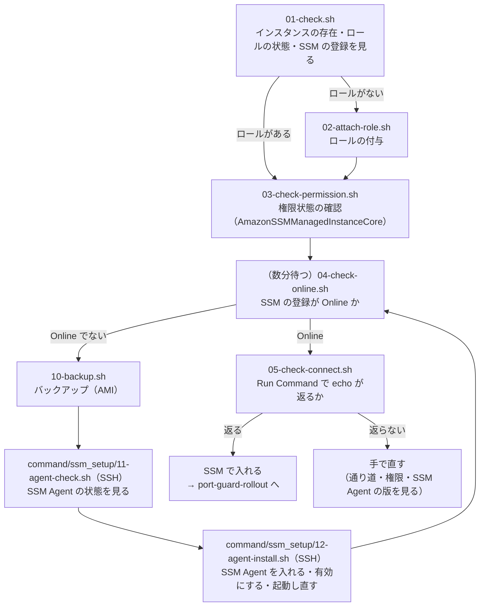

# 作業者の PC の AWS CLI と踏み台サーバーで SSM を使えるようにする: コマンド

> 位置付け: 運用中のインスタンスを SSM（Session Manager・Run Command）で入れる状態にするためのコマンドを、ステップごとのファイルの形でまとめたもの。[port-guard-rollout の踏み台サーバーから入れるコマンド](../port-guard-rollout/bastion-install-commands.md) と同じ形で、どのファイルも**上から順に実行するコマンドを並べただけ**。流れは、道具（`py/`・`sh/`・`rb/`）と同じ。考え方と分け方の詳しい説明は [手順](./steps.md)（正本）。
>
> 状態: AWS でも対象のサーバーでも、まだ流していない。手元（macOS）での確認は「[確かめたこと](#確かめたこと)」。
>
> 更新日: 2026-11-05

## この形の前提

| 項目 | 内容 |
|---|---|
| 2 か所で実行する | **作業者の PC**（`01`〜`10`）: AWS の API を呼ぶもの（インスタンスプロファイルの関連付け、登録と接続の確認、バックアップ）。作業者のローカルの PC の、AWS のアカウントの認証情報が有効な AWS CLI で、作業用のフォルダ（カレントのフォルダ）に置いて `bash <ステップ>.sh <インスタンスの ID>` の形で流す。**踏み台サーバー**（`11`・`12`）: 対象のサーバーの中で行うもの（SSM Agent の確認と導入）。踏み台サーバーの `command/ssm_setup/` に置き、踏み台サーバーから `ssh ... centos@server 'bash' < ./command/ssm_setup/<ステップ>.sh >> ./output/result.txt` で流す（SSM がまだ使えないので SSH） |
| 踏み台サーバーでは AWS CLI を使わない | 踏み台サーバーには AWS の認証情報を置かない前提。踏み台サーバーの `command/` の下には、対象のサーバーに送るファイルだけを置く |
| 複数台 | 作業者の PC のものは 1 台ずつ（インスタンスの ID を引数で渡す）。踏み台サーバーの `command/ssm_setup/` のものは、踏み台サーバーにある今の当て込みのスクリプトで |
| 認証情報・リージョン | 作業者の PC の AWS CLI の設定（`AWS_PROFILE`・`AWS_REGION` など）をそのまま使う。流す前に、下の「作業者の PC の AWS CLI を確かめる」で、有効なアカウント・リージョンになっているかを見る |
| 作業者の PC に要る権限 | `ec2:DescribeInstances`・`ec2:DescribeIamInstanceProfileAssociations`・`ec2:AssociateIamInstanceProfile`（02）、`iam:GetInstanceProfile`・`iam:ListAttachedRolePolicies`（02・03）、`iam:PassRole`（02。関連付けるロールに対して）、`ssm:DescribeInstanceInformation`（04）、`ssm:SendCommand`・`ssm:GetCommandInvocation`（05）、`ec2:CreateImage`・`ec2:CreateTags`・`ec2:DescribeImages`（10）。使うときだけ: `ssm:StartSession`（Session Manager での確認）、`ec2:DisassociateIamInstanceProfile`（02 の戻し方） |
| インスタンスプロファイル | `AmazonSSMManagedInstanceCore` を付けたロールと、それを入れたインスタンスプロファイルを、先に用意しておく（ここでは作らない。既定の名前は `port-guard-ssm`） |
| すでにロールがある台 | 何もしない（ロールの付け替えも、そのロールに権限を足すこともしない） |
| 実行する人（`command/ssm_setup/`） | `centos`。root が要る操作は `sudo -n`（パスワードを聞かれる設定なら、待たずに失敗する） |

### 作業者の PC の AWS CLI を確かめる

01 を流す前に、作業者の PC で次を流し、操作したいアカウントとリージョンになっているかを確かめる（読み取りだけ）。

```bash
aws sts get-caller-identity --query '[Account,Arn]' --output text   # アカウントの番号と、自分の名前（ロール・利用者）
aws configure get region                                          # リージョン（ap-northeast-1 など。AWS_REGION を設定していればそちらが使われる）
```

| 結果 | 次に行うこと |
|---|---|
| アカウントの番号と名前が出る、リージョンが合っている | 01 へ進む |
| `Unable to locate credentials`・`ExpiredToken` など | 認証情報がない・切れている。作業者の PC で、ふだんの方法でログインし直す（例: `aws sso login --profile <名前>`）。`AWS_PROFILE` を設定しているなら、その名前が合っているかも見る |
| 違うアカウント・リージョン | `AWS_PROFILE`・`AWS_REGION` を設定し直す（例: `export AWS_PROFILE=<名前> AWS_REGION=ap-northeast-1`） |

### 流れ



| ステップ | どこで実行するか | ファイル | すること | 変えるもの |
|---|---|---|---|---|
| 1 | 作業者の PC（AWS CLI） | `01-check.sh` | インスタンスの存在、ロールの状態、SSM の登録を見る | なし |
| 2 | 作業者の PC（AWS CLI） | `02-attach-role.sh` | ロールがない台に、インスタンスプロファイルを関連付ける | 関連付け |
| 3 | 作業者の PC（AWS CLI） | `03-check-permission.sh` | 関連付けたロールに `AmazonSSMManagedInstanceCore` が付いているか | なし |
| 4 | 作業者の PC（AWS CLI） | `04-check-online.sh` | SSM の登録が `Online` か（関連付けから数分置いてから） | なし |
| 5 | 作業者の PC（AWS CLI） | `05-check-connect.sh` | Run Command で `echo` が返るか（実際に入れるか） | なし（コマンドの履歴は AWS の側に残る） |
| 10 | 作業者の PC（AWS CLI） | `10-backup.sh` | 4 で `Online` にならない台だけ、AMI を作る（再起動しない） | AMI |
| 11 | 対象のサーバー（踏み台サーバーから SSH） | `command/ssm_setup/11-agent-check.sh` | SSM Agent の有無・動作、インスタンスプロファイルが見えるか、AWS の窓口に届くか | なし |
| 12 | 対象のサーバー（踏み台サーバーから SSH） | `command/ssm_setup/12-agent-install.sh` | SSM Agent を入れて（なければ）、起動時に有効にして、起動し直す | パッケージ、サービス |

ほとんどの台は、SSM Agent が最初から入って動いていて、ロールがないだけと見込んでいる。そういう台は 1 → 2 → 3 → 4 → 5 で終わる。10〜12 は、4 で `Online` にならない台だけ。

## 1. 状態を見る（`01-check.sh`）

```bash
#!/bin/bash
# 使い方: bash 01-check.sh <インスタンスの ID>
# インスタンスの存在、ロール（インスタンスプロファイル）の状態、SSM の登録を見る（読み取りだけ）
ID=$1
echo "== $ID $(date '+%F %T') 01-check"

# インスタンスの存在と状態（running か）、Name
aws ec2 describe-instances --instance-ids "$ID" \
  --query 'Reservations[0].Instances[0].[State.Name, Tags[?Key==`Name`] | [0].Value]' --output text

# ロールの状態（関連付けられているインスタンスプロファイル。何も出なければ、ロールがない）
aws ec2 describe-iam-instance-profile-associations --filters "Name=instance-id,Values=$ID" \
  --query 'IamInstanceProfileAssociations[].[State, IamInstanceProfile.Arn]' --output text

# SSM の登録（Online なら登録できている。何も出なければ、未登録）
aws ssm describe-instance-information --filters "Key=InstanceIds,Values=$ID" \
  --query 'InstanceInformationList[].[PingStatus, AgentVersion]' --output text
```

| 結果 | 次に行うこと |
|---|---|
| 状態が `running` でない、見つからない | 対象外（止まっている台は、SSM で入れない） |
| ロールがない（2 つ目のコマンドが何も出さない） | 2 へ |
| ロールがあり、登録が `Online` | 5 へ（そのロールで SSM が使えている） |
| ロールがあり、登録が `Online` でない | 3 で、そのロールに `AmazonSSMManagedInstanceCore` が付いているかを見る。付いていなければ手で直す（すでにあるロールには、ここでは権限を足さない） |

## 2. ロールを付与する（`02-attach-role.sh`）

```bash
#!/bin/bash
# 使い方: bash 02-attach-role.sh <インスタンスの ID> [インスタンスプロファイルの名前（既定 port-guard-ssm）]
# ロールがない台に、SSM 用のインスタンスプロファイルを関連付ける（再起動は要らない）
set -euo pipefail
ID=$1
PROFILE=${2:-port-guard-ssm}
echo "== $ID $(date '+%F %T') 02-attach-role $PROFILE"

# インスタンスプロファイルがあること（なければ、ここで失敗して止まる）
aws iam get-instance-profile --instance-profile-name "$PROFILE" --query 'InstanceProfile.Arn' --output text

# 関連付ける（すでに別のロールが付いている台は、AWS の側が IncorrectState で拒むので、ここで止まる）
aws ec2 associate-iam-instance-profile --instance-id "$ID" --iam-instance-profile "Name=$PROFILE" \
  --query 'IamInstanceProfileAssociation.[State, IamInstanceProfile.Arn]' --output text
```

| 点 | 内容 |
|---|---|
| ロールがある台 | 流さない（1 で確かめる）。流しても AWS の側が拒む（`IncorrectState`）ので、付け替わることはない |
| 再起動 | 要らない。関連付けは OS のディスクを変えない |
| 戻し方 | `aws ec2 describe-iam-instance-profile-associations --filters Name=instance-id,Values=<ID>` で関連付けの ID を調べ、`aws ec2 disassociate-iam-instance-profile --association-id <関連付けの ID>` |

## 3. 権限状態を確かめる（`03-check-permission.sh`）

```bash
#!/bin/bash
# 使い方: bash 03-check-permission.sh <インスタンスの ID>
# 関連付けられたロールに AmazonSSMManagedInstanceCore が付いているか（読み取りだけ）
set -euo pipefail
ID=$1
echo "== $ID $(date '+%F %T') 03-check-permission"

ARN=$(aws ec2 describe-iam-instance-profile-associations --filters "Name=instance-id,Values=$ID" \
  --query 'IamInstanceProfileAssociations[0].IamInstanceProfile.Arn' --output text)
echo "インスタンスプロファイル: $ARN"
ROLE=$(aws iam get-instance-profile --instance-profile-name "${ARN##*/}" \
  --query 'InstanceProfile.Roles[0].RoleName' --output text)
echo "ロール: $ROLE"
aws iam list-attached-role-policies --role-name "$ROLE" --query 'AttachedPolicies[].PolicyName' --output text
```

最後の行に `AmazonSSMManagedInstanceCore` があればよい。なければ、そのロールでは SSM の登録ができない（独自のポリシーで足りていることもあるので、そのときは 4 で `Online` になるかを見る）。

## 4. SSM の登録を見る（`04-check-online.sh`）

関連付けの後、SSM Agent が新しい権限を拾って登録されるまで、数分かかることがある。少し時間を置いてから流す。

```bash
#!/bin/bash
# 使い方: bash 04-check-online.sh <インスタンスの ID>
# SSM の登録が Online か（読み取りだけ）
ID=$1
echo "== $ID $(date '+%F %T') 04-check-online"
aws ssm describe-instance-information --filters "Key=InstanceIds,Values=$ID" \
  --query 'InstanceInformationList[].[PingStatus, AgentVersion, LastPingDateTime]' --output text
```

| 結果 | 次に行うこと |
|---|---|
| `Online` | 5 へ |
| 何も出ない（未登録）、`ConnectionLost` | 数分置いてもう一度。それでも変わらなければ、10 → 11 → 12（SSM Agent が入っていない・止まっている・権限を拾い直していない見込み） |

## 5. 実際に入れるかを見る（`05-check-connect.sh`）

```bash
#!/bin/bash
# 使い方: bash 05-check-connect.sh <インスタンスの ID>
# Run Command で echo を 1 回だけ流し、返るかを見る（設定は変えない。コマンドの履歴は AWS の側に残る）
set -euo pipefail
ID=$1
echo "== $ID $(date '+%F %T') 05-check-connect"

COMMAND_ID=$(aws ssm send-command --instance-ids "$ID" --document-name AWS-RunShellScript \
  --comment "ssm-setup connect check" --parameters 'commands=["echo ssm-connect-ok"]' \
  --query Command.CommandId --output text)
echo "コマンドの ID: $COMMAND_ID"
sleep 10
aws ssm get-command-invocation --command-id "$COMMAND_ID" --instance-id "$ID" \
  --query '[Status, StandardOutputContent]' --output text
```

| 結果 | 意味 |
|---|---|
| `Success` と `ssm-connect-ok` | SSM で入れる。port-guard-rollout の対象にできる |
| `InProgress`・`Pending` | まだ終わっていない。最後のコマンド（`get-command-invocation`）だけを、少し置いてもう一度 |
| `Failed`・`TimedOut`・`Undeliverable`、または送れない | 手で直す。インスタンスから `ssmmessages`・`ec2messages` への送信の 443 番、作業者の権限（`ssm:SendCommand`）、SSM Agent の版を見る |

人がログインする経路（Session Manager）も確かめるなら、作業者の PC に session-manager-plugin を入れて `aws ssm start-session --target <インスタンスの ID>`。

## 10. バックアップを取る（`10-backup.sh`）

11・12 はインスタンスの中を変えるので、その前に AMI を作る（再起動しない）。4 で `Online` にならない台だけ。

```bash
#!/bin/bash
# 使い方: bash 10-backup.sh <インスタンスの ID>
# AMI を作る（再起動しない。完了は待たない）
set -euo pipefail
ID=$1
NAME="before-ssm-setup-$ID-$(date +%Y%m%d-%H%M%S)"
echo "== $ID $(date '+%F %T') 10-backup $NAME"

aws ec2 create-image --instance-id "$ID" --name "$NAME" --no-reboot \
  --tag-specifications "ResourceType=image,Tags=[{Key=Name,Value=$NAME},{Key=Purpose,Value=ssm-setup-backup},{Key=SourceInstanceId,Value=$ID}]" \
                       "ResourceType=snapshot,Tags=[{Key=Name,Value=$NAME},{Key=Purpose,Value=ssm-setup-backup},{Key=SourceInstanceId,Value=$ID}]" \
  --query ImageId --output text
```

作成が終わったか（`available`）は、表示された AMI の ID で確かめる。`available` になってから 11・12 に進む。

```bash
aws ec2 describe-images --image-ids <AMI の ID> --query 'Images[0].State' --output text
```

| 点 | 内容 |
|---|---|
| タグ | `Purpose=ssm-setup-backup`（port-guard-rollout のバックアップ `port-guard-rollout-backup` とは分ける）、`SourceInstanceId` |
| 片付け | 落ち着いたら、`Purpose=ssm-setup-backup` のタグで AMI とスナップショットを探して消す |

## 11. SSM Agent の状態を見る（`command/ssm_setup/11-agent-check.sh`）

踏み台サーバーから SSH で流す（SSM がまだ使えないので）。読み取りだけ。

```bash
#!/bin/bash
# SSM Agent の有無・動作、インスタンスプロファイルが見えるか、AWS の窓口に届くかを見る（読み取りだけ）
echo "== $(hostname) $(date '+%F %T') 11-agent-check"

head -1 /etc/system-release
rpm -q amazon-ssm-agent
systemctl is-enabled amazon-ssm-agent
systemctl is-active amazon-ssm-agent

# インスタンスのメタデータ（IMDSv2）: インスタンスプロファイルが見えるか、リージョン
IMDS=http://169.254.169.254   # インスタンスメタデータサービス（IMDS）の入り口。AWS が決めたアドレスで、公式の名前（DNS 名）はない
TOKEN=$(curl -s -m 5 -X PUT $IMDS/latest/api/token -H 'X-aws-ec2-metadata-token-ttl-seconds: 60')
curl -s -m 5 -H "X-aws-ec2-metadata-token: $TOKEN" $IMDS/latest/meta-data/iam/info; echo
REGION=$(curl -s -m 5 -H "X-aws-ec2-metadata-token: $TOKEN" $IMDS/latest/meta-data/placement/region)
echo "リージョン: $REGION"

# AWS の窓口に届くか（000 なら届いていない。それ以外の数字なら届いている）
echo "ssm: $(curl -s -o /dev/null -m 5 -w '%{http_code}' https://ssm.$REGION.amazonaws.com/)"
echo "ssmmessages: $(curl -s -o /dev/null -m 5 -w '%{http_code}' https://ssmmessages.$REGION.amazonaws.com/)"
echo "ec2messages: $(curl -s -o /dev/null -m 5 -w '%{http_code}' https://ec2messages.$REGION.amazonaws.com/)"

# SSM Agent の記録の最後
sudo -n tail -n 20 /var/log/amazon/ssm/amazon-ssm-agent.log
```

| 結果 | 意味と次に行うこと |
|---|---|
| `amazon-ssm-agent` が入っていない（`not installed`） | 12 で入れる |
| 入っているが `disabled`・`inactive` | 12 で有効にして起動する |
| 動いている（`enabled`・`active`）が、4 で `Online` でない | 12 で起動し直す（新しい権限を拾い直させる） |
| `iam/info` が `"Code" : "Success"` を返さない | インスタンスプロファイルが見えていない。2 を見直す（12 では直らない） |
| 窓口がどれも `000` | インスタンスから AWS の窓口への送信の 443 番が通っていない（セキュリティグループ、ネットワーク ACL、経路、VPC エンドポイント）。手で直す（12 では直らない） |

## 12. SSM Agent を入れる・有効にする・起動し直す（`command/ssm_setup/12-agent-install.sh`）

```bash
#!/bin/bash
# SSM Agent を入れ（なければ）、起動時に有効にして、起動し直す（権限を拾い直させる）
set -euo pipefail
echo "== $(hostname) $(date '+%F %T') 12-agent-install"

sudo -n yum install -y -q amazon-ssm-agent < /dev/null   # 入っていれば何もしない
sudo -n systemctl enable amazon-ssm-agent
sudo -n systemctl restart amazon-ssm-agent
sleep 10

# 確認
rpm -q amazon-ssm-agent
systemctl is-enabled amazon-ssm-agent    # enabled
systemctl is-active amazon-ssm-agent     # active
sudo -n tail -n 20 /var/log/amazon/ssm/amazon-ssm-agent.log
```

流した後、数分置いてから 4 → 5 をもう一度流す。それでも `Online` にならない台は、11 の結果と記録（`amazon-ssm-agent.log`）を見て手で直す。

| 点 | 内容 |
|---|---|
| `< /dev/null` | 標準入力で送ったスクリプトの残りを `yum` が読んでしまわないように（[流し方](../port-guard-rollout/bastion-install-commands.md#流し方)） |
| 再起動 | OS の再起動は要らない。SSM Agent のサービスを起動し直すだけ |
| 戻し方 | 入れた SSM Agent を止めるなら `sudo systemctl disable --now amazon-ssm-agent`。最後の手段は 10 の AMI |

## 確かめたこと

手元（macOS）で、2026-11-02 に確かめた。AWS でも対象のサーバーでも、まだ流していない。

| 確かめたこと | 結果 |
|---|---|
| 構文 | どのファイルも `bash -n` で通る（手元の bash 3.2。AL2 は bash 4.2） |
| `command/ssm_setup/` の 2 つを `bash < ファイル` の形で流す | 最後まで流れる（`sudo`・`yum`・`systemctl`・`curl`・`rpm`・`tail` は、呼ばれ方を記録するだけの偽物に置き換えた） |
| 作業者の PC で流す 6 つ（`01`〜`10`）を流す | `aws` を、呼ばれ方を記録して決まった値を返す偽物に置き換えて流し、引数（`--filters`・`--query`・`--iam-instance-profile`・`--tag-specifications`）が狙いどおりに渡ることを確かめた |

AWS の上で確かめたいこと: 各コマンドの `--query` が実際の応答から狙いの値を取り出せるか、`create-image` の `--tag-specifications` の書き方が通るか、`send-command` の後の 10 秒で結果が出るか。

## 道具（py/・sh/・rb/）との違い

| 項目 | 道具 | このドキュメント |
|---|---|---|
| 書き方 | 一覧を読んで、分けて表示し、確かめてからまとめて行う | 1 台ずつ、実行するコマンドを並べただけ |
| 分け方（入れる・SSM Agent で直す・手で直す） | 道具が判定する | 作業者が各ステップの結果の表を見て判断する |
| バックアップの確認 | `ssm-agent` が、操作の直前に AMI があるかを確かめる | 作業者が `describe-images` で `available` を確かめてから 11・12 に進む |
| Session Manager での確認 | `ssm-connect-check --via session` | 手で `aws ssm start-session` |
