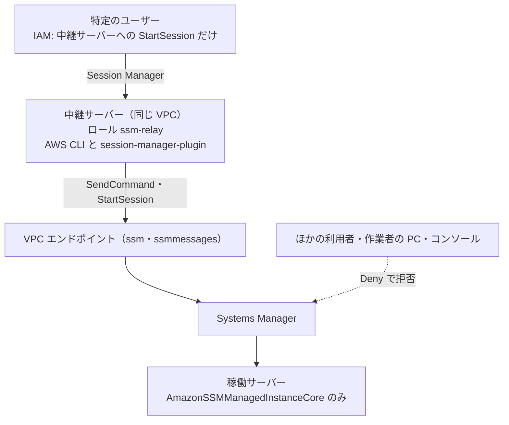

# SSM の操作を特定の中継サーバーからだけに絞る IAM の設定

> 位置付け: 検討と設定の下書き。採用済みの設計ではない。稼働サーバーで SSM Agent が動いている前提で、Run Command と Session Manager の操作を、同じ VPC にある特定の中継サーバーからだけに絞る設定と、特定のユーザーだけが中継サーバー経由で稼働サーバーに入れるようにする設定をまとめる。
>
> 確かめた範囲: AWS の仕様は AWS のドキュメントと照らし合わせた（2026-11-10）。**どのポリシーも AWS の環境では試していない**。特に `ssm:StartSession` に `aws:SourceVpce` の条件が効くことは、AWS のドキュメントの例が `ssm:SendCommand` だけなので、確かめていない。SSM のアクションごとのリソースの種類の一覧（Service Authorization Reference）は取得できず、リソースの指定は Run Command と Session Manager のドキュメントの例に合わせた。
>
> 値の例: リージョン `ap-northeast-1`、アカウント `111122223333`、中継サーバーの IAM ロール `ssm-relay`、中継サーバーの ID `i-0relay0000000000a`、プライベート IP `10.0.1.10`、VPC エンドポイント `vpce-0123456789abcdef0`。
>
> 作成日: 2026-11-10

## 用語

| 用語 | 指すもの |
|---|---|
| 稼働サーバー | 中継サーバーから Run Command・Session Manager で操作する、本番のサーバー。タグ `SsmAccess=relay` を付ける |
| 中継サーバー | 稼働サーバーへの SSM の操作を実行する、同じ VPC の特定のサーバー。IAM ロール `ssm-relay` を付ける |
| 作業者の PC | 作業者の手元の PC。今の `ssm-setup` などの道具を動かしている場所 |

## 結論

- **中継サーバーからだけに絞ることは可能**。ただし、`aws:SourceVpce` だけでは「その VPC エンドポイントを通った」ことしか分からず、**同じ VPC のほかのサーバーと区別できない**。IAM のロールと、中継サーバーのプライベート IP の条件を組み合わせる。
- **特定のユーザーだけが中継サーバー経由で入る形も可能**。ただし、提示の 3 層だけでは足りない。中継サーバーから AWS を呼ぶときに AWS が見るのは**中継サーバーのロール**で、誰が操作したかは見えない。特定のユーザーに絞る場所は、「誰が中継サーバーに入れるか」になる。
- **Deny は `ssm:*` にしない**。稼働サーバーの SSM Agent も `ssm:` の操作を呼ぶので、`ssm:SendCommand` と `ssm:StartSession` に絞る。
- **今の道具と作業の流れに影響する**（[影響を受けるもの](#影響を受けるもの)）。作業者の PC からの `ssm-connect-check` や port-guard の `--via ssm`、コンソールからの操作は止まる。

## 提示の 3 層の確認

| # | 提示の内容 | 判定 | 補足 |
|---|---|---|---|
| 1 | 中継サーバーのロールに、VPC エンドポイント条件付きで `ssm:SendCommand`・`ssm:StartSession` を Allow | 正しい。足すものがある | Run Command のドキュメントは、`ssm:SendCommand` にグローバル条件キーを使うときは `aws:ViaAWSService` を `true` にした文も含めるよう求めている。操作できる稼働サーバーと SSM ドキュメントも絞る |
| 2 | 稼働サーバーのロールは `AmazonSSMManagedInstanceCore` のみ | 正しい | このポリシーに `ssm:SendCommand` と `ssm:StartSession` は含まれない。ただし、すでに別のロールが付いている台は、そのロールの内容を確かめる（`ssm-role` は既存のロールを変えない） |
| 3 | 指定の VPC エンドポイント以外からの SSM 操作を Deny | **このままでは不足があり、危険** | 下の表 |

3 の注意点は次のとおり。

| 問題 | 内容 | 対応 |
|---|---|---|
| エンドポイントの条件は中継サーバーを特定しない | 同じ VPC のサーバーが同じエンドポイントを使えば条件を満たす | `aws:PrincipalArn` で中継サーバーのロールに絞る |
| `ssm:*` を Deny すると SSM Agent が止まる | 稼働サーバーが別の経路で SSM を呼ぶと、`ssm:UpdateInstanceInformation` などが拒否される | `ssm:SendCommand`・`ssm:StartSession` だけを Deny する |
| AWS のサービスからの呼び出しが止まる | サービスが利用者の認証情報で呼ぶときは、元の VPC エンドポイントの情報が引き継がれない | Deny に `aws:ViaAWSService` が `false` の条件を足す |
| SCP の効かない範囲がある | 管理アカウントと、サービスリンクロールには効かない。SCP は AWS Organizations で「すべての機能」が有効なときだけ使える | 稼働サーバーと中継サーバーのある AWS アカウントが、メンバーアカウントかを確かめる |

`StringNotEquals` は、キーがリクエストにないときは条件が真になる。VPC エンドポイントを通らない要求には `aws:SourceVpce` がないので、次の Deny は正しく効く。`StringNotEqualsIfExists` にしても同じく Deny になる。

## 全体の形



## 設定

### 1. VPC エンドポイント

中継サーバーの VPC に、インターフェイス型の `com.amazonaws.ap-northeast-1.ssm` を作る。Session Manager を中継サーバーから使うなら `com.amazonaws.ap-northeast-1.ssmmessages` も要る。

| 設定 | 内容 | 注意 |
|---|---|---|
| プライベート DNS を有効にする（既定の案） | VPC の中で `ssm.ap-northeast-1.amazonaws.com` がエンドポイントのアドレスになる | **VPC の全部のサーバーの SSM Agent もこのエンドポイントを使う**。エンドポイントのセキュリティグループは、稼働サーバーからの 443 番も許可する。中継サーバーだけに絞ると SSM Agent がつながらなくなる |
| プライベート DNS を無効にする（別案） | 中継サーバーだけが `--endpoint-url` でエンドポイントを指定する。セキュリティグループは中継サーバーからだけにできる | 道具の AWS CLI の呼び出しに指定を足す必要がある。稼働サーバーの SSM Agent は今までの経路のまま |

### 2. 中継サーバーのロール

`ssm-relay` に、次のポリシーと `AmazonSSMManagedInstanceCore` を付ける（`AmazonSSMManagedInstanceCore` は、ユーザーが Session Manager で中継サーバーに入るために要る）。

稼働サーバーにタグ `SsmAccess=relay` を付けておく前提である。

```json
{
  "Version": "2012-10-17",
  "Statement": [
    {
      "Sid": "SendCommandToTaggedInstances",
      "Effect": "Allow",
      "Action": "ssm:SendCommand",
      "Resource": "arn:aws:ec2:ap-northeast-1:111122223333:instance/*",
      "Condition": {
        "StringEquals": {
          "aws:SourceVpce": "vpce-0123456789abcdef0",
          "ssm:resourceTag/SsmAccess": "relay"
        },
        "IpAddress": { "aws:VpcSourceIp": "10.0.1.10/32" }
      }
    },
    {
      "Sid": "SendCommandDocument",
      "Effect": "Allow",
      "Action": "ssm:SendCommand",
      "Resource": "arn:aws:ssm:ap-northeast-1::document/AWS-RunShellScript",
      "Condition": {
        "StringEquals": { "aws:SourceVpce": "vpce-0123456789abcdef0" },
        "IpAddress": { "aws:VpcSourceIp": "10.0.1.10/32" }
      }
    },
    {
      "Sid": "SendCommandViaAwsService",
      "Effect": "Allow",
      "Action": "ssm:SendCommand",
      "Resource": [
        "arn:aws:ec2:ap-northeast-1:111122223333:instance/*",
        "arn:aws:ssm:ap-northeast-1::document/AWS-RunShellScript"
      ],
      "Condition": { "Bool": { "aws:ViaAWSService": "true" } }
    },
    {
      "Sid": "ReadCommandResults",
      "Effect": "Allow",
      "Action": [
        "ssm:GetCommandInvocation",
        "ssm:ListCommandInvocations",
        "ssm:ListCommands",
        "ssm:DescribeInstanceInformation"
      ],
      "Resource": "*",
      "Condition": {
        "StringEquals": { "aws:SourceVpce": "vpce-0123456789abcdef0" }
      }
    },
    {
      "Sid": "StartSessionToTaggedInstances",
      "Effect": "Allow",
      "Action": "ssm:StartSession",
      "Resource": "arn:aws:ec2:ap-northeast-1:111122223333:instance/*",
      "Condition": {
        "StringEquals": {
          "aws:SourceVpce": "vpce-0123456789abcdef0",
          "ssm:resourceTag/SsmAccess": "relay"
        },
        "IpAddress": { "aws:VpcSourceIp": "10.0.1.10/32" }
      }
    },
    {
      "Sid": "StartSessionDocuments",
      "Effect": "Allow",
      "Action": "ssm:StartSession",
      "Resource": [
        "arn:aws:ssm:ap-northeast-1:111122223333:document/SSM-SessionManagerRunShell",
        "arn:aws:ssm:ap-northeast-1::document/AWS-StartNonInteractiveCommand"
      ]
    },
    {
      "Sid": "ManageOwnSessions",
      "Effect": "Allow",
      "Action": [
        "ssm:TerminateSession",
        "ssm:ResumeSession",
        "ssmmessages:OpenDataChannel"
      ],
      "Resource": "arn:aws:ssm:*:*:session/*",
      "Condition": {
        "StringEquals": {
          "ssm:resourceTag/aws:ssmmessages:session-id": "${aws:userid}"
        }
      }
    }
  ]
}
```

| 項目 | 内容 |
|---|---|
| `aws:VpcSourceIp` | VPC エンドポイントを通った要求の送り元のプライベート IP。`aws:SourceVpce` などと必ず組み合わせる。**これで同じ VPC のほかのサーバーと区別できる**。中継サーバーを作り直して IP が変わったら直す |
| `ReadCommandResults` | `ssm-connect-check`・port-guard が使う結果の確認 |
| `AWS-StartNonInteractiveCommand` | `ssm-connect-check` の既定の `--via session` が使う |

`iam:PassRole` で `ssm-relay` をほかのインスタンスに付けられる人がいないことも確かめる。

#### CloudFormation で作る

今の中継サーバーには IAM ロールが付いていないので、新しく作って関連付ける。ロール、上のポリシー、`AmazonSSMManagedInstanceCore`、インスタンスプロファイルは [cloudformation/relay-role.yml](./cloudformation/relay-role.yml) で定義している。**AWS ではまだデプロイしていない**（`cfn-lint` と、上のポリシーとの突き合わせだけを確かめた）。

CloudFormation のスタックの外にある既存のインスタンスには、インスタンスプロファイルを定義で関連付けられないので、関連付けは AWS CLI で行う。SCP の Deny と VPC エンドポイントは、このスタックに含めない（VPC エンドポイントは先に作っておく）。

```bash
# スタックの作成（変更セットを確認してから反映する）
aws cloudformation deploy --region ap-northeast-1 --no-execute-changeset \
  --template-file ssm-setup/cloudformation/relay-role.yml \
  --stack-name ssm-relay-role \
  --capabilities CAPABILITY_NAMED_IAM \
  --parameter-overrides VpcEndpointId=vpce-0123456789abcdef0 RelayPrivateIp=10.0.1.10

# 中継サーバーへの関連付け（再起動は要らない）
aws ec2 associate-iam-instance-profile --region ap-northeast-1 \
  --instance-id i-0relay0000000000a \
  --iam-instance-profile Name=ssm-relay
```

稼働サーバーに付けるタグの値は `TargetTagValue`（既定 `relay`）で変えられる。タグのキー `SsmAccess` はポリシーの条件キーの名前なので、テンプレートに固定で書いている。

関連付けると、**中継サーバーにログインできる人全員がこのロールを使える**。先に、誰が中継サーバーに入れるかと、IMDS へのアクセスの制限を確かめる（[特定のユーザーに絞る方法](#特定のユーザーに絞る方法)）。

### 3. 稼働サーバーのロール

`AmazonSSMManagedInstanceCore` だけを付ける。`ssm-setup` の `ssm-role` が関連付けるものと同じで、追加の設定はない。

### 4. Deny（SCP）

中継サーバーのロール以外からの操作を止める。SCP は許可を与えないので、2 の Allow と組み合わせて使う。

```json
{
  "Version": "2012-10-17",
  "Statement": [
    {
      "Sid": "DenySendCommandExceptRelay",
      "Effect": "Deny",
      "Action": "ssm:SendCommand",
      "Resource": "*",
      "Condition": {
        "ArnNotEquals": {
          "aws:PrincipalArn": [
            "arn:aws:iam::111122223333:role/ssm-relay",
            "arn:aws:iam::111122223333:role/break-glass-admin",
            "arn:aws:iam::111122223333:role/<AMI 公開パイプラインの CodeBuild のロール>"
          ]
        },
        "Bool": { "aws:ViaAWSService": "false" }
      }
    },
    {
      "Sid": "DenyStartSessionExceptRelay",
      "Effect": "Deny",
      "Action": "ssm:StartSession",
      "NotResource": [
        "arn:aws:ec2:ap-northeast-1:111122223333:instance/i-0relay0000000000a",
        "arn:aws:ssm:*:*:document/*"
      ],
      "Condition": {
        "ArnNotEquals": {
          "aws:PrincipalArn": [
            "arn:aws:iam::111122223333:role/ssm-relay",
            "arn:aws:iam::111122223333:role/break-glass-admin"
          ]
        },
        "Bool": { "aws:ViaAWSService": "false" }
      }
    },
    {
      "Sid": "DenyRelayRoleOutsideEndpoint",
      "Effect": "Deny",
      "Action": [
        "ssm:SendCommand",
        "ssm:StartSession"
      ],
      "Resource": "*",
      "Condition": {
        "ArnEquals": {
          "aws:PrincipalArn": "arn:aws:iam::111122223333:role/ssm-relay"
        },
        "StringNotEquals": {
          "aws:SourceVpce": "vpce-0123456789abcdef0"
        },
        "Bool": { "aws:ViaAWSService": "false" }
      }
    }
  ]
}
```

| 文 | 役割 |
|---|---|
| `DenySendCommandExceptRelay` | 中継サーバーのロールと例外のロール以外の Run Command を止める |
| `DenyStartSessionExceptRelay` | 中継サーバー以外への Session Manager を止める。ユーザーが中継サーバーへ入る分は `NotResource` で残す |
| `DenyRelayRoleOutsideEndpoint` | 中継サーバーのロールの認証情報が持ち出されても、エンドポイントの外からは使えなくする |

`break-glass-admin` は、中継サーバーが壊れたときに入るための例外である。使う人と手順を決めておく。

**Organizations を使っていない場合**は、同じ内容の Deny を、IAM のユーザーやグループ、ロールに付ける。アカウント全体の強制にはならず、付け忘れや、管理者による取り外しは防げない。

#### Deny を付けない場合

Deny を付けなくても、中継サーバーからの経路は使えるようになる。**今 SSM の権限を持っている人やロールは、今までどおり外部からも操作できる**。外部から誰でも操作できるようになるわけではない。

| 操作する主体 | Deny なし | Deny あり |
|---|---|---|
| 中継サーバーのロール（中継サーバーから） | 使える | 使える |
| 中継サーバーのロールの認証情報を外へ持ち出して使う | 使えない（2 の Allow の条件が VPC エンドポイントと中継サーバーの IP に限っているため） | 使えない |
| 5 のポリシーだけを持つユーザーが稼働サーバーへ直接入る | 入れない（許可がないため） | 入れない |
| すでに `ssm:SendCommand` などの権限を持つ人（管理者、作業者の PC の AWS CLI、コンソール） | **今までどおり操作できる** | 止まる |
| 今後、誤って広い権限を付けられた人 | **操作できる** | 止まる |

Deny の役割は、「中継サーバー以外から操作できない」ことを、ほかのポリシーの内容に関係なく保証することである。付けなければこの保証がなくなるだけで、[影響を受けるもの](#影響を受けるもの)に挙げた作業者の PC の道具、コンソール、CodeBuild のヘルスチェックは今までどおり動く。

Deny なしで外部からの操作を減らしたいときは、該当する人やロールから `ssm:SendCommand` と `ssm:StartSession` の許可を外す。

中継サーバーにログインできる人が、中継サーバーのロールを使えることは、Deny の有無に関係しない（[特定のユーザーに絞る方法](#特定のユーザーに絞る方法)）。

### 5. 特定のユーザーの設定

ユーザーには、**中継サーバーへの `ssm:StartSession` だけ**を許可する。稼働サーバーへの権限は与えない。

```json
{
  "Version": "2012-10-17",
  "Statement": [
    {
      "Sid": "StartSessionToRelayOnly",
      "Effect": "Allow",
      "Action": "ssm:StartSession",
      "Resource": [
        "arn:aws:ec2:ap-northeast-1:111122223333:instance/i-0relay0000000000a",
        "arn:aws:ssm:ap-northeast-1:111122223333:document/SSM-SessionManagerRunShell"
      ]
    },
    {
      "Sid": "ManageOwnSessions",
      "Effect": "Allow",
      "Action": [
        "ssm:TerminateSession",
        "ssm:ResumeSession",
        "ssmmessages:OpenDataChannel"
      ],
      "Resource": "arn:aws:ssm:*:*:session/*",
      "Condition": {
        "StringEquals": {
          "ssm:resourceTag/aws:ssmmessages:session-id": "${aws:userid}"
        }
      }
    }
  ]
}
```

## 特定のユーザーに絞る方法

| | 案 A: 中継サーバーへ入れる人を絞る（勧める） | 案 B: 各自の認証情報を中継サーバーで使う |
|---|---|---|
| 仕組み | 上の 5 のポリシーを持つ人だけが中継サーバーへ入れる。入った後は共通のロール `ssm-relay` を使う | 各自の IAM の認証情報を中継サーバーで使い、各自のポリシーに `aws:SourceVpce` と `aws:VpcSourceIp` の条件を付ける |
| 稼働サーバーごとに人を分ける | **できない**（中継サーバーに入れる人は同じ権限） | できる |
| CloudTrail に残る名前 | `ssm-relay`（誰が操作したかは Session Manager のログで追う） | 各自の名前 |
| 認証情報の置き場所 | なし（インスタンスのロール） | 中継サーバーに各自の認証情報が要る |
| 追加の設定 | 下の表 | 4 の Deny の例外に各自の ARN を足す |

案 A では、中継サーバーの中で次を設定する。

| 設定 | 理由 |
|---|---|
| `ssm-user` の sudo を外す | Session Manager の既定の `ssm-user` は sudo ができる。root になれると、下の制限を外せる |
| Run As で各自の OS ユーザーにする | IAM のユーザーやロールにタグ `SSMSessionRunAs=<OS ユーザー>` を付ける。誰がどの OS ユーザーで入ったかが分かれる |
| IMDS へのアクセスを絞る | iptables の `owner` で、ロールの認証情報を読める OS ユーザーを限る。`owner` のグループの指定は、そのユーザーの主グループにしか効かない |

## 影響を受けるもの

Deny を入れる前に、次を確かめる。

| 影響を受けるもの | 影響 | 対応 |
|---|---|---|
| `ssm-setup` の `ssm-connect-check`（作業者の PC） | 止まる | 中継サーバーから動かす |
| `port-guard-rollout`・`al2-update` の Run Command（作業者の PC） | 止まる | 中継サーバーから動かす |
| AWS のコンソールの Run Command・Session Manager | 止まる（中継サーバーへのセッションを除く） | 中継サーバーを使う |
| AMI 公開パイプラインのヘルスチェック（CodeBuild の `ssm:SendCommand`） | **止まる** | 上の Deny の例外に CodeBuild のロールを入れる |
| 踏み台サーバーの今の前提 | [手順](./bastion-commands.md)は「踏み台サーバーに AWS の認証情報を置かない」前提 | 中継サーバーを今の踏み台サーバーと兼ねるなら、この前提が変わる。別のサーバーにするかを決める |
| `ssm-check` など読み取りのコマンド | 影響なし | Deny の対象外 |
| 中継サーバーで動かす道具 | AWS CLI、Session Manager を使うなら session-manager-plugin が要る | 中継サーバーに入れる |

## 入れる順番

| # | 作業 | 確かめること |
|---|---|---|
| 1 | VPC エンドポイントを作る | 稼働サーバーが `Online` のままであること（プライベート DNS を有効にするとき） |
| 2 | 中継サーバーに `ssm-relay` を付ける | 中継サーバーから `send-command` が成功すること |
| 3 | 稼働サーバーにタグを付ける | タグのない台に `send-command` すると拒否されること |
| 4 | ユーザーのポリシーを付ける | ユーザーが中継サーバーに入れること |
| 5 | Deny を**試験用の OU のアカウント**で確かめる | 下の表 |
| 6 | Deny を本番のアカウントに付ける | 元に戻すときは SCP を外す |

| 確認 | 期待 |
|---|---|
| 中継サーバーから `send-command`（タグあり） | 成功 |
| 作業者の PC から `send-command` | `AccessDenied` |
| 同じ VPC の別のサーバーから `send-command` | `AccessDenied` |
| ユーザーが稼働サーバーへ直接 `start-session` | `AccessDenied` |
| ユーザーが中継サーバーへ `start-session` | 成功 |
| 稼働サーバーの SSM の状態 | `Online` のまま |
| AMI 公開パイプラインのヘルスチェック | 成功 |
| 例外のロールで `send-command` | 成功 |

## 決めること

| # | 論点 |
|---|---|
| R1 | 中継サーバーを今の踏み台サーバーと兼ねるか |
| R2 | 案 A か案 B か（誰が操作したかを CloudTrail で分ける必要があるか） |
| R3 | AWS Organizations の SCP を使えるか（稼働サーバーと中継サーバーのある AWS アカウントがメンバーアカウントか） |
| R4 | VPC エンドポイントのプライベート DNS を有効にするか |
| R5 | 作業者の PC からの道具の実行をやめて、中継サーバーへ移せるか |
| R6 | 例外のロール（`break-glass-admin`）の使い方 |

## 参考

AWS のドキュメントと照らし合わせた（2026-11-10）。

- [AmazonSSMManagedInstanceCore](https://docs.aws.amazon.com/aws-managed-policy/latest/reference/AmazonSSMManagedInstanceCore.html)
- [Setting up Run Command（`aws:ViaAWSService`、タグでの制限）](https://docs.aws.amazon.com/systems-manager/latest/userguide/run-command-setting-up.html)
- [Sample IAM policies for Session Manager](https://docs.aws.amazon.com/systems-manager/latest/userguide/getting-started-restrict-access-quickstart.html)
- [Improve the security of EC2 instances by using VPC endpoints for Systems Manager](https://docs.aws.amazon.com/systems-manager/latest/userguide/setup-create-vpc.html)
- [AWS global condition context keys](https://docs.aws.amazon.com/IAM/latest/UserGuide/reference_policies_condition-keys.html)
- [IAM JSON policy elements: Condition operators](https://docs.aws.amazon.com/IAM/latest/UserGuide/reference_policies_elements_condition_operators.html)
- [Service control policies (SCPs)](https://docs.aws.amazon.com/organizations/latest/userguide/orgs_manage_policies_scps.html)
- [Control access to VPC endpoints using endpoint policies](https://docs.aws.amazon.com/vpc/latest/privatelink/vpc-endpoints-access.html)
- [Turn on Run As support for Linux and macOS managed nodes](https://docs.aws.amazon.com/systems-manager/latest/userguide/session-preferences-run-as.html)
- [Turn on or turn off ssm-user account administrative permissions](https://docs.aws.amazon.com/systems-manager/latest/userguide/session-manager-getting-started-ssm-user-permissions.html)
- [Limit access to the Instance Metadata Service](https://docs.aws.amazon.com/AWSEC2/latest/UserGuide/instance-metadata-limiting-access.html)
