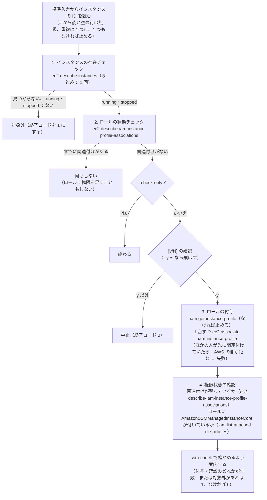
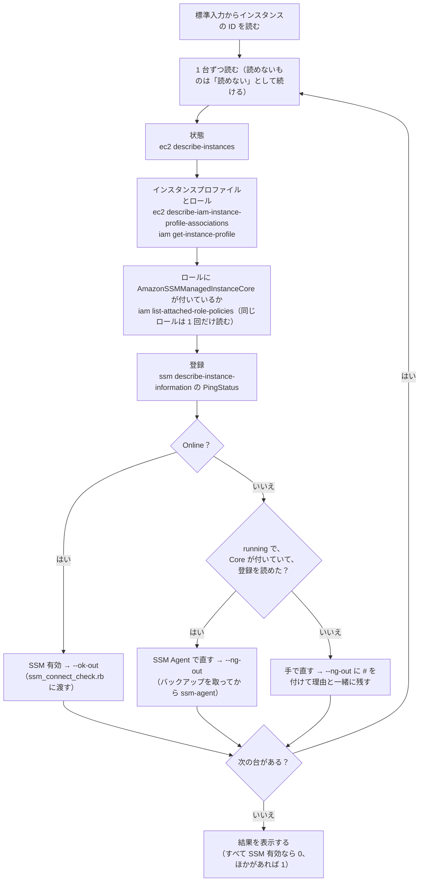
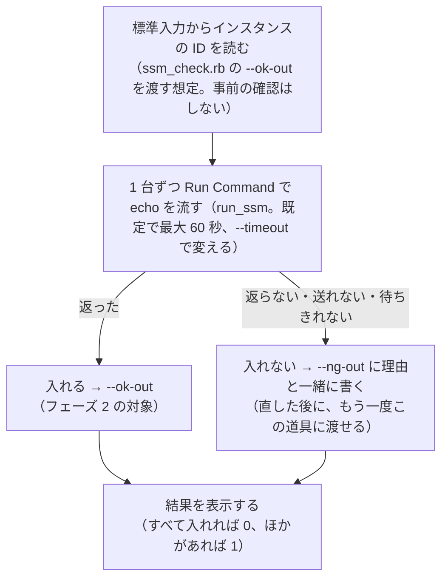
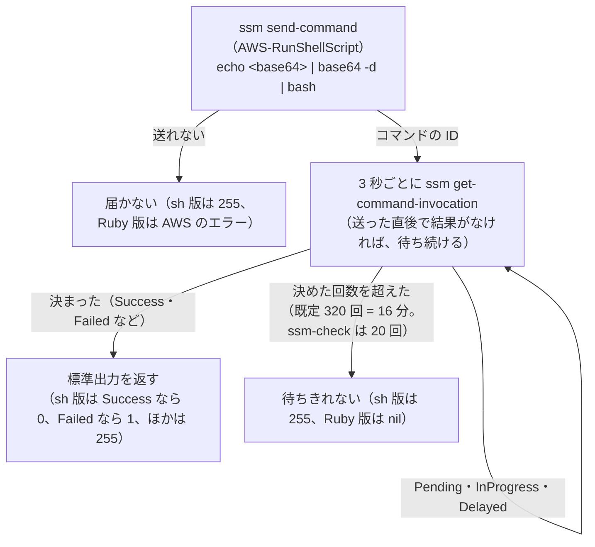

# ssm-role・ssm-check の処理の流れ（sh 版・Ruby 版）

`ssm-role` と `ssm-check` を、機能を絞って sh と Ruby で書き直した版の処理の流れ。sh 版はそれぞれ 50 行以内。Ruby 版は rubocop の既定の書き方に合わせたので 50 行を超える（`ssm_role.rb` 130 行、`ssm_check.rb` 138 行、`ssm_connect_check.rb` 69 行、`lib.rb` 67 行）。各スクリプトは 1 つのクラスで、流れの大枠を公開のメソッドとして上に並べ、ヘルパは `private` の下に分けている（`lib.rb` の内部の補助も `private_class_method` で外から呼べない）。作業の手順（どの順にコマンドを使うか）は [手順](./steps.md) が正本で、ここは 1 つのコマンドの中で何をしているかを書く。

> 状態: 書いただけ（構文の確認だけ済み）。実際の AWS ではまだ動かしていない。Python 版（`python3 -m ssm_setup ssm-role` / `ssm-check` / `ssm-connect-check`）も、おおまかな流れを Ruby 版に合わせている。どれを使うかは決めていない。

## ファイル

| ファイル | 内容 |
|---|---|
| `sh/ssm-role.sh`・`rb/ssm_role.rb` | IAM ロールが未設定のインスタンスに、SSM 用のインスタンスプロファイルを関連付ける |
| `sh/ssm-check.sh` | SSM で入れるかを確かめ、「入れる」「SSM Agent で直す」「手で直す」に分けて、一覧を書き出す（`Online` の台にだけ `echo` を流す） |
| `rb/ssm_check.rb` | 権限と、AWS の上のインスタンスの状態が SSM を使える形かを確かめ、「SSM 有効」「SSM Agent で直す」「手で直す」に分ける（インスタンスには何も送らない） |
| `rb/ssm_connect_check.rb` | 実際に入れるかを、Run Command の `echo` で確かめる（事前の確認はしない） |
| `rb/Gemfile`・`rb/.rubocop.yml` | 書き方の確認の rubocop だけを入れる（道具は標準のライブラリだけで動く）。設定は既定のまま、確かめる版を Ruby 2.6 にしているだけ |
| `sh/lib.sh`・`rb/lib.rb` | 共通の部品。標準入力からのインスタンスの ID の読み込み（`read_ids`）、端末での確認（`ask`）、Run Command での実行（`run_ssm`）。`lib.rb` は AWS CLI を呼んで JSON を読む `aws` も持つ。`sh/lib.sh` は port-guard-rollout の `sh/lib.sh` の写し |

使い方は、どちらも Python 版と同じ形にしている。

```bash
cd ssm-setup
sh/ssm-role.sh [--instance-profile port-guard-ssm] [--check-only] [--yes] < instance-ids.txt
sh/ssm-check.sh --ok-out ok.txt --ng-out ng.txt < instance-ids.txt
ruby rb/ssm_role.rb [--instance-profile port-guard-ssm] [--check-only] [--yes] < instance-ids.txt
ruby rb/ssm_check.rb --ok-out enabled.txt --ng-out ng.txt < instance-ids.txt
ruby rb/ssm_connect_check.rb --ok-out ok.txt --ng-out connect-ng.txt < enabled.txt

# Ruby 版の書き方の確認（rubocop を入れるのは初回だけ）
cd rb && bundle install && bundle exec rubocop
```

| 前提 | 内容 |
|---|---|
| 作業者の PC | AWS CLI（v2）。sh 版は bash（macOS の bash 3.2 でも動く書き方）。Ruby 版は Ruby 2.6 以上（macOS に入っている Ruby でもよい）、標準のライブラリだけ |
| 認証情報・リージョン | AWS CLI の設定をそのまま使う（`AWS_PROFILE`・`AWS_REGION` など。`--profile` の指定はない） |
| 接続の確かめ方 | Run Command だけ（Session Manager での確認は外した。session-manager-plugin も、macOS にない `timeout` も要らない） |

## ssm-role

流れは「インスタンスの存在チェック → ロールの状態チェック → ロールの付与 → 権限状態の確認」の 4 段（Ruby 版は、この 4 段がそのまま `SsmRole#run` から呼ぶ公開のメソッド `check_instances_exist`・`check_role_state`・`attach_role`・`verify_permissions` になっていて、ヘルパは `private` の下に分けている）。インスタンスプロファイルは道具では作らない（なければ止まる）。SSM に登録される（`Online`）のは待たないので、少し時間を置いてから `ssm-check` で確かめる。

> Python 版（`python3 -m ssm_setup ssm-role`）も同じ 4 段（1・2 を plan、3 を apply、4 を finish で行う）。sh 版（`sh/ssm-role.sh`）は、まだ 4 段目（権限状態の確認）がなく、インスタンスプロファイルがあるかを最初に確かめる形のまま。



## ssm-check と ssm_connect_check（Ruby 版は 2 つに分けている）

Ruby 版は、確かめることを 2 つのスクリプトに分けている。

| スクリプト | 確かめること | インスタンスに送るもの |
|---|---|---|
| `rb/ssm_check.rb` | 権限と、AWS の上のインスタンスの状態が SSM を使える形か（状態、インスタンスプロファイルのロール、そのロールの AmazonSSMManagedInstanceCore、登録の `Online`） | なし |
| `rb/ssm_connect_check.rb` | 実際に入れるか（Run Command で `echo` を 1 回流して、返るか）。**事前の確認はしない**（`ssm_check.rb` の `--ok-out` の一覧を渡す想定） | `echo` だけ |

```bash
ruby rb/ssm_check.rb --ok-out enabled.txt --ng-out ng.txt < instance-ids.txt   # SSM 有効か（AWS の上の情報だけ）
ruby rb/ssm_connect_check.rb --ok-out ok.txt --ng-out connect-ng.txt < enabled.txt   # 実際に入れるか
```

> Python 版も同じ分け方（`python3 -m ssm_setup ssm-check` と `ssm-connect-check`。実接続の確かめ方は Session Manager（既定）か Run Command を `--via` で選べる）。sh 版（`sh/ssm-check.sh`）は、まだ 1 つのコマンドで両方を確かめる形のまま（`Online` の台にだけ `echo` を流す）。

### rb/ssm_check.rb（SSM 有効かの確認）



「手で直す」の理由は、次の順に最初に当てはまったものを出す。

| 順 | 当てはまるとき | 理由（見るところ） |
|---|---|---|
| 1 | 状態が `running` でない | 状態が running でない |
| 2 | 登録を読めない | 作業者の権限 `ssm:DescribeInstanceInformation` |
| 3 | インスタンスプロファイルかロールがない | `ssm-role` を見直す |
| 4 | ロールに `AmazonSSMManagedInstanceCore` が付いていない、または読めない | すでにあるロールなら、手で足すかを決める |

### rb/ssm_connect_check.rb（実接続の確認）



入れないときに見るところ: ssmmessages・ec2messages への送信の 443 番、作業者の権限（`ssm:SendCommand`）、SSM Agent の版。

## 共通の部品の Run Command（run_ssm）

`ssm-check`（Ruby 版は `ssm_connect_check.rb`）の `echo` で使う（port-guard-rollout の `sh/install.sh`・`sh/enable.sh` も同じものを使う）。スクリプトは base64 にして 1 行のコマンドとして送る（引用符や改行で壊れないように）。



## Python 版との違い

| 項目 | Python 版 | sh 版・Ruby 版 |
|---|---|---|
| 接続の確かめ方 | Session Manager（既定）か Run Command | Run Command だけ |
| `ssm-role` の読み方 | まとめて 1 回 | sh 版は 1 台ずつ、Ruby 版はまとめて 1 回（AWS のフィルターの値は 200 個まで） |
| `ssm-role` の権限状態の確認（付与した後に、ロールに AmazonSSMManagedInstanceCore が付いているか） | ある | Ruby 版はある。sh 版はない |
| 確認の分け方 | `ssm-check`（権限と AWS の上の状態）と `ssm-connect-check`（実接続）に分けている | Ruby 版は同じに分けている。sh 版は 1 つのまま |
| 表示 | 3 つに分けて見出しをつけて表示し、台ごとに詳しく出す | 1 台を 1〜2 行で出す |
| `--profile`・`--region` | ある | ない（AWS CLI の設定・環境変数で渡す） |
| テスト | `py/tests/`（AWS に接続しない偽物） | まだない（構文の確認だけ） |
