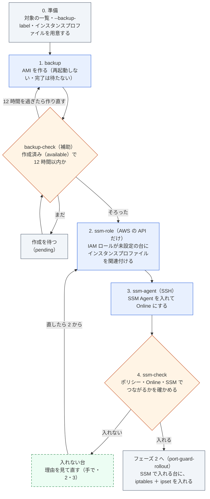
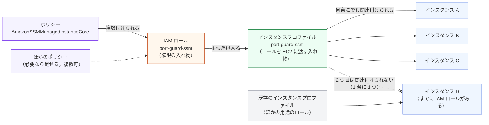

# 手順: SSM を使えるようにする（フェーズ 1）

> 位置付け: `ssm-setup` を使った作業の手順の**正本**。80・443 番を国内だけに絞る作業（フェーズ 2）の手順は [port-guard-rollout の手順](../port-guard-rollout/steps.md)。もとは port-guard-rollout の手順の中にあった SSM の部分（IAM ロールの関連付け、SSM Agent の導入、SSM で入れるかの確認）を、フェーズを分けるためにここに移した。
>
> 更新日: 2026-10-29

## フェーズの分け方

| フェーズ | フォルダ | 行うこと | インスタンスへの入り方 |
|---|---|---|---|
| **1. SSM の有効化（この手順）** | `ssm-setup/` | IAM ロール（インスタンスプロファイル）の関連付け、SSM Agent の導入、SSM で入れるかの確認 | AWS の API と SSH（SSM Agent の導入だけ） |
| 2. 国内だけに絞る設定の導入 | [`port-guard-rollout/`](../port-guard-rollout/README.md) | iptables ＋ ipset の導入と、遮断の有効化 | SSM（`--via ssm`）。SSH も使える |

フェーズ 2 は、このフェーズの最後の `ssm-check` で「入れる」になった台を対象にする。2 つのフェーズは、別の日に、別の作業として行える。

- **バックアップはフェーズごとに取る**。AMI のタグ `Purpose` で分けている（このフェーズは `ssm-setup-backup`、フェーズ 2 は `port-guard-rollout-backup`）。それぞれのフェーズの道具は、自分のフェーズのバックアップだけを確かめる
- 道具も別にしている（`python3 -m ssm_setup` と `python3 -m port_guard_rollout`）。AWS CLI の呼び出しや SSH などの共通の部品は、それぞれのフォルダに写して持つ

## 流れ



青: 道具のコマンド、橙: 確認（道具）、緑の破線: 作業者が手で行う、灰: 準備・待ち・次のフェーズ。バックアップを操作の前に確かめるのは `ssm-agent` だけ（インスタンスの中を変えるため。台ごと、操作の直前にも）。`ssm-role` はインスタンスプロファイルを関連付けるだけ（OS のディスクを変えない）、`ssm-check` は確かめるだけなので、バックアップを確かめない。どの手順も、OS の再起動は要らない。

SVG 版: [SSM の有効化の流れ](images/flow-ssm-setup.svg)（`python3 images/make_flow_svg.py images` で作り直す）

## 共通の使い方

コマンドは `ssm-setup/` で実行する。

```bash
cd ssm-setup
python3 -m ssm_setup --help
python3 -m ssm_setup <コマンド> --help
```

### 入力

対象は標準入力から 1 行に 1 台で渡す。形は `<インスタンスの ID> [<SSH の接続先>]`。空の行と `#` から後は無視し、同じインスタンスの ID は最初の行だけを使う。SSH の接続先を使うのは `ssm-agent` だけ（ほかのコマンドは 2 列目を無視する）。

```
i-0123456789abcdef0                # 接続先は AWS CLI で引く（既定はパブリック IP。--address private でプライベート IP）
i-0fedcba9876543210  10.0.1.23     # 接続先を直接書く（host、host:port、user@host:port）
```

### 確認の形

`backup`・`ssm-role`・`ssm-agent` は、次の順に進む。

1. 全台を確かめる（読み取りだけ）
2. 操作できるものと、できないもの（理由つき）を分けて表示する
3. 試行するかを確かめる。答えは端末（`/dev/tty`）から読む（標準入力は対象の一覧に使うため）。端末がない環境では `--yes` を付けないと止まる
4. 1 台ずつ順に行う

`--check-only` を付けると、1・2 だけを行う。`backup-check` と `ssm-check` は確かめるだけのコマンドなので、試行の確認はない。

### バックアップの確認

`ssm-agent` は、`--backup-label`（`backup` で指定したバックアップ作業のタイミング）が要る。インスタンスごとに、次の 3 つがそろった AMI があるときだけ操作する。一覧を出す前と、各インスタンスを操作する直前の 2 回確かめる。

| 条件 | 内容 |
|---|---|
| タイミングが一致 | AMI のタグ `BackupLabel` が、指定した値と同じ（`Purpose=ssm-setup-backup`、`SourceInstanceId` も一致） |
| 作成が終わっている | `State` が `available`（AMI の作成は非同期で進むので、作成中（`pending`）のものは使わない） |
| 12 時間以内 | 作成の時刻が、確かめた時点から 12 時間以内 |

同じ条件で、確かめるだけのコマンドもある（`backup-check`。読み取りだけ）。操作できるもの（AMI の ID、作成の時刻、作成から何時間たったか、期限まであと何時間か）と、操作できないもの（理由つき）を分けて表示する。

```bash
python3 -m ssm_setup backup-check --backup-label 2026-10 < instance-ids.txt
```

手元の再現の環境（AWS にない偽物のインスタンス）で試すときだけ、`--skip-backup-check` で確かめずに進められる。

### 終了コード

0: すべて成功（または中止した・確かめただけ）、1: 失敗した、または操作できないインスタンスがあった、2: 入力・確認・道具の問題。`ssm-check` は、0: すべての台に入れる、1: 入れない台がある、2: 入力・道具の問題。

### 前提と権限

作業者の PC に Python 3、AWS CLI（v2）、`ssh`（`ssm-agent`）、session-manager-plugin（`ssm-check` の既定の確かめ方）が入っていること。認証情報・プロファイル・リージョンは AWS CLI の設定と、`--profile`・`--region`。

| 手順 | 作業者の IAM に要る権限 |
|---|---|
| すべて | `ec2:DescribeInstances`、`ec2:DescribeImages`（バックアップの確認） |
| `backup` | `ec2:CreateImage`、`ec2:CreateTags` |
| `ssm-role` | `ec2:DescribeIamInstanceProfileAssociations`、`ec2:AssociateIamInstanceProfile`、`iam:GetInstanceProfile`、`iam:PassRole`（関連付けるロールだけ）、`ssm:DescribeInstanceInformation`（`--wait-online` のとき） |
| `ssm-agent` | `ssm:DescribeInstanceInformation` |
| `ssm-check` | `ec2:DescribeIamInstanceProfileAssociations`、`iam:GetInstanceProfile`、`iam:ListAttachedRolePolicies`、`iam:ListRolePolicies`、`ssm:DescribeInstanceInformation`。接続の確認に、`ssm:StartSession`（`AWS-StartNonInteractiveCommand`。既定の `--via session`）と `ssm:TerminateSession`、または `ssm:SendCommand`（`AWS-RunShellScript`）と `ssm:GetCommandInvocation`（`--via run-command`） |

## 0. 準備

| # | 作業 | 内容 |
|---|---|---|
| 0-1 | 対象の一覧 | インスタンスの ID の一覧（`ssm-agent` で使う SSH の接続先も、必要なら書く） |
| 0-2 | バックアップ作業のタイミング | `--backup-label` に使う値を決める（例 `2026-10`、`2026-10-29`） |
| 0-3 | インスタンスプロファイル | `AmazonSSMManagedInstanceCore` を付けたロールと、それを入れたインスタンスプロファイルを用意しておく（すでにあればその名前を `--instance-profile` で渡す）。なければ `ssm-role` が作るためのコマンドを表示する |
| 0-4 | 作業者の道具と権限 | Python 3、AWS CLI、`ssh`、session-manager-plugin、上の権限、SSH の鍵 |
| 0-5 | 通り道 | インスタンスから AWS の窓口（`ssm`・`ssmmessages`・`ec2messages`）へ、送信の 443 番が通ること（セキュリティグループ、ネットワーク ACL、経路）。`ssm-agent` のために、作業者の PC から SSH で入れること |
| 0-6 | 段階 | まず影響の小さい 1 台で最後まで通してから、残りに広げる |

## 1. バックアップ（`backup`）

インスタンスごとに AMI を作る（`create-image --no-reboot`。再起動しない）。**すでにバックアップがあっても、新しく作る**。作成は完了を待たない（取り始めた時点の中身が残る）。

```bash
python3 -m ssm_setup backup --backup-label 2026-10 --check-only < instance-ids.txt   # 確かめるだけ
python3 -m ssm_setup backup --backup-label 2026-10 < instance-ids.txt
```

| 項目 | 内容 |
|---|---|
| 確かめること | インスタンスがあるか、状態が `running` か `stopped` か、ルートボリュームが EBS か、AMI を作る権限があるか（`create-image --dry-run` で、実際には作らずに確かめる） |
| AMI の名前 | `<Name タグ>-<インスタンスの ID>-before-ssm-setup-<実行の ID>`。使えない文字（日本語や空白など）は `-` に置き換える。実行の ID は実行した日時（`YYYYmmdd-HHMMSS`） |
| AMI とスナップショットのタグ | `Name`、`Purpose=ssm-setup-backup`、`SourceInstanceId`、`SourceInstanceName`、`BackupRunId`、`BackupLabel`（`--backup-label` の値） |
| `--backup-label` に使える文字 | 英数字と空白・`_ . : / = + @ -`、128 文字まで |

`ssm-agent` は、AMI の作成が終わって（`available`）から、12 時間以内に行う。**作成が終わったかは `backup-check` で確かめる**（全台が「操作できる」になれば次へ進める）。

## 2. SSM 用の IAM ロールの関連付け（`ssm-role`）

SSM Agent が入っていても、インスタンスに IAM ロール（インスタンスプロファイル）がなければ SSM に登録されない（コンソールでは「IAM ロール: -」）。**IAM ロールが未設定のインスタンスにだけ**、SSM 用のインスタンスプロファイルを関連付ける。AWS の API だけで行い、SSH は使わない。関連付けは OS のディスクを変えず、再起動も要らない。

```bash
python3 -m ssm_setup ssm-role --check-only < instance-ids.txt   # 確かめるだけ
python3 -m ssm_setup ssm-role --instance-profile <用意したインスタンスプロファイル> --wait-online 300 < instance-ids.txt
```

| 段階 | 内容 |
|---|---|
| 前提 | 関連付けるインスタンスプロファイル（既定 `port-guard-ssm`。`--instance-profile` で変えられる）が、先に作ってあること。なければ、作るための AWS CLI のコマンド（ロールの作成、`AmazonSSMManagedInstanceCore` の付与、インスタンスプロファイルの作成とロールの追加）を表示して止まる。道具はインスタンスプロファイルを作らない |
| 確認（読み取りだけ） | インスタンスがあるか、状態が `running` か `stopped` か、インスタンスプロファイルが関連付けられているか |
| 分けて表示 | 「関連付ける（未設定）」「何もしない（すでに IAM ロールがある）」「対象外（理由つき）」 |
| 関連付け | 1 台ずつ順に `associate-iam-instance-profile`。直前にもう一度、関連付けられていないことを確かめる。`associated` になるのを待つ |
| 登録の確認 | `--wait-online`（既定 0 = 待たない）を付けると、SSM に登録される（`Online`）のを待つ |

IAM ロールとインスタンスプロファイルの関係:



SVG 版: [IAM ロールとインスタンスプロファイルの関係](images/iam-instance-profile.svg)（`python3 images/make_iam_svg.py images` で作り直せる）。図のロールとインスタンスプロファイルの名前は既定の `port-guard-ssm` で、用意したものの名前に読み替える。

**すでに IAM ロールがあるインスタンスには何もしない**（そのロールに `AmazonSSMManagedInstanceCore` を足すことは、この道具では行わない。必要なら別に手で行う）。1 台のインスタンスに関連付けられるインスタンスプロファイルは 1 つだけ、1 つのインスタンスプロファイルに入れられるロールも 1 つだけなので、付け替えもしない。

## 3. SSM Agent の導入（`ssm-agent`）

SSM Agent がまだないインスタンスが相手なので、**SSH** で入る。インスタンスプロファイルや IAM の権限の付与は行わない（2 の作業）。

```bash
python3 -m ssm_setup ssm-agent --backup-label 2026-10 --check-only < instance-ids.txt
python3 -m ssm_setup ssm-agent --backup-label 2026-10 --ssh-key ~/.ssh/<鍵> < instance-ids.txt
```

| 段階 | 内容 |
|---|---|
| 確認（読み取りだけ） | SSH で SSM Agent の有無・起動時の有効化・動作、インスタンスのメタデータからインスタンスプロファイルの有無とリージョン、AWS の窓口（`ssm.<リージョン>.amazonaws.com`）に届くかを見る。AWS CLI で登録の状態（`Online` など）も見る |
| 行うこと | 入っていない → **インストール**、入っているが止まっている → **有効化と起動**、動いているのに登録されていない → **起動し直し**、`Online` → 何もしない |
| 操作できない | バックアップがない、SSH で入れない、`sudo` を使えない、Amazon Linux 2 ではない、動いているがインスタンスプロファイルがない・AWS の窓口に届かない |
| 導入 | `yum install amazon-ssm-agent`（入っていなければ）→ `systemctl enable` → `systemctl restart`（認証情報を取り直させる）→ `ssm-cli get-diagnostics`（あれば） |
| 登録の確認 | すべての台を処理した後、`--wait-online`（既定 300 秒）まで、AWS の側で `Online` になるのを待つ。ならなければ、見る場所（インスタンスプロファイル、送信の 443 番、エージェントのログ）を表示する |
| SSH のオプション | `--ssh-user`（既定 `centos`）、`--ssh-key`、`--ssh-option`（`ssh -o` に渡す値）、`--address`（接続先を引くときの IP）。踏み台などは作業者の SSH の設定に書いておけばそのまま使える |

インスタンスプロファイルがない台は、入れても `Online` にならない（注意として表示する）。

## 4. SSM で入れるかの確認（`ssm-check`）

`ssm-role` と `ssm-agent` の後に、**SSM で実際に入れるか**を確かめる。設定は変えない（接続の確認でインスタンスに `echo` を流すだけ。セッションやコマンドの履歴は AWS の側に残る）。SSH は使わない。ここで「入れる」になった台が、フェーズ 2 の対象になる。

```bash
python3 -m ssm_setup ssm-check < instance-ids.txt                       # Session Manager で確かめる（既定）
python3 -m ssm_setup ssm-check --via run-command < instance-ids.txt     # Run Command で確かめる
```

| 確かめること | 内容 |
|---|---|
| 1. インスタンスプロファイル | 関連付けられているインスタンスプロファイルと、その中のロール |
| 2. ポリシー | そのロールに `AmazonSSMManagedInstanceCore` が付いているか（付いていなければ、付いているポリシーとインラインのポリシーの名前を並べる）。**参考の情報で、これだけでは不合格にしない**（独自のポリシーで足りていることがあるため） |
| 3. 登録 | SSM に登録されて `Online` か、SSM Agent のバージョン。`running` でない台、`Online` でない台は、4 を行わずに「入れない」にする |
| 4. 接続 | 害のないコマンド（`echo`）を 1 回だけ流し、返ってくるか（`--connect-timeout`、既定 60 秒） |

| `--via` | 接続の確かめ方 |
|---|---|
| `session`（既定） | Session Manager（`aws ssm start-session --document-name AWS-StartNonInteractiveCommand`）。人がログインするときと同じ経路（インスタンスの `ssmmessages` の権限、作業者の `ssm:StartSession`）を確かめられる。**作業者の PC に session-manager-plugin が要る**（なければ始める前に止まる） |
| `run-command` | Run Command（`aws ssm send-command` の `AWS-RunShellScript`）。フェーズ 2 の `install`・`enable` の `--via ssm` と同じ経路。プラグインは要らないが、Session Manager の経路は確かめられない |

結果は「入れる」（`Online` で、接続できた）と「入れない」（理由つき）に分けて表示し、`AmazonSSMManagedInstanceCore` が付いていない台の数も出す。

## 5. 片付け

| # | 作業 | 内容 |
|---|---|---|
| 5-1 | 記録 | どの台にインスタンスプロファイルを関連付けたか、SSM Agent を入れたか（`ssm-role`・`ssm-agent` の結果の表示）と、`ssm-check` の結果を残す |
| 5-2 | バックアップの片付け | 落ち着いたら、1 の AMI とスナップショットを消す（タグ `Purpose=ssm-setup-backup` と `BackupLabel` で探せる） |

## 元に戻す

| 対象 | 戻し方 |
|---|---|
| `ssm-role` の関連付け | `aws ec2 describe-iam-instance-profile-associations --filters Name=instance-id,Values=<インスタンスの ID>` で関連付けの ID を調べ、`aws ec2 disassociate-iam-instance-profile --association-id <関連付けの ID>` で外す（再起動は要らない） |
| `ssm-agent` で入れた・有効にした SSM Agent | インスタンスで `systemctl disable --now amazon-ssm-agent`。今回入れたもの（結果の表示が「今入れた」）を消すなら `yum remove amazon-ssm-agent` |
| 最後の手段 | 1 の AMI から戻す（戻すときは止まる） |

## 手元の再現の環境で試す

`ssm-agent` の SSH の部分だけは、[port-guard-rollout の `al2-instance/`](../port-guard-rollout/al2-instance/README.md) のコンテナを相手に試せる（AWS にないので `--skip-backup-check` と `--no-aws`）。`ssm-role` と `ssm-check` は AWS の API が相手なので、手元では試せない。

```bash
cd ssm-setup
O=(--skip-backup-check --ssh-key ../port-guard-rollout/al2-instance/ssh/id_ed25519 \
   --ssh-option UserKnownHostsFile=/dev/null --ssh-option StrictHostKeyChecking=no)
echo 'i-00000001 localhost:2222' | python3 -m ssm_setup ssm-agent --no-aws "${O[@]}" --yes
```
