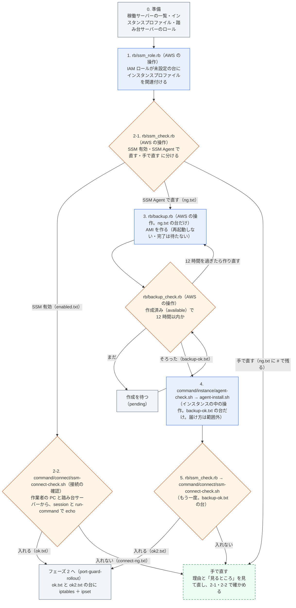
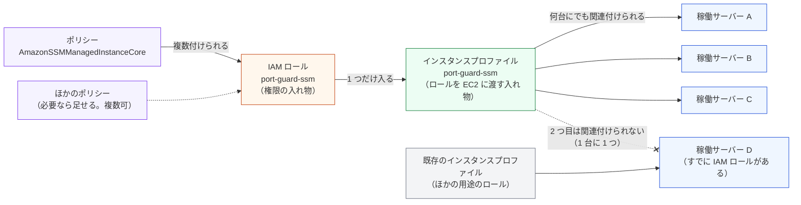

# 手順: SSM を使えるようにする（フェーズ 1）

> 位置付け: `ssm-setup` を使った作業の手順の**正本**。80・443 番を国内だけに絞る作業（フェーズ 2）の手順は [port-guard-rollout の手順](../port-guard-rollout/steps.md)。
>
> 状態: 道具は書いて、構文と書き方（rubocop・`bash -n`・`cfn-lint`）だけを確かめた。AWS でも稼働サーバーでも、まだ流していない。
>
> 更新日: 2026-11-12

## 用語

| 用語 | 指すもの |
|---|---|
| 稼働サーバー | SSM で入れる状態にしたい、運用中の EC2 インスタンス（Amazon Linux 2） |
| 作業者の PC | 作業者の手元の PC。AWS のアカウントの認証情報が有効な AWS CLI がある |
| 踏み台サーバー | 稼働サーバーと同じ環境にある EC2 インスタンス。この手順では、SSM で入れるかの確認（接続の確認）に使い、IAM ロール（インスタンスプロファイル）を付ける |
| AWS の操作 | AWS の API を呼んで、AWS の上の設定や状態を変える・読む操作。作業者の PC から Ruby の道具（`rb/`）で行う。稼働サーバーの中では何も動かさない |
| 接続の確認 | SSM（Session Manager と Run Command）で稼働サーバーに `echo` を流し、実際に入れるかを確かめる操作。作業者の PC と踏み台サーバーの両方から、同じ sh のスクリプト（`command/connect/`）で行う。設定は変えない |
| インスタンスの中の操作 | 稼働サーバーの OS の中で行う操作（SSM Agent の確認と導入）。sh のスクリプト（`command/instance/`）で、稼働サーバーの上で動く。AWS の API は呼ばない |

## フェーズの分け方

| フェーズ | フォルダ | 行うこと | 稼働サーバーへの入り方 |
|---|---|---|---|
| **1. SSM の有効化（この手順）** | `ssm-setup/` | IAM ロール（インスタンスプロファイル）の関連付け、SSM で入れるかの確認、SSM Agent の確認と導入 | AWS の API と SSM。SSM Agent の導入のスクリプトを届けて流すのは、別の枠組み（[範囲外のこと](#範囲外のこと)） |
| 2. 国内だけに絞る設定の導入 | [`port-guard-rollout/`](../port-guard-rollout/README.md) | iptables ＋ ipset の導入と、遮断の有効化 | SSM（`--via ssm`）。SSH も使える |

フェーズ 2 は、このフェーズの接続の確認で「入れる」になった台を対象にする。2 つのフェーズは、別の日に、別の作業として行える。バックアップはフェーズごとに取り、AMI のタグ `Purpose` で分ける（このフェーズは `ssm-setup-backup`、フェーズ 2 は `port-guard-rollout-backup`）。

## 範囲外のこと

- **踏み台サーバーから稼働サーバーへの SSH での操作**。SSM Agent の確認と導入のスクリプト（`command/instance/`）を稼働サーバーへ届けて流すことは、別の枠組みですでにできているので、ssm-setup では扱わない。ssm-setup が渡すのは、インスタンスの中で動かすスクリプトと、流してよい台の一覧（インスタンスの ID）まで。SSH の接続先（インスタンスの ID とホスト名・IP の対応）もその枠組みに任せる。その枠組み（SSH での操作）を SSM Agent による操作（Run Command・Session Manager）に一本化するかどうかは、ssm-setup の外で検討する

## 流れ



青: 設定を変えるもの、橙: 確認、緑の破線: 作業者が手で行う、灰: 準備・待ち・次のフェーズ。

SVG 版: [SSM の有効化の流れ](images/flow-ssm-setup.svg)（`python3 images/make_flow_svg.py images` で作り直す）

ほとんどの台は、SSM Agent が最初から入って動いていて（AL2 の AMI には入っている）、IAM ロール（インスタンスプロファイル）がないだけと見込んでいる。そのため、**まずインスタンスプロファイルを関連付けて確かめ、SSM Agent で直る見込みの台だけに SSM Agent を入れる**。

- 確かめるのは 2 段に分けている。`rb/ssm_check.rb` は権限と AWS の上の状態だけを見て（稼働サーバーには何も送らない）、台を「SSM 有効」「SSM Agent で直す」「手で直す」の 3 つに分ける。`command/connect/ssm-connect-check.sh` は事前の確認をせず、「SSM 有効」の台に `echo` を流して、実際に入れるかだけを見る
- バックアップが要るのは、稼働サーバーの中を変える SSM Agent の導入だけ。**バックアップは「SSM Agent で直す」台だけに取り、そろった台（`backup-ok.txt`）にだけ SSM Agent の導入を流す**
- 書き出した一覧を、そのまま次の道具の標準入力に渡す（`ssm_check.rb` の `enabled.txt` → `ssm-connect-check.sh`、`ng.txt` → `backup.rb`・`backup_check.rb`、`backup_check.rb` の `backup-ok.txt` → SSM Agent の導入、`ssm-connect-check.sh` の `ok.txt` → フェーズ 2）
- どの手順も、OS の再起動は要らない

## 共通の使い方

道具は `ssm-setup/` で実行する。

```bash
cd ssm-setup
ruby rb/ssm_role.rb --help
bash command/connect/ssm-connect-check.sh --help
```

### 入力

対象は標準入力から、インスタンスの ID を 1 行に 1 つ渡す。空の行と `#` から後は無視し、同じインスタンスの ID は 1 回だけ使う。2 列目があっても使わない。

```
i-0123456789abcdef0
i-0fedcba9876543210  # web-02
```

### 確認の形（`rb/ssm_role.rb`・`rb/ssm_role_force.rb`・`rb/backup.rb`）

AWS の上の設定を変える 3 つは、次の順に進む（共通の流れ `rb/lib/flow.rb`）。`rb/ssm_role_force.rb` は 1 で何も読まず、渡した一覧をそのまま表示する。

1. 全台を確かめる（読み取りだけ）
2. 操作できるものと、できないもの（理由つき）を分けて表示する
3. 試行するかを確かめる。答えは端末（`/dev/tty`）から読む（標準入力は対象の一覧に使うため）。端末がない環境では `--yes` を付けないと止まる
4. 1 台ずつ順に行う

`--check-only` を付けると、1・2 だけを行う。`rb/ssm_check.rb`・`rb/backup_check.rb`・`command/connect/ssm-connect-check.sh` は確かめるだけなので、試行の確認はない。

### 終了コード

| 道具 | 0 | 1 | 2 |
|---|---|---|---|
| `rb/ssm_role.rb`・`rb/ssm_role_force.rb`・`rb/backup.rb` | すべて済んだ（または中止した・確かめただけ） | 失敗した、操作できない台があった、`ssm_role.rb` の権限状態の確認で問題があった | 入力・確認・道具の問題、確かめる途中の AWS CLI の失敗 |
| `rb/ssm_role_targets.rb` | 読めた（付与できる台がなくても 0） | — | 入力・道具の問題、AWS CLI の失敗 |
| `rb/ssm_check.rb` | すべての台が SSM 有効 | そうでない台がある | 入力・道具の問題 |
| `rb/backup_check.rb` | すべての台にバックアップがある | ない台がある | 入力・道具の問題 |
| `command/connect/ssm-connect-check.sh` | すべての台に入れる | 入れない台がある | 入力・道具の問題 |

### 前提と権限

| 場所 | 要るもの |
|---|---|
| 作業者の PC | Ruby 2.6 以上（macOS に入っている Ruby でもよい。標準のライブラリだけを使い、gem は要らない）、bash、AWS CLI（v2）、session-manager-plugin（接続の確認の `session`）。認証情報・リージョンは AWS CLI の設定（`AWS_PROFILE`・`AWS_REGION` など） |
| 踏み台サーバー | bash、AWS CLI（v2）、session-manager-plugin、IAM ロール（0-4） |

| 道具 | 作業者の IAM に要る権限 |
|---|---|
| `rb/ssm_role.rb` | `ec2:DescribeInstances`、`ec2:DescribeIamInstanceProfileAssociations`、`ec2:AssociateIamInstanceProfile`、`iam:GetInstanceProfile`、`iam:ListAttachedRolePolicies`（権限状態の確認）、`iam:PassRole`（関連付けるロールだけ） |
| `rb/ssm_role_targets.rb` | `ec2:DescribeInstances`、`ec2:DescribeIamInstanceProfileAssociations` |
| `rb/ssm_role_force.rb` | `ec2:AssociateIamInstanceProfile`、`iam:PassRole`（関連付けるロールだけ） |
| `rb/ssm_check.rb` | `ec2:DescribeInstances`、`ec2:DescribeIamInstanceProfileAssociations`、`iam:GetInstanceProfile`、`iam:ListAttachedRolePolicies`、`iam:ListRolePolicies`、`ssm:DescribeInstanceInformation` |
| `rb/backup.rb` | `ec2:DescribeInstances`、`ec2:CreateImage`、`ec2:CreateTags` |
| `rb/backup_check.rb` | `ec2:DescribeImages` |
| `command/connect/ssm-connect-check.sh` | `ssm:StartSession`（`AWS-StartNonInteractiveCommand`）・`ssm:TerminateSession`（`session`）、`ssm:SendCommand`（`AWS-RunShellScript`）・`ssm:GetCommandInvocation`（`run-command`）。踏み台サーバーでは、0-4 のロールが持つ |

## 0. 準備

| # | 作業 | 内容 |
|---|---|---|
| 0-1 | 稼働サーバーの一覧 | インスタンスの ID の一覧（`instance-ids.txt`） |
| 0-2 | バックアップ作業のタイミング | `--backup-label` に使う値を決める（例 `2026-11`、`2026-11-12`）。3 で使う |
| 0-3 | 稼働サーバーのインスタンスプロファイル | `AmazonSSMManagedInstanceCore` を付けたロールと、それを入れたインスタンスプロファイルを用意しておく（その名前を `--instance-profile` で渡す。既定 `port-guard-ssm`）。道具は作らない |
| 0-4 | 踏み台サーバーのロール | 下の「踏み台サーバーのロール」 |
| 0-5 | 通り道 | 稼働サーバーから AWS の窓口（`ssm`・`ssmmessages`・`ec2messages`）へ、送信の 443 番が通ること（セキュリティグループ、ネットワーク ACL、経路） |
| 0-6 | 段階 | まず影響の小さい 1 台で最後まで通してから、残りに広げる |

### 踏み台サーバーのロール

踏み台サーバーから接続の確認を流すため、踏み台サーバーに IAM ロール（インスタンスプロファイル）を付ける。AWS CLI は、期限付きの認証情報をインスタンスのメタデータから自動で取るので、踏み台サーバーに鍵のファイルは置かない。ロールとインスタンスプロファイルは [cloudformation/bastion-role.yml](./cloudformation/bastion-role.yml) で定義している（既定の名前 `ssm-bastion`）。**AWS ではまだデプロイしていない**（`cfn-lint` だけを確かめた）。

| 権限 | 内容 |
|---|---|
| `ssm:SendCommand` | 稼働サーバー（`instance/*`）と、ドキュメント `AWS-RunShellScript` |
| `ssm:GetCommandInvocation` | Run Command の結果を読む |
| `ssm:StartSession` | 稼働サーバー（`instance/*`）と、ドキュメント `AWS-StartNonInteractiveCommand` |
| `ssm:TerminateSession`・`ssm:ResumeSession`・`ssmmessages:OpenDataChannel` | 自分のセッションだけ |

まず、踏み台サーバーにロールが付いていないかを確かめる（**付いていない見込みだが、要確認**）。付いていたら、新しく関連付けずに、そのロールに上の権限を足す。

```bash
aws ec2 describe-iam-instance-profile-associations --filters Name=instance-id,Values=<踏み台サーバーのインスタンスの ID>

# スタックの作成（変更セットを確認してから反映する）
aws cloudformation deploy --no-execute-changeset \
  --template-file ssm-setup/cloudformation/bastion-role.yml \
  --stack-name ssm-bastion-role \
  --capabilities CAPABILITY_NAMED_IAM

# 踏み台サーバーへの関連付け（再起動は要らない）
aws ec2 associate-iam-instance-profile \
  --instance-id <踏み台サーバーのインスタンスの ID> \
  --iam-instance-profile Name=ssm-bastion
```

気をつけること: 踏み台サーバーにログインできる人と、踏み台サーバーで動くすべてのプログラムが、このロールを使える。`AWS-RunShellScript` と `AWS-StartNonInteractiveCommand` は稼働サーバーで root として任意のコマンドを動かせるので、接続の確認のために付けた権限でも、全部の稼働サーバーで何でもできる強さになる（`echo` だけに絞ることはしないと決めた）。誰が踏み台サーバーに入れるかで守る。操作できる稼働サーバー・人の絞り方は、[中継サーバーからだけに絞る案（note）](../notes/ec2-operations/ssm-relay-server-access-control.md)と合わせて考える。

今までの踏み台サーバーの手順は「踏み台サーバーに AWS の認証情報を置かない」前提にしていたが、この手順で変わる。

## 1. SSM 用の IAM ロールの関連付け（`rb/ssm_role.rb`）

SSM Agent が入っていても、稼働サーバーに IAM ロール（インスタンスプロファイル）がなければ SSM に登録されない（コンソールでは「IAM ロール: -」）。**IAM ロールが未設定の稼働サーバーにだけ**、SSM 用のインスタンスプロファイルを関連付ける。関連付けは OS のディスクを変えず、再起動も要らない。

```bash
ruby rb/ssm_role.rb --check-only < instance-ids.txt   # 確かめるだけ
ruby rb/ssm_role.rb --instance-profile <用意したインスタンスプロファイル> < instance-ids.txt
```

流れは「インスタンスの存在チェック → ロールの状態チェック → ロールの付与 → 権限状態の確認」の 4 段。

| 段 | 内容 |
|---|---|
| 前提 | 関連付けるインスタンスプロファイル（既定 `port-guard-ssm`。`--instance-profile` で変えられる）が、先に作ってあること。付与する台があるのに、その名前のものがなければ止まる |
| 1. インスタンスの存在チェック（読み取りだけ） | インスタンスがあるか、状態が `running` か `stopped` か。それ以外は「対象外（理由つき）」。一覧の台をまとめて読む（AWS のフィルターの値の上限があるので、一度に渡すのは 200 台まで） |
| 2. ロールの状態チェック（読み取りだけ） | インスタンスプロファイルが関連付けられているか。あれば「何もしない」、なければ「付与する」 |
| 3. ロールの付与 | 確認の後、1 台ずつ順に `associate-iam-instance-profile`。確かめた後にほかの人が関連付けていたら、AWS の側が拒む（失敗と表示される） |
| 4. 権限状態の確認 | 付与した台の関連付けが残っているか、そのインスタンスプロファイルのロールに `AmazonSSMManagedInstanceCore` が付いているか。どちらかが満たされなければ終了コード 1 |
| その後 | SSM への登録（`Online`）は待たない。数分置いてから、2-1 の `rb/ssm_check.rb` でまとめて確かめる |

IAM ロールとインスタンスプロファイルの関係:



SVG 版: [IAM ロールとインスタンスプロファイルの関係](images/iam-instance-profile.svg)（`python3 images/make_iam_svg.py images` で作り直せる）。図のロールとインスタンスプロファイルの名前は既定の `port-guard-ssm` で、用意したものの名前に読み替える。

**すでに IAM ロールがある稼働サーバーには何もしない**（そのロールに `AmazonSSMManagedInstanceCore` を足すことは、この道具では行わない。必要なら別に手で行う）。1 台のインスタンスに関連付けられるインスタンスプロファイルは 1 つだけ、1 つのインスタンスプロファイルに入れられるロールも 1 つだけなので、付け替えもしない。

### 分けた版: `rb/ssm_role_targets.rb` → `rb/ssm_role_force.rb`

`rb/ssm_role.rb` を、確かめる部分と付与する部分に分けた版。付与する前に一覧を作って見直したいとき、付与だけを流し直したいときに使う。`rb/ssm_role.rb` はそのまま使える。

```bash
ruby rb/ssm_role_targets.rb --out role-targets.txt < instance-ids.txt        # 付与できる台の一覧を作る（読み取りだけ）
ruby rb/ssm_role_force.rb --instance-profile <用意したインスタンスプロファイル> < role-targets.txt
ruby rb/ssm_check.rb --ok-out enabled.txt --ng-out ng.txt < instance-ids.txt   # 数分置いてから確かめる（権限状態の確認の代わり）
```

| 道具 | 行うこと | 行わないこと |
|---|---|---|
| `rb/ssm_role_targets.rb` | `rb/ssm_role.rb` の 1・2（インスタンスの存在チェック、ロールの状態チェック）。付与できる（`running` か `stopped` で、IAM ロールが未設定）・何もしない（すでにある）・対象外 に分けて表示し、`--out` で付与できる台だけの一覧を書き出す | 何も変えない |
| `rb/ssm_role_force.rb` | `rb/ssm_role.rb` の 3（ロールの付与）だけ。渡した台に 1 台ずつ `associate-iam-instance-profile`。試行するかの確認（`[y/N]`・`--yes`・`--check-only`）はある | 必須でない確かめ（インスタンスの存在、ロールの状態、インスタンスプロファイルがあるか、付与の後の権限状態の確認）。すでに関連付けがある台・見つからない台・インスタンスプロファイルがないときは、AWS の側が拒み、その台の失敗として表示される |

`rb/ssm_check.rb` も 1 台ずつインスタンスプロファイルの有無を見るが、「インスタンスプロファイルがない」台は「手で直す」に入り、付与できる台だけの一覧は書き出さない。付与の前の一覧には `rb/ssm_role_targets.rb` を使う。

## 2. SSM が使える状態かの確認（`rb/ssm_check.rb` → `command/connect/ssm-connect-check.sh`）

1 の後に、全台を 2 段で確かめる。どちらも設定は変えない。最後に「入れる」になった台が、フェーズ 2 の対象になる。

| 段 | 道具 | 確かめること | 稼働サーバーに送るもの |
|---|---|---|---|
| 2-1 | `rb/ssm_check.rb`（AWS の操作） | 権限と、AWS の上の稼働サーバーの状態が SSM を使える形か | なし |
| 2-2 | `command/connect/ssm-connect-check.sh`（接続の確認） | 実際に入れるか。**事前の確認はしない**（2-1 の `--ok-out` の一覧を渡す） | `echo` だけ（セッションやコマンドの履歴は AWS の側に残る） |

```bash
ruby rb/ssm_check.rb --ok-out enabled.txt --ng-out ng.txt < instance-ids.txt
bash command/connect/ssm-connect-check.sh --ok-out ok.txt --ng-out connect-ng.txt < enabled.txt   # 作業者の PC と踏み台サーバーの両方で
```

### 2-1. 権限と AWS の上の状態（`rb/ssm_check.rb`）

| 確かめること | 内容 |
|---|---|
| 1. インスタンスプロファイル | 関連付けられているインスタンスプロファイルと、その中のロール |
| 2. ポリシー | そのロールに `AmazonSSMManagedInstanceCore` が付いているか（付いていなければ、付いているポリシーとインラインのポリシーの名前を並べる）。**`Online` の台では参考の情報で、これだけでは不合格にしない**（独自のポリシーで足りていることがあるため） |
| 3. 登録 | SSM に登録されて `Online` か、SSM Agent のバージョン |

結果は次の 3 つに分けて表示し、`AmazonSSMManagedInstanceCore` が付いていない台の数も出す。「手で直す」台には、理由に加えて「見るところ」も出す。

| 分け方 | 条件 | 次に行うこと |
|---|---|---|
| SSM 有効 | `Online` | 2-2 の接続の確認（`--ok-out` の一覧） |
| SSM Agent で直す | `running` で、インスタンスプロファイルがあり、ロールに `AmazonSSMManagedInstanceCore` が付いているのに、`Online` でない | 3・4（`--ng-out` の一覧）。SSM Agent を入れる・有効にする・起動し直すで直る見込み |
| 手で直す | それ以外: `running` でない・見つからない、インスタンスプロファイルがない、ロールに `AmazonSSMManagedInstanceCore` が付いていない、登録の状態を読めない | 理由と「見るところ」を見て手で直す（SSM Agent の導入では直らない見込み） |

ロールに `AmazonSSMManagedInstanceCore` が付いていない台は、独自のポリシーで足りていて SSM Agent の側に問題があることもある。そう判断したら、`ng.txt` のその行の先頭の `#` を外して 3・4 に回す。

| オプション | 書き出すもの |
|---|---|
| `--ok-out` | 「SSM 有効」の台のインスタンスの ID を 1 行に 1 つ（2-2 の標準入力に渡す） |
| `--ng-out` | 「SSM Agent で直す」台のインスタンスの ID を 1 行に 1 つ（理由は `#` の後ろ）。「手で直す」台も、行の先頭を `#` にして理由・見るところと一緒に残す。`#` から後は読み飛ばされるので、そのまま 3 の標準入力に渡せる |

```
# ssm_check.rb で SSM Agent で直す見込みの台（backup.rb・backup_check.rb の標準入力に渡す）
i-0123456789abcdef0  # SSM の登録が 未登録（Online でない）

# 手で直す台（SSM Agent の導入では直らない見込み。行の先頭が # なので読み飛ばされる）
# i-0fedcba9876543210  # SSM の登録が 未登録（Online でない）  見るところ: インスタンスプロファイルがない。ssm_role.rb を見直す
```

関連付けの直後は、SSM Agent が新しい認証情報を拾うまで数分かかることがある。少し時間を置いてから確かめる（「SSM Agent で直す」になった台も、時間を置いてもう一度確かめると「SSM 有効」になることがある）。

### 2-2. 実際に入れるか（`command/connect/ssm-connect-check.sh`）

2-1 で「SSM 有効」になった台（`enabled.txt`）に、害のないコマンド（`echo`）を 1 回だけ流し、返ってくるかを見る（`--timeout`、既定 60 秒）。状態・ロール・登録の確認はしない。**作業者の PC と踏み台サーバーの両方で流す**（作業者の PC から入れても、踏み台サーバーから入れるとは限らない。認証情報・権限、AWS の窓口への経路が別）。踏み台サーバーには、スクリプトを置いて同じ形で流す。

| `--via` | 確かめ方 |
|---|---|
| 省略（既定） | 下の 2 つの両方。**2 つは IAM の権限が別のアクション（`ssm:StartSession` と `ssm:SendCommand`）で、片方だけ許されていることがあるため** |
| `session` | Session Manager（`aws ssm start-session --document-name AWS-StartNonInteractiveCommand`）。人がログインするときと同じ経路。**流す場所に session-manager-plugin が要る**（なければ始める前に止まる） |
| `run-command` | Run Command（`aws ssm send-command` の `AWS-RunShellScript`）。フェーズ 2 の `--via ssm` と同じ経路 |

| オプション | 書き出すもの |
|---|---|
| `--ok-out` | 確かめた経路のすべてで入れた台のインスタンスの ID を 1 行に 1 つ（フェーズ 2 の標準入力に渡せる） |
| `--ng-out` | どれかの経路で入れなかった台のインスタンスの ID を、入れなかった経路と理由と一緒に 1 行に 1 つ。行の先頭を `#` にしていないので、直した後にそのまま渡し直せる |

入れない台（SSM 有効なのに `echo` が返らない）は、SSM Agent の導入では直らない見込みなので、手で直す。見るところは、`ssmmessages`・`ec2messages` への送信の 443 番、流した場所の認証情報と権限（`ssm:StartSession`・`ssm:SendCommand`）、SSM Agent の版。Session Manager と Run Command が、それぞれ AWS のどの窓口を使うかは、AWS のドキュメントでまだ確かめていない。

## 3. SSM Agent で直す台のバックアップ（`rb/backup.rb` → `rb/backup_check.rb`）

2-1 で「SSM Agent で直す」になった台（`ng.txt`）だけ、インスタンスごとに AMI を作る（`create-image --no-reboot`。再起動しない）。**すでにバックアップがあっても、新しく作る**。作成は完了を待たない（取り始めた時点の中身が残る）。

```bash
ruby rb/backup.rb --backup-label 2026-11 --check-only < ng.txt   # 確かめるだけ
ruby rb/backup.rb --backup-label 2026-11 < ng.txt
ruby rb/backup_check.rb --backup-label 2026-11 --ok-out backup-ok.txt < ng.txt   # 作成が終わったか。そろった台を書き出す
```

| 項目 | 内容 |
|---|---|
| 確かめること | インスタンスがあるか、状態が `running` か `stopped` か、ルートボリュームが EBS か、AMI を作る権限があるか（`create-image --dry-run` で、実際には作らずに確かめる） |
| AMI の名前 | `<Name タグ>-<インスタンスの ID>-before-ssm-setup-<実行の ID>`。使えない文字（日本語や空白など）は `-` に置き換える。実行の ID は実行した日時（`YYYYmmdd-HHMMSS`） |
| AMI とスナップショットのタグ | `Name`、`Purpose=ssm-setup-backup`、`SourceInstanceId`、`SourceInstanceName`、`BackupRunId`、`BackupLabel`（`--backup-label` の値） |
| `--backup-label` に使える文字 | 英数字と空白・`_ . : / = + @ -`、128 文字まで |

`rb/backup_check.rb` は、インスタンスごとに次の 3 つがそろった AMI があるかを確かめ、「操作できる」（AMI の ID、作成の時刻、作成から何時間たったか、期限まであと何時間か）と「操作できない」（理由つき）に分けて表示する。`--ok-out` で、操作できる台だけの一覧（`backup-ok.txt`）を書き出す。

| 条件 | 内容 |
|---|---|
| タイミングが一致 | AMI のタグ `BackupLabel` が、指定した値と同じ（`Purpose=ssm-setup-backup`、`SourceInstanceId` も一致） |
| 作成が終わっている | `State` が `available`（作成中（`pending`）のものは使わない） |
| 12 時間以内 | 作成の時刻が、確かめた時点から 12 時間以内 |

## 4. SSM Agent の確認と導入（`command/instance/agent-check.sh` → `command/instance/agent-install.sh`）

`backup-ok.txt` の台（バックアップがそろった台）**にだけ**流す。SSM がまだ使えない台なので、届けて流すのは別の枠組み（SSH など。[範囲外のこと](#範囲外のこと)）。どちらも稼働サーバーの上で bash で動き、root でなければ root が要るところだけ `sudo -n` を使う（パスワードを聞かれる設定なら、待たずに失敗する）。AWS の API は呼ばない。結果は人が読む形で出す。

```bash
# 例（届け方は別の枠組みに任せる）
ssh centos@<稼働サーバー> 'bash' < command/instance/agent-check.sh
ssh centos@<稼働サーバー> 'bash' < command/instance/agent-install.sh
```

| スクリプト | すること | 変えるもの |
|---|---|---|
| `agent-check.sh` | OS、systemd、SSM Agent の有無・版・起動時の有効化・動作、インスタンスのメタデータからインスタンスプロファイルが見えるかとリージョン、AWS の窓口（`ssm`・`ssmmessages`・`ec2messages`）に届くか、SSM Agent の記録の最後を出す。最後に「見立て」（次に行うこと）を出す | なし |
| `agent-install.sh` | SSM Agent を入れて（入っていなければ）、起動時に有効にして、起動し直す（動いていても、認証情報を取り直させるため）。どの台に流しても同じことをする | パッケージ、サービス |

| `agent-check.sh` の見立て | 次に行うこと |
|---|---|
| 入れる・有効にして起動する・起動し直す | `agent-install.sh` を流す |
| インスタンスプロファイルが見えていない | 1 を見直す（`agent-install.sh` では直らない） |
| AWS の窓口への送信の 443 番が通っていない | 手で直す（セキュリティグループ、ネットワーク ACL、経路、VPC エンドポイント。`agent-install.sh` では直らない） |
| Amazon Linux 2 ではない | 手で直す |

`agent-install.sh` は、標準入力で送ったスクリプトの残りを `yum` が読んでしまわないよう、`yum` に `< /dev/null` を付けている。

## 5. もう一度確かめる（`rb/ssm_check.rb` → `command/connect/ssm-connect-check.sh`）

4 の数分後に、`backup-ok.txt` の台で 2-1・2-2 をもう一度行う。「入れる」になった台（`ok2.txt`）は、フェーズ 2 の対象に加える。

```bash
ruby rb/ssm_check.rb --ok-out enabled2.txt --ng-out ng2.txt < backup-ok.txt
bash command/connect/ssm-connect-check.sh --ok-out ok2.txt --ng-out connect-ng2.txt < enabled2.txt   # 作業者の PC と踏み台サーバーの両方で
cat ok.txt ok2.txt > ../port-guard-rollout/py/instance-ids.txt   # フェーズ 2 の対象（同じ ID は 1 回だけ使われる）
```

ここでも入れない台（`ng2.txt`・`connect-ng2.txt` の台）は、もう 3・4 には戻さず、理由と「見るところ」と `agent-check.sh` の結果を見て手で直す（すでにあるロールに `AmazonSSMManagedInstanceCore` を足す、送信の 443 番の通り道を開ける、など。この道具では行わない）。直したら 2-1・2-2 で確かめ、「入れる」になった台をフェーズ 2 の対象に加える。

## 6. 片付け

| # | 作業 | 内容 |
|---|---|---|
| 6-1 | 記録 | どの台にインスタンスプロファイルを関連付けたか、SSM Agent を入れたか（`ssm_role.rb` と `agent-install.sh` の結果の表示）と、`ssm_check.rb`・`ssm-connect-check.sh` の結果を残す |
| 6-2 | バックアップの片付け | 落ち着いたら、3 の AMI とスナップショットを消す（タグ `Purpose=ssm-setup-backup` と `BackupLabel` で探せる） |

## 元に戻す

| 対象 | 戻し方 |
|---|---|
| `rb/ssm_role.rb` の関連付け | `aws ec2 describe-iam-instance-profile-associations --filters Name=instance-id,Values=<インスタンスの ID>` で関連付けの ID を調べ、`aws ec2 disassociate-iam-instance-profile --association-id <関連付けの ID>` で外す（再起動は要らない） |
| `command/instance/agent-install.sh` で入れた・有効にした SSM Agent | 稼働サーバーで `sudo systemctl disable --now amazon-ssm-agent`。今回入れたもの（結果の表示が「今入れた」）を消すなら `sudo yum remove amazon-ssm-agent` |
| 踏み台サーバーのロール | `aws ec2 disassociate-iam-instance-profile` で関連付けを外してから、スタック `ssm-bastion-role` を消す |
| 最後の手段 | 3 の AMI から戻す（SSM Agent の導入を流した台だけ。戻すときは止まる） |

## 手元の再現の環境で試す

保留（利用者が試す）。案は、[port-guard-rollout の `al2-instance/`](../port-guard-rollout/al2-instance/README.md) のコンテナに、インスタンスの中の操作のスクリプトを SSH で直接流す形（`ssh -i ../port-guard-rollout/al2-instance/ssh/id_ed25519 -p 2222 centos@localhost 'bash' < command/instance/agent-install.sh`）。コンテナでは systemd が動いていないので、起動の部分は飛ばされる。AWS の操作と接続の確認は、AWS が相手なので手元では試せない。
