# SSL/TLS の終端を httpd から ALB・CloudFront へ移す

> 位置付け: 検討と手順の下書き。採用済みの設計ではない。今 httpd（Apache）が SSL/TLS を終端している Web サービスについて、終端を前段へ移す 3 つの構成を比べ、それぞれの移行の手順をまとめる。
>
> 確かめた範囲: AWS の仕様は AWS のドキュメントと照らし合わせた（2026-11-09）。Apache の設定は、今の構成に近いコンテナで確かめた（2026-11-10）。**AWS のコマンドは実行しておらず、実際の ALB・CloudFront では試していない**。結果と、確かめていない点は、各ドキュメントの「検証の結果」と「確かめること」に書いた。
>
> 関連: [前に置くときの国での絞り込み](../notes/ec2-operations/access-restriction-alb-cloudfront.md)、[前段の構成と料金の考え方](../notes/instance-provisioning/cloudfront-alb-front-options.md)、[Let's Encrypt の扱い](../notes/instance-provisioning/letsencrypt-certificate-timing.md)
>
> 作成日: 2026-11-09

## ドキュメント

| ファイル | 内容 |
|---|---|
| このファイル | 3 つの構成の比較、WAF を置ける場所、共通して決めること |
| [alb-to-ec2.md](./alb-to-ec2.md) | ALB → EC2 への移行の手順 |
| [cloudfront-to-ec2.md](./cloudfront-to-ec2.md) | CloudFront → EC2 への移行の手順 |
| [cloudfront-to-ec2-httpd.md](./cloudfront-to-ec2-httpd.md) | CloudFront → EC2 のときに httpd で行う設定 |
| [cloudfront-to-ec2-same-domain.md](./cloudfront-to-ec2-same-domain.md) | CloudFront → EC2 で外部のドメイン名を変えない場合の、DNS・証明書・Host の対応 |
| [cloudfront-to-ec2-domains-certificates.md](./cloudfront-to-ec2-domains-certificates.md) | CloudFront → EC2 のドメイン名・DNS のレコード・証明書の構成と、オリジンの証明書の更新の決めごと |
| [cloudfront-alb-to-ec2.md](./cloudfront-alb-to-ec2.md) | CloudFront → ALB → EC2 への移行の手順 |
| [definitions.md](./definitions.md) | 3 つの構成の ALB・CloudFront の定義（`cloudformation/` の YAML と `cdk/python/` の CDK）の説明と使い方 |

## 結論

- **httpd から証明書と SSL/TLS の処理をなくしたいなら、ALB → EC2 か CloudFront → ALB → EC2**。ALB から EC2 までは VPC の中なので HTTP にできる。
- **CloudFront → EC2 では、EC2 の証明書は残る**。CloudFront から EC2 まではインターネットを通るので、HTTPS を続けるのが前提になる。終端は利用者から見て CloudFront に移るが、httpd の SSL/TLS の処理はなくならない。
- 既定の案は **ALB → EC2**。今の用途（国内向けの Rails アプリ）では、CloudFront の世界中の拠点とキャッシュの利点が小さく、証明書を ACM に寄せられる利点の方が大きい。CloudFront の案は、ALB の時間課金を避けたいときや、静的なファイルのキャッシュが効くときに選ぶ。
- **WAF は 3 つの構成のどれでも置ける**（[下の節](#waf-を置ける場所)）。EC2 に直接は付けられない。
- **どの案でも、今の `rails.conf` の 2 つの VirtualHost の分かれ方を先に片付ける必要がある**（[下の節](#最初に片付けること-2-つのアプリの分かれ方)）。

## 3 つの構成

今の構成は、手前に何も置かない Client → EC2 で、httpd が Let's Encrypt の証明書で SSL/TLS を終端している。ここから、次の A・B・C のどれかへ移す。同じ内容の図を [architecture.svg](./architecture.svg) にも置いている。

```mermaid
%%{init: {"themeVariables": {"fontSize": "16px"}}}%%
flowchart TD
  subgraph Now["今の構成: Client → EC2"]
    N1["利用者"] -- "HTTPS（Let's Encrypt の証明書）" --> N2["EC2 の httpd<br/>証明書あり"]
  end
  subgraph A["A. ALB → EC2"]
    A1["利用者"] -- "HTTPS（ACM の証明書）" --> A2["ALB<br/>WAF を置ける"]
    A2 -- "HTTP（VPC の中）" --> A3["EC2 の httpd<br/>証明書なし"]
  end
  subgraph B["B. CloudFront → EC2"]
    B1["利用者"] -- "HTTPS（ACM の証明書）" --> B2["CloudFront<br/>WAF を置ける"]
    B2 -- "HTTPS（インターネット）" --> B3["EC2 の httpd<br/>証明書あり"]
  end
  subgraph C["C. CloudFront → ALB → EC2"]
    C1["利用者"] -- "HTTPS（ACM の証明書）" --> C2["CloudFront<br/>WAF を置ける"]
    C2 -- "HTTPS（インターネット）" --> C3["ALB<br/>WAF を置ける"]
    C3 -- "HTTP（VPC の中）" --> C4["EC2 の httpd<br/>証明書なし"]
  end
```

| | A. ALB → EC2 | B. CloudFront → EC2 | C. CloudFront → ALB → EC2 |
|---|---|---|---|
| EC2 の証明書 | **要らない** | **要る**（Let's Encrypt などを続ける） | **要らない** |
| 用意する ACM の証明書 | ALB のリージョン | `us-east-1` | `us-east-1` と ALB のリージョンの 2 つ |
| 直接のアクセスの塞ぎ方 | EC2 のセキュリティグループで ALB からだけ許可 | EC2 のセキュリティグループで CloudFront のプレフィックスリストと、httpd で秘密のヘッダーの確認 | ALB のセキュリティグループで CloudFront のプレフィックスリストと、ALB のリスナーで秘密のヘッダーの確認 |
| 国での絞り込み | WAF が要る | CloudFront の地理的制限（無料）か WAF | CloudFront の地理的制限（無料）か WAF |
| 負荷分散・ヘルスチェック | ある | **ない** | ある |
| キャッシュ | ない | ある | ある |
| 置いておくだけの費用 | ALB の時間課金 | なし（従量課金の場合） | ALB の時間課金 |
| httpd の変更 | 中（HTTP の VirtualHost、利用者の IP） | 中（秘密のヘッダー、利用者の IP、更新の経路） | 中（A と同じ。信頼する中継が増える） |
| アプリの応答の上限 | ALB のアイドルタイムアウト（既定 60 秒、最大 4000 秒） | オリジンの応答タイムアウト（既定 30 秒、1〜120 秒。それより長くは申請） | 両方の短い方 |

ALB の料金は、AWS の料金のページの計算例では `us-east-1` で 1 時間 $0.0225、1 LCU あたり 1 時間 $0.008 である（2026-11-09 確認）。東京リージョンの金額はページに載っていなかったので、[料金計算ツール](https://calculator.aws/)で確かめる。

## ALB を通さないことのデメリット

CloudFront → EC2 は、ALB を通す 2 つの構成と比べて次の点で不利になる。

| # | デメリット | 内容 |
|---|---|---|
| 1 | EC2 の証明書が残る | httpd の SSL/TLS の処理も、証明書の更新もなくならない。オリジンの証明書が切れると、すべての利用者に 502 が返る。今の HTTP-01 の更新は CloudFront 経由に変わり、地理的制限を使うと海外からの確認が止まる（[証明書の更新](./cloudfront-to-ec2-httpd.md#証明書の更新)） |
| 2 | ヘルスチェックと負荷分散がない | CloudFront のオリジングループで予備の台への切り替えはできるが、負荷分散ではない |
| 3 | 無停止の入れ替えがしにくい | ALB なら新しい台を登録してから古い台を外せる。直結では、オリジンの付け替えになる |
| 4 | EC2 を外に出したままになる | 公開の DNS 名と IP アドレスが要る。プレフィックスリストは CloudFront 全体の範囲で、他人のディストリビューションからも届くので、httpd で秘密のヘッダーの確認も要る。[VPC オリジン](https://docs.aws.amazon.com/AmazonCloudFront/latest/DeveloperGuide/private-content-vpc-origins.html)を使えば避けられるが、EC2 をプライベートサブネットへ移す話になる |
| 5 | セキュリティグループの枠を消費する | EC2 のセキュリティグループで、プレフィックスリストが 55 件に数えられる。既定の上限は 60 件 |
| 6 | パスでの振り分けを ALB に任せられない | `old_app_a` は httpd の 443 番へ移すか、CloudFront のビヘイビアで分ける |

一方で、ALB の時間課金がなく、構成要素も 1 つ減る。台数が 1 台のままなら、ALB を置いても冗長にはならないので、2 と 3 の差は小さくなる。1 台の運用で、入れ替えのときの停止と証明書の運用を許容できるなら、直結でも問題ない。

## WAF を置ける場所

AWS WAF を関連付けられるのは **CloudFront と ALB** で、EC2 のインスタンスには直接付けられない。

| 構成 | WAF を置く場所 | 備考 |
|---|---|---|
| A. ALB → EC2 | ALB | web ACL は ALB と同じリージョンに作る |
| B. CloudFront → EC2 | CloudFront | web ACL は `us-east-1`（Global (CloudFront)）に作る |
| C. CloudFront → ALB → EC2 | **CloudFront を勧める** | ALB にも付けられるが、ALB から見た送り元は CloudFront になり、利用者の IP で判定するには追加の設定が要る。入口の 1 か所にまとめる |

- CloudFront に関連付けた web ACL は、ALB など別の種類のリソースには関連付けられない。C で両方に置くなら、web ACL も 2 つになる。
- 料金は、web ACL 1 つで月 $5、ルール 1 つで月 $1、100 万リクエストで $0.60 である（2026-11-09 確認。リージョンで異なる場合があると書かれている）。
- CloudFront の月額固定のプランには WAF が含まれる（[料金の考え方](../notes/instance-provisioning/cloudfront-alb-front-options.md)）。
- 国で絞るだけなら、CloudFront は地理的制限で足りて WAF は要らない。ただし、個別の IP の許可やパスごとの例外が要るなら WAF を使う（[国での絞り込み](../notes/ec2-operations/access-restriction-alb-cloudfront.md)）。地理的制限で止めた要求は WAF に届かないので、パスの例外を作るなら地理的制限は使わない。
- B は、EC2 の Let's Encrypt の証明書を HTTP-01 で更新し続けるため、WAF で `/.well-known/acme-challenge/` だけを例外にすると決めた（2026-11-11。[定義](./definitions.md#国の絞り込みwaf)）。

## 最初に片付けること: 2 つのアプリの分かれ方

今の `/etc/httpd/conf.d/rails.conf` は、ポートごとに別のアプリを出している。

| VirtualHost | アプリ | SSL/TLS |
|---|---|---|
| `*:80` | `old_app_a`（`/old_app_a` の下） | なし（平文） |
| `*:443` | `new_app_b`（ルート） | httpd が終端 |

**前段から EC2 の 80 番へ単純に流すと、`new_app_b` ではなく `old_app_a` の VirtualHost に届く**。また、前段で HTTP を HTTPS へリダイレクトすると、`http://.../old_app_a` の使われ方が変わる。各手順は、次の形を前提にしている。

| 決めること | 手順で置いた仮定 |
|---|---|
| `old_app_a` を今も平文の HTTP で呼んでいる相手がいるか | いない、または HTTPS へ移せる。いるなら、平文のまま残す経路を別に作る |
| `old_app_a` を HTTPS で出すか | 出す（前段のパスのルール、または 443 番の VirtualHost の中で振り分ける） |

## どの案でも共通して確かめること

| 項目 | 内容 |
|---|---|
| 今の国での絞り込み（port-guard） | この移行の対象の台には port-guard を入れていない（port-guard-rollout の対象は別の台。2026-11-11）。port-guard を入れた台に当てはめるときだけ考える。CloudFront を前に置くと、拠点のアドレスが日本の範囲に入らず、**すべての通信が止まる**。ALB なら VPC の範囲の許可で通るが、絞り込みは効かなくなる。[国での絞り込み](../notes/ec2-operations/access-restriction-alb-cloudfront.md)と各手順の順番に従う |
| IP で直接つないでいる相手 | Elastic IP を指定して API を呼んでいる相手は、切り替えの後も前段を通らず EC2 へ向かい、セキュリティグループで止まる。[API のアクセス元の洗い出し](../api-access-sources/design.md)で探す |
| 外部に Elastic IP を伝えている先 | EC2 から外へ出る通信の送り元は変わらない。Elastic IP を外すときだけ影響する |
| 古い TLS しか話せない相手 | 前段のセキュリティポリシーで受ける TLS のバージョンが変わる |
| HTTP から HTTPS へのリダイレクト | `POST` で HTTP を呼ぶ API のクライアントは、リダイレクトで動かなくなることがある |
| Rails の `force_ssl`、Secure の Cookie、URL の生成 | Rails が元の接続を HTTPS と認識できることが前提。各手順で確かめる |
| AL2023 での作り直し | この移行を[作り直し](../initial-image-build/existing-system-rebuild-on-al2023.md)と同時に行うなら、新しい土台の Apache の設定に最初から入れる |

## 決めること

| # | 論点 |
|---|---|
| T1 | 何のために移すのか → **WAF による防御**（2026-11-11 に決めた） |
| T2 | A・B・C のどれにするか → **まず B（CloudFront → EC2）で進める**（2026-11-11 に決めた）。対象が多数の台なら、[ALB を共有する案](../notes/instance-provisioning/cloudfront-alb-front-options.md#今の運用物件ごとの単体のサーバーに当てはめた選択肢)も含めて考える |
| T3 | `old_app_a` の扱い → **平文のまま残す相手はいない前提**（2026-11-11）。[443 番へ移す](./cloudfront-to-ec2-httpd.md#6-old_app_a-を-443-番へ移す) |
| T4 | 国で絞る要件を前段のどこで満たすか → B は **WAF**（確認のパスだけを例外にする。2026-11-11 に決めた）。この移行の対象の台には port-guard を入れていない（port-guard-rollout の対象は別の台。2026-11-11）ので、port-guard を外す作業はない |
| T5 | B の場合、EC2 の証明書の更新の経路 → **CloudFront と WAF を経た HTTP-01**（T4 の決定に伴う。[cloudfront-to-ec2-httpd.md](./cloudfront-to-ec2-httpd.md#証明書の更新)） |

## 参考

AWS のドキュメントと照らし合わせた（2026-11-09）。

- [Resources that you can protect with AWS WAF](https://docs.aws.amazon.com/waf/latest/developerguide/how-aws-waf-works-resources.html)
- [AWS WAF Pricing](https://aws.amazon.com/waf/pricing/)
- [Elastic Load Balancing pricing](https://aws.amazon.com/elasticloadbalancing/pricing/)
- [Requirements for using SSL/TLS certificates with CloudFront](https://docs.aws.amazon.com/AmazonCloudFront/latest/DeveloperGuide/cnames-and-https-requirements.html)
- [Target groups for your Application Load Balancers](https://docs.aws.amazon.com/elasticloadbalancing/latest/application/load-balancer-target-groups.html)
- [Edit attributes for your Application Load Balancer](https://docs.aws.amazon.com/elasticloadbalancing/latest/application/edit-load-balancer-attributes.html)
- [CloudFront quotas](https://docs.aws.amazon.com/AmazonCloudFront/latest/DeveloperGuide/cloudfront-limits.html)
- [Require HTTPS between CloudFront and your custom origin](https://docs.aws.amazon.com/AmazonCloudFront/latest/DeveloperGuide/using-https-cloudfront-to-custom-origin.html)
- [Restrict access with VPC origins](https://docs.aws.amazon.com/AmazonCloudFront/latest/DeveloperGuide/private-content-vpc-origins.html)
- [AWS-managed prefix lists（weight）](https://docs.aws.amazon.com/vpc/latest/userguide/working-with-aws-managed-prefix-lists.html)
