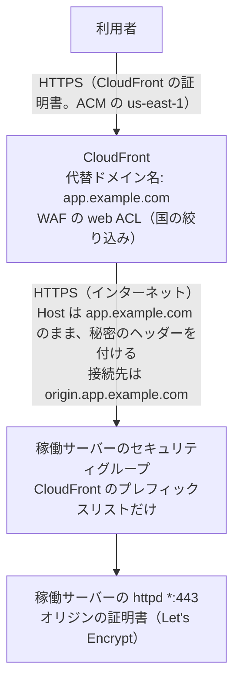
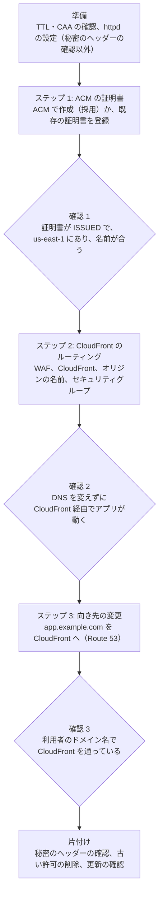

# SSL/TLS の終端を EC2 の httpd から CloudFront へ移す

> 位置付け: 検討と手順の下書き。今 EC2 の httpd（Apache）が SSL/TLS を終端している Web サービスの前に CloudFront を置き、利用者から見た SSL/TLS の終端を CloudFront へ移す。構成は **B. CloudFront → EC2** でほぼ確定している（2026-11-11）。移行は 3 つのステップに分け、ステップの間で設定が正常かを確かめてから次へ進む。
>
> 確かめた範囲: AWS の仕様は AWS のドキュメントと照らし合わせた（2026-11-09〜2026-11-12）。Apache の設定は、今の構成に近いコンテナで確かめた（2026-11-10）。定義（CloudFormation の YAML と CDK）は `cfn-lint` と合成まで（`cdk` の CLI の `cdk synth` も 2026-11-13 に確かめた）、ステップ 3 のシェルスクリプトは構文の確認まで確かめた（2026-11-12）。**AWS のコマンドは実行しておらず、実際の CloudFront・ACM・Route 53 では試していない**。
>
> 関連: [前に置くときの国での絞り込み](../notes/ec2-operations/access-restriction-alb-cloudfront.md)、[稼働サーバーの前に置く構成と料金の考え方](../notes/instance-provisioning/cloudfront-alb-front-options.md)、[Let's Encrypt の扱い](../notes/instance-provisioning/letsencrypt-certificate-timing.md)
>
> 作成日: 2026-11-09（3 ステップの形に書き直した: 2026-11-12）

## 用語

| 用語 | 指すもの |
|---|---|
| 稼働サーバー | 今 SSL/TLS を終端している EC2 のインスタンス（httpd）。移行の後は CloudFront の接続先（オリジン）になる |
| 利用者のドメイン名 | 利用者が使う名前（例 `app.example.com`）。移行の前後で変わらない |
| オリジンの名前 | CloudFront が稼働サーバーへ接続するためだけに使う名前（例 `origin.app.example.com` → 稼働サーバーの Elastic IP） |
| CloudFront の証明書 | 利用者と CloudFront の間で使う証明書。ACM の `us-east-1` に置く。ACM のコンソールの「**証明書**」に出るもので、「ACME 証明書」ではない（[ステップ 1](./step1-acm-certificate.md#証明書の種類)） |
| オリジンの証明書 | CloudFront と稼働サーバーの間で使う証明書。今の Let's Encrypt の証明書を使い続ける |
| 秘密のヘッダー | CloudFront がオリジンへの要求に付けるヘッダー（`X-Origin-Verify`）。稼働サーバーの httpd が値を確かめ、CloudFront を通らない要求を止める |
| 稼働サーバーの前に置くサービス | 利用者と稼働サーバーの間に置く CloudFront や ALB。このドキュメント群では「前段」とは書かず、この言い方をする |
| 本線 | 採用した構成（B. CloudFront → EC2）の手順と定義 |
| オプション | 採用しなかった構成（ALB を使う構成）と、既定に入れなかった設定（WAF のマネージドルールとログ）の手順と定義。`options/` に分けている |

## 移行の後の形

CloudFront から稼働サーバーまではインターネットを通るので、HTTPS を続ける。**オリジンの証明書（Let's Encrypt）は残る**。httpd から SSL/TLS の処理をなくしたい場合の構成は、[オプション](#オプション採用しなかった構成既定に入れなかった設定)にある。

## 3 つのステップ

| ステップ | 行うこと | 使う道具 | 利用者への影響 | 手順 |
|---|---|---|---|---|
| 準備 | DNS の管理先・CAA・TTL の確認、稼働サーバーの httpd の設定 | なし（稼働サーバーの上） | なし | [step0-preparation.md](./step0-preparation.md) |
| 1 | CloudFront の証明書を ACM に用意する。**ACM で作成する（採用）**。既存の証明書を登録する方法は別の節 | **CloudFormation の YAML** `cloudformation/step1-certificate.yml` か **CDK** `<prefix>-step1-certificate`（どちらか一方。`us-east-1`） | なし | [step1-acm-certificate.md](./step1-acm-certificate.md) |
| 2 | WAF の web ACL、CloudFront、オリジンの名前、オリジン用のセキュリティグループを作り、DNS を変えずに CloudFront 経由で確かめる | **CDK** `<prefix>-step2-waf`（`us-east-1`）、`<prefix>-step2-cloudfront`（`ap-northeast-1`）。`cdk deploy` で直接反映するか、CDK から YAML のテンプレートを出して AWS CLI で反映する | なし | [step2-cloudfront.md](./step2-cloudfront.md) |
| 3 | 利用者のドメイン名の向き先を CloudFront へ変える。**Route 53（ステージング）が本線**、外部の DNS サービス（本番）は別の節（手で変える）。落ち着いたら片付ける | **シェルスクリプト** `scripts/step3-dns-switch.sh` | 順次 CloudFront 経由になる | [step3-dns-switch.md](./step3-dns-switch.md) |

- ステップ 1・2 は利用者に影響しない。確認で問題が見つかれば、作ったスタックを消すだけで戻せる
- ステップ 3 は、片付けの前なら、DNS を元のレコードに戻すだけで戻せる
- 定義の中身は [definitions.md](./definitions.md)、CDK のコマンドは [cdk/python/README.md](./cdk/python/README.md)。ステップ 2 の CloudFormation の YAML も同じ内容で残しているが、手順では使わない

## ドキュメント

### 本線（B. CloudFront → EC2）

| ファイル | 内容 |
|---|---|
| このファイル | 結論、3 つのステップの全体、決めたこと |
| [step0-preparation.md](./step0-preparation.md) | 準備（ステップ 1 の前）: 事前の確認と、稼働サーバーの httpd の設定 |
| [step1-acm-certificate.md](./step1-acm-certificate.md) | ステップ 1: ACM の証明書の作成（と登録）、確認 1 |
| [step2-cloudfront.md](./step2-cloudfront.md) | ステップ 2: WAF・CloudFront・オリジンの名前・セキュリティグループ、確認 2 |
| [step3-dns-switch.md](./step3-dns-switch.md) | ステップ 3: 利用者のドメイン名の向き先の変更（`scripts/step3-dns-switch.sh`）、確認 3、片付け、元に戻す手順 |
| [cloudfront-to-ec2-httpd.md](./cloudfront-to-ec2-httpd.md) | 参考: 稼働サーバーの httpd で行う設定の詳細と、コンテナでの検証の結果 |
| [cloudfront-to-ec2-domains-certificates.md](./cloudfront-to-ec2-domains-certificates.md) | 参考: ドメイン名・DNS のレコード・証明書の役割と、通信の流れ |
| [definitions.md](./definitions.md) | 定義（`cloudformation/` の YAML と `cdk/python/` の CDK）の中身と、ステップごとにどちらを使うか |
| `scripts/step3-dns-switch.sh` | ステップ 3 のシェルスクリプト（Route 53 の A レコードの置き換えと戻し） |
| [cdk/python/README.md](./cdk/python/README.md) | CDK（Python）版の準備・合成・デプロイ・撤去のコマンド |

### オプション（採用しなかった構成・既定に入れなかった設定）

| ファイル | 内容 |
|---|---|
| [options/waf-managed-rules.md](./options/waf-managed-rules.md) | ステップ 2 の WAF に、AWS のマネージドルールとログを足す方法（count で試してから block にする流れ）と、既定から外す前の定義の設定値 |
| [options/comparison.md](./options/comparison.md) | 3 つの構成（A. ALB → EC2、B. CloudFront → EC2、C. CloudFront → ALB → EC2）の比較、ALB を通さないことのデメリット、WAF を置ける場所 |
| [options/alb-to-ec2.md](./options/alb-to-ec2.md) | A. ALB → EC2 への移行の手順 |
| [options/cloudfront-alb-to-ec2.md](./options/cloudfront-alb-to-ec2.md) | C. CloudFront → ALB → EC2 への移行の手順 |
| `cloudformation/options/` | A と C の CloudFormation の YAML |
| `cdk/python/tls_termination_cdk/stacks/options/` | A と C の CDK（設定値の `option_stacks` で指定したときだけ合成する） |

## 結論

- **B. CloudFront → EC2 で進める**（2026-11-11）。目的は **WAF による防御**で、WAF は CloudFront に付ける（EC2 には直接付けられない）
- **オリジンの証明書（Let's Encrypt）は残る**。CloudFront から稼働サーバーまではインターネットを通るので、HTTPS を続ける
- **利用者のドメイン名は変えない**。CloudFront の接続先には、別の名前（オリジンの名前）を使う
- 国の絞り込みは **WAF** で行い、`/.well-known/acme-challenge/` だけはどの国からも通す（オリジンの証明書を HTTP-01 で更新し続けるため）。CloudFront の地理的制限は使わない。既定の WAF は国の絞り込みだけで、マネージドルールとログはオプション
- httpd から証明書と SSL/TLS の処理をなくしたい場合は、ALB を通すオプションの構成（A・C）になる。比較は [options/comparison.md](./options/comparison.md)

## 決めたこと

| # | 論点 | 決めたこと |
|---|---|---|
| T1 | 何のために移すのか | **WAF による防御**（2026-11-11） |
| T2 | 3 つの構成のどれにするか | **B. CloudFront → EC2**（2026-11-11）。対象が多数の台なら、[ALB を共有する案](../notes/instance-provisioning/cloudfront-alb-front-options.md#今の運用物件ごとの単体のサーバーに当てはめた選択肢)も含めて考え直す |
| T3 | `old_app_a` の扱い | **平文の HTTP のまま残す相手はいない前提**で、[443 番へ移す](./cloudfront-to-ec2-httpd.md#6-old_app_a-を-443-番へ移す)（2026-11-11） |
| T4 | 国で絞る場所 | **WAF**（確認のパスだけを例外にする。2026-11-11）。この移行の対象の台には port-guard を入れていない（port-guard-rollout の対象は別の台。2026-11-11）ので、port-guard を外す作業はない |
| T5 | オリジンの証明書の更新の経路 | **CloudFront と WAF を経た HTTP-01**（T4 に伴う。[cloudfront-to-ec2-httpd.md](./cloudfront-to-ec2-httpd.md#証明書の更新)） |
| T6 | CloudFront の証明書の用意の仕方 | **ACM で作成する**（2026-11-12）。既存の証明書の登録は、ACM が自動で更新しないので別の節に分けた |
| T7 | 利用者のドメイン名の DNS | **ステージングは Route 53、本番は外部の DNS サービス**（2026-11-11）。手順は Route 53 を本線にし、外部の DNS サービスは各ステップの別の節に書いた（2026-11-12） |
| T8 | ステップ 3 を CloudFormation とシェルスクリプトのどちらで行うか | **シェルスクリプト**（`scripts/step3-dns-switch.sh`。2026-11-12）。利用者のドメイン名のレコードは今もあり、CloudFormation で作るには先に消すかスタックへの取り込みが要る。シェルスクリプトなら、今のレコードを読んで 1 つの変更バッチで置き換え、戻すのも逆の変更バッチで済む（[比べた表](./step3-dns-switch.md#シェルスクリプトにした理由)） |
| T9 | ステップ 1・2 の道具 | **ステップ 1 は CloudFormation の YAML（量がないため）を基本に、CDK でも行えるよう手順書に両方を書く。ステップ 2 は CDK**（2026-11-12。ステップ 1 の併記は 2026-11-13）。ステップ 2 は WAF のルールと CloudFront の設定の量が多い。CDK のデプロイは、`cdk deploy` で直接反映する方法と、CDK から CloudFormation のテンプレート（YAML）を出して AWS CLI で反映する方法の両方を書いた（[cdk/python/README.md のデプロイ](./cdk/python/README.md#デプロイ)。2026-11-13）。どちらも `cdk bootstrap` はしない。両方の書き方の定義は残している |
| T10 | 既定の WAF に何を入れるか | **国の絞り込みだけ**（`AllowAcmeChallenge` と `BlockOutsideAllowedCountries`。2026-11-13）。AWS のマネージドルールとログは既定から外し、入れ方と外す前の設定値を [options/waf-managed-rules.md](./options/waf-managed-rules.md) に残した。定義が短くなり（`step2_waf.py` 236 行 → 155 行）、料金は月 $10 → $7 と要求の料金。許可する国と例外の IP から来る攻撃は WAF では止めない |

## どの手順でも共通して確かめること

| 項目 | 内容 |
|---|---|
| IP で直接つないでいる相手 | Elastic IP を指定して API を呼んでいる相手は、切り替えの後も CloudFront を通らず稼働サーバーへ向かい、片付けの後はセキュリティグループで止まる。[API のアクセス元の洗い出し](../api-access-sources/design.md)で探す |
| 外部に Elastic IP を伝えている先 | 稼働サーバーから外へ出る通信の送り元は変わらない。Elastic IP を外すときだけ影響する |
| 古い TLS しか話せない相手 | CloudFront のセキュリティポリシー（TLSv1.2_2021）で受ける TLS のバージョンが変わる |
| HTTP から HTTPS へのリダイレクト | `POST` で HTTP を呼ぶ API のクライアントは、リダイレクトで動かなくなることがある |
| Rails の `force_ssl`、Secure の Cookie、URL の生成 | Rails が元の接続を HTTPS と認識できることが前提（コンテナで確かめた。[検証の結果](./cloudfront-to-ec2-httpd.md#検証の結果)） |
| AL2023 での作り直し | この移行を[作り直し](../initial-image-build/existing-system-rebuild-on-al2023.md)と同時に行うなら、新しい土台の Apache の設定に最初から入れる |

## 参考

AWS のドキュメントと照らし合わせた（2026-11-09）。ステップごとの参考は各ドキュメントに書いた。

- [Resources that you can protect with AWS WAF](https://docs.aws.amazon.com/waf/latest/developerguide/how-aws-waf-works-resources.html)
- [Requirements for using SSL/TLS certificates with CloudFront](https://docs.aws.amazon.com/AmazonCloudFront/latest/DeveloperGuide/cnames-and-https-requirements.html)
- [Require HTTPS between CloudFront and your custom origin](https://docs.aws.amazon.com/AmazonCloudFront/latest/DeveloperGuide/using-https-cloudfront-to-custom-origin.html)
