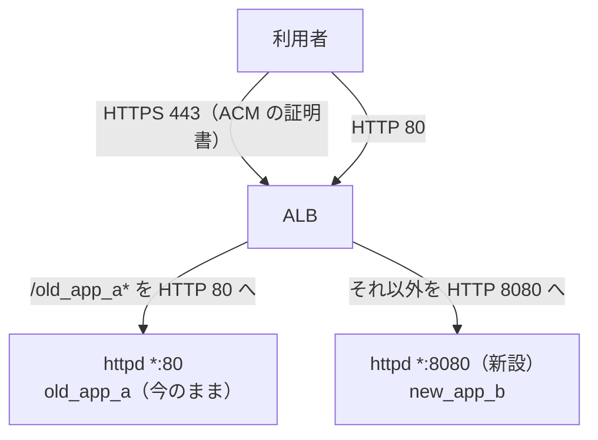

# ALB → EC2 への移行の手順

> 位置付け: 今 httpd が終端している SSL/TLS を ALB へ移す手順の下書き。比較は [README](./README.md)。
>
> 確かめた範囲: AWS の仕様は AWS のドキュメントと照らし合わせた（2026-11-09）。Apache の設定は、今の構成に近いコンテナで確かめた（2026-11-10。下の「検証の結果」）。**AWS のコマンドは実行していない。実際の ALB でも試していない**。`<...>` は環境に合わせて置き換える。
>
> 作成日: 2026-11-09

## 移行後の形



| 要素 | 設定 |
|---|---|
| HTTPS リスナー（443） | 既定: `new_app_b` のターゲットグループへ。`/old_app_a*`: `old_app_a` のターゲットグループへ |
| HTTP リスナー（80） | 既定: HTTPS へ 301 でリダイレクト |
| ターゲットグループ `new_app_b` | HTTP 8080、種類は `instance` |
| ターゲットグループ `old_app_a` | HTTP 80、種類は `instance` |

8080 番を新しく設けるのは、今の 80 番の VirtualHost が `old_app_a` を出していて流用できないためである。今の 443 番の VirtualHost を残しておけば、DNS を戻すだけで元に戻せる。

## 手順

### 1. 事前の確認

| 確認 | 内容 |
|---|---|
| サブネット | ALB には、**異なる Availability Zone のサブネットが 2 つ以上**要る。それぞれ `/27` 以上で、空きの IP アドレスが 8 つ以上 |
| DNS の TTL | 切り替えの前に、対象のレコードの TTL を短くして、元の TTL が過ぎるまで待つ |
| 証明書の残り期間 | 今の Let's Encrypt の証明書が、元に戻せる期間より長く有効であること |
| モジュール | `sudo httpd -M \| grep -E 'remoteip\|headers'` |
| 待ち受け | 8080 番が空いていること（`sudo ss -ltnp \| grep ':8080'`） |
| アプリ | `force_ssl`、IP で判定している処理（`request.remote_ip`）、応答に 60 秒以上かかる処理の有無 |

### 2. ACM の証明書を用意する

ALB と同じリージョンで、DNS 検証の証明書を申請する。

```bash
aws acm request-certificate --region <リージョン> \
  --domain-name <ドメイン> --validation-method DNS
```

ACM が示す CNAME を DNS に登録する。CNAME を残しておけば、使われている間は自動で更新される。

### 3. httpd に HTTP の VirtualHost を足す

今の設定は変えず、次のファイルを足す。

`/etc/httpd/conf.d/rails-behind-alb.conf`:

```apache
Listen 8080

# LogFormat の %a は、mod_remoteip で置き換えた後の利用者の IP を出す
LogFormat "%a %l %u %t \"%r\" %>s %b \"%{Referer}i\" \"%{User-Agent}i\"" combined_client_ip

<VirtualHost *:8080>
   ServerName <ドメイン>
   DocumentRoot /var/www/html/new_app_b
   <Directory /var/www/html>
     Options -MultiViews
     Require all granted
   </Directory>
   PassengerAppRoot /home/ruby/new_app_b
   RailsEnv <今の 443 番と同じ値>

   # ALB のアイドルタイムアウト（既定 60 秒）より長くする
   KeepAlive On
   KeepAliveTimeout 65

   # ALB から来たときだけ X-Forwarded-For を信じて、利用者の IP に置き換える
   RemoteIPHeader X-Forwarded-For
   RemoteIPInternalProxy <VPC の CIDR>
   # 置き換えの残りが Rails に渡らないようにする（利用者が偽った値を使わせない）
   RequestHeader unset X-Forwarded-For
   RequestHeader unset Client-IP

   ErrorLog /var/log/httpd/error.log
   CustomLog /var/log/httpd/access.log combined_client_ip
</VirtualHost>
```

`*:80` の VirtualHost にも、同じ `KeepAliveTimeout`、`RemoteIP...`、`RequestHeader unset`、`CustomLog` を足す。

ヘルスチェック用の静的なファイルを、それぞれの `DocumentRoot` の下に置く（アプリを動かさずに応答させるため）。

```bash
echo ok | sudo tee /var/www/html/new_app_b/alb-health.txt
echo ok | sudo tee /var/www/html/alb-health.txt
sudo apachectl configtest && sudo apachectl graceful
curl -i -H 'Host: <ドメイン>' http://127.0.0.1:8080/alb-health.txt
```

Rails には、ALB が付ける `X-Forwarded-Proto: https` で、元の接続が HTTPS だと伝わる。

### 4. セキュリティグループを用意する

| グループ | 方向 | 相手 | ポート |
|---|---|---|---|
| ALB 用（新規） | 入り | `0.0.0.0/0` | 80、443 |
| ALB 用（新規） | 出 | EC2 のグループ | 80、8080 |
| EC2 のグループ | 入り | ALB 用のグループ | 80、8080（**足す**。今の許可は残す） |

```bash
aws ec2 authorize-security-group-ingress --group-id <EC2 のグループ> \
  --protocol tcp --port 8080 --source-group <ALB のグループ>
aws ec2 authorize-security-group-ingress --group-id <EC2 のグループ> \
  --protocol tcp --port 80 --source-group <ALB のグループ>
```

port-guard は 80・443 番だけを見るので、8080 番は止めない。80 番は、許可の一覧に VPC の範囲が入っていれば通る。入っているかを確かめる。

### 5. ターゲットグループ、ALB、リスナーを作る

```bash
aws elbv2 create-target-group --name <名前>-new-app-b \
  --protocol HTTP --port 8080 --vpc-id <VPC> --target-type instance \
  --health-check-path /alb-health.txt --matcher HttpCode=200

aws elbv2 create-target-group --name <名前>-old-app-a \
  --protocol HTTP --port 80 --vpc-id <VPC> --target-type instance \
  --health-check-path /alb-health.txt --matcher HttpCode=200

aws elbv2 register-targets --target-group-arn <new_app_b の ARN> --targets Id=<インスタンス ID>
aws elbv2 register-targets --target-group-arn <old_app_a の ARN> --targets Id=<インスタンス ID>

aws elbv2 create-load-balancer --name <名前> --type application --scheme internet-facing \
  --subnets <サブネット 1> <サブネット 2> --security-groups <ALB のグループ>

aws elbv2 create-listener --load-balancer-arn <ALB の ARN> --protocol HTTPS --port 443 \
  --ssl-policy ELBSecurityPolicy-TLS13-1-2-2021-06 \
  --certificates CertificateArn=<証明書の ARN> \
  --default-actions Type=forward,TargetGroupArn=<new_app_b の ARN>

aws elbv2 create-listener --load-balancer-arn <ALB の ARN> --protocol HTTP --port 80 \
  --default-actions 'Type=redirect,RedirectConfig={Protocol=HTTPS,Port=443,StatusCode=HTTP_301}'

aws elbv2 create-rule --listener-arn <HTTPS リスナーの ARN> --priority 10 \
  --conditions Field=path-pattern,Values='/old_app_a*' \
  --actions Type=forward,TargetGroupArn=<old_app_a の ARN>
```

応答に 60 秒以上かかる処理があれば、`idle_timeout.timeout_seconds` を延ばす（1〜4000 秒）。httpd の `KeepAliveTimeout` は、その値より長くする。

### 6. 国で絞るなら WAF を付ける

要件があれば、ALB と同じリージョンに web ACL を作り、国の条件を入れて関連付ける。内容は[国での絞り込みの案 B](../notes/ec2-operations/access-restriction-alb-cloudfront.md#案-b-alb--aws-waf-の国の条件--セキュリティグループで-alb-だけ)。

```bash
aws wafv2 associate-web-acl --region <リージョン> \
  --web-acl-arn <web ACL の ARN> --resource-arn <ALB の ARN>
```

### 7. 切り替えの前に確かめる

ターゲットが `healthy` になってから、DNS を変えずに ALB へ接続する。

```bash
aws elbv2 describe-target-health --target-group-arn <ARN>
dig +short <ALB の DNS 名>
curl -v --resolve <ドメイン>:443:<ALB の IP> https://<ドメイン>/
curl -v --resolve <ドメイン>:443:<ALB の IP> https://<ドメイン>/old_app_a/
```

| 確認 | 期待 |
|---|---|
| 証明書 | ACM の証明書が返る |
| ログイン、フォームの送信 | 動く（Cookie、CSRF のトークン） |
| リダイレクト先 | `https://<ドメイン>/...` になる（`http://` や 8080 番が出ない） |
| `access.log` の送り元 | 利用者の IP になる |
| Rails の `request.remote_ip` | 利用者の IP になる |

### 8. DNS を切り替える

DNS を ALB へ向ける。Route 53 なら ALB へのエイリアスレコードにする。

### 9. 落ち着いたら片付ける

元の TTL より長く待ち、エラーがないことを確かめてから行う。

| 順番 | 作業 |
|---|---|
| 1 | EC2 のグループから、`0.0.0.0/0` などの 80・443 番の許可を消す |
| 2 | 国の絞り込みを ALB の WAF へ移したなら、port-guard を外す |
| 3 | certbot の自動更新を止め、`*:443` の VirtualHost と証明書を片付ける |
| 4 | Elastic IP を外すかを決める（外に伝えている先がないか、インスタンスが外へ出られるかを確かめる） |

## 元に戻す

手順 9 の前なら、DNS を Elastic IP へ戻すだけでよい。手順 9 の後は、セキュリティグループと証明書を戻してから DNS を戻す。

## 検証の結果

今の構成に近いコンテナ（Amazon Linux 2、Apache 2.4.56、MPM は prefork、Passenger 6.0.18、Rails 4.2、rack 1.6.13）に上の設定を入れ、別のコンテナから ALB を模した要求を送って確かめた（2026-11-10）。

| 項目 | 結果 |
|---|---|
| Rails の HTTPS の認識 | `X-Forwarded-Proto: https` で `request.ssl?` が true。`force_ssl` が通り、Secure の Cookie が付く。この見出しがないと `force_ssl` は 301 を返す |
| リダイレクト先 | `https://<ドメイン>/...` になり、8080 番は出ない |
| Passenger と利用者の IP | `mod_remoteip` の結果が `REMOTE_ADDR` として Rails に渡り、`request.remote_ip` も利用者の IP になる |
| 偽の `X-Forwarded-For`・`Client-IP` | 効かない。`RequestHeader unset` を外すと、Rails 4.2 の `remote_ip` は偽の値を選ぶ |
| 信頼しない送り元 | `X-Forwarded-For` は無視され、接続元の IP になる |
| 静的なファイル | `alb-health.txt` は Rails を通らずに Apache から返る（8080 番、80 番とも） |
| `/old_app_a` | 80 番の VirtualHost で動き、URL は `https://<ドメイン>/old_app_a/...` になる |
| `KeepAliveTimeout 65` | 無通信で閉じるまで 65 秒（1 回目 65 秒、測り直しの 7 回はすべて 65.0〜65.1 秒、既定の 5 秒の対照は 5.0 秒）。途中の 1 回だけ 84 秒だったが、再現せず、原因は確かめていない |
| ログの形式 | `%a` で利用者の IP が出る。`combined`（`%h`）でも利用者の IP が出た |

## 確かめること（動かしていない点）

| 項目 | 内容 |
|---|---|
| 実際の ALB | ヘルスチェック、`X-Forwarded-*` の値、リダイレクト |
| `KeepAliveTimeout 65` の負荷 | MPM が `prefork` だと、接続ごとにプロセスを占有する。本番で `httpd -V` と `MaxRequestWorkers` に余裕があるかを見る |
| 本物のアプリ | `old_app_a`・`new_app_b` の Cookie、CSRF のトークン、ファイルのアップロード |

## 参考

AWS のドキュメントと照らし合わせた（2026-11-09）。

- [Application Load Balancers（サブネットの条件、属性）](https://docs.aws.amazon.com/elasticloadbalancing/latest/application/application-load-balancers.html)
- [Create an HTTPS listener](https://docs.aws.amazon.com/elasticloadbalancing/latest/application/create-https-listener.html)
- [HTTP headers and Application Load Balancers](https://docs.aws.amazon.com/elasticloadbalancing/latest/application/x-forwarded-headers.html)
- [Health checks for target groups](https://docs.aws.amazon.com/elasticloadbalancing/latest/application/target-group-health-checks.html)
- [Security groups for your Application Load Balancer](https://docs.aws.amazon.com/elasticloadbalancing/latest/application/load-balancer-update-security-groups.html)
- [Edit attributes for your Application Load Balancer](https://docs.aws.amazon.com/elasticloadbalancing/latest/application/edit-load-balancer-attributes.html)
- [AWS Certificate Manager DNS validation](https://docs.aws.amazon.com/acm/latest/userguide/dns-validation.html)
- [Apache mod_remoteip](https://httpd.apache.org/docs/2.4/mod/mod_remoteip.html)
