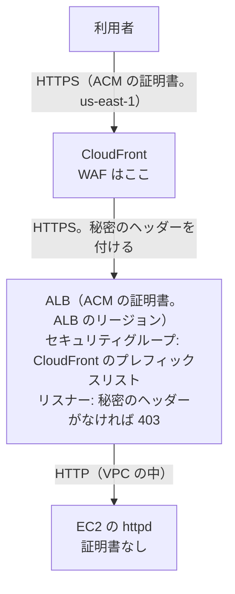

# CloudFront → ALB → EC2 への移行の手順

> 位置付け: CloudFront と ALB の両方を前に置く手順の下書き。比較は [README](./README.md)。ALB から EC2 までの部分は [alb-to-ec2.md](./alb-to-ec2.md) と同じ。
>
> 確かめた範囲: AWS の仕様は AWS のドキュメントと照らし合わせた（2026-11-09）。httpd の設定は、今の構成に近いコンテナで確かめた（2026-11-10）。**実際の CloudFront・ALB では試していない**。`<...>` は環境に合わせて置き換える。
>
> 作成日: 2026-11-09

## 移行後の形



## 進め方

**2 段階で進める**。先に ALB → EC2 へ移して落ち着かせてから、CloudFront を足す。問題が起きたときに、どちらの層が原因かを分けられる。

## 手順

### 1. ALB → EC2 まで移す

[alb-to-ec2.md](./alb-to-ec2.md) の手順を 9 の 2 まで行う。

### 2. 証明書を用意する

| 区間 | 証明書のリージョン | 名前 |
|---|---|---|
| 利用者 → CloudFront | `us-east-1` | `<ドメイン>` |
| CloudFront → ALB | ALB のリージョン | `<ドメイン>` と `origin.<ドメイン>`（オリジンの名前） |

`AllViewer` で Host を渡すので、ALB の証明書は利用者のドメインにも一致させる。ALB の DNS 名（`*.elb.amazonaws.com`）には証明書を発行できないので、`origin.<ドメイン>` を ALB へ向ける。

### 3. CloudFront を作る

| 項目 | 設定 |
|---|---|
| Origin domain | `origin.<ドメイン>` |
| Protocol | **HTTPS only** |
| Add custom header | `X-Origin-Verify: <長いランダムな値>` |
| Response timeout | アプリの最長の応答に合わせる（既定 30 秒、1〜120 秒）。ALB のアイドルタイムアウト以下にそろえる |
| Viewer protocol policy | Redirect HTTP to HTTPS |
| Allowed HTTP methods | GET, HEAD, OPTIONS, PUT, POST, PATCH, DELETE |
| Cache policy | `CachingDisabled` |
| Origin request policy | `AllViewer` |
| Alternate domain name | `<ドメイン>` |
| Custom SSL certificate | `us-east-1` の証明書 |

ヘッダーの名前と値は、ユーザー名とパスワードと同じように扱う。

### 4. ALB を CloudFront からだけにする

切り替えの前は、今の利用者が ALB へ直接来ているので、**DNS を切り替えた後に**塞ぐ（手順 7）。ここでは、リスナーのルールだけ用意する。

| リスナーのルール | 動作 |
|---|---|
| ヘッダーが一致（`/old_app_a*`） | `old_app_a` のターゲットグループへ |
| ヘッダーが一致（それ以外） | `new_app_b` のターゲットグループへ |
| `/old_app_a*`（ヘッダーなし。切り替えの前だけ） | `old_app_a` のターゲットグループへ（ALB へ直接来ている利用者のため） |
| 既定（切り替えの前） | 今のまま `new_app_b` へ |
| 既定（手順 7 の後） | 403 の固定の応答 |

### 5. 切り替えの前に確かめる

```bash
dig +short <ディストリビューションのドメイン名>
curl -v --resolve <ドメイン>:443:<CloudFront の IP> https://<ドメイン>/
```

ログイン、フォームの送信、リダイレクト先、`access.log` の送り元を確かめる（[alb-to-ec2.md の手順 7](./alb-to-ec2.md#7-切り替えの前に確かめる)と同じ観点）。

### 6. httpd の信頼する中継を足す

CloudFront の後ろに ALB を置くと、`X-Forwarded-For` は `利用者, CloudFront のアドレス` の順になる。ALB だけでなく CloudFront も信頼しないと、送り元が CloudFront のアドレスになる。

```apache
RemoteIPHeader X-Forwarded-For
RemoteIPInternalProxy <VPC の CIDR>
Include /etc/httpd/cloudfront-origin-facing.conf
RequestHeader unset X-Forwarded-For
RequestHeader unset Client-IP
```

読み込むファイルの作り方は [cloudfront-to-ec2-httpd.md](./cloudfront-to-ec2-httpd.md#4-利用者の-ip-を復元する)。`RemoteIPInternalProxy` と `RemoteIPTrustedProxyList` を同じ VirtualHost で使う形は、コンテナで確かめたときに CloudFront のアドレスが信頼されず、利用者の IP を取れなかったので使わない。

Rails には、ALB が CloudFront との接続に基づいて付ける `X-Forwarded-Proto: https` が届く。

### 7. DNS を切り替えて、ALB を塞ぐ

| 順番 | 作業 |
|---|---|
| 1 | `<ドメイン>` を CloudFront へ向ける |
| 2 | 元の TTL より長く待つ |
| 3 | ALB のセキュリティグループの 443 番の入りを、`0.0.0.0/0` から CloudFront のプレフィックスリストへ変える（55 件に数える。60 件の上限に注意） |
| 4 | ALB のリスナーの既定の動作を、403 の固定の応答へ変える |
| 5 | ALB へ直接接続して 403 または接続不可になることを確かめる |

### 8. 国で絞るなら CloudFront で行う

地理的制限か WAF を CloudFront に設定する。WAF は `us-east-1` に web ACL を作る。ALB の WAF は外す（CloudFront の後ろでは、ALB から見た送り元が CloudFront になるので、国の判定が合わなくなる）。

## 元に戻す

| 段階 | 戻し方 |
|---|---|
| 手順 7 の 3 の前 | DNS を ALB へ戻す |
| 手順 7 の 3 の後 | ALB のセキュリティグループとリスナーの既定の動作を戻してから、DNS を ALB へ戻す |

## より塞ぐ案: VPC オリジンと内部向けの ALB

内部向けの ALB をプライベートサブネットに置き、CloudFront の VPC オリジンから接続すると、ALB をインターネットに出さずに済む。

| 条件 | 内容 |
|---|---|
| VPC | インターネットゲートウェイが要る（経路には使わない）。プライベートサブネットに空きの IP アドレスが要る |
| リージョン | 東京（`ap-northeast-1`）は対応。ただし AZ `apne1-az3` を除く |
| 制限 | Lambda@Edge のオリジン要求・応答のトリガーは使えない |

今のインスタンスの配置を変える話になるので、手順には含めていない。

## 検証の結果

今の構成に近いコンテナで、ALB を模したコンテナから `X-Forwarded-For: 利用者, CloudFront のアドレス` と `X-Forwarded-Proto: https` を送って確かめた（2026-11-10）。

| 項目 | 結果 |
|---|---|
| 利用者の IP の復元 | `request.remote_ip` が利用者の IP になる |
| 残りの `X-Forwarded-For` | Rails に渡らない |
| HTTPS の認識 | `request.ssl?` が true になる |

## 確かめること（動かしていない点）

| 項目 | 内容 |
|---|---|
| `X-Forwarded-For` の順序 | 実際の見出しで、`利用者, CloudFront` の順になっていること（AWS のドキュメントの記述をもとにした） |
| 応答のタイムアウト | CloudFront と ALB の両方の値の組み合わせで、長い処理が通ること |
| `X-Forwarded-Proto` の値 | 実際の ALB が `https` を付けること |

## 参考

AWS のドキュメントと照らし合わせた（2026-11-09）。

- [Restrict access to Application Load Balancers](https://docs.aws.amazon.com/AmazonCloudFront/latest/DeveloperGuide/restrict-access-to-load-balancer.html)
- [Restrict access with VPC origins](https://docs.aws.amazon.com/AmazonCloudFront/latest/DeveloperGuide/private-content-vpc-origins.html)
- [Request and response behavior for custom origins（X-Forwarded-For）](https://docs.aws.amazon.com/AmazonCloudFront/latest/DeveloperGuide/RequestAndResponseBehaviorCustomOrigin.html)
- [Resources that you can protect with AWS WAF](https://docs.aws.amazon.com/waf/latest/developerguide/how-aws-waf-works-resources.html)
