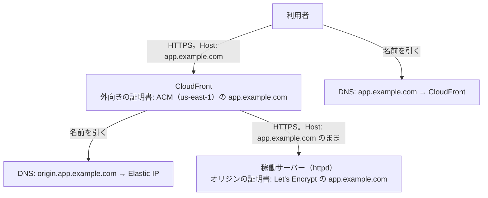

# CloudFront → EC2 のドメイン名と証明書の構成

> 位置付け: CloudFront → EC2 の構成（利用者のドメイン名を変えない形）で使うドメイン名・DNS のレコード・証明書と、それぞれの役割をまとめる。通信の流れと切り替えの順番は [cloudfront-to-ec2-same-domain.md](./cloudfront-to-ec2-same-domain.md)、図は [architecture.svg](./architecture.svg)。
>
> 確かめた範囲: AWS の仕様は AWS のドキュメントと照らし合わせた（2026-11-09〜2026-11-10）。httpd の側は、今の構成に近いコンテナで確かめた（2026-11-10）。**実際の CloudFront・ACM・Route 53 では試していない**。
>
> `app.example.com`・`origin.app.example.com` は例である。
>
> 作成日: 2026-11-11

## 用語

| 用語 | 指すもの |
|---|---|
| 利用者のドメイン名 | 利用者が使う名前（`app.example.com`）。移行の前後で変わらない |
| オリジンの名前 | CloudFront が EC2 へ接続するためだけに使う名前（`origin.app.example.com`） |
| 稼働サーバー | CloudFront の接続先の EC2（httpd） |
| 外向きの証明書 | 利用者と CloudFront の間で使う証明書。ACM で管理する |
| オリジンの証明書 | CloudFront と稼働サーバーの間で使う証明書。今の Let's Encrypt の証明書 |

## 全体

**証明書はサーバーではなくドメイン名に紐づく**。同じ `app.example.com` の証明書を、CloudFront と稼働サーバーに別々に置ける。オリジンの証明書を CloudFront へ移す必要はない。

## DNS のレコード

| レコード | 今 | 移行後 | 作り方 |
|---|---|---|---|
| `app.example.com` | 稼働サーバーの Elastic IP | CloudFront（Route 53 ならエイリアスの A レコード。IPv6 を有効にしたら AAAA も） | 切り替えの時点を担当者が決めて手で変える。定義には含めない |
| `origin.app.example.com` | なし | 稼働サーバーの Elastic IP（A レコード） | 新しく作る。Route 53 なら CloudFront → EC2 のスタックで作れる（`OriginHostedZoneId`） |
| ACM の検証用の CNAME（`_<文字列>.app.example.com`） | なし | ACM が示す値 | 証明書のスタックの作成中に足す。Route 53 なら自動で作られる（`HostedZoneId`）。**ACM が自動で更新するために残しておく** |

| 注意 | 内容 |
|---|---|
| オリジンの名前は利用者のドメイン名と別にする | `app.example.com` は CloudFront を指すので、CloudFront の接続先に使うと自分自身に戻る。定義はデプロイ（CDK は合成）のときに止める |
| オリジンに IP アドレスは指定できない | オリジンには公開の DNS で引ける名前が要る。EC2 のパブリック DNS 名でもよい |
| apex（`example.com`）の場合 | CNAME はサブドメインにしか作れない。apex を CloudFront へ向けるには Route 53 のエイリアスが要る |
| 切り替えの前に TTL を短くする | `app.example.com` の TTL を短くして、元の TTL が過ぎるまで待つ |

## 証明書

| 項目 | 外向きの証明書 | オリジンの証明書 |
|---|---|---|
| 置き場所 | CloudFront | 稼働サーバーの httpd |
| 発行・管理 | ACM | Let's Encrypt（certbot） |
| リージョン | **`us-east-1`**（CloudFront の決まり） | — |
| ドメイン名 | `app.example.com` | `app.example.com`（今のまま） |
| 用意のしかた | 新しく発行する（DNS 検証） | 今のものを使い続ける |
| 更新 | ACM が自動で行う（検証の CNAME が残っていて、証明書が使われている間） | certbot が行う（更新の経路は [下の節](#オリジンの証明書の更新)） |
| 確かめる相手 | 利用者のブラウザ | CloudFront |
| 切れたとき | 利用者に証明書の警告が出る | **すべての利用者に 502 が返る** |
| 定義 | `cloudfront-to-ec2-same-domain-certificate.yml` | なし（稼働サーバーの上） |

## どの接続で、何が確かめられるか

| 接続 | 接続先 | 返る証明書 | 確かめること |
|---|---|---|---|
| 利用者 → CloudFront | `app.example.com`（CloudFront） | 外向きの証明書 | 信頼された CA の証明書で、`app.example.com` に一致すること |
| CloudFront → 稼働サーバー | `origin.app.example.com` の IP | オリジンの証明書 | 信頼された CA の証明書で、期限内で、中間証明書がそろい、**Host の `app.example.com` に一致すること** |

CloudFront がオリジンの証明書で確かめる名前は、「オリジンの名前」か「Host を渡しているならその Host の名前」のどちらかである。この構成は `AllViewer` で Host を渡すので、オリジンの証明書は `app.example.com` に一致すればよく、`origin.app.example.com` を含める必要はない。

| 崩れると | 結果 |
|---|---|
| `AllViewer` をやめて Host を渡さない | オリジンの証明書が `origin.app.example.com` に一致する必要があり、一致しなければ 502 になる |
| オリジンの証明書が自己署名、期限切れ、中間証明書の不足・順序の誤り | CloudFront が接続を切り、502 になる |

CloudFront がオリジンへの TLS で送る名前（SNI）は、AWS のドキュメントでは確かめられなかった。コンテナの httpd は、SNI が別の名前でも、SNI がなくても 200 を返した。

## オリジンの証明書の更新

今は HTTP-01（80 番の `/.well-known/acme-challenge/`）で更新している。移行の後は `app.example.com` が CloudFront を指すので、Let's Encrypt の確認は CloudFront を通る。

**この構成の定義は、既定で地理的制限（日本だけを許可）を有効にしている。地理的制限を有効にすると、海外からも来る Let's Encrypt の確認が止まり、HTTP-01 では更新できない**。次のどれかに決める必要がある（未決定）。

| 方法 | 内容 | 注意 |
|---|---|---|
| DNS-01 に変える | CloudFront の設定に左右されない | DNS の API の権限の持たせ方を決める |
| 地理的制限の代わりに WAF を使う | 国で絞りつつ、`/.well-known/acme-challenge/` だけを例外にできる | WAF の月額の料金。httpd の 443 番に確認のパスの設定が要る |
| オリジンの証明書を ACM のものにする | ACM の ACME かエクスポートできる証明書 | この用途では試していない。エクスポートできる証明書は有料 |

外向きの証明書（ACM）は、どの方法でも影響を受けない。

## 移行の間

| 時点 | 外向きの証明書 | オリジンの証明書 | 利用者への影響 |
|---|---|---|---|
| ACM の発行（DNS の切り替えの前） | 発行される | 今のまま | なし |
| DNS の切り替えが行き渡るまで | CloudFront 経由の利用者が使う | 直接来る利用者と、CloudFront が使う | なし（どちらの経路でも証明書が有効） |
| 切り替えの後 | 利用者が使う | CloudFront だけが使う | なし |

オリジンの証明書を移動しないので、切り替えの間も証明書の差し替えは起きない。

## 残り日数の確かめ方

| 証明書 | 確かめ方 |
|---|---|
| 外向きの証明書 | ACM の `DaysToExpiry`（CloudWatch のメトリクス） |
| オリジンの証明書 | 踏み台サーバーから [`cert-expiry-check.sh`](../port-guard-rollout/certificate-expiry-check.md) で稼働サーバーの 443 番へ接続する。稼働サーバーのセキュリティグループを CloudFront のプレフィックスリストに絞った後も、踏み台サーバーからの 443 番の許可を残す |

## 決めること

| # | 論点 |
|---|---|
| C1 | オリジンの証明書の更新の方法（上の 3 つ） |
| C2 | `app.example.com` の DNS が Route 53 か（検証の CNAME とオリジンの名前のレコードを、定義で作れるか） |
| C3 | ドメインに CAA レコードがあるか。あれば ACM の発行を許可する必要がある（AWS のドキュメントでは確かめられなかった） |

## 参考

AWS のドキュメントと照らし合わせた（2026-11-09〜2026-11-10）。

- [Require HTTPS between CloudFront and your custom origin（オリジンの証明書の名前と検証）](https://docs.aws.amazon.com/AmazonCloudFront/latest/DeveloperGuide/using-https-cloudfront-to-custom-origin.html)
- [Origin settings（Origin domain）](https://docs.aws.amazon.com/AmazonCloudFront/latest/DeveloperGuide/DownloadDistValuesOrigin.html)
- [Requirements for using SSL/TLS certificates with CloudFront（us-east-1）](https://docs.aws.amazon.com/AmazonCloudFront/latest/DeveloperGuide/cnames-and-https-requirements.html)
- [Use managed origin request policies（AllViewer）](https://docs.aws.amazon.com/AmazonCloudFront/latest/DeveloperGuide/using-managed-origin-request-policies.html)
- [Routing traffic to a CloudFront distribution（エイリアス、apex）](https://docs.aws.amazon.com/Route53/latest/DeveloperGuide/routing-to-cloudfront-distribution.html)
- [AWS Certificate Manager DNS validation（検証の CNAME と自動更新）](https://docs.aws.amazon.com/acm/latest/userguide/dns-validation.html)
- [AWS::CertificateManager::Certificate（Route 53 での自動検証）](https://docs.aws.amazon.com/AWSCloudFormation/latest/TemplateReference/aws-resource-certificatemanager-certificate.html)
- [Supported CloudWatch metrics（ACM の DaysToExpiry）](https://docs.aws.amazon.com/acm/latest/userguide/cloudwatch-metrics.html)
