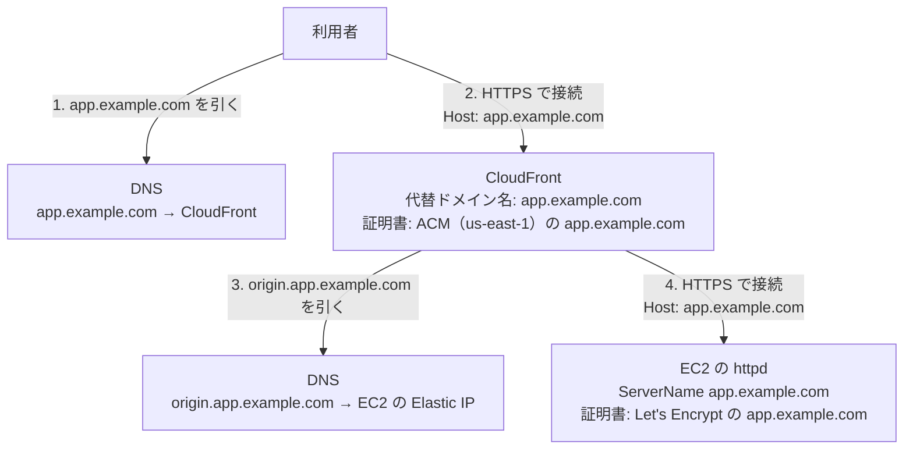

# CloudFront → EC2 の構成（外部のドメイン名を変えない場合）

> 位置付け: 検討の整理。採用済みの設計ではない。今 EC2 の httpd が `app.example.com` で SSL/TLS を終端している構成の前に CloudFront を置き、**利用者が使うドメイン名を変えない**ときに、DNS・証明書・Host がどう対応するかをまとめる。作業の順番の詳細は [cloudfront-to-ec2.md](./cloudfront-to-ec2.md)、httpd の設定の詳細は [cloudfront-to-ec2-httpd.md](./cloudfront-to-ec2-httpd.md)。
>
> 確かめた範囲: AWS の仕様は AWS のドキュメントと照らし合わせた（2026-11-09）。httpd の動作は、今の構成に近いコンテナ（Amazon Linux 2、Apache 2.4.56、Passenger 6.0.18、Rails 4.2）で確かめた（2026-11-10）。**実際の CloudFront では試していない**。下の「確かめたこと・確かめていないこと」を参照。
>
> `app.example.com` と `origin.app.example.com` は例である。
>
> 作成日: 2026-11-10

## 要点

- **構成は可能である**。利用者から見たドメイン名は `app.example.com` のままにできる。
- 証明書はサーバーではなくドメイン名に紐づくので、同じ `app.example.com` の証明書を、CloudFront と EC2 に別々に置ける。**EC2 の証明書を移動する必要はない**。
- DNS で `app.example.com` が指すのは **CloudFront だけ**である。CloudFront が EC2 へ接続するには、**別の DNS 名**（`origin.app.example.com`）を使う。
- CloudFront は EC2 へ接続するときに、Host を `app.example.com` のまま渡す。EC2 の証明書は、この Host の名前で確認される。

## 今の構成との違い

| 項目 | 今（Client → EC2） | 移行後（Client → CloudFront → EC2） |
|---|---|---|
| 利用者が使うドメイン名 | `app.example.com` | `app.example.com`（変わらない） |
| `app.example.com` の DNS の向き先 | EC2 の Elastic IP | CloudFront |
| 利用者が確認する証明書 | EC2 の Let's Encrypt | CloudFront の ACM |
| EC2 への接続元 | 利用者 | CloudFront |
| EC2 の証明書 | Let's Encrypt（`app.example.com`） | 同じものを使い続ける |
| httpd が受ける Host | `app.example.com` | `app.example.com`（変わらない） |

## 2 つの名前の役割

**接続先を決める名前**（DNS）と、**要求の中で伝える名前**（Host）は別のものである。

| 名前 | DNS の向き先 | 使う場面 | 証明書に要るか |
|---|---|---|---|
| `app.example.com` | CloudFront | 利用者の接続先。CloudFront から EC2 へ渡す Host | CloudFront の ACM の証明書と、EC2 の証明書の両方に要る |
| `origin.app.example.com` | EC2 の Elastic IP | CloudFront のオリジンの設定（接続先を引くためだけの名前） | 要らない（`AllViewer` で Host を渡すとき） |

`origin.app.example.com` の代わりに、EC2 のパブリック DNS 名をオリジンに指定することもできる。オリジンのドメイン名には、公開の DNS で引ける名前が要り、IP アドレスは指定できない。

## 図



## 通信の流れ

| # | 動作 | 確認されるもの |
|---|---|---|
| 1 | 利用者が `app.example.com` を DNS で引き、CloudFront のアドレスを得る | |
| 2 | 利用者が CloudFront に HTTPS で接続する | ACM の証明書が `app.example.com` に一致すること |
| 3 | CloudFront が、オリジンの設定の `origin.app.example.com` を DNS で引き、EC2 の Elastic IP を得る | |
| 4 | CloudFront が EC2 に HTTPS で接続する。`AllViewer` により Host は `app.example.com` のまま | EC2 の証明書が信頼された CA のもので、Host の `app.example.com` に一致すること |
| 5 | httpd が Host を見て、`ServerName app.example.com` の VirtualHost で処理する | CloudFront が付けた秘密のヘッダー |
| 6 | Rails が応答を生成する。Host が同じなので、リダイレクト先の URL は `https://app.example.com/...` になる | |

## 証明書

| 場所 | 証明書 | 名前 | 用意のしかた | 更新 |
|---|---|---|---|---|
| CloudFront | ACM の証明書 | `app.example.com` | ACM で管理する。`us-east-1` に DNS 検証で新しく発行する | CNAME を残しておけば ACM が自動で行う |
| EC2 の httpd | 今の Let's Encrypt の証明書 | `app.example.com` | **今のものをそのまま使う** | 経路が変わる（下の表） |

EC2 の証明書の更新の経路は、DNS の向き先が変わるので見直す。

| 方法 | 内容 | 注意 |
|---|---|---|
| HTTP-01 を CloudFront 経由で続ける | Let's Encrypt の確認は `app.example.com` → CloudFront → EC2 の 443 番と届く | 地理的制限を使うと海外からの確認が止まる。WAF でこのパスを例外にする。httpd の 443 番に `/.well-known/acme-challenge` の設定が要る |
| DNS-01 に変える | CloudFront の設定に左右されない | DNS の API の権限の持たせ方を決める |

詳しくは [証明書の更新](./cloudfront-to-ec2-httpd.md#証明書の更新)。

## 設定

### DNS

| レコード | 向き先 | 変える時点 |
|---|---|---|
| `origin.app.example.com` | EC2 の Elastic IP | 最初に新しく作る |
| `app.example.com` | CloudFront | CloudFront の確認が済んだ後に切り替える |

### CloudFront

| 項目 | 値 | この構成での意味 |
|---|---|---|
| Alternate domain name | `app.example.com` | 利用者のドメイン名で受ける |
| Custom SSL certificate | ACM（`us-east-1`）の `app.example.com` | 利用者に見せる証明書 |
| Origin domain | `origin.app.example.com` | EC2 へ接続する名前 |
| Protocol | HTTPS only | CloudFront から EC2 まではインターネットを通る |
| Origin request policy | `AllViewer` | **Host を `app.example.com` のまま渡す**。Cookie、クエリ文字列、`Authorization` も渡す |
| Cache policy | `CachingDisabled` | 利用者ごとに違う応答を保存しない |
| Viewer protocol policy | Redirect HTTP to HTTPS | |
| Allowed HTTP methods | GET, HEAD, OPTIONS, PUT, POST, PATCH, DELETE | フォームと API のため |
| Add custom header | `X-Origin-Verify: <長いランダムな値>` | CloudFront を通らない要求の見分け |

定義は CloudFormation の [cloudfront-to-ec2-same-domain.yml](./cloudformation/cloudfront-to-ec2-same-domain.yml)（`ap-northeast-1`）と [cloudfront-to-ec2-same-domain-certificate.yml](./cloudformation/cloudfront-to-ec2-same-domain-certificate.yml)（ACM の証明書。`us-east-1`）、および同じ内容の CDK。使い方は [definitions.md](./definitions.md#cloudfront--ec2外部のドメイン名を変えない場合)。

### EC2 のセキュリティグループ

443 番の送り元を CloudFront のプレフィックスリスト（`com.amazonaws.global.cloudfront.origin-facing`）にする。プレフィックスリストは 55 件に数えられ、既定の上限は 60 件なので、専用のグループに分ける。

### httpd（443 番の VirtualHost）

```apache
<VirtualHost *:443>
   # 利用者のドメイン名のまま受ける
   ServerName app.example.com

   # 今の証明書をそのまま使う
   SSLEngine on
   SSLCertificateFile /etc/letsencrypt/live/c/cert.pem
   SSLCertificateKeyFile /etc/letsencrypt/live/c/privkey.pem
   SSLCertificateChainFile /etc/letsencrypt/live/c/chain.pem

   # CloudFront を通らない要求を止める
   Include /etc/httpd/secret/cloudfront-origin-verify.conf
   RequestHeader unset X-Origin-Verify

   # 利用者の IP を復元する
   RemoteIPHeader X-Forwarded-For
   Include /etc/httpd/cloudfront-origin-facing.conf
   RequestHeader unset X-Forwarded-For
   RequestHeader unset Client-IP

   # CloudFront の Keep-alive timeout（既定 5 秒）より長くする
   KeepAlive On
   KeepAliveTimeout 10

   # DocumentRoot、PassengerAppRoot などは今のまま
</VirtualHost>
```

`/etc/httpd/cloudfront-origin-facing.conf` は次のように作る。範囲は変わるので、定期的に作り直して `apachectl graceful` する。

```bash
curl -s https://ip-ranges.amazonaws.com/ip-ranges.json \
  | jq -r '.prefixes[] | select(.service=="CLOUDFRONT_ORIGIN_FACING") | "RemoteIPTrustedProxy " + .ip_prefix' \
  | sudo tee /etc/httpd/cloudfront-origin-facing.conf
```

秘密のヘッダーの確認のファイルは [cloudfront-to-ec2-httpd.md](./cloudfront-to-ec2-httpd.md#3-秘密のヘッダーを確認する) のとおり。80 番で出している `old_app_a` は、この構成では CloudFront から届かないので、[443 番へ移す](./cloudfront-to-ec2-httpd.md#6-old_app_a-を-443-番へ移す)。

## 切り替えの順番

**証明書の移動がないので、DNS の切り替えの間も、EC2 への直接の接続と CloudFront 経由の接続の両方が成立する**。ただし、直接来る利用者を止める設定は、DNS の切り替えが行き渡ってから入れる。

| # | 作業 | 利用者への影響 |
|---|---|---|
| 1 | `app.example.com` の DNS の TTL を短くする | なし |
| 2 | ACM の証明書を `us-east-1` に発行する（検証の CNAME を足す） | なし |
| 3 | `origin.app.example.com` を作る | なし |
| 4 | httpd に、秘密のヘッダーの確認**以外**の設定を入れる | なし |
| 5 | セキュリティグループと port-guard で、CloudFront からの接続を通す（今の許可は残す） | なし |
| 6 | CloudFront を作り、本番のドメイン名で確かめる（`curl --resolve`） | なし |
| 7 | `app.example.com` を CloudFront へ向ける | 順次 CloudFront 経由になる |
| 8 | 元の TTL より長く待つ | |
| 9 | httpd の秘密のヘッダーの確認を有効にする | 直接の接続が 403 になる |
| 10 | セキュリティグループから、CloudFront 以外の 80・443 番の許可を消す | 直接の接続ができなくなる |
| 11 | 証明書の更新を新しい経路で確かめ、期限の監視を入れる | なし |

手順 7 までの間は、DNS を Elastic IP へ戻すだけで元に戻せる。手順 9 の後は、秘密のヘッダーの確認を先に外してから DNS を戻す。

詳しくは [cloudfront-to-ec2.md](./cloudfront-to-ec2.md)。

## 前提が崩れたときに起きること

| 状況 | 結果 |
|---|---|
| オリジンに `app.example.com` を指定する | CloudFront が自分自身のアドレスを引くことになり、EC2 へ届かない |
| `AllViewer` をやめて Host を渡さない | Host がオリジンの名前になる。EC2 の証明書が `origin.app.example.com` に一致する必要があり、一致しなければ 502 になる。Rails のリダイレクト先もオリジンの名前になる |
| EC2 の証明書が切れる | すべての利用者に 502 が返る |
| EC2 が中間証明書を返さない、順序が違う | CloudFront が接続を切り、502 になる |
| 手順 8 より前に秘密のヘッダーの確認を入れる | まだ EC2 へ直接来ている利用者が 403 になる |

## 確かめたこと・確かめていないこと

### コンテナで確かめた（2026-11-10）

CloudFront の実際の範囲のアドレス（`130.176.88.20`）から、コンテナの httpd へ接続して確かめた。

| 項目 | 結果 |
|---|---|
| 秘密のヘッダーの確認 | ヘッダーなし・値の違いは 403、一致すれば 200 |
| 秘密のヘッダーが Rails に渡らないこと | 渡らない |
| 利用者の IP の復元 | `REMOTE_ADDR` と `request.remote_ip` が利用者の IP になる |
| 偽の `X-Forwarded-For`・`Client-IP` | 効かない。`RequestHeader unset` を外すと、Rails が偽の値を選ぶことも確かめた |
| Rails の HTTPS の認識 | `X-Forwarded-Proto` なしで HTTPS と扱われる |
| リダイレクト先などの URL | `https://app.example.com/...` になる |
| TLS の接続名と Host が違う場合 | TLS は `origin.app.example.com`、Host は `app.example.com` で 200。TLS で名前を送らない場合も 200 |
| `KeepAliveTimeout 10` | 無通信で 10 秒後に閉じる |

コンテナの証明書は自己署名で、接続時に検証していない。

### 確かめていない

| 項目 | 内容 |
|---|---|
| CloudFront の実際の動作 | 実際のディストリビューションで、`AllViewer` の Host の受け渡しと証明書の確認が、ドキュメントどおりに動くこと |
| CloudFront が TLS で送る名前（SNI） | `AllViewer` のときに利用者のドメイン名を送るかは、AWS のドキュメントで確かめられなかった |
| Let's Encrypt の更新 | CloudFront 経由の HTTP-01 が通ること（`sudo certbot renew --dry-run`） |
| 本物のアプリ | Cookie、CSRF のトークン、ファイルのアップロードなど |

本番の前に、別の環境で 1 度通して確かめる。

## 参考

AWS のドキュメントと照らし合わせた（2026-11-09）。

- [Require HTTPS between CloudFront and your custom origin（オリジンの証明書の名前）](https://docs.aws.amazon.com/AmazonCloudFront/latest/DeveloperGuide/using-https-cloudfront-to-custom-origin.html)
- [Origin settings（Origin domain）](https://docs.aws.amazon.com/AmazonCloudFront/latest/DeveloperGuide/DownloadDistValuesOrigin.html)
- [Requirements for using SSL/TLS certificates with CloudFront](https://docs.aws.amazon.com/AmazonCloudFront/latest/DeveloperGuide/cnames-and-https-requirements.html)
- [Use managed origin request policies（AllViewer）](https://docs.aws.amazon.com/AmazonCloudFront/latest/DeveloperGuide/using-managed-origin-request-policies.html)
- [Routing traffic to a CloudFront distribution](https://docs.aws.amazon.com/Route53/latest/DeveloperGuide/routing-to-cloudfront-distribution.html)
- [AWS Certificate Manager DNS validation](https://docs.aws.amazon.com/acm/latest/userguide/dns-validation.html)
- [AWS-managed prefix lists（weight）](https://docs.aws.amazon.com/vpc/latest/userguide/working-with-aws-managed-prefix-lists.html)
