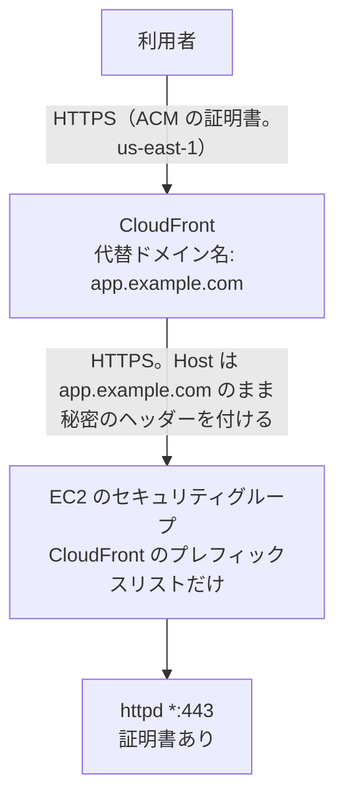

# CloudFront → EC2 への移行の手順

> 位置付け: 利用者から見た SSL/TLS の終端を CloudFront へ移す手順の下書き。比較は [README](./README.md)、httpd の設定は [cloudfront-to-ec2-httpd.md](./cloudfront-to-ec2-httpd.md)。
>
> 確かめた範囲: AWS の仕様は AWS のドキュメントと照らし合わせた（2026-11-09）。httpd の設定は、今の構成に近いコンテナで確かめた（2026-11-10。[結果](./cloudfront-to-ec2-httpd.md#検証の結果)）。**AWS のコマンドは実行していない。実際の CloudFront でも試していない**。`<...>` は環境に合わせて置き換える。
>
> 作成日: 2026-11-09

## 移行後の形



CloudFront から EC2 まではインターネットを通るので、オリジンへは **HTTPS Only** にする。EC2 の証明書は残る。ALB を通さないことのデメリットは [README](./README.md#alb-を通さないことのデメリット) にまとめた。

## 手順

### 1. 事前の確認

| 確認 | 内容 |
|---|---|
| DNS の TTL | 切り替えの前に短くして、元の TTL が過ぎるまで待つ |
| オリジンの名前 | 公開の DNS で引ける名前が要る（IP アドレスは指定できない）。`app.example.com` は CloudFront を指すことになるので、**別の名前**（例: `origin.app.example.com` → Elastic IP）を作る |
| セキュリティグループの枠 | CloudFront のプレフィックスリストは **55 件**に数えられる。既定の上限は 60 なので、同じグループには残り 5 件しか足せない。専用のグループを作るか、上限の引き上げを申請する |
| アプリ | 応答に 30 秒以上かかる処理、`GET` で状態を変える処理（下の注意）、`Authorization` ヘッダーの利用 |

### 2. ACM の証明書を `us-east-1` に用意する

```bash
aws acm request-certificate --region us-east-1 \
  --domain-name <ドメイン> --validation-method DNS
```

### 3. httpd を設定する

[cloudfront-to-ec2-httpd.md](./cloudfront-to-ec2-httpd.md) のとおりに設定する。秘密のヘッダーの確認は、DNS の切り替えが行き渡ってから入れる（手順 9）。先に入れると、まだ EC2 へ直接来ている利用者が 403 になる。

### 4. CloudFront のディストリビューションを作る

| 項目 | 設定 | 理由 |
|---|---|---|
| Origin domain | `origin.app.example.com` | 公開の DNS 名が要る |
| Protocol | **HTTPS only** | インターネットを通るため |
| Minimum origin SSL protocol | TLSv1.2 | |
| Add custom header | `X-Origin-Verify: <長いランダムな値>` | 直接のアクセスの見分け |
| Response timeout | アプリの最長の応答に合わせる | 既定 30 秒、1〜120 秒 |
| Keep-alive timeout | 既定（5 秒） | httpd の `KeepAliveTimeout` をこれより長くする |
| Viewer protocol policy | Redirect HTTP to HTTPS | |
| Allowed HTTP methods | GET, HEAD, OPTIONS, PUT, POST, PATCH, DELETE | フォームと API のため |
| Cache policy | `CachingDisabled` | 利用者ごとに違う応答を保存しない |
| Origin request policy | **`AllViewer`** | Host、Cookie、クエリ文字列、`Authorization` を渡す |
| Alternate domain name | `<ドメイン>` | |
| Custom SSL certificate | 手順 2 の証明書 | |

**注意**:

- オリジンの応答がタイムアウトしたとき、`GET`・`HEAD` は CloudFront が再試行する（既定で最大 3 回）。`GET` で状態を変える処理があれば、二重に実行されることがある。`POST` などは再試行しない。
- 静的なファイルをキャッシュするなら、落ち着いてから `/assets/*` などのビヘイビアを足す。

### 5. CloudFront からの通信を EC2 まで通す

**セキュリティグループ**: 専用のグループを作って、インスタンスに足す。今の許可は残す。

```bash
aws ec2 describe-managed-prefix-lists \
  --filters Name=prefix-list-name,Values=com.amazonaws.global.cloudfront.origin-facing

aws ec2 authorize-security-group-ingress --group-id <専用のグループ> \
  --ip-permissions 'IpProtocol=tcp,FromPort=443,ToPort=443,PrefixListIds=[{PrefixListId=<pl-...>}]'
```

**port-guard**: CloudFront の拠点のアドレスは日本の範囲にほとんど入らないので、そのままでは CloudFront からの通信が止まる。次のどちらかにする。

| 方法 | 内容 |
|---|---|
| 許可の一覧に足す（勧める） | `ip-ranges.json` の `CLOUDFRONT_ORIGIN_FACING` の範囲を port-guard の許可の一覧へ足す。**直接のアクセスは日本に絞ったまま**、CloudFront を通せる。反映のしかたは [port-guard-rollout の手順](../port-guard-rollout/steps.md)で確かめる |
| port-guard を外す | [国での絞り込みの順番](../notes/ec2-operations/access-restriction-alb-cloudfront.md#切り替えるときの順番)のとおり。手順 8 までの間、直接のアクセスの絞り込みがなくなる |

### 6. 切り替えの前に確かめる

CloudFront の `*.cloudfront.net` の名前の IP へ、本番のドメインで接続する。

```bash
dig +short <ディストリビューションのドメイン名>
curl -v --resolve <ドメイン>:443:<CloudFront の IP> https://<ドメイン>/
```

| 確認 | 期待 |
|---|---|
| 応答の見出し | `Via` に `cloudfront.net`、`X-Cache: Miss from cloudfront` |
| ログイン、フォームの送信、ファイルのアップロード | 動く |
| リダイレクト先 | `https://<ドメイン>/...`（`origin.app.example.com` が出ない） |
| `access.log` の送り元 | 利用者の IP になる |
| 502 が出るとき | オリジンの証明書（名前の不一致、期限切れ、中間証明書の不足） |

### 7. 国で絞るなら設定する

| 方法 | 内容 |
|---|---|
| 地理的制限 | 追加の料金なし。パスごとの例外はできない |
| WAF（`us-east-1` に web ACL） | 個別の IP の許可やパスの例外ができる。[証明書の更新](./cloudfront-to-ec2-httpd.md#証明書の更新)を HTTP-01 で続けるなら、`/.well-known/acme-challenge/` を例外にする |

### 8. DNS を切り替える

DNS を CloudFront へ向ける。Route 53 ならエイリアスレコードにする（IPv6 を有効にしているなら A と AAAA の 2 つ）。

### 9. 落ち着いたら片付ける

| 順番 | 作業 |
|---|---|
| 1 | httpd の[秘密のヘッダーの確認](./cloudfront-to-ec2-httpd.md#3-秘密のヘッダーを確認する)を有効にする。`curl -v https://origin.app.example.com/` が 403 になり、CloudFront 経由は通ることを確かめる |
| 2 | EC2 のグループから、`0.0.0.0/0` などの 80・443 番の許可を消す |
| 3 | 国の絞り込みを CloudFront へ移し、直接のアクセスがセキュリティグループで止まることを確かめてから、port-guard を外す |
| 4 | 証明書の更新が新しい経路で成功することを確かめる（`sudo certbot renew --dry-run`） |
| 5 | 証明書の有効期限の監視を入れる。**オリジンの証明書が切れると、すべての利用者に 502 が返る** |

## 元に戻す

手順 9 の前なら、DNS を Elastic IP へ戻すだけでよい。httpd の秘密のヘッダーの確認は、直接のアクセスも止めるので、戻すときは先に外す。

## 確かめること（動かしていない点）

| 項目 | 内容 |
|---|---|
| オリジンへの SNI | `AllViewer` で Host を渡すときに、CloudFront が送る SNI が利用者の Host になるか（AWS のドキュメントでは確かめられなかった）。コンテナの httpd は、SNI が別の名前でも、SNI がなくても 200 を返した。実際の環境で、httpd が別の VirtualHost の証明書を返さないことを確かめる |
| `CachingDisabled` と `AllViewer` の組み合わせ | Cookie と `Set-Cookie`、`Authorization` が期待どおり通ること |
| ファイルのアップロード | 応答タイムアウトに収まること |

## 参考

AWS のドキュメントと照らし合わせた（2026-11-09）。

- [Require HTTPS between CloudFront and your custom origin](https://docs.aws.amazon.com/AmazonCloudFront/latest/DeveloperGuide/using-https-cloudfront-to-custom-origin.html)
- [Origin settings](https://docs.aws.amazon.com/AmazonCloudFront/latest/DeveloperGuide/DownloadDistValuesOrigin.html)
- [Cache behavior settings](https://docs.aws.amazon.com/AmazonCloudFront/latest/DeveloperGuide/DownloadDistValuesCacheBehavior.html)
- [Use managed cache policies](https://docs.aws.amazon.com/AmazonCloudFront/latest/DeveloperGuide/using-managed-cache-policies.html)
- [Use managed origin request policies](https://docs.aws.amazon.com/AmazonCloudFront/latest/DeveloperGuide/using-managed-origin-request-policies.html)
- [Add custom headers to origin requests](https://docs.aws.amazon.com/AmazonCloudFront/latest/DeveloperGuide/add-origin-custom-headers.html)
- [Locations and IP address ranges of CloudFront edge servers](https://docs.aws.amazon.com/AmazonCloudFront/latest/DeveloperGuide/LocationsOfEdgeServers.html)
- [AWS-managed prefix lists（weight）](https://docs.aws.amazon.com/vpc/latest/userguide/working-with-aws-managed-prefix-lists.html)
- [Routing traffic to a CloudFront distribution](https://docs.aws.amazon.com/Route53/latest/DeveloperGuide/routing-to-cloudfront-distribution.html)
