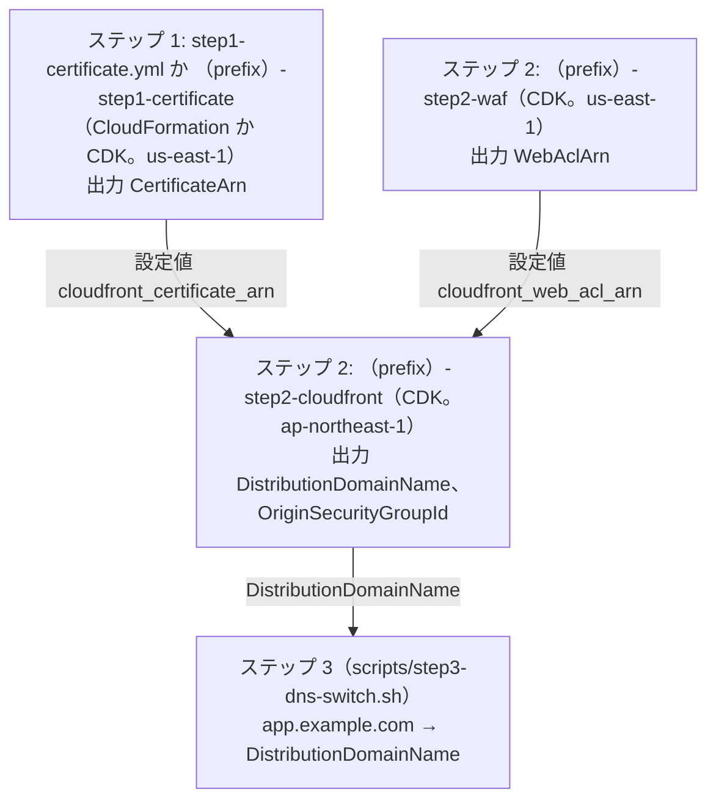

# 定義（CloudFormation の YAML と CDK）

> 位置付け: B. CloudFront → EC2 への移行の 3 つのステップのうち、ステップ 1・2 で使う定義の中身。同じ内容を CloudFormation の YAML（`cloudformation/`）と CDK（Python。`cdk/python/`）の 2 通りで置いている。**手順で使うのは、ステップ 1 が CloudFormation の YAML か CDK（手順書に両方を書いた）、ステップ 2 が CDK**（[README の T9](./README.md#決めたこと)）。ステップ 3 はシェルスクリプト `scripts/step3-dns-switch.sh`。CDK のコマンドは [cdk/python/README.md](./cdk/python/README.md)。手順の全体は [README](./README.md#3-つのステップ)。
>
> 状態: **骨組み（AWS へのデプロイはしていない）**。YAML と CDK の出力は `cfn-lint` 1.60.0 を警告なしで通した（2026-11-12）。CDK は `aws-cdk-lib` 2.275.0 で合成し、3 つのステップの形に組み替える前と後で、リソースの中身が同じであることを確かめた（違いはスタック名から決まる名前と説明だけ。2026-11-12）。合成の結果は YAML と内容を突き合わせた（下の「YAML と CDK の違い」）。
>
> 作成日: 2026-11-10（3 つのステップの順に並べ直した: 2026-11-12）

## 用語

[README の用語](./README.md#用語)と同じ。スタック名の `<prefix>` は、環境ごとの頭（例 `myapp-production`。CDK は設定値の `stack_name_prefix`）。

## ステップと定義の対応

| ステップ | 定義（CloudFormation） | CDK のスタック | 手順で使う | リージョン | 作るもの |
|---|---|---|---|---|---|
| 1 | `cloudformation/step1-certificate.yml` | `<prefix>-step1-certificate` | **CloudFormation か CDK**（どちらか一方） | `us-east-1` | CloudFront の証明書（ACM で作成する場合。登録する場合は使わない） |
| 2 | `cloudformation/step2-waf.yml` | `<prefix>-step2-waf` | **CDK** | `us-east-1` | CloudFront 用の WAF の web ACL（国の絞り込み）、例外の IP の一覧 |
| 2 | `cloudformation/step2-cloudfront.yml` | `<prefix>-step2-cloudfront` | **CDK** | `ap-northeast-1` | CloudFront、オリジン用のセキュリティグループ、オリジンの名前の Route 53 のレコード（任意） |
| 3 | なし | なし | **シェルスクリプト** `scripts/step3-dns-switch.sh`（[比べた表](./step3-dns-switch.md#シェルスクリプトにした理由)） | — | 利用者のドメイン名の A レコードの置き換え（Route 53） |

ステップの順にデプロイする。後のステップは、前のステップの出力（ARN）を受け取る（ステップ 1 の `CertificateArn` は CDK の設定値 `cloudfront_certificate_arn` に書く。スタックの Export は使わない）。手順で使わない書き方（ステップ 2 の YAML）も、同じ内容として残している。



### オプション（採用しなかった構成）

| 構成 | 定義（CloudFormation） | CDK のスタック（`option_stacks` で指定したときだけ） | 手順 |
|---|---|---|---|
| A. ALB → EC2 | `cloudformation/options/alb-to-ec2.yml` | `<prefix>-option-alb-to-ec2` | [options/alb-to-ec2.md](./options/alb-to-ec2.md) |
| C. CloudFront → ALB → EC2 | `cloudformation/options/cloudfront-alb-to-ec2.yml` | `<prefix>-option-cloudfront-alb-to-ec2` | [options/cloudfront-alb-to-ec2.md](./options/cloudfront-alb-to-ec2.md) |

前の版にあった `cloudfront-to-ec2.yml`（利用者のドメイン名を変えることも想定した B）は、`step2-cloudfront.yml` から Route 53 のレコードと名前の確認を除いただけの同じ定義だったので、`step2-cloudfront.yml` に一本化した（2026-11-12）。

## ファイル

```
cloudformation/
  step1-certificate.yml        ステップ 1（CloudFormation で行うとき）
  step2-waf.yml                ステップ 2 の YAML 版（手順では CDK を使う）
  step2-cloudfront.yml         ステップ 2 の YAML 版（同上）
  options/                     オプション（A・C）
scripts/
  step3-dns-switch.sh          ステップ 3（Route 53 の A レコードの置き換えと戻し）
cdk/python/
  app.py                       設定値ファイルからスタックを定義する
  README.md                    使い方と実行コマンド
  config.example.yml           設定値の例
  tls_termination_cdk/
    configuration.py           設定値の読み込みと検証
    stacks/
      __init__.py              どのスタックを定義するか（本線の 3 つと、option_stacks で指定したオプション）
      common.py                スタックの土台、CloudFront のディストリビューション、秘密のヘッダーのパラメータ、オリジン用のセキュリティグループ
      step1_certificate.py     ステップ 1（CDK で行うとき）
      step2_waf.py
      step2_cloudfront.py
      options/                 オプション（A・C と、2 つで共用する ALB の部分 alb.py）
```

CDK は L2 で書いているので、論理 ID は CloudFormation の YAML と違う。YAML でデプロイしたスタックを CDK の出力で更新しない。逆も同じ。

## 定義に含めるもの・含めないもの

| もの | 含めるか | 内容・理由 |
|---|---|---|
| CloudFront の証明書 | ステップ 1 に含める | ACM で作成する場合だけ。既存の証明書の登録は CloudFormation が対応していないので、AWS CLI で行う（[ステップ 1 の 1-B](./step1-acm-certificate.md#1-b-既存の証明書を登録するオプション)） |
| WAF の web ACL | ステップ 2 に含める | 国の絞り込み、例外の IP（下の「ステップ 2 の WAF」）。マネージドルールとログは既定では含めない（[オプション](./options/waf-managed-rules.md)） |
| CloudFront | ステップ 2 に含める | HTTPS only、`CachingDisabled`、`AllViewer`、秘密のヘッダー。地理的制限の設定も持つが、既定は使わない |
| オリジン用のセキュリティグループ | ステップ 2 に含める | CloudFront のプレフィックスリストから 443 番を許可する |
| オリジンの名前の DNS のレコード | ステップ 2 に任意で含める | Route 53（ステージング）なら `OriginHostedZoneId`・`OriginElasticIp` で作る。外部の DNS サービス（本番）なら空にして手で足す |
| 利用者のドメイン名の DNS のレコード | **含めない** | 今もあるレコードで、ステップ 3 で AWS CLI で変える（[README の T8](./README.md#決めたこと)） |
| 稼働サーバーへのセキュリティグループの付け替え | **含めない** | 出力 `OriginSecurityGroupId` を、既存のグループに**足して**付ける（[ステップ 2 の 2-4](./step2-cloudfront.md#2-4-オリジン用のセキュリティグループを稼働サーバーに足す)） |
| 静的なファイルのキャッシュ | 含めない | 使うと決まってから足す |

## ステップ 1 の証明書

| パラメータ（CloudFormation） | CDK の設定値 | 内容 |
|---|---|---|
| `DomainName` | `domain_name` | 利用者のドメイン名（`app.example.com`） |
| `HostedZoneId` | `certificate_hosted_zone_id` | `app.example.com` のホストゾーンが同じアカウントの Route 53 にあるなら指定する（ステージング）。検証用のレコードが自動で作られる。空にすると、ACM が示す CNAME を DNS に足すまで、スタックは `CREATE_IN_PROGRESS` のまま待つ（本番） |

`us-east-1` 以外でデプロイすると、テンプレートの規則（`Rules`）で止まる。出力は `CertificateArn`。

## ステップ 2 の WAF（国の絞り込み）

CloudFront → EC2 では、WAF で国を絞る（2026-11-11 に決めた）。特定の IP を例外にでき、オリジンの証明書（Let's Encrypt）を CloudFront 経由の HTTP-01 で更新し続けるため、確認のパスだけはどの国からも通す。**既定の WAF は、この国の絞り込みだけにする**（2026-11-13。[README の T10](./README.md#決めたこと)）。AWS のマネージドルールとログは既定では入れず、オプションとして [options/waf-managed-rules.md](./options/waf-managed-rules.md) に入れ方と外す前の設定値を残した。

| ルール | 優先順位 | 条件 | 動作 |
|---|---|---|---|
| `AllowAcmeChallenge` | 0 | パスが `/.well-known/acme-challenge/` で始まる。比べる前に `URL_DECODE`、`NORMALIZE_PATH` の順で変換する | 通す（以降のルールは見ない） |
| `BlockOutsideAllowedCountries` | 1 | 送り元の国が許可する国（既定 `JP`）になく、**かつ**例外の IP の一覧（IPv4・IPv6）にもない | 止める（CloudFront が 403 を返す） |
| 既定の動作 | — | どれにも当たらない（許可する国か、例外の IP から来た要求） | 通す |

- **変換の理由**: `/.well-known/acme-challenge/../../admin` や `%2e%2e` のように、例外のパスで始まって外へ出る要求を、例外に当てないため。`NORMALIZE_PATH` は重複したスラッシュ、`.`、`..` を取り除く
- **CloudFront の地理的制限は使わない**: 地理的制限で止めた要求は WAF に届かないので、パスの例外を作れない。`step2-cloudfront.yml` のパラメータ `GeoRestrictionType` の既定は `none`（CDK は `geo_restriction_countries` の既定が空）。`whitelist` にすると、HTTP-01 の更新が止まる
- **国の判定**: 送り元の IP アドレス（CloudFront に接続した利用者）で行う。`X-Forwarded-For` は使わない（利用者が書き換えられるため）
- **料金**: web ACL 1 つで月 $5、ルール 1 つで月 $1、100 万リクエストごとに $0.60（2026-11-09 確認）。ルール 2 つで、月 $7 と要求の料金
- **キャパシティ（WCU）**: 自分で書いた 2 つのルールで約 25。web ACL の上限 1,500 に十分収まる
- **止めた要求の見方**: web ACL の CloudWatch のメトリクス（ルールごと）と、サンプルのリクエスト。全件のログは既定では残さない（残すなら [options/waf-managed-rules.md のログ](./options/waf-managed-rules.md#ログ)。ログだけを足すこともできる）
- **httpd**: 443 番の VirtualHost に確認のパスの設定が要る（[証明書の更新](./cloudfront-to-ec2-httpd.md#証明書の更新)。[準備](./step0-preparation.md#3-稼働サーバーの-httpd-の設定)で入れる）
- `CloudFrontWebAclArn` は空でもデプロイできる（その間は国で絞らない）。一旦、任意のままにする（2026-11-11。必須にするかは後で決め直す）。**本番で空にしない**

| パラメータ（CloudFormation） | CDK の設定値 | 内容 |
|---|---|---|
| `AllowedCountries` | `waf_allowed_countries` | 許可する国（ISO 3166-1 alpha-2。既定 `JP`。CDK は空だとエラー） |
| `ExceptionIpv4Addresses`、`ExceptionIpv6Addresses` | `waf_exception_ipv4_addresses`、`waf_exception_ipv6_addresses` | 許可する国の外から通す IP（CIDR。例 `192.0.2.44/32`）。既定は空。一覧は空でも作っておくので、例外を足すときは値を変えて更新するだけでよい |

出力は `WebAclArn`（`step2-cloudfront.yml` の `CloudFrontWebAclArn`、CDK の設定値 `cloudfront_web_acl_arn` に渡す）。

### 定義の中身と、それぞれが要る理由

「許可する国でなく、例外の IP でもない要求を止める」ために、定義には次のものが要る。`stacks/step2_waf.py` は 155 行（コメント込み）、`step2-waf.yml` は 138 行（2026-11-13）。

| 部分 | 要る理由 |
|---|---|
| 例外の IP の一覧（`AWS::WAFv2::IPSet` を 2 つ） | WAF のルールには IP アドレスを直接書けず、IP の一覧（IPSet）を別のリソースとして作り、ARN で参照する決まり。1 つの一覧は IPv4 か IPv6 のどちらかしか持てない（`IPAddressVersion`）ので、2 つ作る。設定値が IPv4 と IPv6 で分かれているのもこのため |
| `BlockOutsideAllowedCountries` | WAF のルールは「条件に当たったら 1 つの動作」しか書けず、「止める。ただしこの IP は除く」という書き方がない。そこで「許可する国でない」**かつ**「IPv4 の例外でない」**かつ**「IPv6 の例外でない」を、否定（NOT）と論理積（AND）で組む。例外の IP を先に「通す」ルールにする書き方もあるが、通すはそこで評価を終えるので、オプションのマネージドルールを足したときに例外の IP が素通りする。足せる形のままにしておくため、この形にした |
| `AllowAcmeChallenge` | Let's Encrypt の確認の要求は海外からも来るので、国で絞ると、オリジンの証明書の HTTP-01 の更新が止まる。確認のパスだけを先に通す。パスの比べ方の変換は、`/.well-known/acme-challenge/../` のような抜け道を塞ぐため |
| web ACL と、メトリクスの設定（`VisibilityConfig`） | どのルールにも web ACL にも、メトリクスとサンプルの設定が必須（CloudFormation の決まり）。CDK では同じ形を関数 `_visibility` にまとめた |
| `us-east-1` の確認（YAML の `Rules`、CDK のスタックのリージョン） | CloudFront 用の web ACL は `us-east-1` に作る決まり |

## ステップ 2 の CloudFront

| パラメータ（CloudFormation） | CDK の設定値 | 内容 |
|---|---|---|
| `VpcId` | `vpc_id` | オリジン用のセキュリティグループを作る VPC（稼働サーバーの VPC） |
| `CloudFrontPrefixListId` | `cloudfront_prefix_list_id` | `com.amazonaws.global.cloudfront.origin-facing` の ID（リージョンごとに違う） |
| `DomainName` | `domain_name` | 利用者のドメイン名。代替ドメイン名になる |
| `OriginDomainName` | `origin_domain_name` | オリジンの名前。`DomainName` と同じだとデプロイのとき（CDK は合成のとき）に止まる |
| `CloudFrontCertificateArn` | `cloudfront_certificate_arn` | ステップ 1 の `CertificateArn`。CDK は空の間このスタックを合成しない |
| `CloudFrontWebAclArn` | `cloudfront_web_acl_arn` | ステップ 2 の WAF の `WebAclArn` |
| `OriginVerifyHeaderValue` | なし（デプロイのときのパラメータ） | 秘密のヘッダーの値（32 文字以上。下の「秘密のヘッダーの値」） |
| `OriginHostedZoneId`、`OriginElasticIp` | `origin_hosted_zone_id`、`origin_elastic_ip` | オリジンの名前の A レコードも作るときに 2 つとも指定する（ステージング）。本番は空 |
| `OriginReadTimeoutSeconds`、`OriginKeepaliveTimeoutSeconds` | `origin_read_timeout_seconds`、`origin_keepalive_timeout_seconds` | 既定 30 秒・5 秒 |
| `GeoRestrictionType`、`GeoRestrictionCountries` | `geo_restriction_countries` | 地理的制限。**既定は使わない**（上の WAF の節） |

出力は `DistributionDomainName`（ステップ 2 の確認とステップ 3 で使う）と `OriginSecurityGroupId`（稼働サーバーに足す）。設定の一覧と理由は [ステップ 2 の 2-3](./step2-cloudfront.md#2-3-cloudfront-とオリジン用のセキュリティグループ)。

### 秘密のヘッダーの値

`OriginVerifyHeaderValue` は**デプロイのときのパラメータ**で渡す（32 文字以上）。`NoEcho` にしているのでテンプレートと `describe-stacks` には出ないが、CloudFront の設定を読める人には見える。

```bash
openssl rand -hex 32
```

## 使い方

どちらの書き方でも、変更の中身を確かめてから反映する。下は CloudFormation の YAML の形。CDK は、`cdk deploy` で直接反映するか、CDK から出したテンプレート（`cdk synth <スタック名>` の YAML）を同じコマンドで反映する（[cdk/python/README.md のデプロイ](./cdk/python/README.md#デプロイ)）。

```bash
# 1. 変更セットを作る（反映はしない）
aws cloudformation deploy --region <リージョン> --no-execute-changeset \
  --template-file cloudformation/<ステップの定義>.yml \
  --stack-name <prefix>-<step1-certificate など> \
  --parameter-overrides <パラメータ>

# 2. 中身を確かめる
aws cloudformation describe-change-set --region <リージョン> \
  --stack-name <スタック名> --change-set-name <1 の出力の名前>

# 3. 反映する
aws cloudformation execute-change-set --region <リージョン> \
  --stack-name <スタック名> --change-set-name <1 の出力の名前>
```

ステップごとのコマンド（パラメータの具体的な形）は、各ステップのドキュメントにある。

| ステップ | 道具 | コマンド |
|---|---|---|
| 1 | CloudFormation か CDK | [ステップ 1 の 1-A](./step1-acm-certificate.md#1-a-acm-で作成する採用) |
| 2（WAF） | CDK | [ステップ 2 の 2-1](./step2-cloudfront.md#2-1-waf-の-web-acl) |
| 2（CloudFront） | CDK | [ステップ 2 の 2-3](./step2-cloudfront.md#2-3-cloudfront-とオリジン用のセキュリティグループ) |
| 3 | シェルスクリプト | [ステップ 3 の 3-1・3-2](./step3-dns-switch.md#3-1-流す変更を確かめる) |

## YAML と CDK の違い

合成の結果を YAML と項目ごとに比べた（セキュリティグループ、ディストリビューション、証明書、WAF。オプションはターゲットグループ、リスナー、ルールも）。違いは次のとおりで、動作は同じ見込み。

| 項目 | YAML | CDK の出力 |
|---|---|---|
| プレフィックスリストからの許可 | セキュリティグループの中に書く | 別のリソース（`AWS::EC2::SecurityGroupIngress`） |
| オリジン用のグループの外向き | 省略（既定の全許可） | 全許可を明示 |
| オリジンの `HTTPSPort` | `443` を明示 | 省略（既定の 443） |
| ACM の証明書の `Name` タグ | なし | CDK が付ける |
| 論理 ID | 短い名前 | CDK が生成する名前 |
| ALB の `deletion_protection.enabled`（オプション） | 省略（既定の `false`） | `false` を明示 |
| `RestrictToCloudFront`（オプションの C） | パラメータで切り替える | 設定値で切り替える（合成し直す） |

CDK の ALB のセキュリティグループの外向きは、L2 の `add_egress_rule` を使わず、L1 のプロパティで直接書いている。理由は `tls_termination_cdk/stacks/options/alb.py` のコメントのとおり。

## 確かめること

| 項目 | 内容 |
|---|---|
| AWS での検証 | 変更セットの作成と、実際のデプロイ。`cfn-lint` はプロパティの形を見るだけで、ID の実在や権限は見ない |
| オプションの既存のセキュリティグループへの許可の追加 | オプションの A・C で、スタックを消すと、足した許可も消える |

## 参考

AWS のドキュメントと照らし合わせた（2026-11-09、2026-11-10）のは、各ステップのドキュメントの「参考」と、次のページ。

- [AWS::EC2::SecurityGroup（既定の外向きの規則）](https://docs.aws.amazon.com/AWSCloudFormation/latest/TemplateReference/aws-resource-ec2-securitygroup.html)
- [AWS::EC2::SecurityGroupEgress](https://docs.aws.amazon.com/AWSCloudFormation/latest/TemplateReference/aws-resource-ec2-securitygroupegress.html)
- [AWS::CertificateManager::Certificate（DNS 検証）](https://docs.aws.amazon.com/AWSCloudFormation/latest/TemplateReference/aws-resource-certificatemanager-certificate.html)

WAF は 2026-11-11 に照らし合わせた（マネージドルールとログの参考は [options/waf-managed-rules.md の参考](./options/waf-managed-rules.md#参考)）。

- [AWS::WAFv2::WebACL（CLOUDFRONT は us-east-1 に作る、GetAtt の Arn）](https://docs.aws.amazon.com/AWSCloudFormation/latest/TemplateReference/aws-resource-wafv2-webacl.html)
- [Geographic match rule statement（CloudFront の地理的制限で止めた要求は WAF に届かない、送り元の IP で判定）](https://docs.aws.amazon.com/waf/latest/developerguide/waf-rule-statement-type-geo-match.html)
- [String match rule statement（Starts with、変換は並べた順に行う）](https://docs.aws.amazon.com/waf/latest/developerguide/waf-rule-statement-type-string-match.html)
- [Using text transformations（URL_DECODE、NORMALIZE_PATH）](https://docs.aws.amazon.com/waf/latest/developerguide/waf-rule-statement-transformation.html)
- [AWS::WAFv2::IPSet（Addresses は空の配列でよい、CIDR で書く、IPAddressVersion は IPV4 か IPV6）](https://docs.aws.amazon.com/AWSCloudFormation/latest/TemplateReference/aws-resource-wafv2-ipset.html)
- [AWS::WAFv2::WebACL Rule（VisibilityConfig は必須、Action と OverrideAction はどちらか一方）](https://docs.aws.amazon.com/AWSCloudFormation/latest/TemplateReference/aws-properties-wafv2-webacl-rule.html)（2026-11-13）
