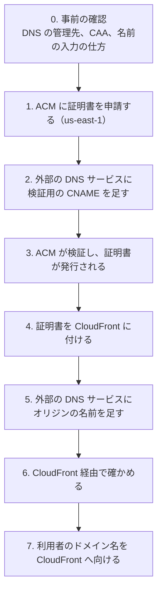

# 外部の DNS サービスで管理しているドメインに ACM の証明書を用意する

> 位置付け: 利用者のドメイン名の DNS を Route 53 ではなく外部の DNS サービスで管理している場合に、ACM の証明書を発行して CloudFront（または ALB）に付け、DNS を切り替えるまでの流れ。この移行では**本番**が当てはまる（ステージングは Route 53。2026-11-11 に聞いた）。全体の構成は [cloudfront-to-ec2-domains-certificates.md](./cloudfront-to-ec2-domains-certificates.md)、切り替えの順番は [cloudfront-to-ec2-same-domain.md](./cloudfront-to-ec2-same-domain.md#切り替えの順番)。
>
> 確かめた範囲: ACM・CloudFormation の仕様は AWS のドキュメントと照らし合わせた（2026-11-11）。**AWS のコマンドは実行しておらず、外部の DNS サービスでも試していない**。
>
> `app.example.com`・`origin.app.example.com` は例である。
>
> 作成日: 2026-11-11

## 用語

| 用語 | 指すもの |
|---|---|
| 利用者のドメイン名 | 利用者が使う名前（`app.example.com`）。移行の前後で変わらない |
| オリジンの名前 | CloudFront が稼働サーバーへ接続するためだけに使う名前（`origin.app.example.com`） |
| 稼働サーバー | CloudFront の接続先の EC2（httpd） |
| 外部の DNS サービス | `example.com` のゾーン（DNS のレコード）を管理しているサービス。**レジストラ（ドメインを買った先）と同じとは限らない** |
| 外向きの証明書 | 利用者と CloudFront の間で使う、ACM の証明書 |
| 検証用の CNAME | ACM が示す `_<文字列>.app.example.com` → `_<文字列>.acm-validations.aws.` のレコード。ドメインを持っていることの証明と、自動更新に使う |

## 流れの全体

「AWS で証明書を申請する → 外部の DNS サービスに検証用の CNAME を足す → 発行された証明書を CloudFront（または ALB）に付ける」は、Route 53 を使わない場合の一般的な流れで、ACM のドキュメントもこの手順を示している。DNS のレコードを足す先は、レジストラではなく外部の DNS サービスである。



| 順 | 作業 | 場所 | 利用者への影響 |
|---|---|---|---|
| 0 | DNS の管理先、CAA、名前の入力の仕方を確かめる | 手元 | なし |
| 1 | 証明書を申請する | AWS（`us-east-1`） | なし |
| 2 | 検証用の CNAME を足す | 外部の DNS サービス | なし |
| 3 | 証明書が「発行済み」になるのを待つ | AWS | なし |
| 4 | 証明書を CloudFront に付ける | AWS（`ap-northeast-1` のスタック） | なし |
| 5 | `origin.app.example.com` → 稼働サーバーの Elastic IP を足す | 外部の DNS サービス | なし |
| 6 | CloudFront 経由で確かめる | 手元 | なし |
| 7 | `app.example.com` を CloudFront へ向ける | 外部の DNS サービス | 順次 CloudFront 経由になる |

ステージングと本番の違いは次のとおり。

| 作業 | ステージング（Route 53） | 本番（外部の DNS サービス） |
|---|---|---|
| 2. 検証用の CNAME | 証明書のスタックの `HostedZoneId` を指定すれば自動 | 手で足す |
| 5. オリジンの名前 | CloudFront のスタックの `OriginHostedZoneId`・`OriginElasticIp` を指定すれば自動 | 手で足す（2 つのパラメータは空にする） |
| 7. 利用者のドメイン名 | 手で変える（エイリアスの A レコード） | 手で変える（CNAME） |

## 0. 事前の確認

```bash
# DNS の管理先（ネームサーバー）。レジストラではなく、ここに出るサービスでレコードを足す
dig +short NS example.com

# CAA。app.example.com になければ親のドメインが効くので、両方を見る
dig +short CAA app.example.com
dig +short CAA example.com

# 今の向き先と TTL（7 の前に TTL を短くするため）
dig app.example.com
```

| 確かめること | 内容 |
|---|---|
| DNS の管理先と、レコードを変える権限 | 権限がなければ、管理している人に頼む。頼む内容は 2・5・7 の 3 回ある |
| CAA | 結果が空なら対応は要らない。`letsencrypt.org` などだけが書かれていると、ACM は発行できない。Amazon を許可する行を足す（Let's Encrypt の行は、稼働サーバーの証明書で使うので残す）。Amazon を許可する値は、AWS のドキュメントで確かめられなかった（2026-11-11）。CAA があったときに確かめる |
| 名前の欄の入力の仕方 | サービスによって、名前を `_<文字列>.app.example.com.` と完全な形で入れるものと、`_<文字列>.app` のように、ゾーンの名前を自動で付け足すものがある。間違えると `..example.com.example.com.` になり、検証が失敗する（ACM のドキュメントの注意） |
| 先頭の `_` | 先頭が `_` の名前を受け付けないサービスがある（ACM のドキュメントの注意。その場合は ACM のトラブルシューティングを見る） |

## 1. 証明書を申請する

CloudFront に付ける証明書は **`us-east-1`** に作る（ALB に付けるなら、ALB と同じリージョン）。定義の証明書のスタックを、`HostedZoneId` を空にして作る。

```bash
aws cloudformation deploy --region us-east-1 \
  --template-file cloudformation/cloudfront-to-ec2-same-domain-certificate.yml \
  --stack-name <スタック名>-certificate \
  --parameter-overrides DomainName=app.example.com
```

ドメインが Route 53 にない場合、**スタックは検証が終わるまで `CREATE_IN_PROGRESS` のまま待つ**（AWS のドキュメントの記述）。上のコマンドは戻ってこないので、2 の作業は別の端末で行う。

## 2. 検証用の CNAME を足す

別の端末で、ACM が示すレコードを取り出す。

```bash
# 証明書の ARN
aws acm list-certificates --region us-east-1 \
  --certificate-statuses PENDING_VALIDATION \
  --query "CertificateSummaryList[?DomainName=='app.example.com'].CertificateArn" --output text

# 足すレコード（Name、Type、Value）
aws acm describe-certificate --region us-east-1 --certificate-arn <ARN> \
  --query 'Certificate.DomainValidationOptions[].ResourceRecord'
```

申請の直後は `ResourceRecord` がまだ空のことがある見込みで、その場合は少し待って流し直す（確かめていない）。

外部の DNS サービスに、次の形のレコードを足す。TTL は既定のままでよい。

| 名前 | 種類 | 値 |
|---|---|---|
| `_<文字列>.app.example.com.`（入力の仕方は 0 のとおり） | CNAME | `_<文字列>.acm-validations.aws.` |

**このレコードは消さない**。ACM は、証明書が使われていて、このレコードが残っている間、自動で更新する。消すと自動更新が止まる。

## 3. 発行を待つ

```bash
# 足したレコードが引けるか
dig +short CNAME _<文字列>.app.example.com

# 証明書の状態（ISSUED になれば発行済み）
aws acm describe-certificate --region us-east-1 --certificate-arn <ARN> \
  --query 'Certificate.Status' --output text
```

発行されると、1 のスタックが `CREATE_COMPLETE` になる。出力の `CertificateArn` を 4 で使う。

**ACM が CNAME を作ってから 72 時間以内に検証できないと、証明書は `Validation timed out` になり、新しく申請し直す必要がある**（ACM のドキュメントの記述）。その場合は、スタックを消して 1 からやり直す。2 の作業を頼む相手がいるなら、72 時間以内に足してもらえる段取りを先に付けてから 1 を始める。

## 4. 証明書を CloudFront に付ける

CloudFront のスタックの `CloudFrontCertificateArn` に、3 の ARN を渡す。WAF の web ACL も先に作っておく（[definitions.md](./definitions.md#国の絞り込みwaf)）。本番では `OriginHostedZoneId`・`OriginElasticIp` を空にする。

```bash
aws cloudformation deploy --region ap-northeast-1 --no-execute-changeset \
  --template-file cloudformation/cloudfront-to-ec2-same-domain.yml \
  --stack-name <スタック名> \
  --parameter-overrides VpcId=<VPC> CloudFrontPrefixListId=<pl-...> \
    DomainName=app.example.com OriginDomainName=origin.app.example.com \
    CloudFrontCertificateArn=<3 の ARN> CloudFrontWebAclArn=<web ACL の ARN> \
    OriginVerifyHeaderValue=<秘密の値>
```

CloudFront に `app.example.com` を代替ドメイン名として付けるには、その名前を含む証明書が要る。3 が済む前は、このスタックは作れない。

## 5. オリジンの名前を足す

| 名前 | 種類 | 値 |
|---|---|---|
| `origin.app.example.com` | A | 稼働サーバーの Elastic IP |

CloudFront のオリジンには、公開の DNS で引ける名前が要る（IP アドレスは指定できない）。4 より前に足してもよい。

## 6. CloudFront 経由で確かめる

DNS を変える前に、CloudFront のドメイン名（スタックの出力、`dxxxx.cloudfront.net`）へ、`app.example.com` として接続して確かめる。

```bash
curl -sI --connect-to app.example.com:443:dxxxx.cloudfront.net:443 https://app.example.com/
```

証明書の誤りがなく、アプリの応答が返ればよい。確かめる項目は [cloudfront-to-ec2-same-domain.md](./cloudfront-to-ec2-same-domain.md#切り替えの順番) の手順 6。

## 7. 利用者のドメイン名を CloudFront へ向ける

前もって `app.example.com` の TTL を短くし、元の TTL が過ぎてから変える。

| 名前 | 今 | 変えた後 |
|---|---|---|
| `app.example.com` | A（稼働サーバーの Elastic IP） | CNAME（`dxxxx.cloudfront.net`） |

- `app.example.com` は名前の頭に `app.` が付いているので、CNAME にできる。**`example.com` そのもの（ゾーンの頂点）は、DNS の決まりで CNAME にできない**。頂点を向けるなら、外部の DNS サービスに ALIAS・ANAME・CNAME flattening などの機能があるかで決まる
- 同じ名前に A と CNAME は並べられないので、A を消して CNAME を足す（サービスによっては種類の変更で行う）
- 戻すときは、CNAME を A（Elastic IP）に戻す。秘密のヘッダーの確認を入れた後は、先にその確認を外す（[切り替えの順番](./cloudfront-to-ec2-same-domain.md#切り替えの順番)）

## ALB に付ける場合

流れは同じで、違いは次の 2 つだけ。

- 証明書は、ALB と同じリージョンに作る（`us-east-1` ではない）
- 7 の向き先は、ALB の DNS 名（`xxxx.<リージョン>.elb.amazonaws.com`）

## 終わった後

| 項目 | 内容 |
|---|---|
| 検証用の CNAME | 消さない。DNS サービスを移すときも、一緒に移す |
| 更新 | ACM が自動で行う。作業は要らない |
| 同じ名前の証明書を作り直すとき | CNAME が残っていれば、検証をやり直さずに発行できる（別のリージョンでも同じ CNAME が使える。ACM のドキュメントの記述） |

## 参考

AWS のドキュメントと照らし合わせた（2026-11-11）。

- [AWS Certificate Manager DNS validation（外部の DNS での CNAME の足し方、名前の欄の注意、CNAME を残すと自動更新、72 時間で Validation timed out、別のリージョンでも同じ CNAME）](https://docs.aws.amazon.com/acm/latest/userguide/dns-validation.html)
- [AWS::CertificateManager::Certificate（Route 53 にないドメインは CREATE_IN_PROGRESS のまま待つ）](https://docs.aws.amazon.com/AWSCloudFormation/latest/TemplateReference/aws-resource-certificatemanager-certificate.html)
- [Requirements for using SSL/TLS certificates with CloudFront（us-east-1）](https://docs.aws.amazon.com/AmazonCloudFront/latest/DeveloperGuide/cnames-and-https-requirements.html)
- [Origin settings（Origin domain）](https://docs.aws.amazon.com/AmazonCloudFront/latest/DeveloperGuide/DownloadDistValuesOrigin.html)
