# オプション: 3 つの構成の比較

> 位置付け: **オプション（採用しなかった構成を含む比較）**。採用したのは **B. CloudFront → EC2**（2026-11-11）で、手順は [README](../README.md) の 3 つのステップ。このドキュメントは、構成を選んだときの比較の記録と、ALB を使う構成（A・C）を考え直すときの材料として残す。
>
> 確かめた範囲: AWS の仕様は AWS のドキュメントと照らし合わせた（2026-11-09）。**実際の ALB・CloudFront では試していない**。
>
> 作成日: 2026-11-09（[README](../README.md) から分けた: 2026-11-12）

## 用語

[README の用語](../README.md#用語)と同じ。「稼働サーバーの前に置くサービス」は、利用者と稼働サーバー（EC2 の httpd）の間に置く CloudFront や ALB を指す。

## 3 つの構成

今の構成は、稼働サーバーの前に何も置かない「利用者 → EC2」で、httpd が Let's Encrypt の証明書で SSL/TLS を終端している。ここから、次の A・B・C のどれかへ移す。同じ内容の図を [architecture.svg](../architecture.svg) にも置いている。

```mermaid
%%{init: {"themeVariables": {"fontSize": "16px"}}}%%
flowchart TD
  subgraph Now["今の構成: 利用者 → EC2"]
    N1["利用者"] -- "HTTPS（Let's Encrypt の証明書）" --> N2["EC2 の httpd<br/>証明書あり"]
  end
  subgraph A["A. ALB → EC2（オプション）"]
    A1["利用者"] -- "HTTPS（ACM の証明書）" --> A2["ALB<br/>WAF を置ける"]
    A2 -- "HTTP（VPC の中）" --> A3["EC2 の httpd<br/>証明書なし"]
  end
  subgraph B["B. CloudFront → EC2（採用）"]
    B1["利用者"] -- "HTTPS（ACM の証明書）" --> B2["CloudFront<br/>WAF を置ける"]
    B2 -- "HTTPS（インターネット）" --> B3["EC2 の httpd<br/>証明書あり"]
  end
  subgraph C["C. CloudFront → ALB → EC2（オプション）"]
    C1["利用者"] -- "HTTPS（ACM の証明書）" --> C2["CloudFront<br/>WAF を置ける"]
    C2 -- "HTTPS（インターネット）" --> C3["ALB<br/>WAF を置ける"]
    C3 -- "HTTP（VPC の中）" --> C4["EC2 の httpd<br/>証明書なし"]
  end
```

| | A. ALB → EC2 | **B. CloudFront → EC2（採用）** | C. CloudFront → ALB → EC2 |
|---|---|---|---|
| EC2 の証明書 | 要らない | **要る**（Let's Encrypt を続ける） | 要らない |
| 用意する ACM の証明書 | ALB のリージョン | **`us-east-1`** | `us-east-1` と ALB のリージョンの 2 つ |
| 直接のアクセスの塞ぎ方 | EC2 のセキュリティグループで ALB からだけ許可 | **EC2 のセキュリティグループで CloudFront のプレフィックスリストと、httpd で秘密のヘッダーの確認** | ALB のセキュリティグループで CloudFront のプレフィックスリストと、ALB のリスナーで秘密のヘッダーの確認 |
| 国での絞り込み | WAF が要る | **WAF**（地理的制限も使えるが、確認のパスを例外にできないので使わない） | CloudFront の地理的制限（無料）か WAF |
| 負荷分散・ヘルスチェック | ある | ない | ある |
| キャッシュ | ない | ある（今は使わない） | ある |
| 置いておくだけの費用 | ALB の時間課金 | **なし**（従量課金の場合） | ALB の時間課金 |
| httpd の変更 | 中（HTTP の VirtualHost、利用者の IP） | **中**（秘密のヘッダー、利用者の IP、更新の経路） | 中（A と同じ。信頼する中継が増える） |
| アプリの応答の上限 | ALB のアイドルタイムアウト（既定 60 秒、最大 4000 秒） | **オリジンの応答タイムアウト**（既定 30 秒、1〜120 秒。それより長くは申請） | 両方の短い方 |
| 手順 | [alb-to-ec2.md](./alb-to-ec2.md) | [README の 3 つのステップ](../README.md#3-つのステップ) | [cloudfront-alb-to-ec2.md](./cloudfront-alb-to-ec2.md) |

ALB の料金は、AWS の料金のページの計算例では `us-east-1` で 1 時間 $0.0225、1 LCU あたり 1 時間 $0.008 である（2026-11-09 確認）。東京リージョンの金額はページに載っていなかったので、[料金計算ツール](https://calculator.aws/)で確かめる。

比べたときの既定の案は A. ALB → EC2 だった（証明書を ACM に寄せられる利点が大きいため）。WAF による防御を目的にし、ALB の時間課金を避けるため、B に決めた（2026-11-11）。

## ALB を通さないことのデメリット

B. CloudFront → EC2 は、ALB を通す 2 つの構成と比べて次の点で不利になる。B を選んだうえで受け入れている点である。

| # | デメリット | 内容 |
|---|---|---|
| 1 | EC2 の証明書が残る | httpd の SSL/TLS の処理も、証明書の更新もなくならない。オリジンの証明書が切れると、すべての利用者に 502 が返る。今の HTTP-01 の更新は CloudFront 経由に変わり、地理的制限を使うと海外からの確認が止まる（[証明書の更新](../cloudfront-to-ec2-httpd.md#証明書の更新)） |
| 2 | ヘルスチェックと負荷分散がない | CloudFront のオリジングループで予備の台への切り替えはできるが、負荷分散ではない |
| 3 | 無停止の入れ替えがしにくい | ALB なら新しい台を登録してから古い台を外せる。直結では、オリジンの付け替えになる |
| 4 | EC2 を外に出したままになる | 公開の DNS 名と IP アドレスが要る。プレフィックスリストは CloudFront 全体の範囲で、他人のディストリビューションからも届くので、httpd で秘密のヘッダーの確認も要る。[VPC オリジン](https://docs.aws.amazon.com/AmazonCloudFront/latest/DeveloperGuide/private-content-vpc-origins.html)を使えば避けられるが、EC2 をプライベートサブネットへ移す話になる |
| 5 | セキュリティグループの枠を消費する | EC2 のセキュリティグループで、プレフィックスリストが 55 件に数えられる。既定の上限は 60 件 |
| 6 | パスでの振り分けを ALB に任せられない | `old_app_a` は httpd の 443 番へ移すか、CloudFront のビヘイビアで分ける |

一方で、ALB の時間課金がなく、構成要素も 1 つ減る。台数が 1 台のままなら、ALB を置いても冗長にはならないので、2 と 3 の差は小さくなる。

## WAF を置ける場所

AWS WAF を関連付けられるのは **CloudFront と ALB** で、EC2 のインスタンスには直接付けられない。

| 構成 | WAF を置く場所 | 備考 |
|---|---|---|
| A. ALB → EC2 | ALB | web ACL は ALB と同じリージョンに作る |
| **B. CloudFront → EC2（採用）** | **CloudFront** | web ACL は `us-east-1`（Global (CloudFront)）に作る。定義は `step2-waf.yml` |
| C. CloudFront → ALB → EC2 | CloudFront を勧める | ALB にも付けられるが、ALB から見た送り元は CloudFront になり、利用者の IP で判定するには追加の設定が要る |

- CloudFront に関連付けた web ACL は、ALB など別の種類のリソースには関連付けられない。C で両方に置くなら、web ACL も 2 つになる
- 料金は、web ACL 1 つで月 $5、ルール 1 つで月 $1、100 万リクエストで $0.60 である（2026-11-09 確認。リージョンで異なる場合があると書かれている）
- CloudFront の月額固定のプランには WAF が含まれる（[料金の考え方](../../notes/instance-provisioning/cloudfront-alb-front-options.md)）
- 地理的制限で止めた要求は WAF に届かないので、パスの例外を作るなら地理的制限は使わない（[国での絞り込み](../../notes/ec2-operations/access-restriction-alb-cloudfront.md)）

## 最初に片付けること: 2 つのアプリの分かれ方

どの構成でも、今の `/etc/httpd/conf.d/rails.conf` の 2 つの VirtualHost の分かれ方を先に片付ける必要がある。

| VirtualHost | アプリ | SSL/TLS |
|---|---|---|
| `*:80` | `old_app_a`（`/old_app_a` の下） | なし（平文） |
| `*:443` | `new_app_b`（ルート） | httpd が終端 |

ALB を使う構成（A・C）で、ALB から EC2 の 80 番へ単純に流すと、`new_app_b` ではなく `old_app_a` の VirtualHost に届く。B では、CloudFront は 443 番にだけ接続するので、`old_app_a` を [443 番へ移す](../cloudfront-to-ec2-httpd.md#6-old_app_a-を-443-番へ移す)（[README の T3](../README.md#決めたこと)）。

## 参考

AWS のドキュメントと照らし合わせた（2026-11-09）。

- [Resources that you can protect with AWS WAF](https://docs.aws.amazon.com/waf/latest/developerguide/how-aws-waf-works-resources.html)
- [AWS WAF Pricing](https://aws.amazon.com/waf/pricing/)
- [Elastic Load Balancing pricing](https://aws.amazon.com/elasticloadbalancing/pricing/)
- [Target groups for your Application Load Balancers](https://docs.aws.amazon.com/elasticloadbalancing/latest/application/load-balancer-target-groups.html)
- [Edit attributes for your Application Load Balancer](https://docs.aws.amazon.com/elasticloadbalancing/latest/application/edit-load-balancer-attributes.html)
- [CloudFront quotas](https://docs.aws.amazon.com/AmazonCloudFront/latest/DeveloperGuide/cloudfront-limits.html)
- [Restrict access with VPC origins](https://docs.aws.amazon.com/AmazonCloudFront/latest/DeveloperGuide/private-content-vpc-origins.html)
- [AWS-managed prefix lists（weight）](https://docs.aws.amazon.com/vpc/latest/userguide/working-with-aws-managed-prefix-lists.html)
