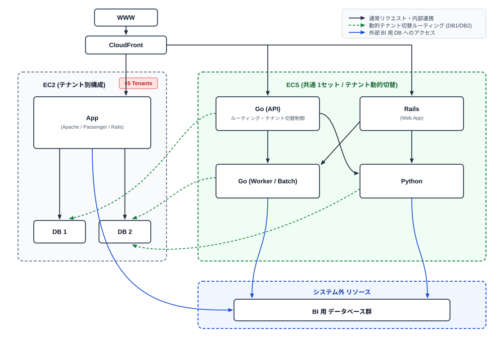
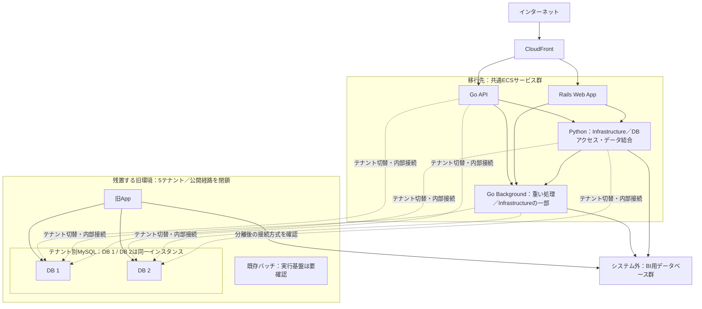

# システム構成と段階的なECS移行方針

## 1. 目的と前提

本システムは、テナント別の旧EC2環境を残しながら、アプリケーション機能を共通のECSサービス群へ段階的に移行する。

- 構成図の左側にある **Appは旧アプリケーションサーバー**（Apache / Passenger / Rails）を表す。
- 右側の **ECSサービス群は移行先**であり、5テナントで共通利用し、対象テナントを動的に切り替える。
- 旧サービスには移行が難しい既存バッチやDBがあるため、旧App・既存バッチ・DBを残す。ECS移行の完了条件に旧環境の廃止やDB移行を含めない。
- 将来は、必要な内部連携を維持したまま旧環境をインターネットから分離する。

追加で確定したサービスの分担は次のとおり。

- **Rails Web AppはDBへ直接接続しない**。PythonおよびGo BackgroundをClean ArchitectureのInfrastructure層の実装として利用する。DB間の結合はPythonのSQLAlchemyを主経路とし、重い処理はGo Backgroundへ委譲する。
- **Go API・Go Background・PythonはすべてDB 1 / DB 2の両方へアクセスする**。Go APIは直接DB参照とPython経由を使い分け、性能重視のDB間結合はGo API・Go BackgroundでもORMを使わずSQL直書きで実行する。
- **DB 1 / DB 2は同一MySQLインスタンス内の別データベース**。ローカルは各テナント1コンテナ内に`db1`・`db2`を作り、PythonはSQLAlchemyのスキーマ指定とJOIN機能を使う。
- 元図のGo（Worker / Batch）は、以降 **Go Background** と呼ぶ。Railsで重い処理や、RailsからPythonを経由しても重い処理の実行先であり、Infrastructure層の役割も一部担う。旧バッチの置き換えを意味しない。

ローカル実装はまず**2テナント分**を対象とする。[Docker構成・起動手順](./docker/README.md)と[追加取得物・検証結果](./docker/dependency-report.md)を参照。

本書は[元の構成図（a.svg）](./a.svg)と上記の移行方針を整理したものであり、稼働環境の設定を調査した結果ではない。構成図は旧環境と移行先の関係を示すものとして扱い、各サービスの移行済み・未移行は断定しない。以降の「分離後の構成」「移行手順」は、この方針に基づく整理案である。

## 2. 元の構成図

図の線の意味は次のとおり。

| 表示 | 意味 |
| --- | --- |
| 黒い実線 | 通常リクエスト・内部連携 |
| 緑の破線 | テナントに応じたDB 1 / DB 2への接続先切り替え |
| 青い実線 | システム外のBI用データベース群へのアクセス |

矢印は接続・連携の方向を示す。同期／非同期、通信プロトコル、DBの読み書き区分までは図から確定できない。

## 3. 構成要素と役割

| 領域 | 構成要素 | 図から確認できる役割・関係 | 移行時の扱い |
| --- | --- | --- | --- |
| 外部入口 | WWW / CloudFront | インターネット側からCloudFrontを経由し、旧App、Go API、ECS上のRailsへ分岐する | 公開機能を段階的にECS側へ切り替える |
| 旧環境 | EC2（テナント別、5テナント） | テナントごとに旧AppとDB 1 / DB 2の組がある | 既存バッチやDBを維持する基盤として残す |
| 旧環境 | App（Apache / Passenger / Rails） | DB 1、DB 2、BI用DBへアクセスする旧アプリケーションサーバー | 移行困難な既存処理に必要な部分を残し、将来は公開経路を閉じる |
| 旧環境 | 既存バッチ | ユーザー指定の残置対象。元図では独立した箱として描かれていない | 実行場所・起動方式・依存関係を確認したうえで継続運用する |
| 旧環境 | DB 1 / DB 2 | 旧AppとECSサービス群から利用するテナント別DB | 当面は移行せず利用を継続する |
| 移行先 | ECS（共通1セット） | 複数テナントで共通利用するサービス群 | テナントごとにサービス群を複製せず、接続先などを動的に切り替える構成 |
| 移行先 | Go（API） | API、テナント切替、DB 1 / DB 2の直接参照・SQL直書きJOINとPython経由の参照。Go Backgroundとも連携する | 公開APIなどの移行先 |
| 移行先 | Rails（Web App） | 公開Webアプリ。DB参照をPythonへ委譲し、重い処理をGo Backgroundへ委譲する | Web機能の移行先。DBへ直接接続しない |
| 移行先 | Go Background（元図：Worker / Batch） | 重い処理の実行先。DB 1 / DB 2の両方を参照し、性能重視のDB間結合はSQL直書きで行う。BI用DBにもアクセスする | Infrastructure層の役割も一部担う。既存バッチの全移行を意味しない |
| 移行先 | Python | Rails向けInfrastructure層。SQLAlchemyでDB 1 / DB 2間をJOINする主経路。Go APIからの委譲も受ける | 重い処理はGo Backgroundへ委譲できる |
| システム外 | BI用データベース群 | 旧App、Go Worker / Batch、Pythonからアクセスされる | 分離後も必要な接続を維持できるか確認する |

「共通1セット」はサービス群の共用を意味し、タスク数やインスタンス数が1であることを意味しない。DB 1 / DB 2は同一MySQLインスタンス内の別DBである。Appとの本番ホストの共有有無や、それぞれのDBの業務上の用途は未確認である。

## 4. リクエストとデータアクセス

### 4.1 公開リクエスト

図では、`WWW → CloudFront`を共通入口とし、以下の3経路に分岐する。

1. `CloudFront → 旧App`
2. `CloudFront → Go API（ECS）`
3. `CloudFront → Rails Web App（ECS）`

移行期間中は旧・新の経路を併存させ、移行した機能をECS側へ振り向ける。ホスト名・パスなどの振り分け条件と、実際のオリジン構成は図に記載されていない。

### 4.2 ECS内の連携

図にある連携方向は次の4本。

| 接続元 | 接続先 |
| --- | --- |
| Go API | Go Worker / Batch |
| Go API | Python |
| Rails Web App | Go Worker / Batch |
| Rails Web App | Python |

キューやスケジューラーは描かれていないため、起動方式やジョブの受け渡し方式は未確定とする。

上表のGo Worker / Batchは、追加方針ではGo Backgroundに対応する。PythonからGo Backgroundへの委譲も定義する。DB間の結合はPythonのSQLAlchemyを主経路とし、性能が必要な場合はGo API・Go BackgroundがSQL直書きで行う。いずれも同一MySQLインスタンス内でDB名を修飾したSQL JOINを実行できる。

### 4.3 テナント別DBへのアクセス

旧Appは自身のテナントに対応するDB 1 / DB 2へアクセスする。共通ECS側では対象テナントのMySQL接続先を切り替える。最新のアクセス方針は以下のとおり。

| 接続元 | アクセス対象・結合方式 |
| --- | --- |
| 旧App | DB 1、DB 2 |
| Go API | 対象テナントのDB 1 / DB 2。性能重視の結合はSQL直書き。Python経由も利用 |
| Go Background（元図：Worker / Batch） | 対象テナントのDB 1 / DB 2。結合はSQL直書き |
| Python | 対象テナントのDB 1 / DB 2。SQLAlchemyのモデルにDB名を指定し、ORMのJOIN機能を利用 |
| Rails Web App | 直接DB接続なし。Python・Go BackgroundをInfrastructure層の実装として利用 |

元図の緑線はGo APIからDB 1、Go Worker / Batch・PythonからDB 2へ描かれているが、アクセス先を片方に限定するものとしては扱わない。DB 1 / DB 2は同一インスタンス内の別DBであり、3サービスすべてが両方を利用する。

共通サービスから既存DBを利用するため、移行時にはテナントの判定方法、テナントとDB接続先の対応、サービス別の更新対象を明確にする必要がある。旧App・既存バッチとECS側が同じデータを更新する場合は、処理の重複や競合、スキーマ変更による相互影響も確認する。

### 4.4 BI用DBへのアクセス

図では、旧App、Go Worker / Batch、Pythonの3要素から、システム外のBI用DBへアクセスする。読み取り・書き込み・データ同期のいずれかは未確認である。「システム外」は配置上の区分であり、インターネット経由の接続を意味するとは限らない。

## 5. 将来のインターネット分離

### 5.1 分離後の構成イメージ

次の図は将来像を示す概念図であり、現状のネットワーク設定を表すものではない。旧環境は5テナント分をまとめて表記している。ECS側からのDB接続と、残置する既存処理に必要な連携を維持する。

既存バッチの接続先は元図にないため、上図にも追加していない。残置する旧Appの機能をECSから呼び出す必要がある場合は、対象機能を特定して内部接続を別途設計する。

### 5.2 分離の範囲

分離時には、CloudFrontから旧Appへの経路を廃止し、旧環境へのインターネットからの直接到達も閉じる。CloudFrontの振り分け変更だけで分離が完了するとは扱わず、旧環境の公開アドレスやその他の入口も確認する。

一方、旧環境からインターネットへの送信も全面的に遮断するかは未確定である。既存バッチの外部API利用、BI用DBへの接続、運用に必要な通信を調べ、完全分離を求める場合は、それぞれの通信を内部経路へ変更するなどの対応を分離前に完了させる。必要な外向き通信を残す場合は、その範囲を明記する。

分離後も維持すべき通信・運用は以下のとおり。

- 共通ECSから各テナントDBへの内部接続。
- 旧App・既存バッチが継続稼働するためのDB接続と内部連携。
- 必要なBI用DBへの接続。
- インターネットに直接公開しない管理経路、監視、ログ取得、バックアップ・復旧手段。

VPC、サブネット、ルート、セキュリティグループ、公開入口の実装方式は元図にないため、本書では確定しない。

## 6. 段階的な移行手順（案）

| 段階 | 実施内容 | 次段階へ進むための確認 |
| --- | --- | --- |
| 1. 依存関係の整理 | 公開機能、旧Appの内部利用、既存バッチ、DBの更新元、外部接続を棚卸しする | ECSへ移す処理と旧環境に残す処理、各処理の接続先が分かる |
| 2. ECS側の機能移行 | 共通ECSからテナント別DBへ接続し、移行対象のAPI・Web・ワーカー処理を実装・配置する | 各テナントで正しいDBを利用し、既存処理とのデータ互換性を確認できる |
| 3. 公開経路の段階切替 | 機能・テナントなどの切替単位を決め、CloudFront経由のリクエストをECS側へ移す | 対象機能が動作し、バッチの二重実行を防げる。DB更新への影響を含め切り戻し方法がある |
| 4. 旧環境の分離 | 残る公開機能を移行し、旧環境への公開経路を閉じる。送信側も合意した分離範囲へ変更する | インターネットから旧環境へ到達できず、ECS・既存バッチ・DB・BI連携と運用を継続できる |
| 5. 残置環境の継続運用 | 旧Appの必要部分、既存バッチ、DBの保守・監視・バックアップを継続する | 残置範囲と運用責任が明確。追加移行や廃止は別途判断する |

## 7. 設計を確定するための確認事項

| 項目 | 確認する内容 |
| --- | --- |
| 移行状況 | 既に移行済みの機能、移行予定の機能、残置する機能・バッチ |
| テナント構成 | 5テナントの識別方法、DB接続先との対応、テナントをまたぐ誤接続の防止方法 |
| DB構成 | DB 1 / DB 2の用途・配置・エンジン、更新元、スキーマ変更の管理方法 |
| リクエスト経路 | CloudFrontの振り分け条件、オリジン、認証・セッションの扱い、旧Appへの直接アクセスの有無 |
| バッチ・内部連携 | 既存バッチの実行場所・スケジュール・依存先、ECS側との処理分担、各サービス間の通信方式 |
| BI連携 | 接続先の配置・経路、読み書きの用途、旧環境の分離による影響 |
| 分離・運用 | 受信・送信それぞれの分離範囲、内部接続と管理経路、残置環境の保守担当・復旧手順 |

現時点で確定している方針は、**ECSへ段階的に機能を移し、移行困難な旧Appの処理・既存バッチ・DBを残したうえで、将来は旧環境をインターネットから分離する**ことである。
