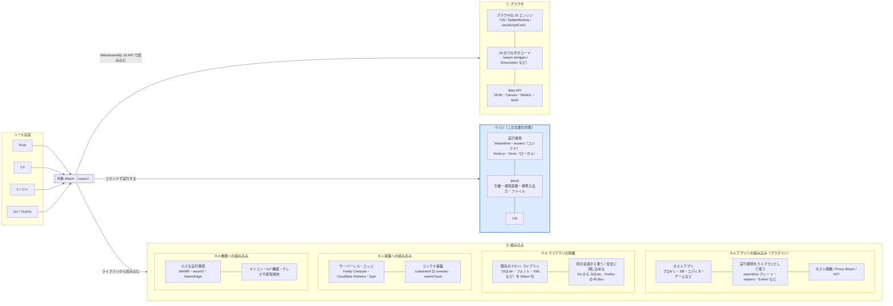
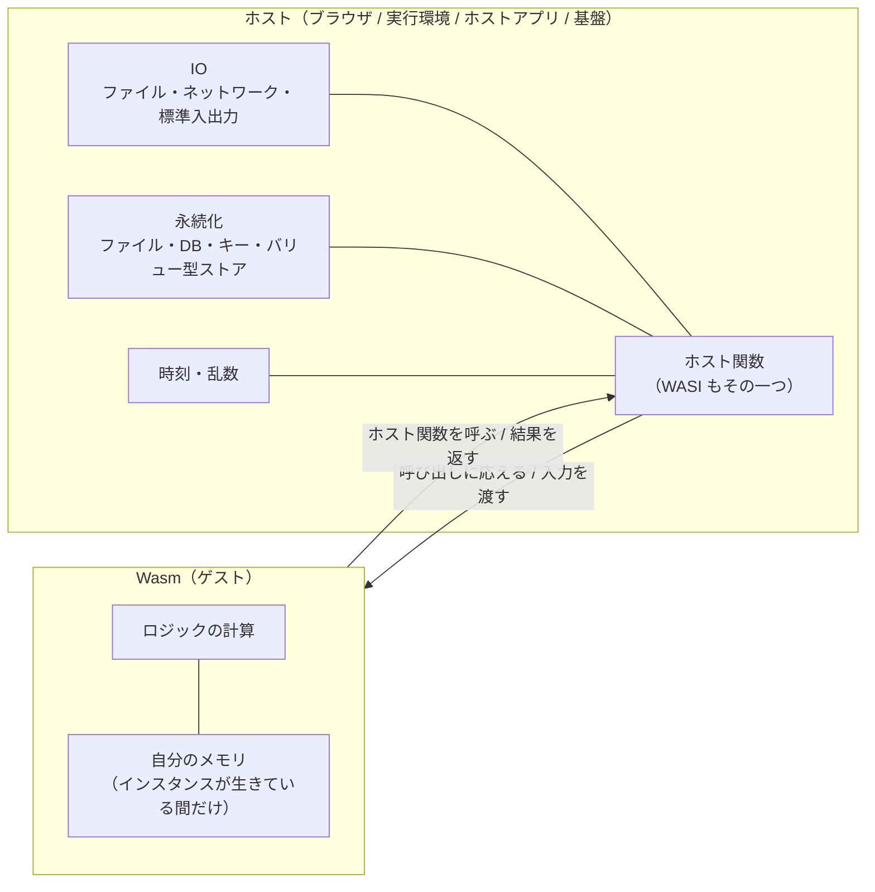

# Wasm を CLI で動かす実行環境の構成

作成日: 2026-11-12（同日にネットで再調査して修正。修正の内容は末尾の「再調査で直したところ」）
状態: 構築済み・動作確認済み（2026-11-12）。4 つの実行環境すべてで、Rust・Go・TinyGo・手書きの Wasm が動いた

同じ `.wasm` ファイルを、4 つの実行環境（Wasmtime、wazero、Node.js、Deno）で動かして比べるための構成をまとめる。Wasmtime と wazero は Docker コンテナの中で、Node.js と Deno はこの Mac 上で直接動かす。wazero はコンテナでだけ使う。Wasmtime はホストにも入っている（Homebrew。手早く試すときの参考用）。

対象 Wasm は次のものを作った。Rust と TinyGo はホストでビルドする（Rust 用のコンテナは作らなかった）。

| 対象 Wasm | 言語 | 内容 | 章 |
|---|---|---|---|
| `wcount.wasm` | Rust | 行数・単語数・バイト数を数える CLI ツール | 7 章、10 章 |
| `hello-py.wasm` | 手書き（Python で組み立て） | 最小の hello | 8 章 |
| `hello-go.wasm` / `hello-tinygo.wasm` | Go / TinyGo | hello | 8 章、10 章 |
| `mandel.wasm` / `mandel-tinygo.wasm` | Go / TinyGo | マンデルブロ集合（重い計算）。ブラウザでも動かした | 9 章、10 章 |

### ホストに入っているもの（2026-11-12 時点）

| もの | 版 | 入れ方 | 用途 |
|---|---|---|---|
| Go | 1.27.4 | 既存 | Go の Wasm とネイティブのビルド |
| Rust | 1.99.1（`wasm32-wasip1`） | Homebrew の `rustup`（keg-only なので `~/.zprofile` で PATH を通す） | wcount のビルド |
| TinyGo | 0.44.0 | Homebrew（`tinygo-org/tools` の tap） | 小さな Go の Wasm のビルド |
| Node.js / Deno | v26.13.0 / 2.9.8 | 既存 | ローカル実行環境 |
| Wasmtime | 50.0.1 | Homebrew | 参考用（比較の本命はコンテナ） |
| wasm-tools / wabt | 1.263.0 / 1.0.42 | Homebrew | `.wasm` の検証と中身の確認 |
| Python / Chrome | 3.15.2 / 157 | 既存 | 手書きの Wasm、ブラウザでの確認 |

Zig と Swift は使わない（Zig はやらないと決めた。Swift は取得が大きいので保留）。

---

## 用語

| 名前 | 指すもの |
|---|---|
| **実行環境** | `.wasm` を読み込んで実行するプログラム。この文書では Wasmtime、wazero、Node.js、Deno の 4 つ |
| **コンテナ実行環境** | Docker コンテナの中で動かす実行環境（Wasmtime、wazero） |
| **ローカル実行環境** | この Mac で直接動かす実行環境（Node.js、Deno） |
| **起動スクリプト** | Node.js / Deno で `.wasm` を読み込んで WASI をつなぐための、数十行の JS / TS ファイル |
| **対象 Wasm** | 実行環境に渡す `.wasm` ファイル。Rust や C# でビルドしたもの。`dist/` に置く |
| **ホスト** | この Mac（macOS、arm64） |
| **WASI 0.1** | WASI の最初の版（別名 preview1）。Rust のターゲット名では `wasm32-wasip1` |
| **WASI 0.2** | コンポーネントモデルを前提にした WASI の版（別名 preview2）。Rust のターゲット名では `wasm32-wasip2` |
| **WASI 0.3** | 非同期処理をコンポーネントモデルに組み込んだ次の版。wasi.dev によると 2026 年 6 月に公開され、Wasmtime 46 から使える。この文書では扱わない |
| **ゲスト側のパス** | Wasm の中から見えるパス。実行環境に「ホストのこのディレクトリを、ゲスト側ではこのパスとして見せる」と指定する（preopen） |
| **ビルド用コンテナ** | Rust のソースをビルドするための Docker コンテナ（`rust-build`）として計画していたもの。Rust をホストに入れたので**作らなかった** |
| **wcount** | 最初の対象 Wasm にする Rust 製の CLI ツール。行数・単語数・バイト数を数える（`wc` の簡易版） |
| **試験データ** | wcount に読ませるテキストファイル。`testdata/` に置き、どの実行環境でもゲスト側のパス `/data` として見せる |
| **実行形態** | Wasm をどこでどう動かすかの分け方。この文書では「ブラウザ」「CLI」「組み込み」の 3 つ |
| **ホストアプリ** | 組み込みの実行形態で、Wasm の実行環境をライブラリとして中に持つアプリ（Go のサーバー、プロキシ、データベースなど） |
| **ホスト関数** | ホストアプリが Wasm に提供する関数。Wasm から見ると、外の世界とやり取りするための窓口 |
| **組み込み（③）の 4 つの分け方** | 「組み込み」は意味が広いので、この文書では次の 4 つに分けて名前を付ける。**アプリへの組み込み**（ホストアプリにプラグインとして Wasm を読み込む）、**ライブラリの隔離**（既存の C/C++ ライブラリを Wasm にして、安全に、または別の言語から使う）、**基盤への組み込み**（サーバーレス・エッジ・コンテナの基盤が利用者の Wasm を動かす）、**機器への組み込み**（マイコンやテレビなどの組み込み機器で Wasm を動かす） |
| **ゲスト** | ホストアプリや基盤に読み込まれて動く Wasm の側 |
| **インスタンス** | 読み込んだ Wasm の実体。自分のメモリとグローバル変数を持ち、ホストが捨てるまで残る |
| **計算部品型 / WASI アプリ型** | Wasm とホストの役割の分け方（0-3）。計算部品型は、ホストから入力を受け取って結果を返すだけのもの。WASI アプリ型は、WASI の関数を呼んで自分でファイルや標準入出力を読み書きするもの |
| **Proxy-Wasm** | プロキシ（Envoy など）の拡張を Wasm で書くための、ホストとゲストの間の決まりごと（ABI） |
| **コンポーネントモデル / WIT** | Wasm 同士やホストとの間で、文字列や構造体などの型をそのまま受け渡すための仕組み（コンポーネントモデル）と、そのインターフェースを書く言語（WIT）。WASI 0.2 の土台 |

---

## 0. Wasm の 3 つの実行形態

Wasm を動かす場所は、大きく **ブラウザ**、**CLI**、**組み込み** の 3 つに分けられる。この文書で扱うのは CLI（青い枠）だけだが、全体の中での位置を示すために 3 つを並べる。



### 0-1. 3 つの実行形態の違い

| 観点 | ① ブラウザ | ② CLI | ③ 組み込み |
|---|---|---|---|
| 誰が Wasm を読み込むか | ブラウザ（JS から呼ぶ） | 実行環境のコマンド | ホストアプリ、または機器の上の実行環境 |
| 外の世界とのやり取り | JS のつなぎのコード経由で Web API を使う | **WASI**（OS の機能を、許可した範囲だけ使う） | **ホスト関数**（ホストアプリが決める）。WASI を併せて使うこともある |
| 主な用途 | 重い計算、ゲーム（Unity Web ビルド）、Blazor、既存の C/C++ の移植 | CLI ツール、バッチ処理 | プラグイン、ライブラリの隔離、サーバーレス・エッジ、組み込み機器（詳しくは 0-2） |
| Rust のターゲット | `wasm32-unknown-unknown` | `wasm32-wasip1` / `wasm32-wasip2` | ホストアプリに合わせる（WASI 0.1 / 0.2 か、`wasm32-unknown-unknown`） |
| この文書との関係 | 扱わない | **扱う** | 扱わない（ただし下の注を参照） |

注: Wasmtime と wazero は、もともと**アプリへの組み込み用のライブラリ**で、CLI はそのライブラリを使ったコマンドの一つにすぎない。つまり ② で確かめたことは、③ のアプリへの組み込みにもそのまま役に立つ。Node.js と Deno も、ホストアプリ（JS のプログラム）が Wasm を読み込む形なので、仕組みとしては ③ に近い。この文書では「コマンドとして実行する」という使い方に注目して ② に入れている。

### 0-2. ③ 組み込みの 4 つのパターン

どのパターンにも共通する Wasm の利点は次の 3 つ。組み込みでは、特に 1 つ目が採用の理由になることが多い。

- **隔離**: Wasm は自分のメモリの外に触れず、ホストが渡した関数しか呼べない。他人が書いたコードや信用しきれないコードを、プロセスを分けずに安全に動かせる
- **持ち運べる**: 同じ `.wasm` が CPU や OS を問わず動く
- **軽い**: コンテナや仮想マシンより起動が速く（数ミリ秒以下）、メモリも少ない

#### ③-a アプリへの組み込み（プラグイン）

ホストアプリが Wasm の実行環境をライブラリとして持ち、利用者が書いた Wasm をプラグインとして読み込む。ホストアプリは本体を作り直さずに機能を足せて、プラグインに不具合や悪意があっても本体は守られる。

**ホストアプリとゲストのつなぎ方**は 3 段階ある。下に行くほど新しく、手間が少ない。

| つなぎ方 | 中身 | 向いている場面 |
|---|---|---|
| 生のホスト関数 | Wasm の関数の取り込み（import）と公開（export）だけを使う。受け渡せるのは数値だけなので、文字列は「メモリ上の位置と長さ」で渡す | 小さく決め打ちのやり取り。仕組みを理解するため |
| 共通の決まりごと（ABI） | 決まった形を先に決めておく。プロキシ向けの **Proxy-Wasm**、汎用のプラグイン基盤 **Extism**（ホスト用の SDK とゲスト用の PDK を多くの言語に用意）など | 既存の仕組みに乗れるとき。いろいろな言語でプラグインを書かせたいとき |
| コンポーネントモデル / WIT | インターフェースを WIT で書くと、ホストとゲストの両方のつなぎのコードが生成され、文字列や構造体をそのまま渡せる。Wasmtime が対応 | これから新しく作るとき。ただし wazero や Node.js などは未対応（1 章の表を参照） |

使われている例:

| 分野 | 例 |
|---|---|
| プロキシ・API ゲートウェイ | Envoy・Istio の拡張（Proxy-Wasm） |
| データベース | ユーザー定義関数を Wasm で書く。SingleStore（Code Engine。数値だけの簡単な ABI と、複雑な型を渡せる ABI の 2 つがある）、ScyllaDB（Wasmtime を使用。既定では無効） |
| ストリーム処理・ログ | Redpanda のデータ変換（ブローカーの中の Wasmtime で動く）、Fluent Bit の Wasm フィルター |
| ポリシー判定 | OPA（`opa build -t wasm` で Rego を Wasm にし、各言語のアプリで評価する）、Kubewarden（Kubernetes の受付制御のポリシーを Wasm で書く） |
| 開発ツール・エディタ | Zed の拡張機能（Rust で書いて `wasm32-wasip2` のコンポーネントにし、Wasmtime で動かす）、Zellij のプラグイン（WASI） |
| EC・SaaS の利用者による拡張 | Shopify Functions（割引・配送・決済のロジックを利用者が書く。どれも WASI のモジュールとして動く） |
| ゲーム | Microsoft Flight Simulator（2020 / 2024）のアドオン。SDK が DLL の代わりに Wasm のモジュールを使う形になっている |
| ブロックチェーン | スマートコントラクトの実行（CosmWasm など） |

#### ③-b ライブラリの隔離・別の言語からの利用

既存の C/C++ ライブラリを Wasm にビルドし、ホストアプリの中で動かす。③-a と仕組みは同じだが、目的が「機能を足す」ではなく「**既存のライブラリを安全に、または別の言語から使う**」点が違う。

- **別の言語から使う**: Go から SQLite を使う `ncruces/go-sqlite3` は、SQLite を Wasm にしてから Go で使う。cgo（Go から C を呼ぶ仕組み）を使わないので、C のコンパイラが要らず、クロスコンパイルが簡単になる。以前は Wasm を wazero で実行していたが、2026 年 3 月に **wasm2go**（Wasm を Go のソースに変換する方式）に切り替えた。Wasm を「実行する」のではなく「別の言語への変換の中間形式」として使う例でもある
- **安全に閉じ込める**: Firefox は RLBox という仕組みで、C/C++ のライブラリを Wasm にし、それを wasm2c で C に戻してからネイティブのコードとして組み込んでいる。Wasm を通すことで、ライブラリがその外のメモリに触れないことが保証される。対象はフォント（graphite、woff2）、XML（expat）、音声（ogg、soundtouch）、スペルチェック（hunspell）のライブラリ。ライブラリに脆弱性があっても、被害がその中に留まる
- **気を付ける点**: ネイティブで動かすより遅くなる（目安として 1.x〜2 倍程度。処理による）。スレッドや SIMD が使えるかは実行環境しだい

#### ③-c 基盤への組み込み（サーバーレス・エッジ・コンテナ）

クラウドやエッジの基盤が Wasm の実行環境を内蔵していて、利用者は `.wasm` を渡すだけで動かせる。③-a の「ホストアプリ」が基盤そのものになった形。

| 種類 | 例 | 特徴 |
|---|---|---|
| エッジのサーバーレス | Fastly Compute（Wasmtime を使用）、Cloudflare Workers（V8 の上で JS と Wasm を動かす） | リクエストごとに Wasm を起動しても間に合うほど起動が速い |
| サーバーレスの枠組み | Spin（WASI 0.2 / コンポーネントモデルで HTTP の処理を書く）。Kubernetes 向けには SpinKube がある。Spin と SpinKube は CNCF の Sandbox のプロジェクト。開発元の Fermyon は 2025 年 12 月に Akamai に買収された | 自分の環境にも Kubernetes にも置ける |
| 分散アプリの基盤 | wasmCloud（CNCF） | コンポーネントを複数の場所に配置して動かす |
| コンテナ基盤との統合 | containerd の runwasi（Kubernetes から Wasm をコンテナと同じように扱う）。SpinKube の containerd 用のつなぎ（containerd-shim-spin）も runwasi の上に作られている | 既存のコンテナの運用の仕組みに乗せられる |

この文書の ② で WASI 0.1 を確かめた後、HTTP を扱いたくなったら、この分野（WASI 0.2 の `wasi:http`）が次の候補になる。

#### ③-d 機器への組み込み

マイコン、IoT 機器、テレビや配信端末などで Wasm を動かす。アプリの部分を Wasm にしておくと、**機器ごとにビルドし直さずに、同じ `.wasm` を配って更新できる**のが大きな理由になる。

| 実行環境 | 特徴 |
|---|---|
| **WAMR**（WebAssembly Micro Runtime、Bytecode Alliance） | インタープリター・AOT（事前コンパイル）・JIT を選べる。インタープリターなら数十 KB から動く。組み込み機器向けでは最も使われている |
| **wasm3** | とても小さく速いインタープリター。作者が戦争で被災したため、開発は最小限の保守の段階に入っている（README に記載）。最後のリリースは 2021 年の v0.5.0。新しく採用するなら WAMR を先に検討する |
| **WasmEdge**（CNCF） | エッジや IoT 向け。AI 推論などの拡張がある |

使われている例: Amazon Prime Video は、テレビ・ゲーム機・配信端末など 8,000 種類を超える機器向けのアプリで、端末ごとに置くネイティブの部分と、起動時に配る Rust 製の Wasm の部分に分けている。Wasm の部分は機器ごとにリリースし直さずに更新できる。実行環境に何を使っているか（WAMR かどうか）は、公開されている資料では確かめられなかった。

気を付ける点:

- 機器のメモリが小さいと、Wasm のメモリの単位（64 KB のページ）や実行環境の大きさが効いてくる
- 速さが要るときは、インタープリターではなく AOT で機器向けの機械語にしておく
- ハードウェアの操作（GPIO など）は WASI にないので、ホスト関数として自分で用意する

注: ③ の例は 2026-11-12 にネットで調べ直した。ただし、元の情報の多くは各製品の資料や報道で、細かな仕様（どの機能が実験的か、など）は版によって変わる。採用を考えるときは、その製品の最新の資料を確かめる。

### 0-3. Wasm とホストの役割分担（IO と永続化はホストの役目）

#### Wasm 自体は IO を持たない

Wasm の命令でできるのは、計算、自分のメモリの読み書き、関数の呼び出しだけ。ファイル、ネットワーク、時刻、乱数、画面への出力などは、**すべてホストから渡された関数（ホスト関数）を呼んで行う**。WASI も特別な仕組みではなく、「ホストが渡す関数の名前と引数を標準として決めたもの」にすぎない。

そのため、ブラウザ・CLI・組み込みのどの実行形態でも、**IO と永続化はホストが受け持つ**。



8 章で作った 128 バイトの `hello-py.wasm` がこの例になっている。`hello` を出力しているのは Wasm ではなく、取り込んだ `fd_write` を実装している Node.js や Deno。Wasm は「メモリに文字列を置き、その位置を `fd_write` に渡す」ことしかしていない。

#### 「IO をホストに置く」2 つの形

| | 計算部品型 | WASI アプリ型 |
|---|---|---|
| Wasm がすること | ホストから入力を受け取り、計算し、結果を返す | WASI の関数を呼んで、自分でファイルや標準入出力を読み書きする |
| IO の主導権 | ホスト（何を読み、どこに保存するかを決める） | Wasm 側のコード（実際の処理はホストが行う） |
| ホストに求める関数 | ほとんどない（入力と出力の受け渡しだけ） | WASI の関数一式 |
| 例 | OPA のポリシー判定、DB のユーザー定義関数、Shopify Functions（入力の JSON → 出力の JSON） | wcount、hello、Spin や Fastly の HTTP ハンドラー |

**用途がロジックの計算だけなら、計算部品型の方が素直**。

- 入力と出力だけで確かめられるので、テストしやすい
- ホストに求める関数が少ないほど、ブラウザ・CLI・組み込みの間で同じ `.wasm` を使い回しやすい

この文書の wcount は WASI アプリ型だが、標準入力から読んで標準出力に書くだけにすれば、計算部品型とほぼ同じに扱える（入力と出力の受け渡しに標準入出力を使っているだけ、と考えられる）。

#### 「永続化しない」と「状態を持たない」は別

| | 残るか | 補足 |
|---|---|---|
| 呼び出しの間 | 残る | ホストがインスタンスを使い回す限り、メモリとグローバル変数は残る。キャッシュや途中の計算結果を、呼び出しをまたいで持つこともできる |
| インスタンスを捨てた後・再起動の後 | 残らない | 保存はホストの役目 |
| サーバーレスやエッジ（③-c） | 毎回まっさら | Fastly や Spin などでは、リクエストごとに新しいインスタンスを作るのが普通。保存は基盤のキー・バリュー型ストアなど（ホストの API）に任せる |

設計としては、**状態は呼び出しのたびに受け取るか、ホストに保存してもらう**ことにしておくと、どの実行形態でも同じように動かせる。

#### 設計で気を付けること

- **受け渡しにはコストがかかる**: ホストと Wasm の間で文字列や構造体を渡すと、メモリへのコピーが発生する。細かい呼び出しを何度も繰り返すより、まとまった入力を 1 回渡して 1 回で結果を返す形にする
- **入出力の形を先に決める**: JSON、バイト列、WIT（型付きのインターフェース）のどれにするかを早めに決めておくと、ホストを替えたときに困らない
- **時刻と乱数も外から来る**: 計算だけのつもりでも、現在時刻や乱数を使えばホスト関数が要る。同じ入力から必ず同じ結果を出したいなら、これらも入力として受け取る形にする

---

## 1. 全体の構成

```
 ホスト（macOS / arm64）
 │
 │   rust/wcount/ ── cargo（ホスト）──┐
 │   go/*/        ── go / tinygo ────┼─▶ dist/*.wasm（対象 Wasm）   testdata/（試験データ）
 │   python/      ── python3 ────────┘        │                          │
 │                                             │                          │
 ├─ ローカル実行環境                            │                          │
 │   ├─ Node.js v26.13.0 ── runtimes/node/run.mjs（起動スクリプト）
 │   ├─ Deno 2.9.8       ── runtimes/deno/run.ts （起動スクリプト）
 │   └─ （参考）Wasmtime 50.0.1（Homebrew）
 │
 └─ Docker（linux/arm64）
     ├─ wasmtime コンテナ   ── /work（dist/、読み取り専用） /data（testdata/、読み取り専用）
     └─ wazero コンテナ     ── /work（dist/、読み取り専用） /data（testdata/、読み取り専用）
```

- 4 つの実行環境は、どれも**同じ `dist/` の対象 Wasm**を読む。
- 試験データは、どの実行環境でもゲスト側のパス **`/data`** として見せる。こうすると wcount に渡す引数（`/data/sample.txt`）が 4 つで同じになる。
- コンテナは 1 回ごとに起動して終わる使い方（`docker compose run --rm`）にする。常駐させない。

### 共通の前提: 対象 Wasm は WASI 0.1 で作る

4 つ全部で動かすには、対象 Wasm を **WASI 0.1（`wasm32-wasip1`）** で作る必要がある。

| 実行環境 | WASI 0.1 | WASI 0.2（コンポーネント） |
|---|---|---|
| Wasmtime | 対応 | 対応 |
| wazero | 対応 | **非対応** |
| Node.js（`node:wasi`） | 対応 | **非対応**（jco という別ツールで JS に変換すれば動く） |
| Deno（`node:wasi`） | 対応（Deno 2.8.0 から） | **非対応**（同上） |

---

## 2. ファイルの配置

```
wasm/
├─ wasm.md               C# と Rust の Wasm の整理（最初のまとめ）
├─ runtimes.md           この文書
├─ wasmtime-languages.md Wasmtime と組み合わせる言語の整理
├─ rust/
│   └─ wcount/           Rust のソース（Cargo のプロジェクト）
│       ├─ Cargo.toml
│       └─ src/main.rs
├─ go/
│   ├─ hello/            Go の hello（8 章）
│   └─ mandel/           マンデルブロ集合（9 章・10 章）。標準の Go と TinyGo の両方でビルドする
├─ python/
│   └─ hello_wasm.py     Wasm のバイト列を直接組み立てる hello（8 章）
├─ web/                  ブラウザで動かすページ、ブラウザ用の WASI、JS 版の計算（9 章）
├─ bench/                計測用のスクリプト（9 章・10 章）
├─ dist/                 対象 Wasm を置く（ビルドの出力先）
├─ testdata/             試験データ
│   └─ sample.txt
└─ runtimes/
    ├─ compose.yaml      wasmtime、wazero の 2 つのサービス
    ├─ wasmtime/
    │   └─ Dockerfile
    ├─ wazero/
    │   └─ Dockerfile
    ├─ node/
    │   └─ run.mjs       起動スクリプト
    └─ deno/
        └─ run.ts        起動スクリプト
```

ビルドの結果は必ず `dist/` に置く。実行環境の側は `dist/` しか見ない。C# はまだ扱っていない。

---

## 3. 実行環境ごとの構成

### 3-1. Wasmtime（コンテナ実行環境）

| 項目 | 内容 |
|---|---|
| 版 | **v50.0.1**（2026-10-29 公開。2026-11-12 時点の最新） |
| 入手方法 | GitHub Releases の Linux 向けビルド済みファイル（`wasmtime-v50.0.1-aarch64-linux.tar.xz`。x86_64 向けは `-x86_64-linux.tar.xz`）。**公式の Docker イメージはない**（公式の手順はインストール用スクリプト、ビルド済みファイル、`cargo install` の 3 つ。第三者のイメージはあるが使わない） |
| イメージの作り方 | 多段ビルド。1 段目でファイルを取得して展開し、2 段目に実行ファイルだけを入れる |
| 1 段目のベース | `golang:1.27.3-trixie`（**ホストにすでにある**。curl と tar を使うためだけに借りる）。このイメージには `xz` が入っていない（確認済み）ので、`.tar.xz` を展開するために `xz-utils` を足す |
| 2 段目のベース | `debian:trixie-slim`（Wasmtime は glibc に依存するため、空のイメージは使えない） |
| 実行のしかた | `wasmtime run --dir /work::/ /work/<名前>.wasm 引数...` |

Dockerfile の案:

```dockerfile
# 1 段目: 公式のビルド済みファイルを取得
FROM golang:1.27.3-trixie AS fetch
# 2026-10-29 公開の最新版。取得前に再確認する
# （Dockerfile は行の途中の # をコメントとして扱わないので、コメントは別の行に書く）
ARG WASMTIME_VERSION=50.0.1
ARG TARGETARCH
RUN set -eux; \
    apt-get update; \
    apt-get install -y --no-install-recommends xz-utils; \
    case "$TARGETARCH" in arm64) A=aarch64 ;; amd64) A=x86_64 ;; esac; \
    curl -fsSL -o /tmp/w.tar.xz \
      "https://github.com/bytecodealliance/wasmtime/releases/download/v${WASMTIME_VERSION}/wasmtime-v${WASMTIME_VERSION}-${A}-linux.tar.xz"; \
    tar -xJf /tmp/w.tar.xz -C /tmp; \
    cp /tmp/wasmtime-v*/wasmtime /usr/local/bin/wasmtime

# 2 段目: 実行用
FROM debian:trixie-slim
COPY --from=fetch /usr/local/bin/wasmtime /usr/local/bin/wasmtime
WORKDIR /work
ENTRYPOINT ["wasmtime"]
```

### 3-2. wazero（コンテナ実行環境）

| 項目 | 内容 |
|---|---|
| 版 | **v1.12.0**（2026-05-29 公開。2026-11-12 時点の最新）。リポジトリは `github.com/wazero/wazero` に移ったという報告があるが、Go のモジュールのパスは `github.com/tetratelabs/wazero` のまま |
| 入手方法 | `go install github.com/tetratelabs/wazero/cmd/wazero@<版>` でソースからビルドする（CLI の README に載っている方法）。Go のモジュールだけを取得するので、通信量は数 MB 程度。公式サイトにはインストール用スクリプト（`curl https://wazero.io/install.sh \| sh`）も載っている |
| イメージの作り方 | 多段ビルド。1 段目で Go を使ってビルドし、2 段目に実行ファイルだけを入れる |
| 1 段目のベース | `golang:1.27.3-trixie`（**ホストにすでにある**） |
| 2 段目のベース | `scratch`（空のイメージ）。wazero は他に依存しない Go のプログラムなので、`CGO_ENABLED=0` で静的にビルドすれば何も要らない |
| 実行のしかた | `wazero run <オプション> <wasm のパス> [--] <wasm に渡す引数>`。ディレクトリは `-mount=<ホストのパス>[:<ゲストのパス>][:ro]` で見せる（末尾に `:ro` で読み取り専用） |
| 注意 | wazero の CLI の説明には「`-mount` で見せたディレクトリから、`../../` のような相対パスで外に出られてしまう」とある。外に出られたくないなら、CLI ではなくライブラリとして使い、ファイルシステムを自分で用意する。この文書ではコンテナの中で動かし、マウントも読み取り専用にするので影響は小さい |

Dockerfile の案:

```dockerfile
# 1 段目: ビルド
FROM golang:1.27.3-trixie AS build
# 2026-05-29 公開の最新版。取得前に再確認する
ARG WAZERO_VERSION=v1.12.0
ENV CGO_ENABLED=0
RUN go install github.com/tetratelabs/wazero/cmd/wazero@${WAZERO_VERSION}

# 2 段目: 実行用（空のイメージ）
FROM scratch
COPY --from=build /go/bin/wazero /wazero
WORKDIR /work
ENTRYPOINT ["/wazero"]
```

### 3-3. compose.yaml（2 つのコンテナ実行環境をまとめる）

ビルドしたイメージの大きさ: `wasm-runtime-wasmtime:local` は 225 MB、`wasm-runtime-wazero:local` は 12.5 MB。

```yaml
services:
  wasmtime:
    build: ./wasmtime
    image: wasm-runtime-wasmtime:local
    volumes:
      - ../dist:/work:ro
      - ../testdata:/data:ro
    stdin_open: true          # 標準入力を Wasm に渡せるようにする

  wazero:
    build: ./wazero
    image: wasm-runtime-wazero:local
    volumes:
      - ../dist:/work:ro
      - ../testdata:/data:ro
    stdin_open: true
```

使い方:

```sh
cd runtimes
docker compose build
docker compose run --rm -T wasmtime run --dir /data /work/wcount.wasm /data/sample.txt
echo "hello" | docker compose run --rm -T wazero run /work/wcount.wasm
```

標準入力をパイプで渡すときは `-T`（疑似端末を割り当てない）を付ける。

### 3-4. Node.js（ローカル実行環境）

| 項目 | 内容 |
|---|---|
| 版 | v26.13.0（**ホストにすでにある**） |
| 使う機能 | 標準モジュール `node:wasi`（Node.js の分類では Stability 1 = Experimental。使うと警告が出ることがある） |
| 注意 | `version` は必須（`"preview1"` を指定）。`returnOnExit` は v20.1.0 から既定で `true`。Node.js の資料には「`node:wasi` は WASI の実行環境が持つようなファイルシステムの安全性を備えていない。信用できないコードの実行には使わない」とある |
| 実行のしかた | `node runtimes/node/run.mjs dist/<名前>.wasm 引数...` |

起動スクリプトの案（`runtimes/node/run.mjs`）:

```js
import { readFile } from "node:fs/promises";
import { WASI } from "node:wasi";
import process from "node:process";

const [wasmPath, ...args] = process.argv.slice(2);
const wasi = new WASI({
  version: "preview1",
  args: [wasmPath, ...args],
  env: process.env,
  preopens: { "/data": "testdata" },  // ゲスト側の /data を testdata/ に対応させる（wasm/ で実行する前提）
  returnOnExit: true,
});
const module = await WebAssembly.compile(await readFile(wasmPath));
const instance = await WebAssembly.instantiate(module, wasi.getImportObject());
process.exitCode = wasi.start(instance);
```

### 3-5. Deno（ローカル実行環境）

| 項目 | 内容 |
|---|---|
| 版 | 2.9.8（**ホストにすでにある**） |
| 使う機能 | Deno の Node.js 互換機能の `node:wasi`。起動スクリプトは Node.js 版とほぼ同じ書き方になる |
| 実行のしかた | `deno run --allow-read --allow-env --allow-write=testdata runtimes/deno/run.ts dist/<名前>.wasm 引数...` |
| 権限 | Deno は既定で何も許可しない。読み込みと環境変数の権限を明示して渡す。さらに、`preopens` に渡すディレクトリには**書き込み権限も要る**（読むだけでも `NotCapable: Requires write access to "testdata"` で止まる。2.9.8 で確認）。`--allow-write` は `testdata` に限定して渡す |

**`node:wasi` の対応状況**: Deno 2.0 では `node:wasi` は中身のない仮のもの（stub）だったが、**Deno 2.8.0（2026-05-22）で実装された**（リリースノートに「implement node:wasi」と「implement node:wasi preview1 compat」がある）。**ホストの 2.9.8 で動くことを確認した**（8 章）。API リファレンスにはまだ「stub」と書かれたままで、資料の更新が追いついていない。

`node:wasi` が動かなかったときの代わりの手段: JS だけで WASI を実装したライブラリ（例: `@bjorn3/browser_wasi_shim`）を `npm:` 指定で読み込む。

**Deno の今後についての注意**: 2026-10-09 に、Deno の開発チームが Cloudflare に移ることが発表された。報道（The Register など）によると、Deno のランタイムは約 1 年間バグと脆弱性の修正が続いた後、開発が終わる予定で、MIT ライセンスのプロジェクトの引き取り先を探している。この文書の比較には今の版のまま使えるが、長く使う前提の選択肢にはしない方がよい。

---

## 4. 実行環境ごとの指定方法の対応

同じことを、それぞれの実行環境でどう指定するかの対応表。

| やりたいこと | Wasmtime | wazero | Node.js / Deno（起動スクリプト） |
|---|---|---|---|
| 引数を渡す | `wasmtime run x.wasm a b` | `wazero run x.wasm a b` | `new WASI({ args: [...] })` |
| 環境変数を渡す | `--env KEY=VALUE` | `-env=KEY=VALUE` | `new WASI({ env: {...} })` |
| ディレクトリを見せる | `--dir ホスト[::ゲスト]`（ゲストを省くとホストと同じパス） | `-mount=ホスト[:ゲスト][:ro]`（ゲストを省くとホストと同じパス） | `new WASI({ preopens: { ゲスト: ホスト } })` |
| オプションの位置 | Wasm のパスより前に書く | Wasm のパスより前に書く | — |
| 標準入出力 | そのまま使える | そのまま使える | そのまま使える |
| 終了コード | Wasm の終了コードがそのまま返る | 同じ | `wasi.start()` の戻り値を `process.exit` に渡す |

コンテナ実行環境では「ホスト」がコンテナの中のパス（`/work`）になる点に注意する。Mac のパスはそのままでは見えない。

---

## 5. 構築に必要な取得（すべて取得済み）

**コンテナ**

| もの | 大きさ | 状態 |
|---|---|---|
| `golang:1.27.3-trixie` | — | もともとホストにあった |
| `debian:trixie-slim` | 30.2 MB | 取得済み（利用者が `docker pull`） |
| `xz-utils`（Wasmtime の 1 段目のイメージに追加） | 1 MB 未満 | ビルドの中で取得済み |
| Wasmtime のビルド済みファイル（v50.0.1、Linux arm64） | 10.8 MB | ビルドの中で取得済み |
| wazero の Go モジュール（v1.12.0） | 数 MB | ビルドの中で取得済み |
| `scratch` | 0（空のイメージ） | 取得不要 |

**ホスト**: Rust（rustup と `wasm32-wasip1`）、TinyGo、Wasmtime、wasm-tools、wabt を Homebrew で入れた（冒頭の表）。Rust をコンテナでビルドする案（`rust:<版>-slim-trixie`、286.9 MB）は使わなかった。

---

## 6. 決めたこと

| 項目 | 決めたこと |
|---|---|
| Wasmtime の版 | `50.0.1`（2026-11-12 時点の最新）。月に 1 回ほど新しい版が出る |
| wazero の版 | `v1.12.0`（同上）。wazero はコンテナでだけ使う |
| Deno の `node:wasi` | 2.9.8 で動くことを確認した（8 章）。`preopens` のディレクトリに書き込み権限が要る |
| Rust のビルド場所 | **ホスト**（Homebrew の rustup）。ビルド用コンテナは作らなかった |
| Rust の版 | 1.99.1。`edition = "2024"` は Rust 1.85 以降なら使える |
| 使わない言語 | Zig（やらない）。Swift は取得が大きいので保留 |

---

## 7. Rust で作って 4 つの実行環境で動かす流れ

### 7-0. 流れの全体

```
 ① 取得の確認 ─▶ ② wcount のソースを書く ─▶ ③ ホストの cargo で dist/wcount.wasm を作る
                                                        │
                       ┌────────────────┬───────────────┼────────────────┐
                       ▼                ▼               ▼                ▼
                 ④ Wasmtime         ⑤ wazero        ⑥ Node.js        ⑦ Deno
                 （コンテナ）       （コンテナ）     （ローカル）     （ローカル）
                       └────────────────┴───────┬───────┴────────────────┘
                                                ▼
                                   ⑧ 4 つの結果と macOS の wc を比べる
```

コマンドはすべて `wasm/`（この文書があるディレクトリ）で実行する前提で書く。この流れは 2026-11-12 に最後まで実行し、4 つの実行環境で同じ結果になった（10-1）。

### 7-1. ① 取得の確認

5 章の取得を行ってよいかを確かめてから始める（済み）。

### 7-2. ② wcount のソースを書く

wcount の仕様:

- 引数にファイルのパスがあれば、そのファイルを読む。なければ標準入力を読む
- `行数 単語数 バイト数 名前` を 1 行で出す（`wc` と同じ数え方: 行数は改行の数、単語は空白で区切ったもの）
- ファイルが読めなければ標準エラー出力にメッセージを出し、終了コード 1 で終わる

この 3 つで、WASI の主な機能（引数、標準入出力、ファイルの読み込み、終了コード）を一通り確かめられる。

`rust/wcount/Cargo.toml`:

```toml
[package]
name = "wcount"
version = "0.1.0"
edition = "2024"

[profile.release]
opt-level = "s"     # 大きさを優先して最適化
strip = true
```

`rust/wcount/src/main.rs`:

```rust
use std::{env, fs, io::{self, Read}, process};

fn main() {
    let path = env::args().nth(1);
    let data = match &path {
        Some(p) => fs::read(p).unwrap_or_else(|e| {
            eprintln!("wcount: {p}: {e}");
            process::exit(1);
        }),
        None => {
            let mut buf = Vec::new();
            io::stdin().read_to_end(&mut buf).expect("stdin");
            buf
        }
    };
    let text = String::from_utf8_lossy(&data);
    let lines = data.iter().filter(|&&b| b == b'\n').count();
    let words = text.split_whitespace().count();
    println!("{lines} {words} {} {}", data.len(), path.as_deref().unwrap_or("-"));
}
```

試験データ `testdata/sample.txt` には、日本語を含む数行のテキストを置く（バイト数と文字数が違うことを確かめるため）。

### 7-3. ③ ホストの cargo で dist/wcount.wasm を作る

```sh
export PATH="$(brew --prefix rustup)/bin:$PATH"   # ~/.zprofile を読まないシェルの場合
cargo build --release --target wasm32-wasip1 --manifest-path rust/wcount/Cargo.toml
mkdir -p dist
cp rust/wcount/target/wasm32-wasip1/release/wcount.wasm dist/
wasm-tools validate dist/wcount.wasm
```

確かめること: `dist/wcount.wasm` ができていて、大きさが数十〜百数十 KB 程度であること（実際は 71.8 KB）。

最初はビルド用コンテナ（`rust:<版>-slim-trixie` に `wasm32-wasip1` を足したもの）でビルドする案だったが、Rust をホストに入れたので使わなかった。

### 7-4. ④ Wasmtime（コンテナ実行環境）

```sh
cd runtimes
docker compose build wasmtime
docker compose run --rm -T wasmtime run --dir /data /work/wcount.wasm /data/sample.txt
echo "hello wasm" | docker compose run --rm -T wasmtime run /work/wcount.wasm
docker compose run --rm -T wasmtime run --dir /data /work/wcount.wasm /data/none.txt; echo "exit=$?"
cd ..
```

### 7-5. ⑤ wazero（コンテナ実行環境）

```sh
cd runtimes
docker compose build wazero
docker compose run --rm -T wazero run -mount=/data:/data:ro /work/wcount.wasm /data/sample.txt
echo "hello wasm" | docker compose run --rm -T wazero run /work/wcount.wasm
docker compose run --rm -T wazero run -mount=/data:/data:ro /work/wcount.wasm /data/none.txt; echo "exit=$?"
cd ..
```

### 7-6. ⑥ Node.js（ローカル実行環境）

```sh
node runtimes/node/run.mjs dist/wcount.wasm /data/sample.txt
echo "hello wasm" | node runtimes/node/run.mjs dist/wcount.wasm
node runtimes/node/run.mjs dist/wcount.wasm /data/none.txt; echo "exit=$?"
```

### 7-7. ⑦ Deno（ローカル実行環境）

```sh
deno run --allow-read --allow-env --allow-write=testdata runtimes/deno/run.ts dist/wcount.wasm /data/sample.txt
echo "hello wasm" | deno run --allow-read --allow-env --allow-write=testdata runtimes/deno/run.ts dist/wcount.wasm
deno run --allow-read --allow-env --allow-write=testdata runtimes/deno/run.ts dist/wcount.wasm /data/none.txt; echo "exit=$?"
```

`node:wasi` は Deno 2.8.0 で実装されたので動くはずだが、動かなかったときは 3-5 の代わりの手段に切り替えてからやり直す。

### 7-8. ⑧ 結果を比べる

基準は macOS の `wc`:

```sh
wc -l -w -c testdata/sample.txt
echo "hello wasm" | wc -l -w -c
```

確かめる観点:

| 観点 | 期待する結果 |
|---|---|
| ファイルを読む | 4 つとも同じ数字。`wc` の行数・単語数・バイト数と一致する |
| 標準入力を読む | 4 つとも `1 2 11 -` |
| ファイルがない | 4 つとも標準エラー出力にメッセージが出て、`exit=1` |
| 起動の速さ（参考） | `time` を付けて比べる。コンテナ実行環境はコンテナ起動の時間が上乗せされる点に注意 |

`/data` を見せる指定を忘れると、ファイルを読むところで「ファイルがない」と同じ失敗になる。結果が食い違ったときは、まず 4 章の対応表で指定を見直す。

---

## 8. ダウンロードなしで動かした hello（2026-11-12 実施）

Rust の取得の前に、ホストにすでにある Python と Go だけで hello の Wasm を 2 つ作り、ローカル実行環境（Node.js、Deno）で動かした。コンテナ実行環境（Wasmtime、wazero）では、コンテナを作った後に同じ 2 つが動くことを確かめた（結果は同じ）。

### 8-1. 作った Wasm

| 名前 | 作り方 | 大きさ | ソース |
|---|---|---|---|
| `dist/hello-py.wasm` | Python で Wasm のバイト列を直接書く（標準ライブラリだけ） | **128 バイト** | `python/hello_wasm.py` |
| `dist/hello-go.wasm` | Go 1.27.4 の標準機能（`GOOS=wasip1 GOARCH=wasm`） | **約 2.4 MB**（Go のランタイムを含む） | `go/hello/main.go` |

作り方（`wasm/` で実行）:

```sh
python3 -I python/hello_wasm.py dist/hello-py.wasm
(cd go/hello && GOTOOLCHAIN=local GOOS=wasip1 GOARCH=wasm go build -o ../../dist/hello-go.wasm .)
```

`GOTOOLCHAIN=local` は、Go が別の版のツールチェーンを勝手に取得しないようにするための指定。

`hello-py.wasm` の中身は、`fd_write` の取り込み、64 KB のメモリ 1 ページ、`memory` と `_start` の公開だけ。`_start` は標準出力（fd 1）に `hello\n` を書いて終わる。

### 8-2. 動かした結果

| | Node.js v26.13.0 | Deno 2.9.8 |
|---|---|---|
| `hello-py.wasm` | `hello`、終了コード 0 | `hello`、終了コード 0 |
| `hello-go.wasm a b` | `hello from Go (wasip1)` / `args: [a b]`、終了コード 0 | 同じ |

```sh
node runtimes/node/run.mjs dist/hello-go.wasm a b
deno run --allow-read --allow-env --allow-write=testdata runtimes/deno/run.ts dist/hello-go.wasm a b
```

### 8-3. 分かったこと

- Node.js と Deno のどちらでも、手で書いた最小の Wasm と Go でビルドした Wasm の両方が動いた。WASI 0.1 の引数の受け渡しも動いた。
- どちらも標準エラー出力に `ExperimentalWarning: WASI is an experimental feature` が出る。Deno も Node.js 互換の実装なので同じ警告が出る。
- Deno は `preopens` のディレクトリに書き込み権限を求める（3-5 に追記）。最初は `--allow-write` なしで動かして失敗した。

### 8-4. Go 版と Python 版の作り方の違い

2 つの hello は、どちらも「Wasm を作る」ものだが、仕組みがまったく違う。

| | Go 版（`go/hello`） | Python 版（`python/hello_wasm.py`） |
|---|---|---|
| ロジックを書いている言語 | Go | **Wasm の命令そのもの**（Python の中にバイト列として埋め込んである） |
| Go / Python の役割 | Go のコンパイラが、Go のソースを Wasm に**翻訳**する | Python は Wasm のバイト列を**組み立てて書き出す道具**にすぎない |
| Wasm の中で動くもの | 翻訳された Go のコード ＋ Go のランタイム（ガベージコレクション、goroutine の切り替え、`fmt` など） | 手で書いた命令だけ（`fd_write` を 1 回呼ぶ） |
| 大きさ | 約 2.4 MB | 128 バイト |
| 近いもの | Rust、C の clang、TinyGo などの普通のコンパイラ | WAT（Wasm のテキスト形式）を手で書いて `wat2wasm` で変換すること（アセンブラ） |

Python のスクリプトは、Wasm の中では一切動いていない。`.wasm` を書き出した時点で役目は終わる。スクリプトの中の `0x41` は `i32.const`、`0x10` は `call` という Wasm の命令の番号で、Python はそれを並べてファイルに書いているだけ。

`hello-py.wasm` を WAT で書くと次のようになる。`hello_wasm.py` は、この WAT をバイナリに変換する処理を Python で直接書いたものにあたる。

```wat
(module
  (import "wasi_snapshot_preview1" "fd_write"
    (func $fd_write (param i32 i32 i32 i32) (result i32)))
  (memory (export "memory") 1)
  ;; アドレス 0: iovec（文字列の位置 8、長さ 6）、アドレス 8: "hello\n"
  (data (i32.const 0) "\08\00\00\00\06\00\00\00hello\n")
  (func (export "_start")
    (drop (call $fd_write
      (i32.const 1)      ;; 標準出力
      (i32.const 0)      ;; iovec の位置
      (i32.const 1)      ;; iovec の数
      (i32.const 20))))) ;; 書いたバイト数を受け取る位置
```

#### Wasm を作る 3 つの形

| 形 | 例 | Wasm の中で動くもの | 大きさ |
|---|---|---|---|
| コンパイルする | Go、Rust、C/C++、TinyGo | その言語から翻訳された命令（＋必要ならランタイム） | 数十 KB〜数 MB |
| バイト列を直接組み立てる | 今回の Python スクリプト、WAT ＋ `wat2wasm` | 手で書いた命令だけ | 数百バイト〜 |
| インタープリターごと入れる | componentize-py、ComponentizeJS（`wasmtime-languages.md` の 2 章） | Wasm にコンパイルされた CPython や JS のエンジンが、Python や JS のコードを解釈して動かす | 数 MB〜数十 MB |

使い分け:

- **バイト列を直接組み立てる形**は、Wasm の構造を理解したり、実行環境の最小限の動作を確かめたりするのに向いている（今回の hello の目的）。ロジックが少しでも複雑になると、手で書くのは現実的ではない。
- **実際の計算部品**は、Go、Rust、TinyGo のようにコンパイルする形で作るのが普通。
- **Python で書いたロジックそのものを Wasm で動かしたい**ときは、インタープリターごと入れる形になる。大きさと速さの面では不利になる。

---

## 9. 重い計算とブラウザ（2026-11-12 実施）

hello の次の段階として、マンデルブロ集合の計算（重い計算）を Go で書き、**1 つの `dist/mandel.wasm`** を CLI とブラウザの両方で動かした。ダウンロードはしていない（Go、Node.js、Deno、Python、Chrome はホストにあったもの）。

| パターン | 内容 | 結果 |
|---|---|---|
| P1. 重い計算で速さを比べる（CLI） | Go ネイティブ、Go → Wasm（Node.js / Deno）、純粋な JS（Node.js / Deno）を比べる | 動いた。checksum はすべて一致 |
| P2. 同じ Wasm をブラウザで動かす | CLI と同じ `mandel.wasm` を、JS で書いた最小限の WASI でブラウザで動かし、画像を描く | 動いた（ヘッドレスの Chrome 157 で確認） |
| P3. ブラウザで重い計算の速さを比べる | ブラウザの中で Go → Wasm と純粋な JS を比べる | 動いた。checksum は一致 |

### 9-1. 作ったもの

```
wasm/
├─ go/mandel/            マンデルブロ集合の計算（Go）。同じソースから Wasm とネイティブを作る
│   ├─ main.go
│   ├─ impl_wasm.go / impl_native.go   どちらで動いているかを JSON に出すためだけのもの
│   └─ go.mod
├─ web/
│   ├─ index.html        P2 と P3 のページ
│   ├─ wasi-shim.js      ブラウザ用の最小限の WASI（JS で書いたもの）
│   └─ mandel.js         同じ計算を純粋な JS で書いたもの（ブラウザと CLI で共通）
├─ bench/
│   ├─ bench-cli.mjs     P1 の計測
│   ├─ bench-browser.mjs P2・P3 をヘッドレスの Chrome で動かし、結果と画面の画像を取り出す
│   └─ mandel-js-cli.mjs mandel.js を CLI から動かすためのもの
└─ dist/
    ├─ mandel.wasm       Go → Wasm（約 4.5 MB）
    ├─ mandel-native     Go ネイティブ（比較用）
    └─ browser.png       ブラウザで動かしたときの画面
```

- **計算の中身**: 1200×900 の各画素で最大 1000 回の反復をする。結果の **checksum**（全画素の反復回数の合計）が同じなら、同じ計算をしたと分かる。
- **ブラウザ用の WASI**: ブラウザには `node:wasi` がないので、Go の `wasip1` のプログラムが使う WASI の関数（引数、標準出力への書き込み、時刻、乱数、終了など）を JS で書いた。ファイルシステムは持たせていない。Wasm が取り込む関数のうち、用意していないものは「未実装」を返す。
- **Go の FMA への対策**: ARM64 では、Go が `x*y+z` を積和演算（FMA）の 1 命令にまとめることがある。まとめられると丸め方が変わり、Wasm や JS と結果が食い違う。そのため `float64(x*y)` のように明示的に変換して、まとめられないようにしている。

### 9-2. 動かし方（`wasm/` で実行）

```sh
# ビルド
(cd go/mandel && GOTOOLCHAIN=local GOOS=wasip1 GOARCH=wasm go build -o ../../dist/mandel.wasm .)
(cd go/mandel && GOTOOLCHAIN=local go build -o ../../dist/mandel-native .)

# P1: CLI での比較
node bench/bench-cli.mjs 5            # 回数 [幅 高さ 最大反復回数]

# P2・P3: ブラウザ（.wasm を fetch するので、ファイルを直接開くのではなく HTTP で配信する）
python3 -m http.server 8765 --bind 127.0.0.1     # 別の端末で
open http://127.0.0.1:8765/web/index.html        # 手で見る場合
node bench/bench-browser.mjs "runs=5" dist/browser.png   # ヘッドレスの Chrome で自動で動かす場合
```

### 9-3. 結果

ホスト: Apple M5。条件: 1200×900、最大反復 1000、各 5 回の中央値。checksum はすべて 218222850 で一致した。

**P1（CLI）**

| 実装 | 計算時間 (ms) | ネイティブ比 | 全体の時間 (ms) |
|---|---:|---:|---:|
| Go ネイティブ | 387.7 | 1.00 | 390.4 |
| Go → Wasm on Node.js | 1358.5 | 3.50 | 1414.9 |
| Go → Wasm on Deno | 1352.9 | 3.49 | 1392.8 |
| Go → Wasm on Node.js（`--no-liftoff`） | 397.9 | 1.03 | 1009.2 |
| Go → Wasm on Deno（`--v8-flags=--no-liftoff`） | 401.3 | 1.04 | 1116.2 |
| Go → Wasm on Wasmtime 50.0.1（コンテナ） | 836.4 | 2.16 | 1425.5 |
| Go → Wasm on wazero 1.12.0（コンテナ） | 622.9 | 1.61 | 1486.7 |
| ホストの Wasmtime 50.0.1（参考） | 832.0 | 2.15 | 857.9 |
| JS on Node.js | 402.9 | 1.04 | 445.0 |
| JS on Deno | 395.8 | 1.02 | 411.1 |

計算時間はプログラムの中で計った計算だけの時間。全体の時間はプロセスの起動から終了まで（Wasm のコンパイルを含む。コンテナの行はコンテナの起動も含む）。すべての行を同じ 1 回の計測（`node bench/bench-cli.mjs 5`）でそろえた。

コンテナのイメージの大きさ: `wasm-runtime-wasmtime:local` 225 MB（`debian:trixie-slim` の上に Wasmtime）、`wasm-runtime-wazero:local` 12.5 MB（空のイメージに wazero だけ）。

**P3（ブラウザ。ヘッドレスの Chrome 157）**

| 実装 | 計算時間 (ms) | JS 比 |
|---|---:|---:|
| Go → Wasm（ブラウザ） | 386.7 | 0.98 |
| JS（ブラウザ） | 393.5 | 1.00 |

Wasm の取得とコンパイルは 52 ms。P2 の画像（600×450、最大反復 500）の計算は 186.4 ms。

### 9-4. 分かったこと

- **同じ `.wasm` がブラウザでも CLI でも動いた**: ブラウザで足りないのは WASI の部分だけで、150 行ほどの JS で補えた。計算部品型（0-3）であれば、ホストに求める関数が少ないので、ブラウザに持っていくのは難しくない。
- **CLI で Wasm が 3.5 倍遅かったのは、Wasm 自体の遅さではなかった**: V8（Node.js、Deno、Chrome の JS エンジン）は、Wasm をまず簡易なコンパイラ（Liftoff）で動かし、よく使われる関数を後から最適化する。最適化したコードに切り替わるのは次に関数が呼ばれたときで、この計算のように 1 回の長い呼び出しで終わるプログラムは、最後まで遅いコードのまま動く。
  - `--no-liftoff`（最初から最適化する）を付けると、計算時間はネイティブとほぼ同じ（1.02〜1.04 倍）になった。
  - その代わり、4.5 MB の Wasm 全体を最初に最適化するので、全体の時間は約 1 秒に増えた（計算時間の短縮より起動の遅れが大きい）。
  - 同じプロセスで続けて動かした場合も、2 回目からは約 380 ms になった。ブラウザ（P3）が速いのは、P2 の画像の計算で先に最適化が済んでいたため。
- **実用上の目安**:
  - 1 回きりの CLI では、起動と最適化の時間が効く。
  - サーバーや組み込みのように同じインスタンスを何度も呼ぶ使い方なら、最適化が済んだ後はネイティブに近い速さが出る。
  - 重い処理は「1 回の長い呼び出し」より、ほどよい単位に分けて何度も呼ぶ方が最適化の恩恵を受けやすい。
- **Wasmtime と wazero は、V8 の 2 段階の間に入った**: どちらも 1 回の実行で、V8 の簡易なコンパイラ（3.5 倍）より速く、V8 の最適化済みのコード（1.03 倍）より遅かった。
  - Wasmtime（2.16 倍）は、読み込むときに Cranelift というコンパイラで全体を一度だけ機械語にする。V8 のように途中で切り替える仕組みがないので、1 回きりの実行でも遅いコードのまま動くことはない。ただし、この計算では V8 の最適化コンパイラほど速いコードにはならなかった。
  - wazero（1.61 倍）は、この計算では Wasmtime より速かった。これは Go の Wasm とこの計算に限った結果で、一般に wazero が Wasmtime より速いとは言えない（原因は調べていない）。
  - Wasmtime の計算時間は、5 回のうちでばらつきが大きかった（最小 731.7 ms、中央値 836.4 ms）。
- **コンテナの起動には 0.5 秒前後かかる**: ホストの Wasmtime（全体 857.9 ms）とコンテナの Wasmtime（全体 1425.5 ms）の差は約 0.57 秒で、これがコンテナの起動の分にあたる。wazero のコンテナは全体の時間がさらに長い（1486.7 ms）。wazero は読み込むときに Wasm 全体を機械語にするので、4.5 MB の Go の Wasm ではそのコンパイルの時間も含まれる（`-cachedir` でコンパイル結果を保存すれば 2 回目から短くなるはずだが、試していない）。1 回きりの短い処理をコンテナで動かすと、起動の時間の方が大きくなる。
- **純粋な JS も、この計算ではネイティブとほぼ同じ速さだった**: 数値計算の単純なループでは、V8 の JS の最適化はとても強い。Wasm の利点が出やすいのは、既存の Go・Rust・C/C++ のコードを使い回したいときや、速さが安定していてほしいとき（JS は最適化の当たり外れがある）。
- **Go の Wasm は大きい**: 計算だけでも約 4.5 MB ある（Go のランタイムを含むため）。ブラウザで配るなら、圧縮（gzip や Brotli）するか、TinyGo や Rust で小さくすることを考える。
- **ヘッドレスの Chrome の注意点**: `--virtual-time-budget` を付けると、ページの中の時刻が止まり、計測結果がすべて 0 ms になる。時間を測るときは、DevTools Protocol で完了を待つ方法（`bench/bench-browser.mjs`）を使う。

### 9-5. まだやっていないこと

- Safari（JavaScriptCore）での計測
- ブラウザで重い計算を Web Worker に移すこと（今はページの描画を止めて計算している）

---

## 10. Rust の wcount と TinyGo（2026-11-12 実施）

ホストに Rust（Homebrew の rustup。stable 1.99.1 と `wasm32-wasip1`）と TinyGo 0.44.0（Homebrew、手元の Go 1.27.4 を使う）を入れた後に行った。Rust はビルド用コンテナではなく**ホストでビルドした**。

### 10-1. Rust の wcount を 4 つの実行環境で動かす（7 章の流れ）

```sh
export PATH="$(brew --prefix rustup)/bin:$PATH"   # rustup は keg-only なので PATH を通す
cargo build --release --target wasm32-wasip1 --manifest-path rust/wcount/Cargo.toml
cp rust/wcount/target/wasm32-wasip1/release/wcount.wasm dist/
```

`dist/wcount.wasm` は **71.8 KB**（`wasm-tools validate` で問題なし）。

| 観点 | 基準（macOS の `wc`） | Wasmtime（コンテナ） | wazero（コンテナ） | Node.js | Deno |
|---|---|---|---|---|---|
| ファイルを読む（`/data/sample.txt`） | `4 12 134` | `4 12 134` | `4 12 134` | `4 12 134` | `4 12 134` |
| 標準入力（`hello wasm`） | `1 2 11` | `1 2 11 -` | 同じ | 同じ | 同じ |
| ファイルがない | — | エラーメッセージ、終了コード 1 | 同じ | 同じ | 同じ |

4 つとも同じ結果で、`wc` とも一致した。エラーメッセージはどれも `wcount: /data/none.txt: No such file or directory (os error 44)`（44 は WASI のエラー番号の ENOENT）。

### 10-2. TinyGo でビルドした mandel

同じ `go/mandel` のソースを TinyGo でビルドした。実装名を区別するため、ビルドタグで `implName` を切り替えるようにした（`impl_tinygo.go` など）。

```sh
(cd go/mandel && tinygo build -target=wasip1 -opt=2 -no-debug -o ../../dist/mandel-tinygo.wasm .)
```

**大きさ**

| もの | 標準の Go | TinyGo（`-opt=2`） | TinyGo（`-opt=2 -no-debug`） | TinyGo（`-opt=z -no-debug`） |
|---|---:|---:|---:|---:|
| mandel | 4.5 MB | 3.9 MB | **1.36 MB** | 1.05 MB |
| hello | 2.4 MB | — | **184 KB**（既定の最適化） | — |

- TinyGo は既定でデバッグ情報（DWARF）を入れる。mandel では約 2.5 MB がデバッグ情報だった。`-no-debug` で外すと大きく減る。
- 残りの多くは `encoding/json` と `fmt` の分（mandel のコード部分は 1.26 MB）。計算部品から JSON の出力を外せば、さらに小さくなるはず（未確認）。
- 比較には、速さを優先した `-opt=2 -no-debug` を使った。

**速さ**（9-3 と同じ条件で、全部を同じ 1 回の計測で取り直した。checksum はすべて 218222850 で一致）

| 実装 | 計算時間 (ms) | ネイティブ比 | 全体の時間 (ms) |
|---|---:|---:|---:|
| Go ネイティブ | 386.2 | 1.00 | 388.7 |
| Go → Wasm on Node.js | 1348.1 | 3.49 | 1403.3 |
| Go → Wasm on Deno | 1376.9 | 3.57 | 1418.0 |
| Go → Wasm on Node.js（`--no-liftoff`） | 397.8 | 1.03 | 1022.2 |
| Go → Wasm on Deno（`--no-liftoff`） | 401.4 | 1.04 | 1130.2 |
| Go → Wasm on Wasmtime（コンテナ） | 755.7 | 1.96 | 1366.4 |
| Go → Wasm on wazero（コンテナ） | 626.0 | 1.62 | 1473.4 |
| ホストの Wasmtime（参考） | 748.4 | 1.94 | 776.3 |
| **TinyGo → Wasm on Node.js** | 928.8 | 2.41 | 977.1 |
| **TinyGo → Wasm on Node.js（`--no-liftoff`）** | 387.9 | **1.00** | 745.7 |
| **TinyGo → Wasm on Wasmtime（コンテナ）** | 787.2 | 2.04 | 1248.6 |
| **TinyGo → Wasm on wazero（コンテナ）** | 398.5 | **1.03** | 1002.2 |
| JS on Node.js | 391.9 | 1.01 | 431.2 |
| JS on Deno | 391.3 | 1.01 | 406.6 |

### 10-3. 分かったこと

- **Rust の Wasm は小さく、4 つの実行環境で同じに動いた**: 71.8 KB で、ファイル、標準入出力、終了コードのどれも差がなかった。
- **TinyGo は大きさに効く**: デバッグ情報を外せば、標準の Go の 3〜13 分の 1 になった。ただし既定ではデバッグ情報が入るので、`-no-debug` を忘れると差が小さい。
- **TinyGo は速さでも有利な場面があった**:
  - V8 の最初の遅いコード（Liftoff）でも、標準の Go の 3.49 倍に対して 2.41 倍で済んだ。
  - 全体の時間（起動とコンパイルを含む）も短い。Wasm が小さく、コンパイルする量が少ないため。
  - wazero では、ネイティブとほぼ同じ（1.03 倍）だった。標準の Go の Wasm（1.62 倍）より速い。標準の Go の Wasm は、goroutine を実現するための仕組みが余分な処理を足していて、それがない TinyGo の方が実行環境の最適化が効きやすいとみられる（推測）。
- **Wasmtime はどちらの Wasm でもネイティブの約 2 倍だった**: 標準の Go でも TinyGo でも同じ傾向で、ホストとコンテナの差もない。理由は 10-4 で調べた。

### 10-4. Wasmtime がネイティブの約 2 倍かかる理由

**結論**: Wasmtime のコンパイラ（Cranelift）が浮動小数点の計算を苦手にしているのではなかった。計算のループが**大きな関数の中**に置かれると、Cranelift がループの変数をレジスタに置ききれず、**ループの中でメモリへの退避と読み戻し（スピル）が起きる**ことが原因だった。

**調べた順序と結果**

1. **コンパイラの設定を変える**（TinyGo の mandel。ホストの Wasmtime。計算時間）

   | 設定 | 計算時間 (ms) |
   |---|---:|
   | 既定（Cranelift） | 約 785 |
   | `-C inlining=y`（Wasmtime 側でのインライン化） | 約 770 |
   | `-O regalloc-algorithm=single-pass`（簡易なレジスタの割り当て） | 約 1,560 |
   | `-O signals-based-traps=n`（メモリの境界チェックを命令で行う） | 約 736 |
   | `-C compiler=winch`（簡易コンパイラ） | 約 930 |
   | 参考: ネイティブ | 約 390 |

   どの設定でも約 2 倍のまま。最適化するコンパイラ（Cranelift）と簡易コンパイラ（winch）の差が小さいことから、ループの機械語そのものに問題がありそうだと分かった。

2. **計算のループだけを WAT で手書きして比べる**（`bench/kernel/mandel-kernel.wat`。273 バイト。Go のランタイムを含まない）

   | 実行環境 | 時間 |
   |---|---:|
   | Wasmtime（Cranelift） | **0.39 秒（ネイティブと同じ）** |
   | Wasmtime（winch） | 1.35 秒 |
   | Node.js（1 回目。Liftoff） | 927 ms |
   | Node.js（2 回目以降、または `--no-liftoff`） | 約 398 ms |

   同じ計算でも、手書きの小さな関数なら Wasmtime はネイティブと同じ速さになった。

3. **機械語を比べる**（`wasmtime compile` で事前にコンパイルし、`objdump -d` で逆アセンブル）

   | | 手書きのループ | TinyGo のループ |
   |---|---|---|
   | ループの置き場所 | 小さな関数 | `main` などがインライン展開された大きな関数（`runtime.run$1`。ローカル変数が 30 個以上、goroutine のための状態チェックも含む） |
   | ループ 1 周の中のメモリ操作 | **0 回** | **6 回**（反復回数 `i`、最大反復回数、`y` の退避と読み戻し） |

   特に `y` は毎周スタックに書いて次の周ですぐ読み戻していた。前の周の結果を使って次の周を計算する依存関係の上に、メモリの書き込みと読み込みの待ち時間が乗るので、遅くなる。

   TinyGo が出力した Wasm のループ自体は、手書きのものとほぼ同じ素直な形だった（LLVM が `2*x*y` を `x*(y+y)` に変えている程度）。違いは、置かれている関数の大きさと複雑さだけ。

4. **計算の関数をインライン展開させないと速くなるか**（作業用のコピーで `mandelbrot` に `//go:noinline` を付けて試した。本体のコードは変えていない）

   | | Wasmtime での計算時間 (ms) |
   |---|---:|
   | TinyGo（元） | 約 775 |
   | **TinyGo（`//go:noinline`）** | **約 380（ネイティブと同じ）** |
   | 標準の Go（元） | 約 820 |
   | 標準の Go（`//go:noinline`） | 約 790（ほぼ変わらない） |

   TinyGo では仮説どおり解消した。標準の Go は変わらなかった。標準の Go は、Wasm でも Go 独自のスタックをメモリ上に持つ方式で変数を扱うので、関数の大きさに関係なくメモリ操作が多いのだと考えられる（未検証）。

**V8 や wazero が同じ Wasm で速かった理由（推測）**: V8 の最適化するコンパイラ（TurboFan）や wazero のコンパイラは、大きな関数でもこのループの変数をレジスタに置けている、またはメモリの読み書きをまとめて減らせている、とみられる。機械語は確かめていない。

**実用上の目安**

- Wasmtime で計算部品を速く動かしたいなら、**重いループは小さな関数に分けておく**。TinyGo なら `//go:noinline` で、言語のコンパイラがループを大きな関数にまとめてしまうのを防げる。
- Rust や C/C++ は、関数の分け方を自分で決めやすいので、この問題を避けやすい（今回は未検証）。
- 標準の Go の Wasm は、Wasmtime では約 2 倍かかると考えておく。速さが要るなら TinyGo か Rust にする。
- 実行環境によって「得意な Wasm の形」が違う。同じ `.wasm` でも、V8・wazero・Wasmtime で速さの順位が入れ替わることがある。

**調査に使ったもの**: `bench/kernel/mandel-kernel.wat`（手書きのループ）、`bench/kernel/run-node.mjs`（Node.js で呼ぶもの）、`dist/mandel-kernel.wasm`。

---

## 再調査で直したところ（2026-11-12）

| 箇所 | 直す前 | 直した後 |
|---|---|---|
| 3-1 Wasmtime の版 | 44.0.2 | 50.0.1（最新）。配布ファイル名も確認した |
| 3-1 Dockerfile | `xz-utils` が入っているか未確認 | 入っていないことを手元のイメージで確認し、追加する手順にした |
| 3-1 / 3-2 / 7-3 Dockerfile | `ARG ...=... # コメント` のように行の途中にコメントを書いていた | Dockerfile は行の途中の `#` をコメントとして扱わないので、コメントを別の行に移した |
| 3-2 wazero | 版は `latest`、`-mount` の書き方は未確認 | 版は v1.12.0。`-mount` の書き方（`:ro` を含む）とパスの外に出られる注意を、CLI のソースで確認して書いた |
| 3-4 Node.js | — | `version` は必須、`returnOnExit` の既定値、安全性についての注意を追記 |
| 3-5 Deno | `node:wasi` が動くかは未確認 | Deno 2.8.0 で実装されたことを確認。Deno の開発が終わる予定であることを追記 |
| 0-2 ③-b | `ncruces/go-sqlite3` は wazero で動かす | 2026 年 3 月に wasm2go に切り替えた |
| 0-2 ③-b | RLBox は「フォントや画像など」のライブラリ | 画像は含まれない。対象のライブラリを具体的に書いた |
| 0-2 ③-d | Prime Video は WAMR を使う | WAMR を使うかは確認できなかったので、その記述を外した |
| 0-2 ③-c | — | Fermyon の買収、Spin / SpinKube の位置づけを追記 |
| 用語 | — | WASI 0.3 を追記 |

## 参照した情報

- [Wasmtime: CLI のインストール方法](https://docs.wasmtime.dev/cli-install.html)
- [Wasmtime v50.0.1 のリリース](https://github.com/bytecodealliance/wasmtime/releases/tag/v50.0.1)
- [wazero 公式サイト](https://wazero.io/)
- [wazero のリリース一覧](https://github.com/tetratelabs/wazero/releases)
- [wazero CLI（pkg.go.dev）](https://pkg.go.dev/github.com/tetratelabs/wazero/cmd/wazero)
- [wazero CLI のソース（cmd/wazero/wazero.go）](https://github.com/tetratelabs/wazero/blob/main/cmd/wazero/wazero.go)
- [Node.js v26.13.0: WASI](https://nodejs.org/download/release/v26.13.0/docs/api/wasi.html)
- [Deno: WebAssembly のガイド](https://docs.deno.com/runtime/reference/wasm/)
- [Deno: node:wasi API リファレンス](https://docs.deno.com/api/node/wasi/)
- [Deno v2.8.0 のリリース](https://github.com/denoland/deno/releases/tag/v2.8.0)
- [Node.js creator ditches Deno to work on open source Cloudflare Workers（The Register, 2026-10-16）](https://www.theregister.com/devops/2026/10/16/nodejs-creator-ditches-deno-to-work-on-open-source-cloudflare-workers/5303662)
- [Cloudflare acquires Deno（The New Stack）](https://thenewstack.io/cloudflare-acquires-deno-ryan-dahl/)
- [WASI 0.3（wasi.dev）](https://wasi.dev/releases/wasi-p3)
- [ncruces/go-sqlite3（GitHub）](https://github.com/ncruces/go-sqlite)
- [WebAssembly and Back Again: Fine-Grained Sandboxing in Firefox 95（Mozilla Hacks）](https://hacks.mozilla.org/2021/12/webassembly-and-back-again-fine-grained-sandboxing-in-firefox-95/)
- [Firefox ソース内の RLBox の資料（Searchfox）](https://searchfox.org/firefox-main/source/security/rlbox/docs/index.md)
- [wasm3（GitHub）](https://github.com/wasm3/wasm3)
- [Prime Video の Rust と Wasm についての講演（InfoQ）](https://www.infoq.com/presentations/prime-video-rust)
- [Fermyon joins Akamai（Fermyon Blog）](https://www.fermyon.com/blog/fermyon-joins-akamai)
- [Life of a Zed Extension: Rust, WIT, Wasm（Zed Blog）](https://zed.dev/blog/zed-decoded-extensions)
- [Zellij: Plugins](https://zellij.dev/documentation/plugins)
- [MSFS 2024 SDK: WebAssembly](https://docs.flightsimulator.com/msfs2024/html/6_Programming_APIs/WASM/WebAssembly.htm)
- [Shopify Functions: WebAssembly](https://shopify.dev/docs/apps/build/functions/programming-languages/webassembly-for-functions)
- [Redpanda: How Data Transforms Work](https://docs.redpanda.com/current/develop/data-transforms/how-transforms-work/)
- [Fluent Bit: Wasm filter plugins](https://docs.fluentbit.io/manual/development/wasm-filter-plugins)
- [SingleStore: Code Engine - Powered by Wasm](https://docs.singlestore.com/cloud/reference/code-engine-powered-by-wasm)
- [ScyllaDB: Wasm support for user-defined functions](https://docs.scylladb.com/manual/master/cql/wasm.md)
- [OPA: WebAssembly](https://www.openpolicyagent.org/docs/wasm)
